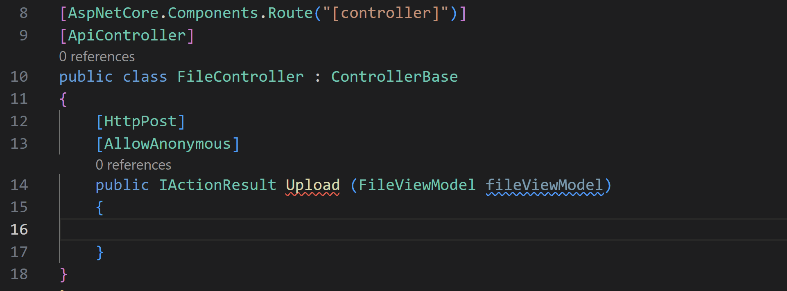
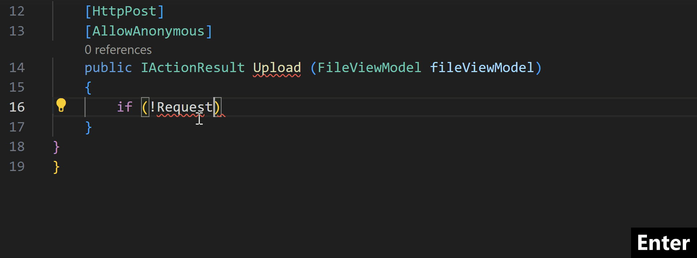
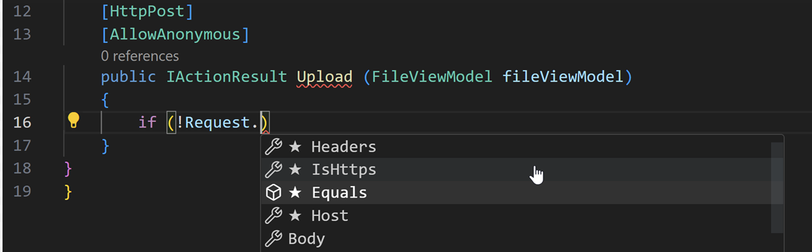

+++
title = "10.8.4 C# IntelliCode"
date = "2026-11-06T07:53:25+08:00"
weight = 4
type = "docs"
description = ""
isCJKLanguage = true
draft = false
+++

> 原文链接: [https://code.visualstudio.com/docs/csharp/intellicode](https://code.visualstudio.com/docs/csharp/intellicode)

# 10.8.4 C# IntelliCode

　　使用 [C# Dev Kit](https://marketplace.visualstudio.com/items?itemName=ms-dotnettools.csdevkit)时，可以安装 [IntelliCode for C# Dev Kit](https://marketplace.visualstudio.com/items?itemName=ms-dotnettools.vscodeintellicode-csharp)扩展获得 IntelliCode 支持，包括整行代码预测以及 IntelliSense 列表中的方法和属性排序。

## 整行建议 {#whole-line-suggestions}

**场景 1**：显示灰色文本时，按 `Tab` 接受预测：

**场景 2**：灰色文本和 IntelliSense 列表同时显示时，按 `Tab` 接受列表选择，再按 `Tab` 接受多标记预测的其余部分。可以用列表选择引导 IntelliCode 的多标记预测：

模型建议应该有字符串但没有具体建议时，按 `Tab` 会将光标放入空字符串，便于补全代码行。

模型根据已编写代码的丰富知识预测下一步输入，包括：

* 变量名和位置
* 使用的库
* 附近代码中的函数
* IntelliSense 列表

## 星标建议 {#starred-suggestions}

扩展在补全列表顶部显示根据代码上下文推荐的项：

对于重载，IntelliCode 将最相关的项放在前面，而不是按字母顺序。深度学习模型不仅排序已知方法，也会排序代码中独有的方法。

要看到 AI 辅助排序，必须打开属于解决方案的 C# 文件。不属于解决方案的 C# 文件没有此功能。

## 安全和隐私 {#security-and-privacy}

　　所有代码保留在本地，模型在计算机上运行，不需要将代码传输到远程服务器进行自定义模型训练。机器学习系统设计减少了内存占用并提高推理速度。

由于模型在本地运行，IntelliCode 支持离线或气隙环境。

## 获取其他语言支持 {#get-support-for-other-languages}

需要 Python、JavaScript 和 TypeScript 的整行自动补全时，安装通用 [IntelliCode](https://marketplace.visualstudio.com/items?itemName=VisualStudioExptTeam.vscodeintellicode)扩展。通用扩展还为 Python 和 SQL 的 IntelliSense 列表添加星标排序。

## 前提条件 {#prerequisites}

必须安装并启用 C# Dev Kit 和 .NET 6。支持平台：

* **Windows**：x64 和 ARM（Windows 11 22H2 测试）
* **macOS**：x64 和 ARM（x64 在 OS X Monterey v12.6.5 测试）
* **Linux**：x64 和 ARM（x64 在 Ubuntu 22.04 测试）

## 反馈和问题 {#how-do-i-report-feedback-and-issues}

请在 [IntelliCode GitHub 反馈仓库](https://github.com/MicrosoftDocs/intellicode/issues)提交议题。
