+++
title = "10.8.5 C# 重构"
date = "2026-11-06T07:53:25+08:00"
weight = 5
type = "docs"
description = ""
isCJKLanguage = true
draft = false
+++

> 原文链接: [https://code.visualstudio.com/docs/csharp/refactoring](https://code.visualstudio.com/docs/csharp/refactoring)

# 10.8.5 C# 重构

　　C# Dev Kit 和 C# 扩展提供大量重构和快速修复。将光标放在代码上，单击灯泡或按 `Ctrl + .`（macOS：`Cmd + .`） 打开代码操作菜单。

## 支持的重构和快速修复 {#supported-refactorings-and-quick-fixes}

* 添加 await
* 从成员添加构造函数参数
* 添加 `DebuggerDisplay` 特性
* 添加显式强制转换
* 添加文件头
* 添加缺失 `using`
* 添加命名参数
* 匿名类型转换为类
* 自动属性和完整属性互转
* 直接强制转换和 `as` 表达式互转
* `for` 循环和 `foreach` 互转
* `Get` 方法和属性互转
* `if` 和 `switch` 互转
* 常规字符串和逐字字符串互转
* 类转换为记录
* 本地函数转换为方法
* 数字字面量转换为十六进制、十进制或二进制
* 占位符转换为内插字符串
* 常规字符串转换为内插字符串
* 元组转换为结构
* 封装字段
* 生成比较运算符
* 生成默认构造函数
* 生成参数
* 显式/隐式实现所有成员
* 内联方法
* 内联临时变量
* 为表达式引入局部变量
* 引入参数
* 引入 `using` 语句
* 反转条件表达式和逻辑运算
* 反转 `if`
* 将成员设为静态
* 将声明移到引用附近
* 将类型移到匹配文件
* 反转 `for` 语句
* 拆分或合并 `if` 语句
* 使用显式类型
* 使用隐式类型
* 使用 lambda 表达式或块体
* 使用递归模式
* 换行、缩进和对齐重构

## 添加 await {#add-await}

在异步方法调用前添加 `await`：

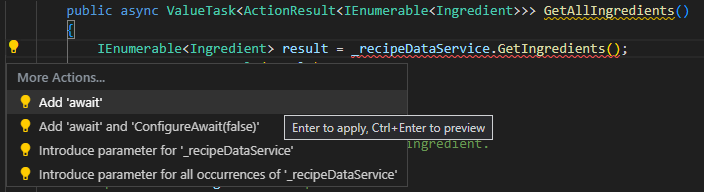

## 从成员添加构造函数参数 {#add-constructor-parameters-from-members}

从类成员生成构造函数参数：

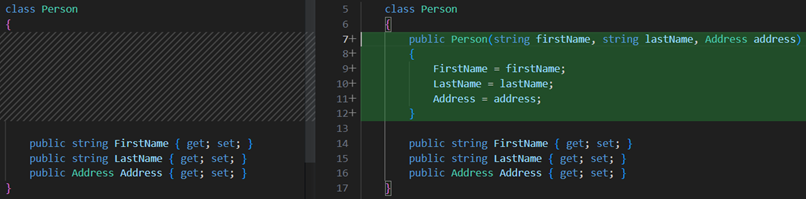

## 添加 DebuggerDisplay 特性 {#add-debuggerdisplay-attribute}

为类添加 `[DebuggerDisplay]`，自定义调试器显示：

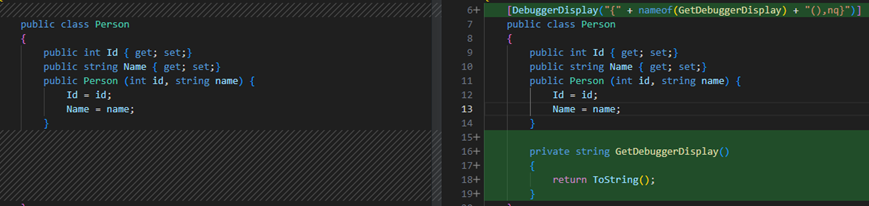

## 添加显式强制转换 {#add-explicit-cast}

添加显式类型转换：

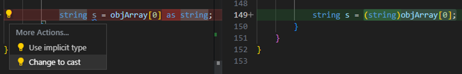

## 添加文件头 {#add-file-header}

添加版权/文件头注释。

## 添加缺失 using {#add-missing-usings-imports}

为未解析类型添加 `using`：

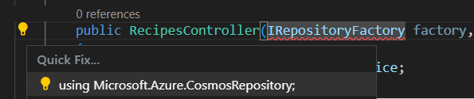

## 添加命名参数 {#add-named-argument}

将位置参数转换为命名参数：

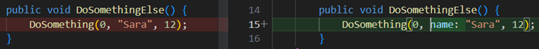

## 匿名类型转换为类 {#convert-anonymous-type-to-class}

将匿名类型转换为命名类：

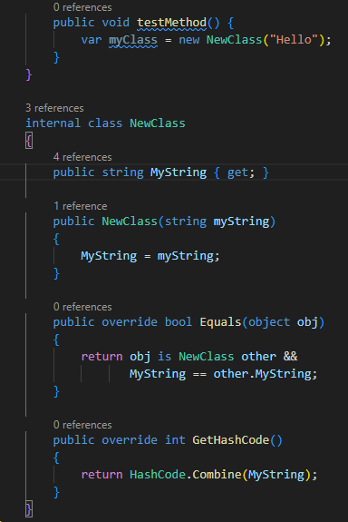

## 自动属性和完整属性互转 {#convert-between-auto-property-and-full-property}

在自动属性和带后备字段的完整属性之间转换：

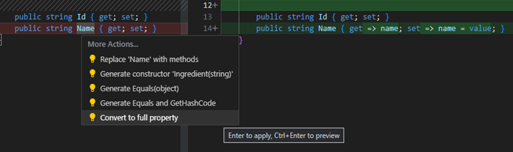

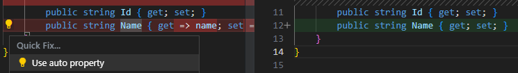

## 直接强制转换和 as 表达式互转 {#convert-between-direct-cast-and-as-expression}

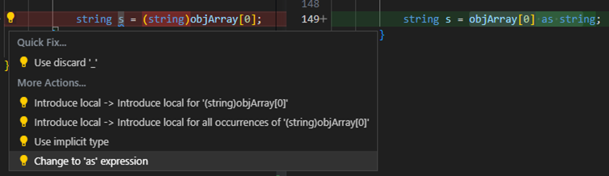

## for 循环和 foreach 互转 {#convert-between-for-loop-and-foreach-statement}

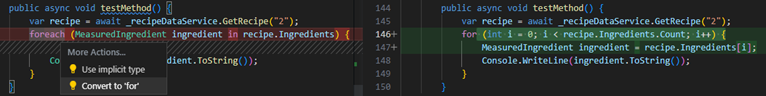

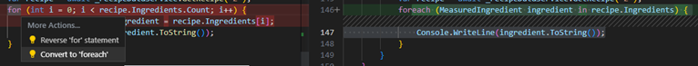

## Get 方法和属性互转 {#convert-between-get-method-and-property}

### Get 方法转属性 {#convert-get-method-to-property}

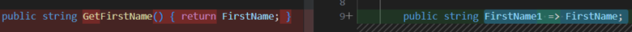

### 属性转 Get 方法 {#convert-property-to-get-method}

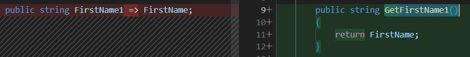

## if 和 switch 互转 {#convert-between-if-and-switch-statements}

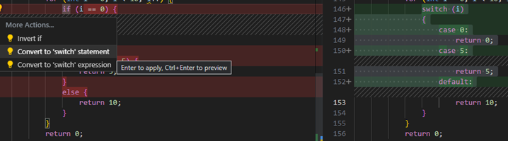

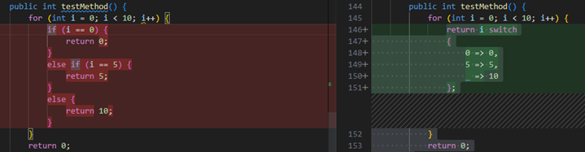

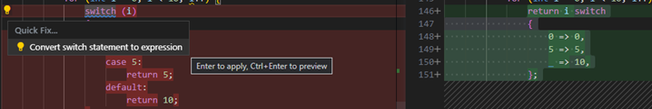

## 常规字符串和逐字字符串互转 {#convert-between-regular-string-and-verbatim-string}

在 `"..."` 和 `@"..."` 之间转换。

## 类转换为记录 {#convert-class-to-record}

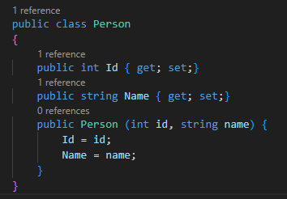

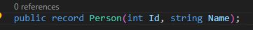

## 本地函数转换为方法 {#convert-local-function-to-method}

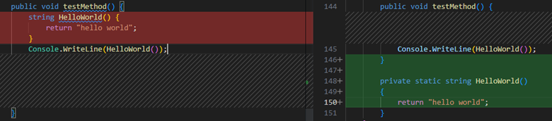

## 数字字面量转换 {#convert-numeric-literal-to-hex-decimal-or-binary-number}

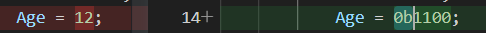

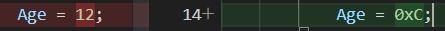

## 占位符转换为内插字符串 {#convert-placeholder-to-interpolated-string}

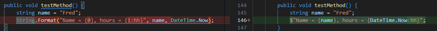

## 常规字符串转换为内插字符串 {#convert-regular-string-to-interpolated-string}

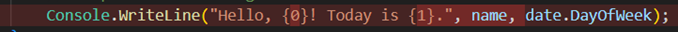

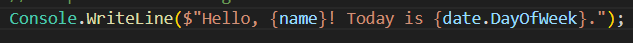

## 元组转换为结构 {#convert-tuple-to-struct}

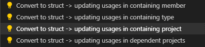

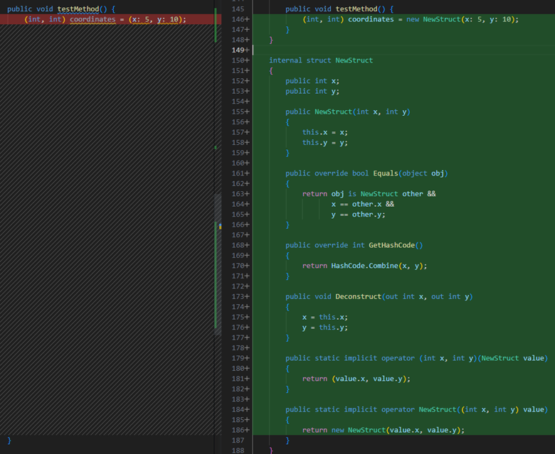

## 封装字段 {#encapsulate-field}

将字段封装为属性：

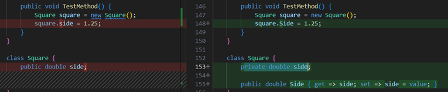

## 生成比较运算符 {#generate-comparison-operators}

为类型生成 `==`、`!=`、`<`、`>` 等运算符。

## 生成默认构造函数 {#generate-default-constructors}

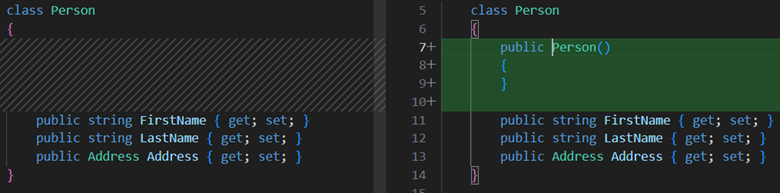

## 生成参数 {#generate-parameter}

从方法体中的值生成参数：

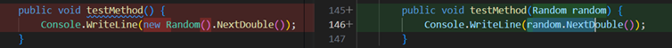

## 显式/隐式实现所有成员 {#implement-all-members-explicitly}

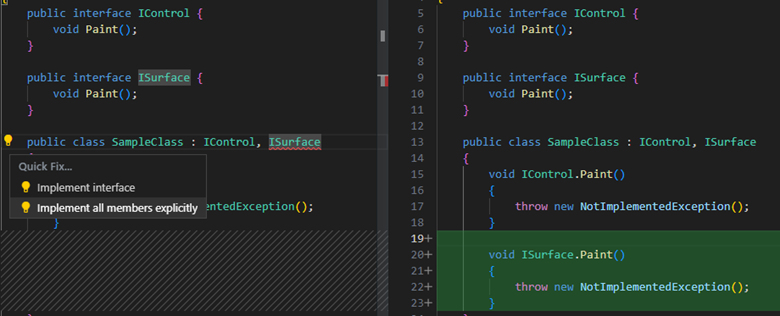

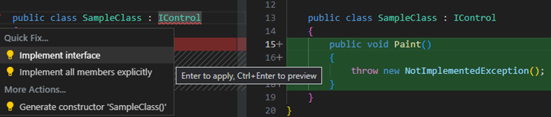

## 内联方法 {#inline-method}

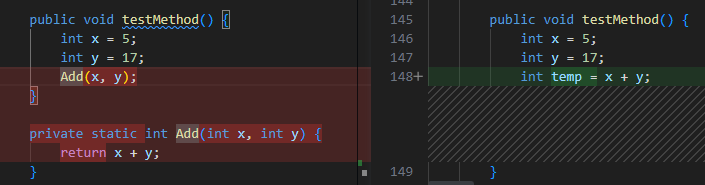

## 内联临时变量 {#inline-temporary-variable}

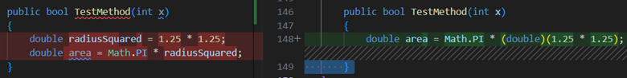

## 为表达式引入局部变量 {#introduce-local-variable-for-expression}

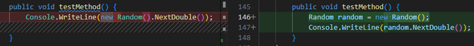

## 引入参数 {#introduce-parameter}

从表达式或方法提取参数：

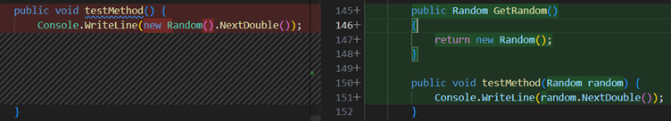

## 引入 using 语句 {#introduce-using-statement}

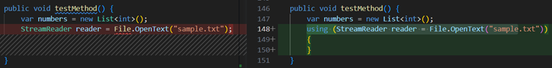

## 反转条件和逻辑运算 {#invert-conditional-expressions-and-logical-operations}

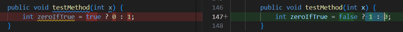

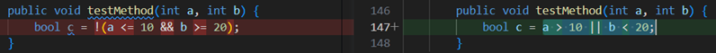

## 反转 if {#invert-if}

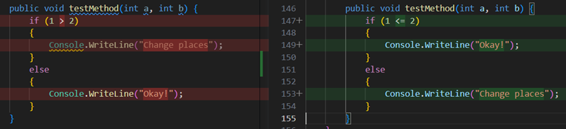

## 将成员设为静态 {#make-member-static}

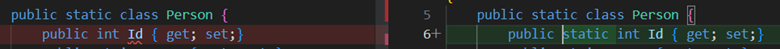

## 将声明移到引用附近 {#move-declaration-near-reference}

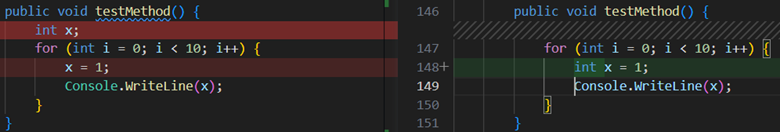

## 将类型移到匹配文件 {#move-type-to-matching-file}

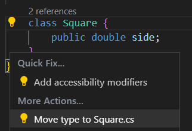

## 反转 for 语句 {#reverse-for-statement}

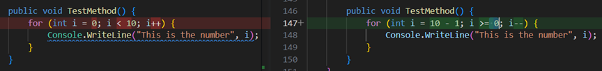

## 拆分或合并 if 语句 {#split-or-merge-if-statements}

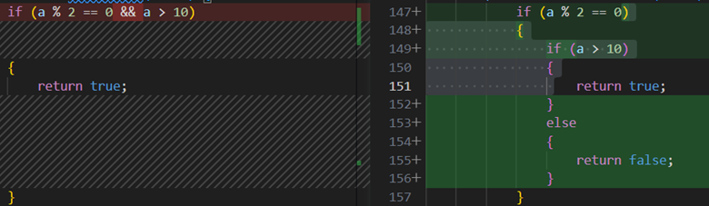

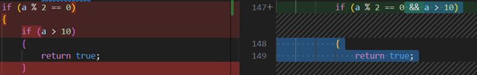

## 使用显式/隐式类型 {#use-explicit-type}

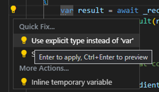

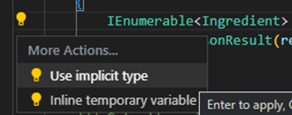

## 使用 lambda 表达式或块体 {#use-lambda-expression-or-block-body}

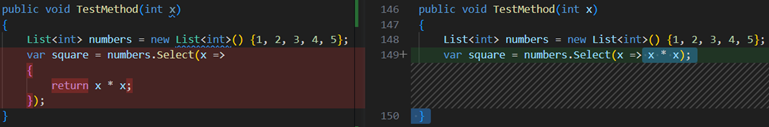

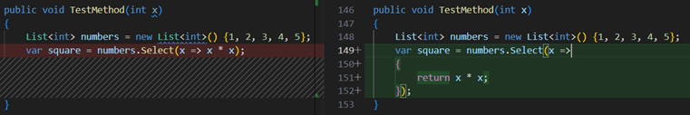

## 使用递归模式 {#use-recursive-patterns}

## 换行、缩进和对齐重构 {#wrap-indent-and-align-refactorings}

### 换行和对齐调用链 {#wrap-and-align-call-chains}

### 换行、缩进和对齐参数/实参 {#wrap-indent-and-align-parameters-or-arguments}

### 换行二元表达式 {#wrap-binary-expressions}

## 后续步骤 {#next-steps}

* [C# 格式化和 Lint](10.8.6-FormattingLinting/)
* [C# 导航和编辑](10.8.3-NavigateEdit/)
* [C# 项目管理](10.8.7-ProjectManagement/)
