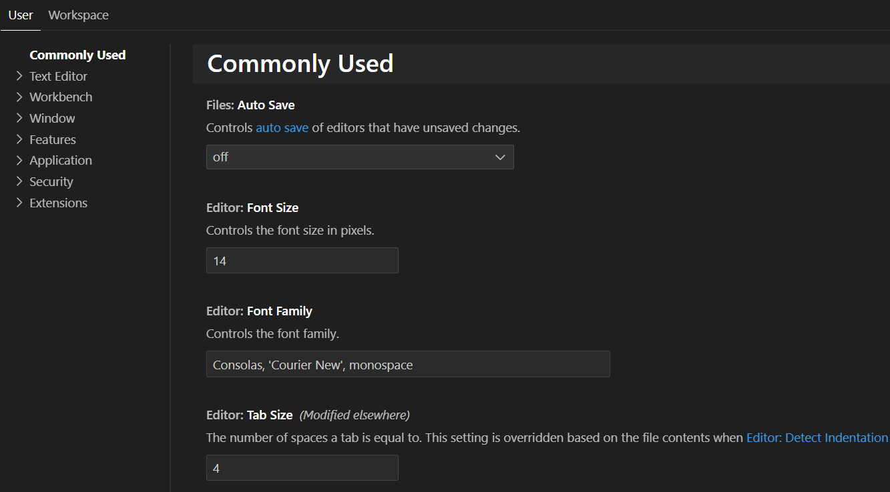
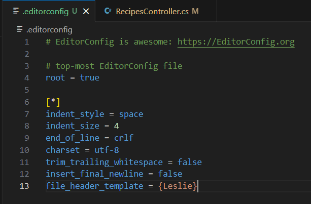

+++
title = "10.8.6 C# 格式化和 Lint"
date = "2026-11-06T07:53:25+08:00"
weight = 6
type = "docs"
description = ""
isCJKLanguage = true
draft = false
+++

> 原文链接: [https://code.visualstudio.com/docs/csharp/formatting-linting](https://code.visualstudio.com/docs/csharp/formatting-linting)

# 10.8.6 C# 格式化和 Lint

　　可以使用 [C# Dev Kit](https://marketplace.visualstudio.com/items?itemName=ms-dotnettools.csdevkit)扩展格式化 C# 源代码。

转到 **文件 > 首选项 > 设置**（`Ctrl + ,`，macOS：`Cmd + ,`）自定义 `.cs` 文件格式化。设置编辑器在 **常用** 和 **文本编辑器** 下列出格式化选项，可以按工作区或用户配置文件调整。

## 使用 EditorConfig 支持 C# Dev Kit {#how-to-support-editorconfig-with-c-dev-kit}

　　[EditorConfig for VS Code 扩展](https://marketplace.visualstudio.com/items?itemName=EditorConfig.EditorConfig)支持 **EditorConfig（`.editorconfig`）文件**，可以自定义 C# 项目格式化选项，并覆盖用户/工作区设置。

