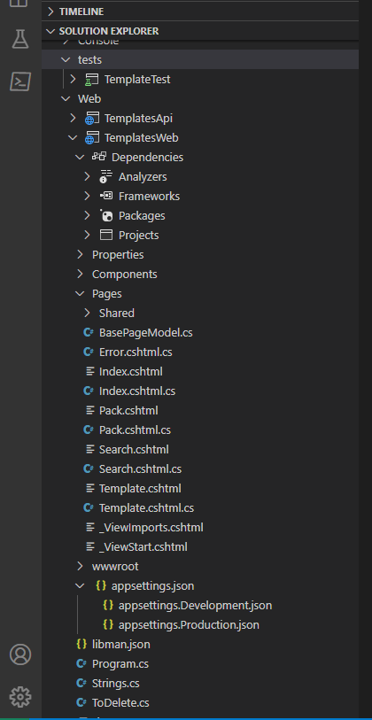
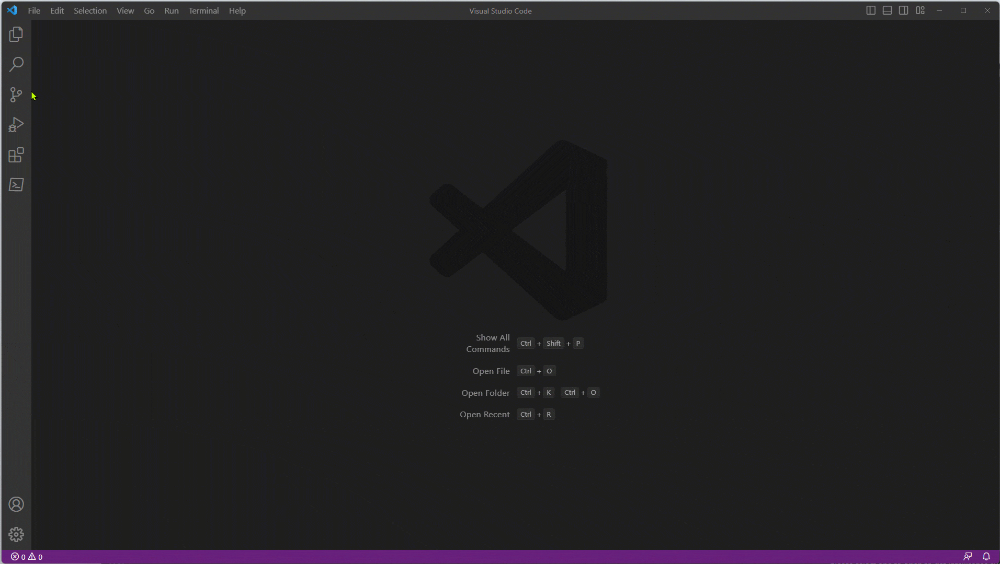
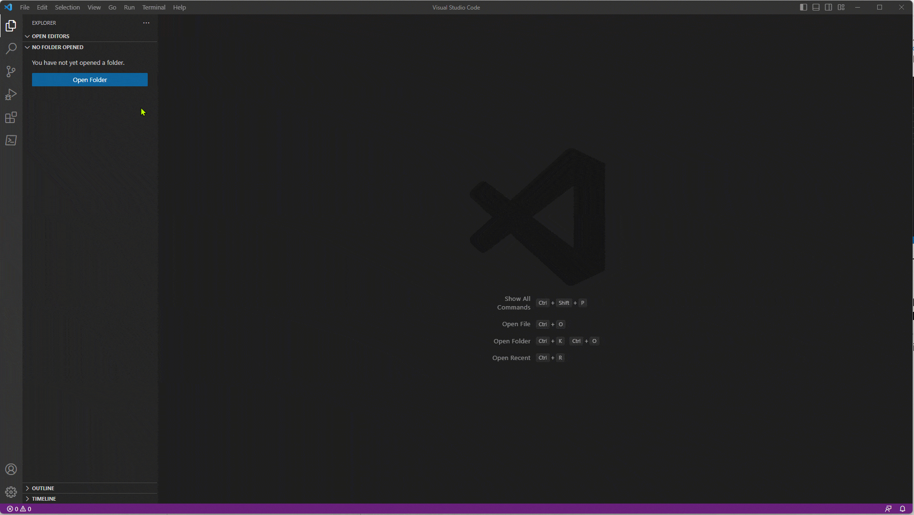
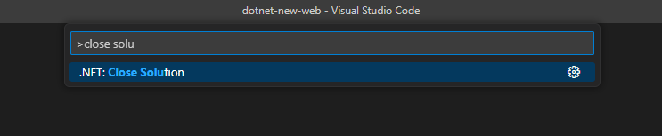
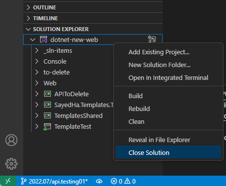
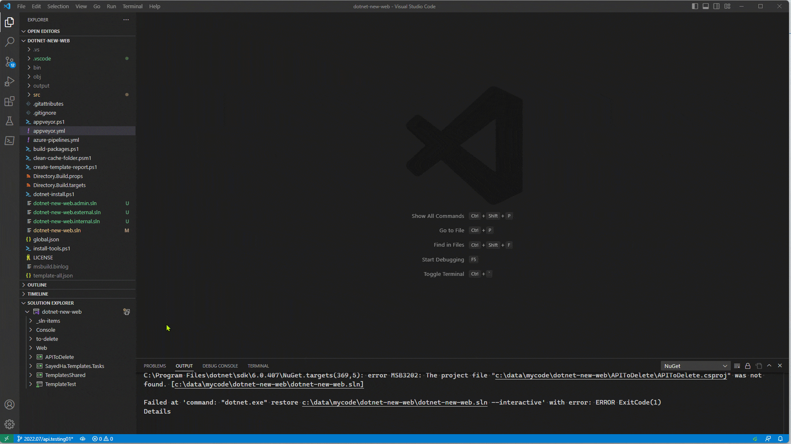
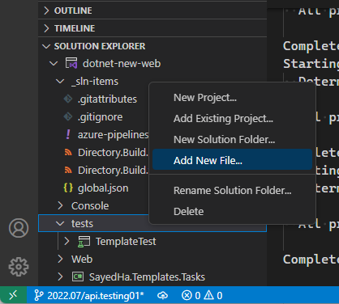
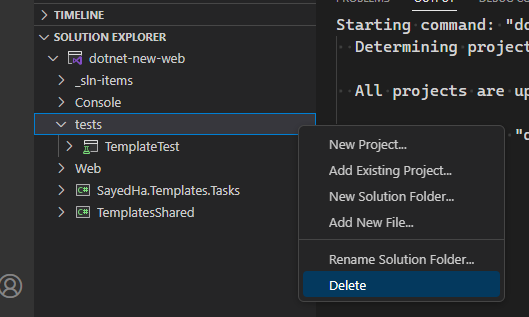
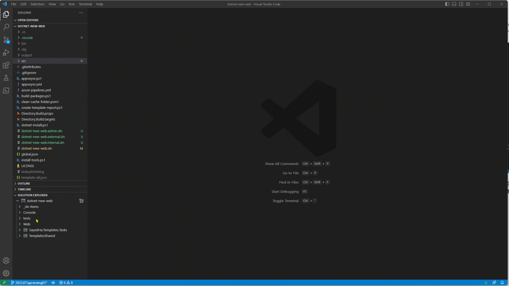
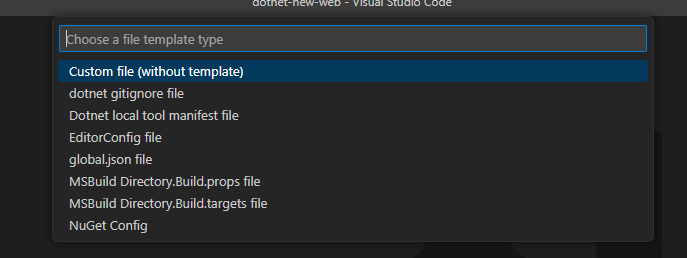

+++
title = "10.8.7 C# 项目管理"
date = "2026-11-06T07:53:25+08:00"
weight = 7
type = "docs"
description = ""
isCJKLanguage = true
draft = false
+++

> 原文链接: [https://code.visualstudio.com/docs/csharp/project-management](https://code.visualstudio.com/docs/csharp/project-management)

# 10.8.7 C# 项目管理

　　C# Dev Kit 提供解决方案资源管理器，用于管理 C# 解决方案、项目和文件。

## 解决方案资源管理器 {#solution-explorer}

打开包含 `.sln` 文件的文件夹时，C# Dev Kit 会自动加载解决方案。**解决方案资源管理器** 显示解决方案、项目、依赖项和文件：

可以打开单个解决方案：

工作区有多个 `.sln` 文件时，可以选择要加载的解决方案：

关闭解决方案：

* 命令面板运行 **.NET: Close Solution**：

  

* 右键解决方案选择 **Close Solution**：

  

## 解决方案文件夹 {#solution-folders}

解决方案文件夹用于组织项目。右键解决方案选择 **New Solution Folder**，输入名称：

添加文件到解决方案文件夹：

删除解决方案文件夹：

## 使用项目 {#working-with-projects}

### 添加现有项目 {#add-existing-project}

右键解决方案选择 **Add > Existing Project...**，选择 `.csproj` 文件：

### 添加新文件 {#add-new-file}

右键项目选择 **Add > New File...**，或从命令面板运行 **.NET: New File**：

### 管理 NuGet 包 {#manage-nuget-packages}

右键项目选择 **Manage NuGet Packages**，打开 NuGet 包管理器。详情请参阅[包管理](10.8.9-PackageManagement/)。

### 构建和运行 {#build-and-run}

解决方案资源管理器工具栏提供构建、运行和调试按钮。也可以使用 **.NET: Build**、**Run** 命令。

更多构建工具请参阅[构建工具](10.8.8-BuildTools/)。

## 后续步骤 {#next-steps}

* [C# 构建工具](10.8.8-BuildTools/)
* [C# 包管理](10.8.9-PackageManagement/)
* [C# 调试](10.8.10-Debugging/)
