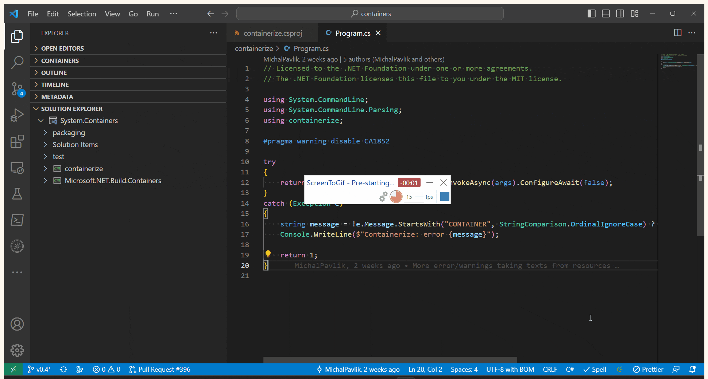
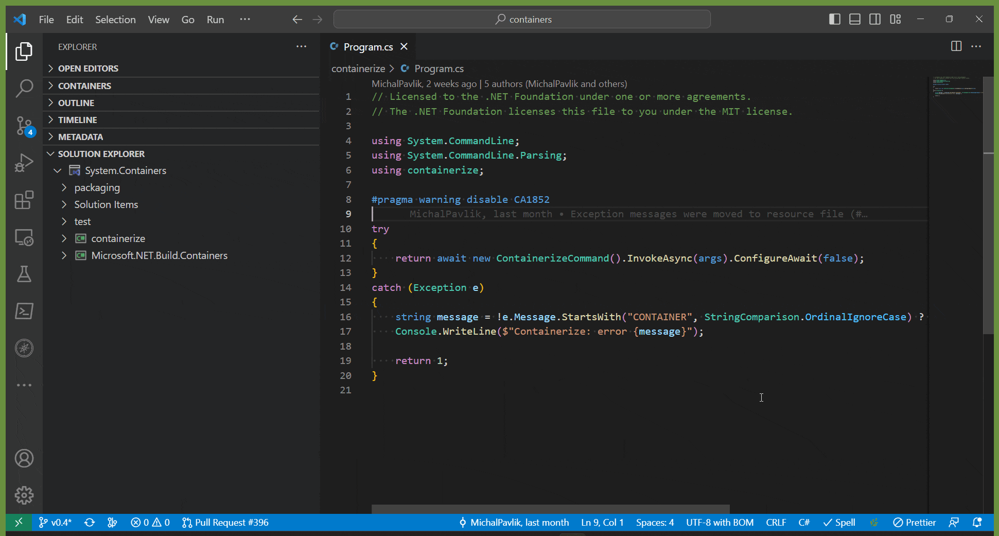

+++
title = "10.8.8 C# 构建工具"
date = "2026-11-06T07:53:25+08:00"
weight = 8
type = "docs"
description = ""
isCJKLanguage = true
draft = false
+++

> 原文链接: [https://code.visualstudio.com/docs/csharp/build-tools](https://code.visualstudio.com/docs/csharp/build-tools)

# 10.8.8 C# 构建工具

　　本文介绍 C# Dev Kit 提供的 C# 解决方案构建功能。

## 构建解决方案 {#building-a-solution}

加载解决方案后，C# Dev Kit 提供多个操作解决方案和项目的任务。除了在解决方案资源管理器中右键构建，还可以使用 **.NET: Build** 命令构建整个解决方案：

也可以使用 VS Code 的[任务](../../../debugging-and-testing/6.3-Tasks/)功能。C# Dev Kit 注册了 `dotnet` 任务组：

* `build`：通过 [dotnet build](https://learn.microsoft.com/dotnet/core/tools/dotnet-build) 构建打开的解决方案。
* `clean`：通过 [dotnet clean](https://learn.microsoft.com/dotnet/core/tools/dotnet-clean) 清理所有输出。
* `watch`：监视特定项目，文件更改时重新构建，等同于 [dotnet watch](https://learn.microsoft.com/dotnet/core/tools/dotnet-watch)。

## 管理项目文件 {#managing-project-files}

　　项目文件是可扩展 XML 文档，描述项目如何构建。通过添加 Properties（带内部值的 XML 元素）和 Items（带属性的 XML 元素）修改构建。

需要属性/项补全、语法高亮和常见项目属性工具提示时，可以安装 [MSBuild project tools](https://marketplace.visualstudio.com/items?itemName=tintoy.msbuild-project-tools)扩展。该扩展是社区项目，不由 Microsoft 直接支持。

更多 .NET 项目文件内容请参阅 [.NET project SDKs 文档](https://learn.microsoft.com/dotnet/core/project-sdk/overview)。
