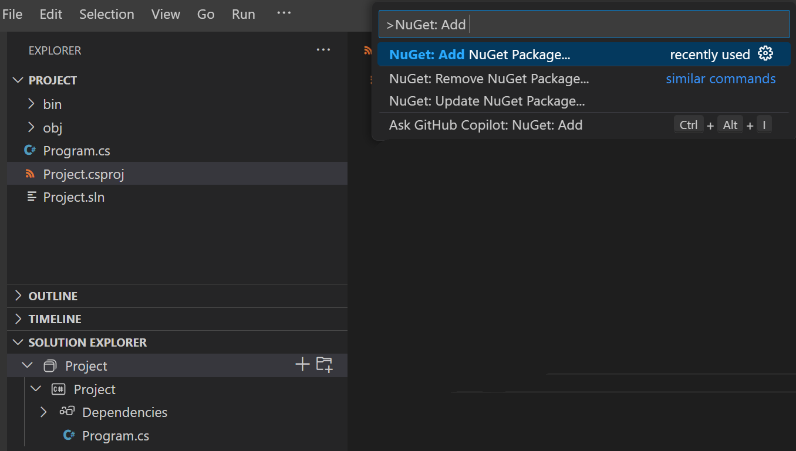
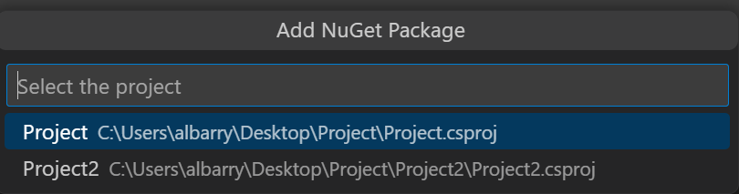
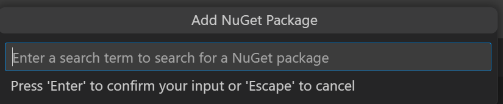
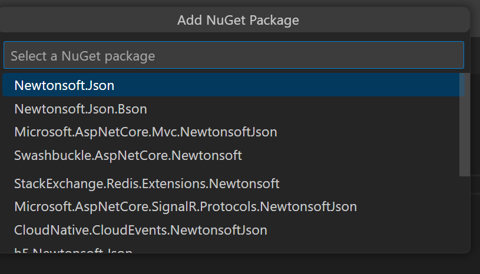
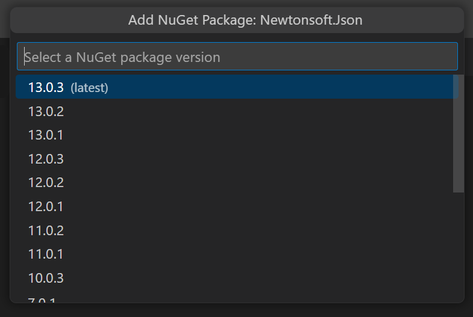
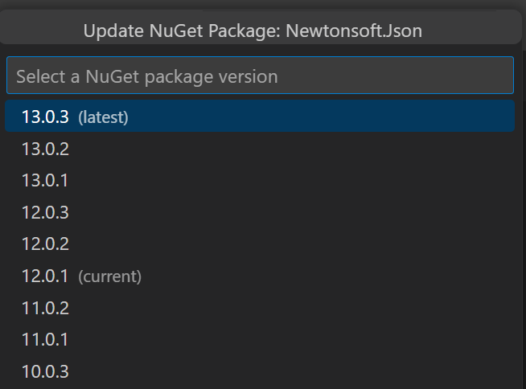
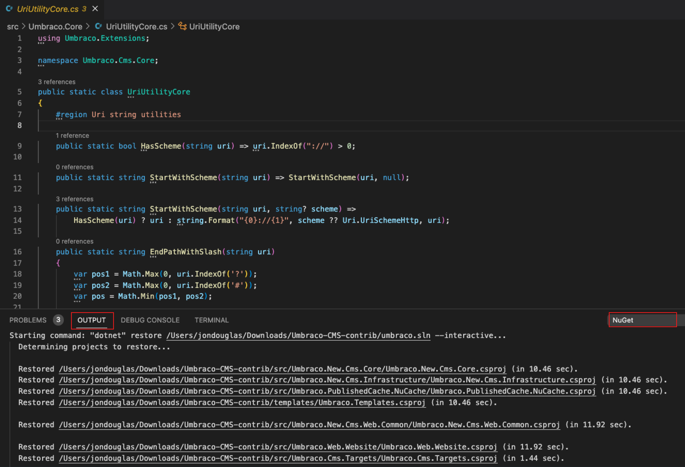
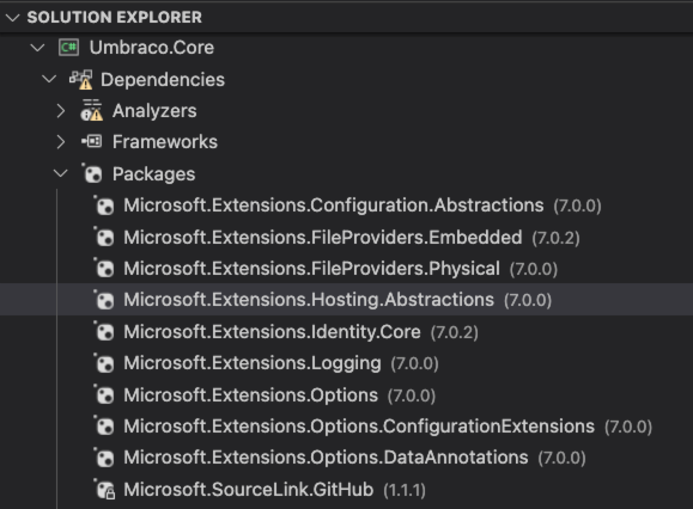

+++
title = "10.8.9 C# 包管理"
date = "2026-11-06T07:53:25+08:00"
weight = 9
type = "docs"
description = ""
isCJKLanguage = true
draft = false
+++

> 原文链接: [https://code.visualstudio.com/docs/csharp/package-management](https://code.visualstudio.com/docs/csharp/package-management)

# 10.8.9 C# 包管理

　　NuGet 是 .NET 包管理器，定义如何创建、托管和使用 .NET 包，并代为管理项目依赖树。

在 VS Code 中可以通过 C# Dev Kit 解决方案资源管理器或命令面板管理 NuGet 包。详情请参阅 [NuGet 文档](https://learn.microsoft.com/nuget/what-is-nuget)。

## C# Dev Kit 中的 NuGet 命令 {#nuget-commands-in-c-dev-kit}

可以通过命令面板（`Ctrl + Shift + P`，macOS：`Cmd + Shift + P`）或解决方案资源管理器右键菜单执行 NuGet 操作。

### 添加包 {#add-a-package}

1. 运行 **NuGet: Add NuGet Package**：

   

2. 解决方案有多个项目时，选择目标项目：

   

3. 输入搜索词：

   

   快速选择显示包列表：

   

4. 选择版本：

   

5. C# Dev Kit 将包添加到项目并更新项目文件和引用。

### 更新包 {#update-a-package}

1. 运行 **NuGet: Update NuGet Package**。
2. 选择项目。
3. 从有可用更新的已安装包中选择。
4. 选择目标版本，列表标记当前版本（current）和最新版本（latest）：

   

5. 扩展更新项目文件和引用。

### 移除包 {#remove-a-package}

1. 运行 **NuGet: Remove NuGet Package**。
2. 选择项目。
3. 从已安装包中选择要移除的包。
4. 扩展更新项目文件和引用。

### 包含预发布版本 {#include-prerelease-package-versions}

在 **文件 > 首选项 > 设置**（`Ctrl + ,`，macOS：`Cmd + ,`）中搜索 `nuget.includePrereleasePackageVersions`，设置为 `true`。

## 依赖管理 {#dependency-management}

### 自动 NuGet 还原 {#automatic-nuget-restore}

　　.NET 项目从模板创建、构建、加载或修改 SDK 风格项目时会自动还原包。进度和日志显示在输出面板：

使用 `<PackageReference>` 的项目可以在解决方案资源管理器中查看包引用：

还原或构建时安装失败的包会在解决方案资源管理器中显示错误图标。

> **注意**：目前不能右键单击项目管理 NuGet 包，VS Code 中也没有 NuGet 包管理器 UI。

更多包管理信息请参阅[使用 dotnet CLI 安装和管理 NuGet 包](https://learn.microsoft.com/nuget/consume-packages/install-use-packages-dotnet-cli)。
