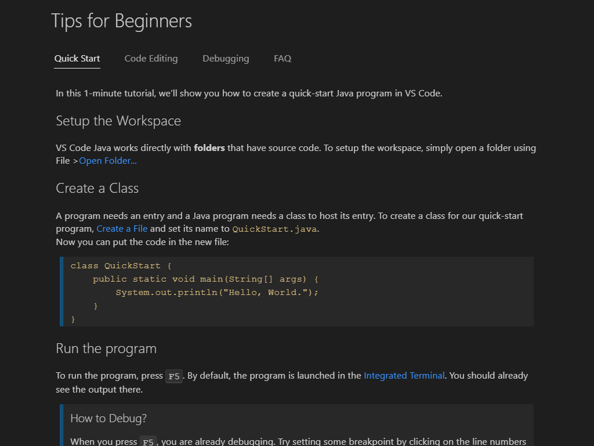

+++
title = "10.6.1 Java 教程"
date = 2026-11-06T07:53:25+08:00
weight = 1
type = "docs"
description = ""
isCJKLanguage = true
draft = false
+++

> 原文链接: [https://code.visualstudio.com/docs/java/java-tutorial](https://code.visualstudio.com/docs/java/java-tutorial)

# 10.6.1 Java 教程

　　本教程演示如何在 VS Code 中编写和运行 Java Hello World 程序，并介绍一些高级功能。Java 功能概览请参阅 [Java 语言](../../language-support/10.2.10-Java/)。

遇到问题可以在 [vscode-java-pack](https://github.com/microsoft/vscode-java-pack/issues) 创建议题。

## 为 Java 开发设置 VS Code {#setting-up-vs-code-for-java-development}

### Java 编码包 {#coding-pack-for-java}

快速设置可以安装 **Coding Pack for Java**，其中包含 VS Code、Java Development Kit（JDK）和必需的 Java 扩展。编码包可用于全新安装，也可更新或修复现有环境。

* [安装 Coding Pack for Java - Windows](https://aka.ms/vscode-java-installer-win)
* [安装 Coding Pack for Java - macOS](https://aka.ms/vscode-java-installer-mac)

> **注意**：Coding Pack for Java 仅适用于 Windows 和 macOS。其他操作系统需要手动安装 JDK、VS Code 和 Java 扩展。

### 安装扩展 {#installing-extensions}

已有 VS Code 时，可以安装 [Extension Pack for Java](https://marketplace.visualstudio.com/items?itemName=vscjava.vscode-java-pack)，其中包含：

* [Language Support for Java™ by Red Hat](https://marketplace.visualstudio.com/items?itemName=redhat.java)
* [Debugger for Java](https://marketplace.visualstudio.com/items?itemName=vscjava.vscode-java-debug)
* [Test Runner for Java](https://marketplace.visualstudio.com/items?itemName=vscjava.vscode-java-test)
* [Maven for Java](https://marketplace.visualstudio.com/items?itemName=vscjava.vscode-maven)
* [Project Manager for Java](https://marketplace.visualstudio.com/items?itemName=vscjava.vscode-java-dependency)
* [Visual Studio IntelliCode](https://marketplace.visualstudio.com/items?itemName=VisualStudioExptTeam.vscodeintellicode)

扩展包提供快速入门、代码编辑和调试提示，以及常见问题。可以从命令面板（`Ctrl + Shift + P`，macOS：`Cmd + Shift + P`）运行 **Java: Tips for Beginners** 打开指南。

也可以单独安装扩展，使用 **Java: Extensions Guide** 命令打开扩展指南。

本教程仅需：

* [Language Support for Java™ by Red Hat](https://marketplace.visualstudio.com/items?itemName=redhat.java)
* [Debugger for Java](https://marketplace.visualstudio.com/items?itemName=vscjava.vscode-java-debug)

## 安装和设置 JDK {#installing-and-setting-up-a-java-development-kit-jdk}

　　在 VS Code 中使用 Java 需要在本地安装 JDK。JDK 是用于开发 Java 应用的软件开发环境。

### 支持的 Java 版本 {#supported-java-versions}

　　Extension Pack for Java 支持 Java 1.8 及以上版本。

> **注意**：为项目配置 JDK 请参阅[为项目配置运行时](10.6.5-ProjectManagement/#configure-runtime-for-projects)。启用 Java 预览功能请参阅[如何在 VS Code 中使用新 Java 版本](10.6.15-FAQ/#how-can-i-use-visual-studio-code-with-new-java-versions)。

### 安装 JDK {#installing-a-java-development-kit-jdk}

推荐来源：

* [Amazon Corretto](https://aws.amazon.com/corretto)
* [Azul Zulu](https://www.azul.com/downloads/?package=jdk)
* [Eclipse Adoptium Temurin](https://adoptium.net/)
* [IBM Semeru Runtimes](https://developer.ibm.com/languages/java/semeru-runtimes)
* [Microsoft Build of OpenJDK](https://www.microsoft.com/openjdk)
* [Oracle Java SE](https://www.oracle.com/java/technologies/javase-downloads.html)
* [Red Hat build of OpenJDK](https://developers.redhat.com/products/openjdk/download)
* [SapMachine](https://sapmachine.io)

## 创建源代码文件 {#creating-a-source-code-file}

创建 Java 程序文件夹并在 VS Code 中打开。创建新文件并保存为 `Hello.java`。打开文件时 Java 语言服务器会自动加载，状态栏右侧显示加载图标。加载完成后悬停状态项可以确认成功，也可以将其固定到状态栏。

<video src="https://code.visualstudio.com/assets/docs/java/java-tutorial/JavaHelloWorld.Standalone.mp4" autoplay loop muted playsinline controls title="创建源代码文件"></video>

> **注意**：只打开 Java 文件而不打开其文件夹时，Java 语言服务器可能无法正常工作。

　　VS Code 会尝试为新类型推断正确包名，并从模板填充文件。详情请参阅[创建新文件](10.6.2-Editing/#create-new-file)。

也可以使用 **Java: Create Java Project** 命令创建 Java 项目。打开命令面板输入 `java` 搜索命令，选择项目位置、名称和构建工具。

<video src="https://code.visualstudio.com/assets/docs/java/java-tutorial/JavaHelloWorld.Project.mp4" autoplay loop muted playsinline controls title="创建 Java 项目"></video>

VS Code 也支持更复杂的 Java 项目，请参阅[项目管理](10.6.5-ProjectManagement/)。

## 编辑源代码 {#editing-source-code}

可以使用代码片段搭建类和方法，VS Code 还提供 IntelliSense 代码补全和多种重构方法。

<video src="https://code.visualstudio.com/assets/docs/java/java-tutorial/edit-code.mp4" autoplay loop muted playsinline controls title="编辑源代码"></video>

详情请参阅[编辑 Java](10.6.2-Editing/)。

## 运行和调试程序 {#running-and-debugging-your-program}

设置断点后按 `F5` 或使用 **运行 > 启动调试**，也可以使用编辑器中的 **Run|Debug** CodeLens。代码编译后，可以在 **运行和调试** 视图中查看变量和线程。

<video src="https://code.visualstudio.com/assets/docs/java/java-tutorial/run-debug.mp4" autoplay loop muted playsinline controls title="运行和调试程序"></video>

调试器还支持 [Hot Code Replace](10.6.7-Debugging/#hot-code-replace) 和条件断点等高级功能。详情请参阅[调试 Java](10.6.7-Debugging/)。

## 更多功能 {#more-features}

* [编辑 Java](10.6.2-Editing/)：导航和编辑 Java。
* [调试](10.6.7-Debugging/)：Java 调试器关键功能。
* [测试](10.6.8-Testing/)：对 JUnit 和 TestNG 的完整支持。
* [Java 项目管理](10.6.5-ProjectManagement/)：项目视图和 Maven。
* [Spring Boot](10.6.9-SpringBoot/)和 [Tomcat/Jetty](10.6.11-AppServers/)：框架支持。
* [Java Web 应用](https://code.visualstudio.com/docs/java/java-webapp)：在 VS Code 中处理 Java Web 应用。
