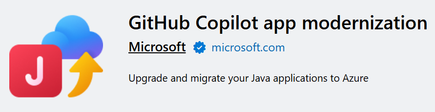

+++
title = "10.6.10 现代化旧版 Java 应用"
date = 2026-11-06T07:53:25+08:00
weight = 10
type = "docs"
description = ""
isCJKLanguage = true
draft = false
+++

> 原文链接: [https://code.visualstudio.com/docs/java/java-app-mod](https://code.visualstudio.com/docs/java/java-app-mod)

# 10.6.10 现代化旧版 Java 应用

　　[GitHub Copilot App Modernization](https://marketplace.visualstudio.com/items?itemName=vscjava.migrate-java-to-azure)扩展帮助开发者以更快速度、更高准确性和效率现代化旧版 Java 应用。

无论是升级框架、处理过时依赖还是准备迁移到云，GitHub Copilot 都使用智能自动化和 Microsoft Azure 深度集成，将现代化周期从数月缩短到数天。

## 扩展功能 {#extension-capabilities}

* **智能评估和升级计划**：Copilot 扫描代码库、分析依赖和框架，并制定可操作计划。
* **AI 驱动的代码转换**：从 Java 8 到最新 LTS 版本，Copilot 使用结构化、上下文感知的编辑自动升级，减少重复工作和升级风险。
* **可复用迁移模式**：将团队的构建逻辑保存为自定义公式，并在多个应用中重用，实现一致、可扩展的现代化。
* **构建和测试验证**：修复构建错误、运行单元测试，确保更改后应用稳定，保持干净的 CI/CD 流水线。
* **CVE 检测和修复**：升级后自动检测并修补已知漏洞，Copilot 应用安全修复，同时让用户完全控制更改。
* **无缝 Azure 集成**：轻松将升级后的应用部署到 Azure。现代化应用可以立即使用 Azure AI Foundry，获得 11,000 多个模型、内置可观测性、安全工具和代理服务。

## 开始使用 {#get-started}

* [升级 Java 项目](https://learn.microsoft.com/java/upgrade/quickstart-upgrade)
* [评估和迁移 Java 项目](https://learn.microsoft.com/azure/developer/java/migration)
* [检测并修复 Java 项目安全问题](https://learn.microsoft.com/java/upgrade/tools)

## 相关资源 {#related-resources}

* [应用现代化通用概念](https://learn.microsoft.com/en-us/azure/developer/github-copilot-app-modernization/overview)
