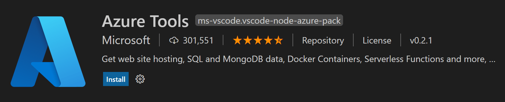

+++
title = "10.6.12 部署 Java 应用"
date = 2026-11-06T07:53:25+08:00
weight = 12
type = "docs"
description = ""
isCJKLanguage = true
draft = false
+++

> 原文链接: [https://code.visualstudio.com/docs/java/java-on-azure](https://code.visualstudio.com/docs/java/java-on-azure)

# 10.6.12 部署 Java 应用

　　[Azure Tools](https://marketplace.visualstudio.com/items?itemName=ms-vscode.vscode-node-azure-pack)扩展包包含丰富的扩展，便于发现和交互支持 Java 应用的云服务。

支持的工作流：

* 将 Java 应用（包括容器）部署到 [Azure App Service](https://azure.microsoft.com/services/app-service)。
* 将 Spring 微服务部署到 [Azure Spring Cloud](https://azure.microsoft.com/services/spring-cloud/)。
* 将无服务器代码部署到 [Azure Functions](https://azure.microsoft.com/services/functions)。

需要特定 Azure 服务时，可以直接在 [Marketplace](https://marketplace.visualstudio.com/VSCode)搜索扩展。

## 部署教程 {#deployment-tutorials}

更多内容请参阅 [Java Azure 开发者中心](https://learn.microsoft.com/azure/developer/java)。

| 教程 | 说明 | 相关工具 |
| --- | --- | --- |
| [将 Java Web 应用部署到 Azure App Service](https://code.visualstudio.com/docs/java/java-webapp) | 将 Web 应用部署到云 | [Apache Maven](https://maven.apache.org/download.cgi)   [Azure App Service](https://marketplace.visualstudio.com/items?itemName=ms-azuretools.vscode-azureappservice) |
| [将 Spring Boot 应用部署到 Azure Spring Apps](https://code.visualstudio.com/docs/java/java-spring-apps) | 将 Spring Boot 应用部署到 Azure Spring Apps | [Apache Maven](https://maven.apache.org/download.cgi)   [Azure Spring Apps](https://marketplace.visualstudio.com/items?itemName=vscjava.vscode-azurespringcloud) |
| [使用 VS Code 创建 Azure Functions 项目](https://learn.microsoft.com/azure/azure-functions/create-first-function-vs-code-java) | 使用 Azure Functions 部署无服务器代码 | [Apache Maven](https://maven.apache.org/download.cgi)   [Azure Functions](https://marketplace.visualstudio.com/items?itemName=ms-azuretools.vscode-azurefunctions) |
