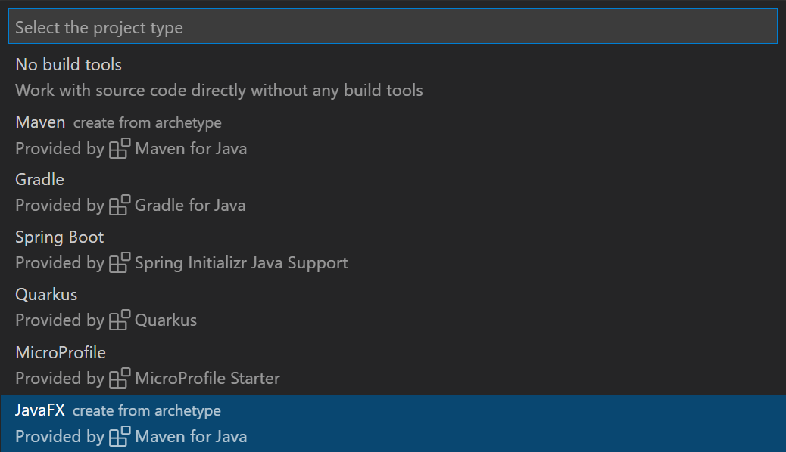

+++
title = "10.6.13 Java GUI 应用"
date = 2026-11-06T07:53:25+08:00
weight = 13
type = "docs"
description = ""
isCJKLanguage = true
draft = false
+++


> 原文链接: [https://code.visualstudio.com/docs/java/java-gui](https://code.visualstudio.com/docs/java/java-gui)

# 10.6.13 Java GUI 应用

　　可以在 VS Code 中轻松开发 Java GUI 应用。需要安装 [Extension Pack for Java](https://marketplace.visualstudio.com/items?itemName=vscjava.vscode-java-pack)，其中包含开发 Java GUI 应用所需的全部扩展。

遇到问题可以在 [vscode-java-pack](https://github.com/microsoft/vscode-java-pack/issues) 创建议题。

## 开发 JavaFX 应用 {#develop-javafx-applications}

### 创建新的 JavaFX 项目 {#create-a-new-javafx-project}

1. 安装 Extension Pack for Java。
2. 打开命令面板（`Ctrl + Shift + P`，macOS：`Cmd + Shift + P`），选择 **Java: Create Java Project**。
3. 选择 **JavaFX**，按照向导通过 Maven Archetype 创建项目。



### 运行 JavaFX 应用 {#run-the-javafx-application}

> **注意**：以下说明仅适用于 Maven 管理的项目。生成的项目至少需要 JDK 11，请确保本地已安装并在 [`java.configuration.runtimes`](https://github.com/redhat-developer/vscode-java#project-jdks) 中设置安装路径。

打开 **Maven** 资源管理器，展开 `hellofx` > `Plugins` > `javafx`，运行 Maven 目标 `javafx:run`。

> **注意**：需要安装 [Maven for Java](https://marketplace.visualstudio.com/items?itemName=vscjava.vscode-maven)扩展。找不到 **Maven** 资源管理器时，运行 **Explorer: Focus on Maven View** 命令。

<video src="https://code.visualstudio.com/assets/docs/java/java-gui/run-javafx.mp4" autoplay loop muted playsinline controls title="运行 JavaFX 应用"></video>

### 更多 JavaFX 示例 {#more-javafx-examples}

更多 JavaFX 项目示例请参阅 [openjfx samples 仓库](https://github.com/openjfx/samples/tree/master/IDE/VSCode)，涵盖 Gradle 和未管理文件夹等不同项目结构。

## 开发 AWT 应用 {#develop-awt-applications}

　　默认隐藏 Abstract Window Toolkit（AWT）类型，开发 AWT 应用时可能发现代码补全不工作。启用补全：打开命令面板，选择 **Java: Help Center**，转到 **Student** 部分，选择 **Enable AWT Development**。

<video src="https://code.visualstudio.com/assets/docs/java/java-gui/enable-awt.mp4" autoplay loop muted playsinline controls title="开发 AWT 应用"></video>

> **注意**：此操作会在工作区 `.vscode\settings.json` 中更新 `java.completion.filteredTypes`，请确保已打开工作区。

简单 AWT 示例：

```java
import java.awt.*;
import java.awt.event.*;

public class AwtExample extends Frame {
  public AwtExample() {
    Button btn = new Button("Button");
    btn.setBounds(50, 50, 50, 50);
    add(btn);
    setSize(150, 150);
    setTitle("This is my First AWT example");
    setLayout(new FlowLayout());
    setVisible(true);
    addWindowListener(new WindowAdapter() {
        public void windowClosing(WindowEvent we) {
            dispose();
        }
    });
  }

  public static void main(String args[]){
    new AwtExample();
  }
}
```

## 开发 Swing 应用 {#develop-swing-applications}

　　默认支持 Swing 应用开发，无需任何设置即可直接编写 Swing 代码。更多示例请参阅 [Oracle Swing 文档](https://docs.oracle.com/javase/tutorial/uiswing/examples/components/index.html)。
