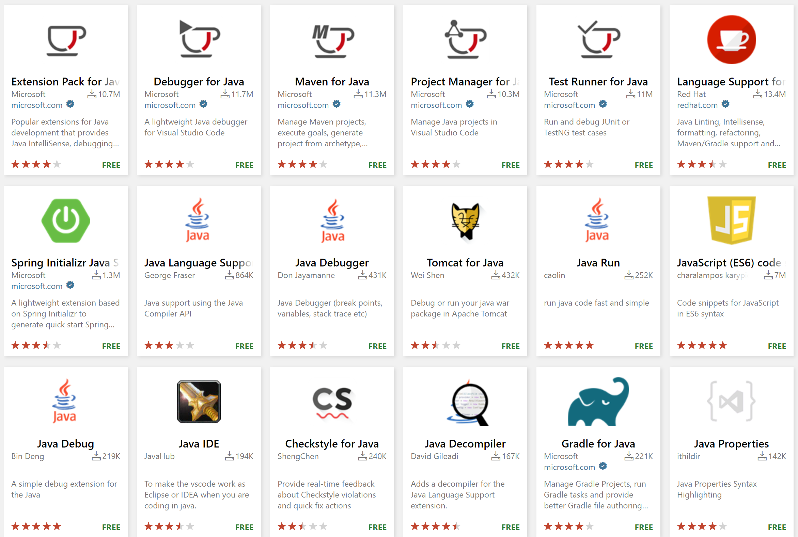

+++
title = "10.6.14 Java 扩展"
date = 2026-11-06T07:53:25+08:00
weight = 14
type = "docs"
description = ""
isCJKLanguage = true
draft = false
+++

> 原文链接: [https://code.visualstudio.com/docs/java/extensions](https://code.visualstudio.com/docs/java/extensions)

# 10.6.14 Java 扩展

　　借助 VS Code 周围的 Java 社区，可以使用大量扩展增强 Java 开发体验。

> **提示**：扩展安装和管理请参阅[扩展文档](../../../editor/3.3-ConfigureTheEditor/3.3.6-Extensions/3.3.6.2-ExtensionMarketplace/)。

本文推荐不同 Java 开发场景的常用扩展。

## 基础 Java 开发 {#fundamental-java-development}

需要核心 Java 开发体验（代码补全、运行/调试/测试、项目管理等）时，推荐 [Extension Pack for Java](https://marketplace.visualstudio.com/items?itemName=vscjava.vscode-java-pack)，包含：

1. [Language Support for Java™ by Red Hat](https://marketplace.visualstudio.com/items?itemName=redhat.java)
2. [Debugger for Java](https://marketplace.visualstudio.com/items?itemName=vscjava.vscode-java-debug)
3. [Test Runner for Java](https://marketplace.visualstudio.com/items?itemName=vscjava.vscode-java-test)
4. [Maven for Java](https://marketplace.visualstudio.com/items?itemName=vscjava.vscode-maven)
5. [Project Manager for Java](https://marketplace.visualstudio.com/items?itemName=vscjava.vscode-java-dependency)
6. [Visual Studio IntelliCode](https://marketplace.visualstudio.com/items?itemName=VisualStudioExptTeam.vscodeintellicode)

入门请参阅 [Java 入门](10.6.1-Tutorial/)。也可以安装 [SonarLint](https://marketplace.visualstudio.com/items?itemName=SonarSource.sonarlint-vscode)检测代码质量和安全问题。

## Spring Boot 扩展 {#spring-boot-extensions}

　　Spring Boot 是流行的开源微服务 Java Web 框架。VMware 和 Microsoft 提供了优秀扩展。

推荐 [Spring Boot Extension Pack](https://marketplace.visualstudio.com/items?itemName=vmware.vscode-boot-dev-pack)，包含：

1. [Spring Boot Tools](https://marketplace.visualstudio.com/items?itemName=vmware.vscode-spring-boot)
2. [Spring Initializr Java Support](https://marketplace.visualstudio.com/items?itemName=vscjava.vscode-spring-initializr)
3. [Spring Boot Dashboard](https://marketplace.visualstudio.com/items?itemName=vscjava.vscode-spring-boot-dashboard)

详情请参阅 [Spring Boot](10.6.9-SpringBoot/)。

## Gradle for Java {#gradle-for-java}

通过 [Gradle for Java](https://marketplace.visualstudio.com/items?itemName=vscjava.vscode-gradle)扩展支持 Gradle，详情请参阅[构建工具](10.6.6-Build/#gradle)。

## 应用服务器（Tomcat / Jetty 等） {#application-servers-tomcat--jetty-etc}

[Community Server Connectors](https://marketplace.visualstudio.com/items?itemName=redhat.vscode-community-server-connector)是 Tomcat、Jetty 等应用服务器的优秀扩展。详情请参阅[应用服务器](10.6.11-AppServers/)。

## MicroProfile / Quarkus {#microprofile--quarkus}

* [Extension pack for MicroProfile](https://marketplace.visualstudio.com/items?itemName=MicroProfile-Community.vscode-microprofile-pack)
* [Quarkus](https://marketplace.visualstudio.com/items?itemName=redhat.vscode-quarkus)

## 其他 Java IDE 的快捷键映射 {#keymaps-for-other-java-ides}

* [Eclipse Keymap](https://marketplace.visualstudio.com/items?itemName=alphabotsec.vscode-eclipse-keybindings)
* [IntelliJ IDEA keyboard shortcuts](https://marketplace.visualstudio.com/items?itemName=k--kato.intellij-idea-keybindings)

快捷键映射扩展将其他 IDE 的快捷键应用到 VS Code，无需重新学习。

## 远程开发和容器支持 {#remote-development-and-container-support}

* [远程开发](../../../remote/)扩展可以访问容器、远程机器或 Windows Subsystem for Linux。
* [容器工具](https://marketplace.visualstudio.com/items?itemName=ms-azuretools.vscode-containers)扩展可以构建 Docker 镜像并使用镜像注册表。
* [Kubernetes](https://marketplace.visualstudio.com/items?itemName=ms-kubernetes-tools.vscode-kubernetes-tools)扩展提供管理集群和节点的资源管理器视图，以及 Kubernetes 清单文件语法支持。
* [Live Share](https://marketplace.visualstudio.com/items?itemName=MS-vsliveshare.vsliveshare)用于与其他人协作处理同一代码库。

## VS Code 中的 Azure {#azure-on-vs-code}

### 团队开发 {#team-development}

* [Azure Repos](https://marketplace.visualstudio.com/items?itemName=ms-vsts.team)扩展连接 Azure DevOps Server，监控构建、拉取请求和工作项。

### 物联网 {#internet-of-things}

* [Azure IoT Toolkit](https://marketplace.visualstudio.com/items?itemName=vsciot-vscode.azure-iot-toolkit)帮助开发 IoT 应用并连接 Azure IoT Hub、管理设备和使用代码片段。

### 通用工具 {#general-tools}

* [Azure Tools Extension Pack](https://marketplace.visualstudio.com/items?itemName=ms-vscode.vscode-node-azure-pack)提供丰富的 Azure 服务扩展。
* [Azure Resource Manager Tools](https://marketplace.visualstudio.com/items?itemName=msazurermtools.azurerm-vscode-tools)为 ARM 模板和表达式提供 IntelliSense、签名帮助、转到定义、速览定义/引用、错误和警告。

更多 Azure 扩展请参阅 [Azure 扩展](https://code.visualstudio.com/docs/azure/extensions)。

## 搜索其他 Java 扩展 {#search-for-other-java-extensions}

1. 打开 **扩展** 视图（`Ctrl + Shift + X`）。
2. 输入 `java` 筛选扩展列表。

欢迎向现有扩展贡献代码，或在 Marketplace 中找不到所需功能时创建新的 Java 扩展。
