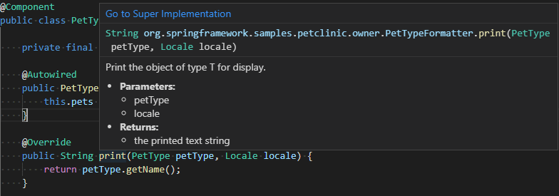
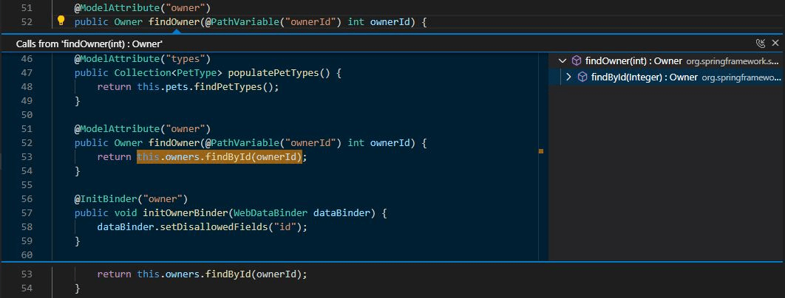
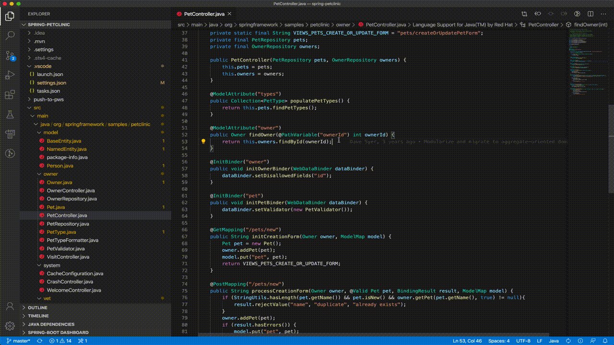
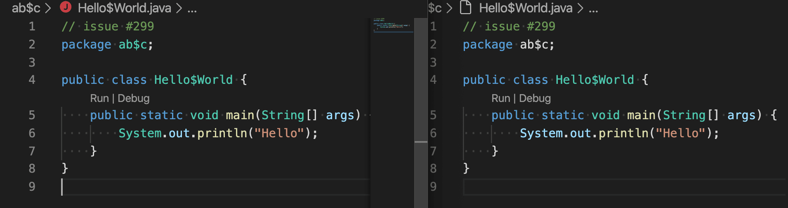
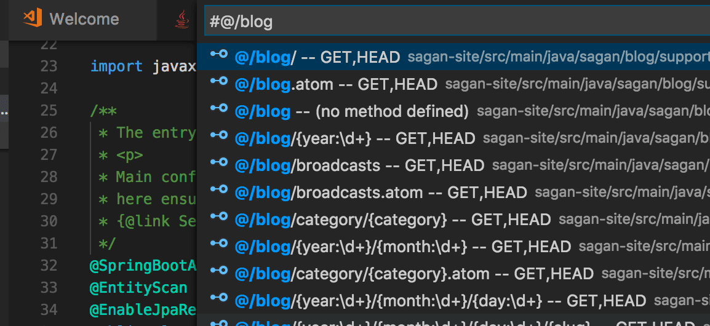
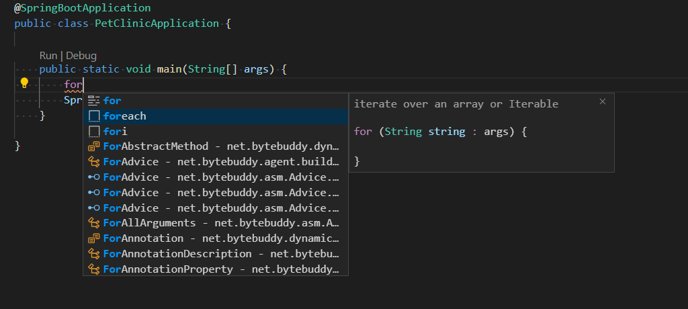

+++
title = "10.6.2 编辑 Java"
date = 2026-11-06T07:53:25+08:00
weight = 2
type = "docs"
description = ""
isCJKLanguage = true
draft = false
+++

> 原文链接: [https://code.visualstudio.com/docs/java/java-editing](https://code.visualstudio.com/docs/java/java-editing)

# 10.6.2 编辑 Java

　　VS Code 首先是具有丰富[编辑功能](../../../editor/3.2-WriteCode/3.2.1-BasicEditing/)的源代码编辑器。本文介绍处理 Java 时有用的特定功能。

遇到问题可以在 [vscode-java-pack](https://github.com/microsoft/vscode-java-pack/issues) 创建议题。

## 代码导航 {#code-navigation}

　　[大纲视图](../../../editor/3.1-GettingStarted/3.1.2-UserInterface/#outline-view)可以浏览当前文件成员，[项目视图](10.6.5-ProjectManagement/#projects-view)提供项目概览。Java 编辑器还支持调用层次结构、类型层次结构、定义导航和工作区类型搜索。

## 搜索符号 {#search-for-symbols}

### 在工作区搜索符号 {#search-for-symbols-in-the-workspace}

按 `Ctrl + T`（macOS：`Cmd + T`） 输入符号名称，匹配列表会出现。选择未打开文件中的匹配项时，会先打开文件再导航。也可以使用 **快速打开**（`Ctrl + P`，macOS：`Cmd + P`）输入 `#` 命令搜索工作区；`Ctrl + T`（macOS：`Cmd + T`） 是该命令的快捷键。

<video src="https://code.visualstudio.com/assets/docs/java/java-editing/search-in-workspace.mp4" autoplay loop muted playsinline controls title="在工作区搜索符号"></video>

### 在当前文件搜索符号 {#search-for-symbols-in-current-file}

使用 **快速打开**（`Ctrl + P`，macOS：`Cmd + P`）输入 `@`，再输入符号名称。列表会随输入筛选，选择后导航。

<video src="https://code.visualstudio.com/assets/docs/java/java-editing/search-in-file.mp4" autoplay loop muted playsinline controls title="在当前文件搜索符号"></video>

## 速览定义 {#peek-definition}

将光标放在符号使用处，按 `Alt + F12`（macOS：`Option + F12`），或右键选择 **速览定义**。速览窗口显示定义附近代码，不离开当前位置。

## 转到定义 {#go-to-definition}

将光标放在符号使用处按 `F12`，或右键选择 **转到定义**。只有一个定义时直接导航；多个定义时在速览窗口显示选项。

## 转到超级实现 {#go-to-super-implementation}

悬停类实现或重写方法时，单击 **转到超级实现** 链接跟踪父类实现。

<video src="https://code.visualstudio.com/assets/docs/java/java-editing/goto-super-implementation.mp4" autoplay loop muted playsinline controls title="转到超级实现"></video>

## 调用层次结构 {#call-hierarchy}

调用层次结构显示函数的所有调用者和被调用者，可以深入查看调用者的调用者。右键单击函数，选择 **速览 > 速览调用层次结构**。

也可以在函数体中右键选择 **显示调用层次结构**。

## 类型层次结构 {#type-hierarchy}

类型层次结构显示 Java 对象之间的继承关系。右键单击类型，选择 **显示类型层次结构**。

<video src="https://code.visualstudio.com/assets/docs/java/java-editing/type-hierarchy.mp4" autoplay loop muted playsinline controls title="类型层次结构"></video>

## 折叠区域 {#folding-regions}

折叠区域可以折叠或展开代码片段，便于查看源代码。

<video src="https://code.visualstudio.com/assets/docs/java/java-editing/folding-range.mp4" autoplay loop muted playsinline controls title="折叠区域"></video>

## 智能选择 {#smart-selection}

智能选择（语义选择）根据光标位置的语义信息扩展或缩小选择范围：

* 扩展选择：`Shift + Alt + →`（macOS：`Ctrl + Cmd + Shift + →`）。
* 缩小选择：`Shift + Alt + ←`（macOS：`Ctrl + Cmd + Shift + ←`）。

<video src="https://code.visualstudio.com/assets/docs/java/java-editing/smart-selection.mp4" autoplay loop muted playsinline controls title="智能选择"></video>

## 语义高亮 {#semantic-highlighting}

语法高亮提高代码阅读效率。借助[语义高亮](https://github.com/microsoft/vscode/wiki/Semantic-Highlighting-Overview)，VS Code 可以根据 Java 语言服务的符号信息提供更准确的着色。

下图左侧启用语义高亮，右侧仅语法高亮：

详情请参阅 [Java 语言支持扩展 wiki](https://github.com/redhat-developer/vscode-java/wiki/Semantic-Highlighting)。

## 使用 Spring Boot 导航代码 {#navigating-code-with-spring-boot}

[Spring Boot Tools](https://marketplace.visualstudio.com/items?itemName=vmware.vscode-spring-boot)扩展为 Spring Boot 项目提供增强导航和补全：

* `@/`：显示所有请求映射（路径、请求方法、源位置）。
* `@+`：显示所有 bean（名称、类型、源位置）。
* `@>`：显示所有函数（原型实现）。
* `@`：显示代码中所有 Spring 注解。

Spring Boot 支持详情请参阅 [VS Code 中的 Spring Boot](10.6.9-SpringBoot/)。

## 代码编辑 {#code-editing}

　　IntelliSense 提供智能代码补全和签名详情。可以使用代码片段以及生成 Getter/Setter、组织导入等代码操作提高效率。

<video src="https://code.visualstudio.com/assets/docs/java/java-editing/code-editing.mp4" autoplay loop muted playsinline controls title="代码编辑"></video>

　　Java 支持会自动检测代码问题并提供快速修复建议。

<video src="https://code.visualstudio.com/assets/docs/java/java-editing/quick-fix.mp4" autoplay loop muted playsinline controls title="快速修复建议"></video>

重构和代码操作详情请参阅[重构和源代码操作](10.6.3-Refactoring/)。

## IntelliSense {#intellisense}

　　Java 代码补全由 [Language Support for Java™ by Red Hat](https://marketplace.visualstudio.com/items?itemName=redhat.java)提供，底层使用与 Eclipse 相同的 [Java 开发工具（JDT）](https://www.eclipse.org/jdt/)。

　　此外还有 AI 辅助的 [IntelliCode](https://visualstudio.microsoft.com/services/intellicode/)，将最可能使用的项放在补全列表顶部。推荐基于 GitHub 上数千个超过 100 星的开源项目训练。

<video src="https://code.visualstudio.com/assets/docs/java/java-editing/intellicode.mp4" autoplay loop muted playsinline controls title="IntelliSense 代码补全建议"></video>

　　IntelliCode 支持 Java SE、Spring 等流行库和框架，适用于单体 Web 应用和微服务。

## 创建新文件 {#create-new-file}

在文件资源管理器创建 `.java` 文件时，语言服务器会自动生成类体并填写包信息。

<video src="https://code.visualstudio.com/assets/docs/java/java-editing/create-new-file.mp4" autoplay loop muted playsinline controls title="创建新文件"></video>

## 代码片段 {#code-snippets}

VS Code 支持大量常用 Java 代码片段，例如类/接口、`syserr`、`sysout`、if/else、try/catch、静态 main 方法。选择时还会显示代码片段预览。

输入 **sout** 或 **sysout** 生成 `System.out.println()`；输入 **main** 或 **psvm** 生成 `public static void main(String[] args) {}`。

### 代码片段快捷键 {#code-snippet-shortcuts}

| 快捷键 | 说明 |
| --- | --- |
| `ctor` | 公共构造函数 |
| `dowhile` | do-while 语句 |
| `foreach`、`iter` | 遍历数组或 Iterable |
| `fori` | 遍历数组 |
| `if` | if 语句 |
| `ifelse` | if-else 语句 |
| `ifnull` | 检查 null 的 if 语句 |
| `ifnotnull` | 检查非 null 的 if 语句 |
| `main`、`psvm` | 公共静态 main 方法 |
| `new` | 创建新对象 |
| `private_method` | 私有方法 |
| `private_static_method` | 私有静态方法 |
| `prf` | 私有字段 |
| `protected_method` | 受保护方法 |
| `public_method` | 公共方法 |
| `public_static_method` | 公共静态方法 |
| `switch` | switch 语句 |
| `syserr`、`serr` | 输出到标准错误 |
| `sysout`、`sout` | 输出到标准输出 |
| `systrace`、`soutm` | 输出当前方法 |
| `try_catch` | try/catch 块 |
| `try_resources` | try-with-resources 语句 |
| `while` | while 语句 |

### 后缀代码片段快捷键 {#postfix-snippet-shortcuts}

| 快捷键 | 模板内容 | 说明 |
| --- | --- | --- |
| `cast` | `((SomeType) expr)` | 将表达式转换为新类型 |
| `else` | `if (!expr)` | 创建否定 if 语句 |
| `for` | `for (T item : expr)` | 创建 for 语句 |
| `fori` | `for (int i = 0; i < expr.length; i++)` | 遍历数组 |
| `forr` | `for (int i = expr.length-1; i >= 0; i--)` | 反向遍历数组 |
| `if` | `if (expr)` | 创建 if 语句 |
| `nnull` | `if (expr != null)` | 检查表达式非 null |
| `null` | `if (expr == null)` | 检查表达式为 null |
| `sysout` | `System.out.println(expr)` | 输出表达式 |
| `throw` | `throw expr` | 抛出异常 |
| `var` | `T name = expr` | 创建新变量 |
| `while` | `while (expr) {}` | 创建 while 循环 |
