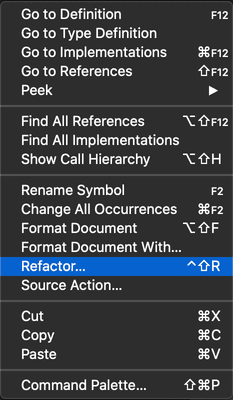
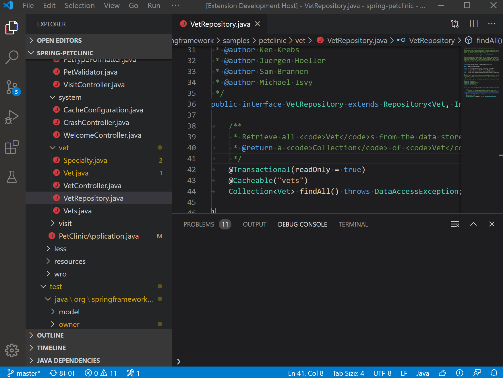

+++
title = "10.6.3 重构 Java"
date = 2026-11-06T07:53:25+08:00
weight = 3
type = "docs"
description = ""
isCJKLanguage = true
draft = false
+++


> 原文链接: [https://code.visualstudio.com/docs/java/java-refactoring](https://code.visualstudio.com/docs/java/java-refactoring)

# 10.6.3 重构 Java

　　VS Code 提供多种源代码重构和源代码操作，用于生成代码和修复问题。看到灯泡 💡 时单击，或右键单击编辑器选择 **源代码操作...**。

## 支持的代码操作列表 {#list-of-supported-code-actions}

* [重构](#refactoring)
  * [分配给变量](#assign-to-variable)
  * [匿名类转换为嵌套类](#convert-anonymous-to-nested-class)
  * [转换为匿名类创建](#convert-to-anonymous-class-creation)
  * [转换为增强 for 循环](#convert-to-enhanced-for-loop)
  * [转换为 lambda 表达式](#convert-to-lambda-expression)
  * [转换为静态导入](#convert-to-static-import)
  * 提取重构：常量、字段、方法、局部变量
  * 内联重构：常量、局部变量、方法
  * 反转布尔：条件、局部变量
  * [移动](#move)
  * [重命名](#rename)
  * 类型变更：解析类型转 `var`、`var` 转解析类型
* [源代码操作](#source-actions)
  * 生成构造函数、委托方法、重写/实现方法
  * 组织导入
  * 生成 getter/setter、`hashCode()`/`equals()`、`toString()`
  * 尽可能将修饰符改为 `final`
* 其他：修复不可访问引用、创建不存在的包等

## 重构 {#refactoring}

　　Java 重构的目标是在不改变程序行为的情况下进行系统级代码更改。Java 语言支持提供多种重构选项。

### 调用重构 {#invoke-refactoring}

重构命令在编辑器上下文菜单中。选择要重构的元素，右键选择 **重构...**：



### 分配给变量 {#assign-to-variable}

将表达式赋给局部变量或字段。

**之前：**

```java
Arrays.asList("apple", "lemon", "banana");
```

**之后：**

```java
List<String> fruits = Arrays.asList("apple", "lemon", "banana");
```

还可以将构造函数中未使用的参数赋给新字段。

<video src="https://code.visualstudio.com/assets/docs/java/java-refactoring/assign-to-field.mp4" autoplay loop muted playsinline controls title="将参数赋给新字段"></video>

### 匿名类转换为嵌套类 {#convert-anonymous-to-nested-class}

将匿名内部类转换为成员类。

**之前：**

```java
public class Clazz {
  public Interface method() {
    final boolean isValid = true;
    return new Interface() {
      public boolean isValid() {
        return isValid;
      }
    };
  }
}
```

**之后：**

```java
public class Clazz {
  private final class MyInterface extends Interface {
    private final boolean isValid;

    private MyInterface(boolean isValid) {
      this.isValid = isValid;
    }

    public boolean isValid() {
      return isValid;
    }
  }

  public Interface method() {
    final boolean isValid = true;
    return new MyInterface(isValid);
  }
}
```

### 转换为匿名类创建 {#convert-to-anonymous-class-creation}

将 lambda 表达式转换为匿名类。

**之前：**

```java
public void method() {
  Runnable runnable = () -> {
    // 执行操作
  };
}
```

**之后：**

```java
public void method() {
  Runnable runnable = new Runnable() {
    @Override
    public void run() {
      // 执行操作
    }
  };
}
```

### 转换为增强 for 循环 {#convert-to-enhanced-for-loop}

将简单 `for` 循环转换为 `for-each` 风格。

**之前：**

```java
public void order(String[] books) {
  for (int i = 0; i < books.length; i++) {
    // 执行操作
  }
}
```

**之后：**

```java
public void order(String[] books) {
  for (String book : books) {
    // 执行操作
  }
}
```

<video src="https://code.visualstudio.com/assets/docs/java/java-refactoring/convert-for-loop.mp4" autoplay loop muted playsinline controls title="转换为增强 for 循环"></video>

### 转换为 lambda 表达式 {#convert-to-lambda-expression}

将匿名类创建转换为 lambda 表达式。

**之前：**

```java
public void method() {
  Runnable runnable = new Runnable(){
    @Override
    public void run() {
      // 执行操作
    }
  };
}
```

**之后：**

```java
public void method() {
    Runnable runnable = () -> {
      // 执行操作
    };
  }
```

### 转换为静态导入 {#convert-to-static-import}

将字段或方法转换为静态导入。

**之前：**

```java
import org.junit.Assert;
...
public void test() {
  Assert.assertEquals(expected, actual);
}
```

**之后：**

```java
import static org.junit.Assert.assertEquals;
...
public void test() {
  assertEquals(expected, actual);
}
```

<video src="https://code.visualstudio.com/assets/docs/java/java-refactoring/convert-static-imports.mp4" autoplay loop muted playsinline controls title="转换为静态导入"></video>

### 提取为常量 {#extract-to-constant}

从选中表达式创建 `static final` 字段，并用字段引用替换相同表达式。

**之前：**

```java
public double getArea(double r) {
  return 3.14 * r * r;
}
```

**之后：**

```java
private static final double PI = 3.14;

public double getArea(double r) {
  return PI * r * r;
}
```

### 提取为字段 {#extract-to-field}

声明新字段并用选中表达式初始化，原表达式替换为字段引用。

**之前：**

```java
class Square {
  public void calculateArea() {
    int height = 1;
    int width = 2;
    int area = height * width;
  }
}
```

**之后：**

```java
class Square {
  private int area;

  public void calculateArea() {
    int height = 1;
    int width = 2;
    area = height * width;
  }
}
```

<video src="https://code.visualstudio.com/assets/docs/java/java-refactoring/extract-field.mp4" autoplay loop muted playsinline controls title="提取为字段"></video>

选择变量声明时，可以将变量转换为字段。

<video src="https://code.visualstudio.com/assets/docs/java/java-refactoring/convert-field.mp4" autoplay loop muted playsinline controls title="将变量转换为字段"></video>

### 提取为方法 {#extract-to-method}

创建包含选中语句或表达式的新方法，并用方法调用替换选择。适合清理冗长复杂的方法。

**之前：**

```java
public void method() {
  int height = 1;
  int width = 2;
  int area = height * width;
}
```

**之后：**

```java
public void method() {
  int height = 1;
  int width = 2;
  int area = getArea(height, width);
}

private int getArea(int height, int width) {
  return height * width;
}
```

<video src="https://code.visualstudio.com/assets/docs/java/java-refactoring/refactor.mp4" autoplay loop muted playsinline controls title="提取为方法"></video>

### 提取为局部变量 {#extract-to-local-variable}

创建新变量并赋值为选中表达式，用新变量替换选择。

**之前：**

```java
public void method() {
  if (platform.equalsIgnoreCase("MAC")) {
    // 执行操作
  }
}
```

**之后：**

```java
public void method() {
  boolean isMac = platform.equalsIgnoreCase("MAC");
  if (isMac) {
    // 执行操作
  }
}
```

<video src="https://code.visualstudio.com/assets/docs/java/java-refactoring/extract-local-variable.mp4" autoplay loop muted playsinline controls title="提取为局部变量"></video>

提取后可以在同一事务中重命名。

<video src="https://code.visualstudio.com/assets/docs/java/java-refactoring/extract-rename.mp4" autoplay loop muted playsinline controls title="提取后重命名局部变量"></video>

### 内联常量 {#inline-constant}

用常量定义的值替换常量引用。

**之前：**

```java
private static final double PI = 3.14;

public double getArea(double r) {
  return PI * r * r;
}
```

**之后：**

```java
private static final double PI = 3.14;

public double getArea(double r) {
  return 3.14 * r * r;
}
```

### 内联局部变量 {#inline-local-variable}

用初始化表达式替换冗余变量。

**之前：**

```java
public void method() {
  boolean isMac = platform.equalsIgnoreCase("MAC");
  if (isMac) {
    // 执行操作
  }
}
```

**之后：**

```java
public void method() {
  if (platform.equalsIgnoreCase("MAC")) {
    // 执行操作
  }
}
```

### 内联方法 {#inline-method}

用方法体替换方法调用。

**之前：**

```java
public void method() {
  int height = 1;
  int width = 2;
  int area = getArea(height, width);
}

private int getArea(int height, int width) {
  return height * width;
}
```

**之后：**

```java
public void method() {
  int height = 1;
  int width = 2;
  int area = height * width;
}
```

<video src="https://code.visualstudio.com/assets/docs/java/java-refactoring/inline.mp4" autoplay loop muted playsinline controls title="用方法体替换方法调用"></video>

### 反转条件 {#invert-conditions}

反转条件中的布尔表达式。

**之前：**

```java
public void method(int value) {
  if (value > 5 && value < 15) {
    // 执行操作
  }
}
```

**之后：**

```java
public void method(int value) {
  if (value <= 5 || value >= 15) {
    // 执行操作
  }
}
```

### 反转局部变量 {#invert-local-variable}

反转局部布尔变量。

**之前：**

```java
public void method(int value) {
  boolean valid = value > 5 && value < 15;
}
```

**之后：**

```java
public void method(int value) {
  boolean notValid = value <= 5 || value >= 15;
}
```

<video src="https://code.visualstudio.com/assets/docs/java/java-refactoring/invert-variable.mp4" autoplay loop muted playsinline controls title="反转局部变量"></video>

### 移动 {#move}

移动选中元素并修正所有引用（包括其他文件）：

* 将类移到另一个包。
* 将静态或实例方法移到另一个类。
* 将内部类移到新文件。

**之前：**

```java
public class Office {
  public static void main(String[] args) {
    print();
  }

  public static void print() {
    System.out.println("This is printer");
  }

  static class Printer { }
}
```

**之后：**

```java
public class Office {
  public static void main(String[] args) {
    Printer.print();
  }

  static class Printer {
    public static void print() {
      System.out.println("This is printer");
    }
  }
}
```

<video src="https://code.visualstudio.com/assets/docs/java/java-refactoring/move-static-method.mp4" autoplay loop muted playsinline controls title="移动静态方法"></video>

<video src="https://code.visualstudio.com/assets/docs/java/java-refactoring/move-class.mp4" autoplay loop muted playsinline controls title="将类移到另一个包"></video>

<video src="https://code.visualstudio.com/assets/docs/java/java-refactoring/move-inner-type.mp4" autoplay loop muted playsinline controls title="将内部类移到新文件"></video>

### 重命名 {#rename}

默认快捷键 `F2`。重命名选中元素并修正所有引用（包括其他文件）。

**之前：**

```java
public class Foo {
  // ...
}

public void myMethod() {
  Foo myClass = new Foo();
}
```

**之后：**

```java
public class Bar {
  // ...
}

public void myMethod() {
  Bar myClass = new Bar();
}
```

<video src="https://code.visualstudio.com/assets/docs/java/java-refactoring/rename.mp4" autoplay loop muted playsinline controls title="重命名重构快捷键"></video>

文件资源管理器中的文件夹和文件也支持重命名，会先预览受影响文件。



### 将解析类型改为 var 类型 {#change-resolved-type-to-var-type}

**之前：**

```java
String s = "";
```

**之后：**

```java
var s = "";
```

### 将 var 类型改为解析类型 {#change-var-type-to-resolved-type}

**之前：**

```java
var s = "";
```

**之后：**

```java
String s = "";
```

## 源代码操作 {#source-actions}

源代码操作生成常见代码结构和重复元素，部分也是快速修复。

### 生成构造函数 {#generate-constructors}

为类添加构造函数。

<video src="https://code.visualstudio.com/assets/docs/java/java-refactoring/generate-constructor.mp4" autoplay loop muted playsinline controls title="生成构造函数"></video>

### 生成委托方法 {#generate-delegate-methods}

生成委托方法。

<video src="https://code.visualstudio.com/assets/docs/java/java-refactoring/generate-delegate-methods.mp4" autoplay loop muted playsinline controls title="生成委托方法"></video>

### 重写/实现方法 {#overrideimplement-methods}

显示所有候选项的检查列表，选择要重写或实现的方法。

<video src="https://code.visualstudio.com/assets/docs/java/java-refactoring/override-implement-methods.mp4" autoplay loop muted playsinline controls title="重写/实现方法"></video>

### 组织导入 {#organize-imports}

清理导入，处理有歧义的导入（显示下拉列表选择），并显示未解析类型的代码行。

<video src="https://code.visualstudio.com/assets/docs/java/java-refactoring/resolve-ambiguous-imports.mp4" autoplay loop muted playsinline controls title="组织导入"></video>

### 生成 getter 和 setter {#generate-getters-and-setters}

批量生成 getter 和 setter。类有多个字段时会显示快速选择，选择目标字段。

<video src="https://code.visualstudio.com/assets/docs/java/java-refactoring/advancedgettersetter.mp4" autoplay loop muted playsinline controls title="生成 getter 和 setter"></video>

### 生成 `hashCode()` 和 `equals()` {#generate-hashcode-and-equals}

生成默认实现，列出所有非静态成员变量并可通过检查列表自定义。

选项：

* Java 7+ 设置 `java.codeGeneration.hashCodeEquals.useJava7Objects` 为 `true`，生成调用 `Objects.hash` 和 `Objects.equals` 的简短代码。
* 设置 `java.codeGeneration.hashCodeEquals.useInstanceof` 为 `true`，使用 `instanceof` 而不是 `Object.getClass()` 检查类型。

<video src="https://code.visualstudio.com/assets/docs/java/java-refactoring/generate-hashcode-equals.mp4" autoplay loop muted playsinline controls title="生成 hashCode() 和 equals()"></video>

### 生成 `toString()` {#generate-tostring}

生成 `toString()` 方法，可通过成员变量检查列表自定义。

<video src="https://code.visualstudio.com/assets/docs/java/java-refactoring/generate-tostring.mp4" autoplay loop muted playsinline controls title="生成 toString()"></video>

### 尽可能将修饰符改为 final {#change-modifiers-to-final-where-possible}

为当前源文件所有变量和参数添加 `final`。

**之前：**

```java
public class Clazz {
  public void method(int value) {
    boolean notValid = value > 5;
    if (notValid) {
      // 执行操作
    }
  }
}
```

**之后：**

```java
public class Clazz {
  public void method(final int value) {
    final boolean notValid = value > 5;
    if (notValid) {
      // 执行操作
    }
  }
}
```

### 修复不可访问引用 {#fix-non-accessible-reference}

快速修复不可访问的引用。

<video src="https://code.visualstudio.com/assets/docs/java/java-refactoring/fix-non-access-reference.mp4" autoplay loop muted playsinline controls title="修复不可访问引用"></video>

### 创建不存在的包 {#create-non-existing-package}

包名与文件夹名不匹配时，可以修改源代码中的包名，或将文件夹移动到文件系统（目标文件夹可以不存在）。

<video src="https://code.visualstudio.com/assets/docs/java/java-refactoring/create-non-exist-package.mp4" autoplay loop muted playsinline controls title="创建不存在的包"></video>

### 其他支持的代码操作 {#other-code-actions-supported}

* 创建未解析类型
* 移除 `final` 修饰符
* 移除不必要的强制转换
* 移除冗余接口
* 在 switch 语句中添加缺失的 case 标签
* 在 break/continue 上转到定义
* 修正静态元素访问
