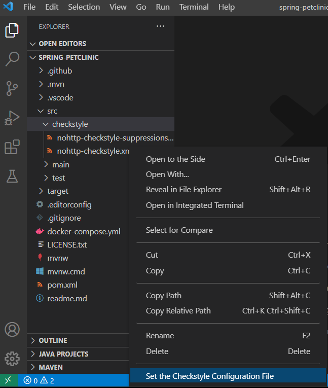
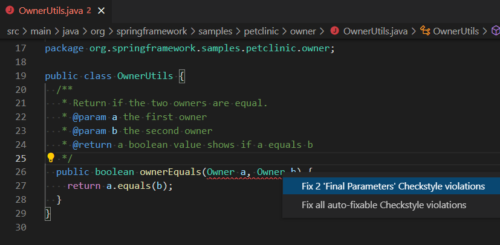

+++
title = "10.6.4 Java 格式化和 Lint"
date = 2026-11-06T07:53:25+08:00
weight = 4
type = "docs"
description = ""
isCJKLanguage = true
draft = false
+++


> 原文链接: [https://code.visualstudio.com/docs/java/java-linting](https://code.visualstudio.com/docs/java/java-linting)

# 10.6.4 Java 格式化和 Lint

　　[Language Support for Java™ by Red Hat](https://marketplace.visualstudio.com/items?itemName=redhat.java)提供[格式化设置](https://github.com/redhat-developer/vscode-java/wiki/Formatter-settings)，可以导出 Eclipse 格式化文件并在 VS Code 项目中使用。

此外，[Checkstyle for Java](https://marketplace.visualstudio.com/items?itemName=shengchen.vscode-checkstyle)和 [SonarLint](https://marketplace.visualstudio.com/items?itemName=SonarSource.sonarlint-vscode)扩展提供实时 Lint 和代码分析。

## 格式化程序 {#formatter}

可以使用 **格式化文档** 命令格式化 Java 文件。未指定格式化配置文件时使用默认设置。

<video src="https://code.visualstudio.com/assets/docs/java/java-linting/formatting.mp4" autoplay loop muted playsinline controls title="格式化文档"></video>

### 应用格式化设置 {#applying-formatter-settings}

可以从 Eclipse 方案的现有配置文件应用格式化设置。例如为 Java 项目应用 [Google Style](https://raw.githubusercontent.com/google/styleguide/gh-pages/eclipse-java-google-style.xml)，在 `settings.json` 中设置：

```json
"java.format.settings.url": "https://raw.githubusercontent.com/google/styleguide/gh-pages/eclipse-java-google-style.xml",
```

属性可以是 URL 或本地文件路径。XML 包含多个配置文件时可以指定名称：

```json
"java.format.settings.profile": "GoogleStyle",
```

设置后 **格式化文档** 会使用指定配置文件。

### 编辑格式化设置 {#editing-formatter-settings}

　　Extension Pack for Java 提供编辑器帮助修改现有格式化配置文件。使用 **Java: Open Java Formatter Settings with Preview** 命令打开。可以修改设置并在右侧 **预览** 面板查看效果，保存后写入配置文件。

<video src="https://code.visualstudio.com/assets/docs/java/java-linting/formatting-editing.mp4" autoplay loop muted playsinline controls title="编辑格式化设置"></video>

> **注意**：格式化设置编辑器仅支持本地配置文件。工作区包含远程配置时，会引导下载到 `.vscode` 文件夹。

<video src="https://code.visualstudio.com/assets/docs/java/java-linting/formatting-preview.mp4" autoplay loop muted playsinline controls title="预览格式化效果"></video>

也可以撤销和重做更改。

<video src="https://code.visualstudio.com/assets/docs/java/java-linting/formatting-undoredo.mp4" autoplay loop muted playsinline controls title="撤销和重做格式化更改"></video>

## SonarLint {#sonarlint}

　　[SonarLint](https://marketplace.visualstudio.com/items?itemName=SonarSource.sonarlint-vscode)帮助在编码时发现并修复缺陷和安全问题。扩展在后台运行，像拼写检查器一样高亮质量或安全问题，并提供上下文指导、原因和修复示例。支持 [500 多条 Java 规则](https://rules.sonarsource.com/java)和多个[快速修复](https://rules.sonarsource.com/java/quickfix)。

### 实时代码分析 {#code-analysis-on-the-fly}

问题在编辑器中高亮，悬停显示详细说明。

<video src="https://code.visualstudio.com/assets/docs/java/java-linting/sonarlint.mp4" autoplay loop muted playsinline controls title="实时代码分析"></video>

打开文件中的问题也可以在 **问题** 面板查看。适用时会显示次要代码位置，帮助理解问题来源（例如导致缺陷的代码路径）。

### 规则文档和修复指导 {#rule-documentation-and-remediation-guidance}

SonarLint 为检测到的问题提供完整规则文档和相关最佳实践，帮助理解问题原因和修复方法。

<video src="https://code.visualstudio.com/assets/docs/java/java-linting/sonarlint-description.mp4" autoplay loop muted playsinline controls title="规则文档和修复指导"></video>

### 启用更多质量和安全规则 {#enabling-more-quality-and-security-rules}

默认提供大量缺陷和漏洞规则，可以通过 **SonarLint Rules** 视图启用更多检查。

<video src="https://code.visualstudio.com/assets/docs/java/java-linting/sonarlint-rules.mp4" autoplay loop muted playsinline controls title="启用更多质量和安全规则"></video>

详情请参阅 [SonarLint 网站](https://www.sonarlint.org/vscode/)。

## Checkstyle {#checkstyle}

　　[Checkstyle for Java](https://marketplace.visualstudio.com/items?itemName=shengchen.vscode-checkstyle)扩展可以使用现有 `checkstyle` 配置（Google 或 Sun Check）或自定义文件。编辑 Java 文件时会检查格式并提供快速修复。

使用 **Checkstyle: Set the Checkstyle Configuration File** 命令设置配置文件。

<video src="https://code.visualstudio.com/assets/docs/java/java-linting/checkstyle.mp4" autoplay loop muted playsinline controls title="设置 Checkstyle 配置文件"></video>

支持实时 Lint：

<video src="https://code.visualstudio.com/assets/docs/java/java-linting/checkstyle-live-linting.mp4" autoplay loop muted playsinline controls title="实时 Lint"></video>

以及批量检查：

<video src="https://code.visualstudio.com/assets/docs/java/java-linting/checkstyle-batch.mp4" autoplay loop muted playsinline controls title="批量检查"></video>

单击状态栏 Checkstyle 图标会打开 **问题** 面板。

### 设置 Checkstyle 配置文件 {#set-checkstyle-configuration-file}

右键单击 `.xml` 文件，选择 **Set the Checkstyle Configuration File**。



也可以运行 **Checkstyle: Set Checkstyle Configuration File** 命令选择文件。扩展会查找工作区中的 `checkstyle.xml`，并提供两个内置配置：

* **Google's Check**
* **Sun's Check**

命令会检测潜在配置文件并列出，也可以直接输入 URL。

<video src="https://code.visualstudio.com/assets/docs/java/java-linting/checkstyle-configuration.mp4" autoplay loop muted playsinline controls title="设置 Checkstyle 配置"></video>

使用 **Checkstyle: Set the Checkstyle Version** 命令设置版本：

* 列出主仓库最新版本。
* 列出已下载版本。
* 列出所有支持版本。
* 用勾号标记当前版本。

可以通过配置路径引入第三方模块。例如添加：

```json
"java.checkstyle.modules": [ "${workspaceFolder}/src/main/resources/sevntu-checks-1.35.0.jar" ]
```

之后可以在 `checkstyle.xml` 中使用 `<module name="SingleBreakOrContinueCheck"/>` 或完整类名。

### 检查样式并修复违规 {#check-the-style-and-fix-the-violations}

编辑 Java 文件时扩展会检查格式并提供快速修复。单击编辑器灯泡查看可用修复。



详情请参阅 [Checkstyle for Java GitHub 仓库](https://github.com/jdneo/vscode-checkstyle)。
