+++
title = "10.6.5 管理 Java 项目"
date = 2026-11-06T07:53:25+08:00
weight = 5
type = "docs"
description = ""
isCJKLanguage = true
draft = false
+++


> 原文链接: [https://code.visualstudio.com/docs/java/java-project](https://code.visualstudio.com/docs/java/java-project)

# 10.6.5 管理 Java 项目

　　[Project Manager for Java](https://marketplace.visualstudio.com/items?itemName=vscjava.vscode-java-dependency)扩展帮助管理 Java 项目及依赖，也可以创建新项目、包和类。安装 [Extension Pack for Java](https://marketplace.visualstudio.com/items?itemName=vscjava.vscode-java-pack)获得完整 Java 支持。

## 项目视图 {#projects-view}

　　**Java Projects** 视图显示 Java 项目及依赖，并提供项目管理任务入口。

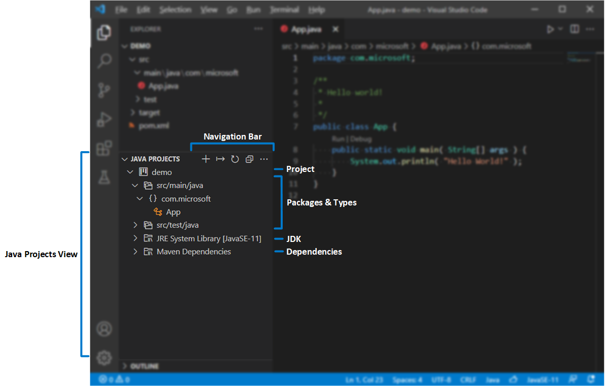

> 默认显示在 **资源管理器** 下方。看不到时单击 **资源管理器** 标题栏 `...` 按钮，选择 **Java Projects**。

导航栏溢出按钮提供更多选项，例如在层次视图和平面视图间切换。

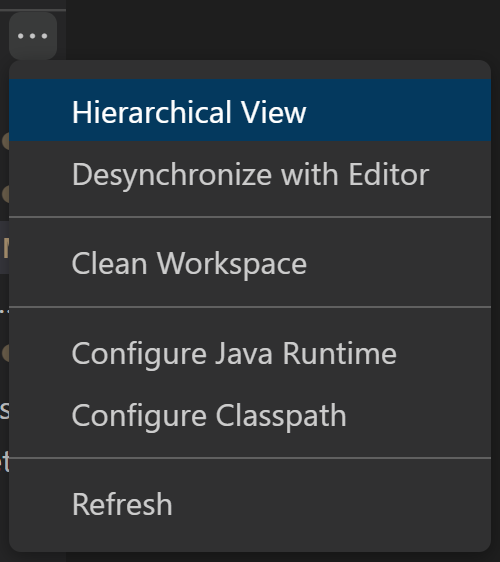

资源管理器节点旁有快捷操作按钮：


节点上下文菜单也提供许多功能：

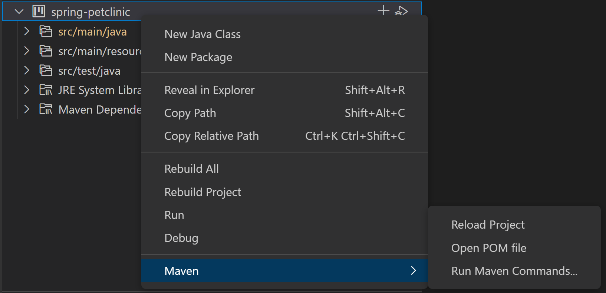

### 创建新的 Java 项目 {#create-a-new-java-project}

单击导航栏 **+**，或从命令面板运行 **Java: Create Java Project...**。创建时 VS Code 会根据项目类型提示安装所需扩展。

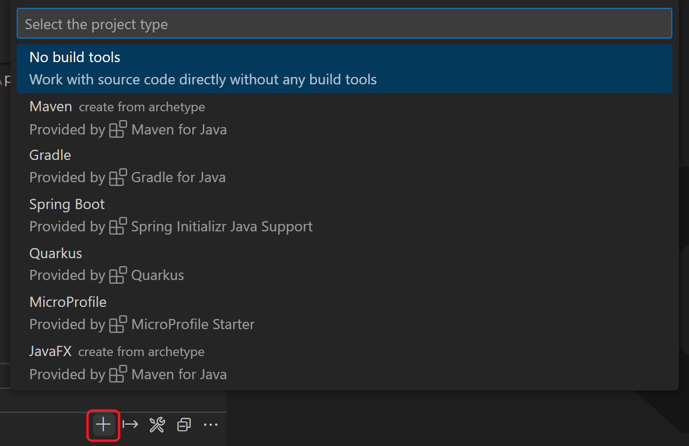

### 导入 Java 项目 {#import-java-projects}

通过 **文件 > 打开文件夹...** 直接导入现有 Java 项目或模块（文件夹需包含 `pom.xml`、`build.gradle` 等构建脚本）。VS Code 会自动检测并导入。

添加新模块后，可以运行 **Java: Import Java projects in workspace** 导入，无需重新加载窗口。

### 导出为 JAR {#export-to-jar}

可以在项目视图导出构建，或运行 **Java: Export Jar...**。

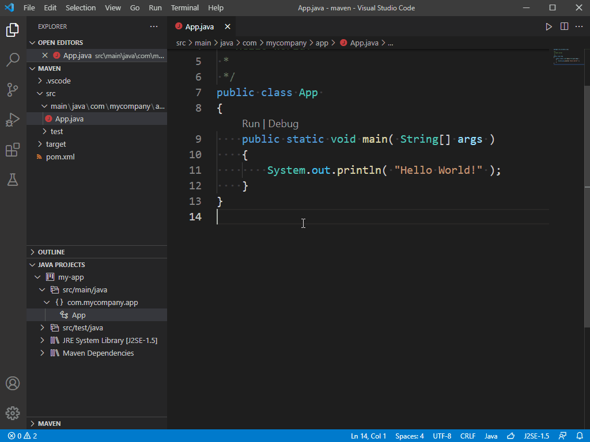

## 为项目配置运行时 {#configure-runtime-for-projects}

　　开发者常使用多个 JDK 版本，可以通过 `java.configuration.runtimes` 将版本映射到本地安装路径：

```json
"java.configuration.runtimes": [
  {
    "name": "JavaSE-1.8",
    "path": "/usr/local/jdk1.8.0_201"
  },
  {
    "name": "JavaSE-11",
    "path": "/usr/local/jdk-11.0.3",
    "sources" : "/usr/local/jdk-11.0.3/lib/src.zip",
    "javadoc" : "https://docs.oracle.com/en/java/javase/11/docs/api",
    "default":  true
   },
   {
    "name": "JavaSE-12",
    "path": "/usr/local/jdk-12.0.2"
   },
   {
    "name": "JavaSE-13",
    "path": "/usr/local/jdk-13"
   }
]
```

> **注意**：添加 `"default": true` 可设为默认，默认 JDK 用于没有构建工具的未管理文件夹。

运行 **Java: Configure Java Runtime** 命令查看项目使用的 JDK：

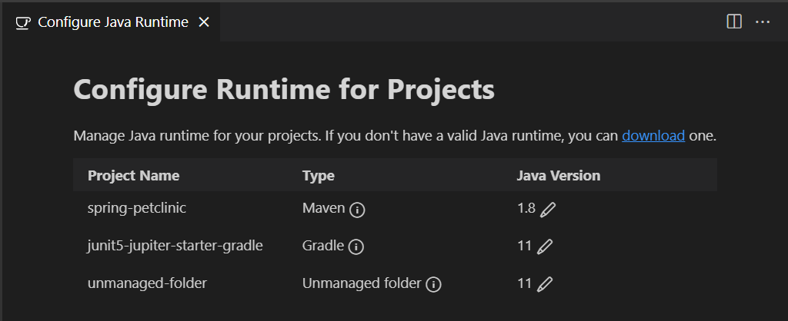

### 更改 Maven 和 Gradle 项目的 JDK {#change-jdk-for-maven-and-gradle-projects}

Maven 或 Gradle 项目需要在构建脚本（`pom.xml` 或 `build.gradle`）中修改 JDK 版本。单击信息图标查看修改方法，单击编辑图标导航到构建脚本。

### 更改未管理文件夹的 JDK {#change-jdk-for-unmanaged-folders}

单击编辑按钮，会列出所有 JDK，为未管理文件夹选择。

### 下载 JDK {#download-jdks}

单击 `download` 链接，或运行 **Java: Install New JDK** 命令，打开 JDK 下载视图。

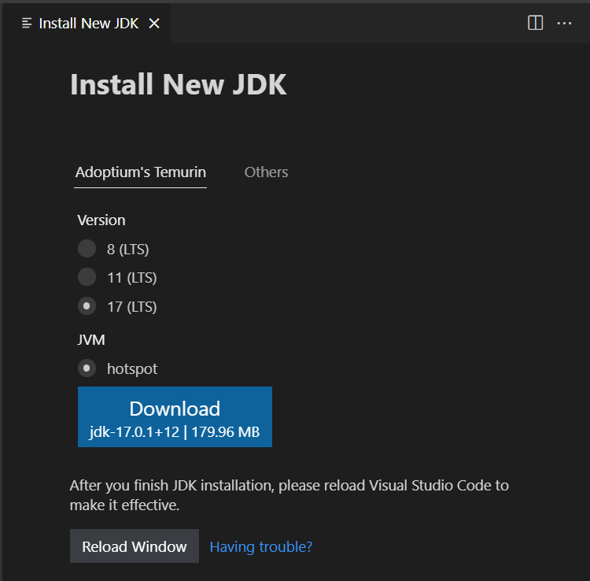

> **注意**：启用 Java 预览功能请参阅[如何使用新 Java 版本](10.6.15-FAQ/#how-can-i-use-visual-studio-code-with-new-java-versions)。

## 为未管理文件夹配置类路径 {#configure-classpath-for-unmanaged-folders}

　　项目扩展提供类路径配置 UI。运行 **Java: Configure Classpath** 命令打开：

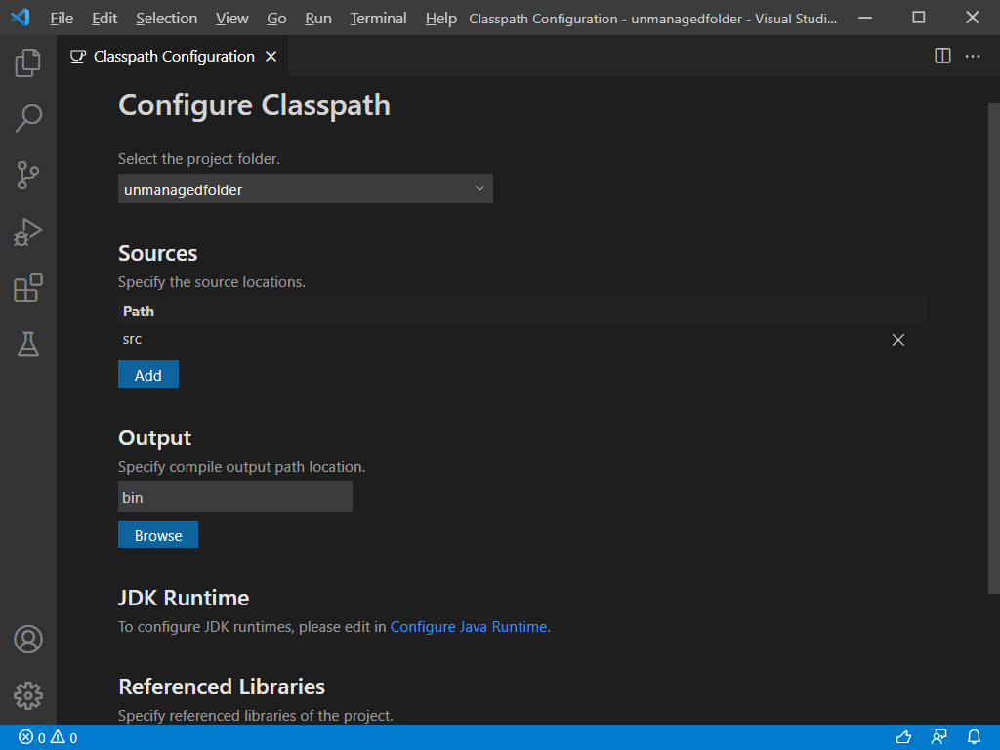

少数情况下需要运行 **Java: Clean Java Language Server Workspace** 清理工作区，让语言服务器重建依赖。

## 依赖管理 {#dependency-management}

### 添加 Maven 依赖 {#add-a-maven-dependency}

Maven 项目中单击 **Maven Dependencies** 节点旁的 **+** 图标。

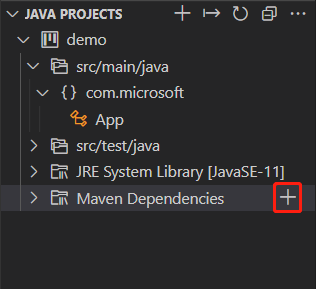

### 管理未管理文件夹的依赖 {#manage-dependencies-for-unmanaged-folder}

没有构建工具的未管理文件夹中，可以通过 **Referenced Libraries** 节点上的 **+**/**-** 图标管理依赖，也可以直接将 JAR 拖到该节点。

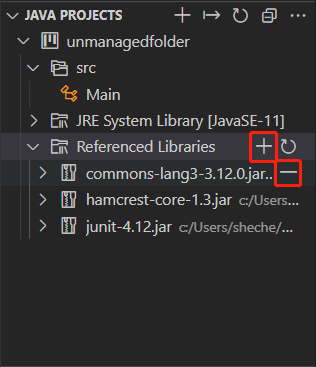

> 也可以在类路径配置页面管理依赖。

底层设置是 `settings.json` 中的 `java.project.referencedLibraries`。

**包含库**

使用 glob 模式描述库：

```json
"java.project.referencedLibraries": [
    "library/**/*.jar",
    "/home/username/lib/foo.jar"
]
```

这会添加工作区 `library` 文件夹中所有 `.jar` 以及指定绝对路径的 `foo.jar`。VS Code 会监视这些文件，变化时刷新项目。默认使用 `lib/**/*.jar` 引用 `lib` 目录中的所有 JAR。

**排除库**

使用 `include`/`exclude` 字段：

```json
"java.project.referencedLibraries": {
    "include": [
        "library/**/*.jar",
        "/home/username/lib/foo.jar"
    ],
    "exclude": [
        "library/sources/**"
    ]
}
```

**附加源 JAR**

默认会在同一目录查找 `{binary}-sources.jar` 并附加。也可以手动指定：

```json
"java.project.referencedLibraries": {
    "include": [
        "library/**/*.jar",
        "/home/username/lib/foo.jar"
    ],
    "exclude": [
        "library/sources/**"
    ],
    "sources": {
        "library/bar.jar": "library/sources/bar-src.jar"
    }
}
```

## 轻量模式 {#lightweight-mode}

　　VS Code Java 支持轻量模式和标准模式。轻量模式只解析源文件和 JDK；标准模式解析导入依赖并构建项目。轻量模式适合快速阅读源代码、导航、查看大纲和 Javadoc、检测语法错误，代码补全限于源文件和 JDK。

轻量模式不支持运行、调试、重构、Lint 或检测语义错误。需要这些功能时请切换到标准模式。

通过 `java.server.launchMode` 配置：

* `Hybrid`（默认）：先以轻量模式打开；存在未解析 Java 项目时询问是否切换标准模式。选择 **Later** 保持轻量模式，可以单击状态栏语言项手动切换。
* `Standard`：以标准模式打开。
* `LightWeight`：以轻量模式打开，可以单击状态栏语言项切换。

状态栏语言项图标表示当前模式：

* 括号圆点：轻量模式。
* 同步图标：正在以标准模式打开。
* 命名空间图标：标准模式。

单击语言项切换到标准模式。

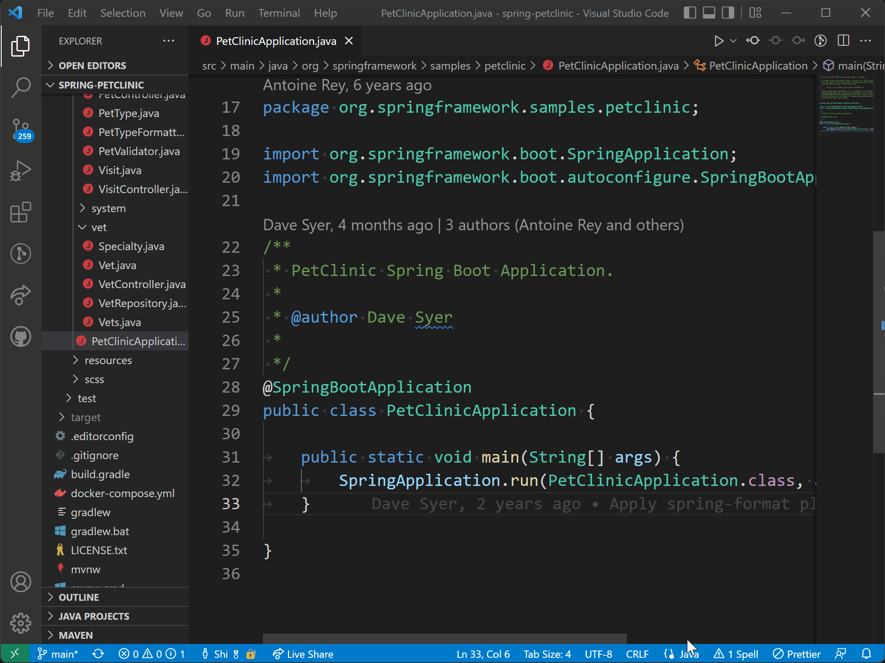

## 构建状态 {#build-status}

编辑 Java 源代码时，语言服务器会构建工作区以提供语言功能。单击状态栏语言项查看详细构建任务状态。语言服务器打开 Java 项目时，通知中的 **check details** 链接也可以查看状态。

<video src="https://code.visualstudio.com/assets/docs/java/java-project/java.build.status.mp4" autoplay loop muted playsinline controls title="Java 项目构建状态"></video>

### 其他资源 {#additional-resources}

* [Maven for Java](https://marketplace.visualstudio.com/items?itemName=vscjava.vscode-maven)
* [Gradle for Java](https://marketplace.visualstudio.com/items?itemName=vscjava.vscode-gradle)
* [Bazel for Java](https://marketplace.visualstudio.com/items?itemName=sfdc.bazel-vscode-java)

遇到问题可以在 [vscode-java-pack](https://github.com/microsoft/vscode-java-pack/issues) 创建议题。

## 后续步骤 {#next-steps}

* [编辑 Java](10.6.2-Editing/)
* [调试 Java](10.6.7-Debugging/)
* [测试 Java](10.6.8-Testing/)
* [Java 扩展](10.6.14-Extensions/)
