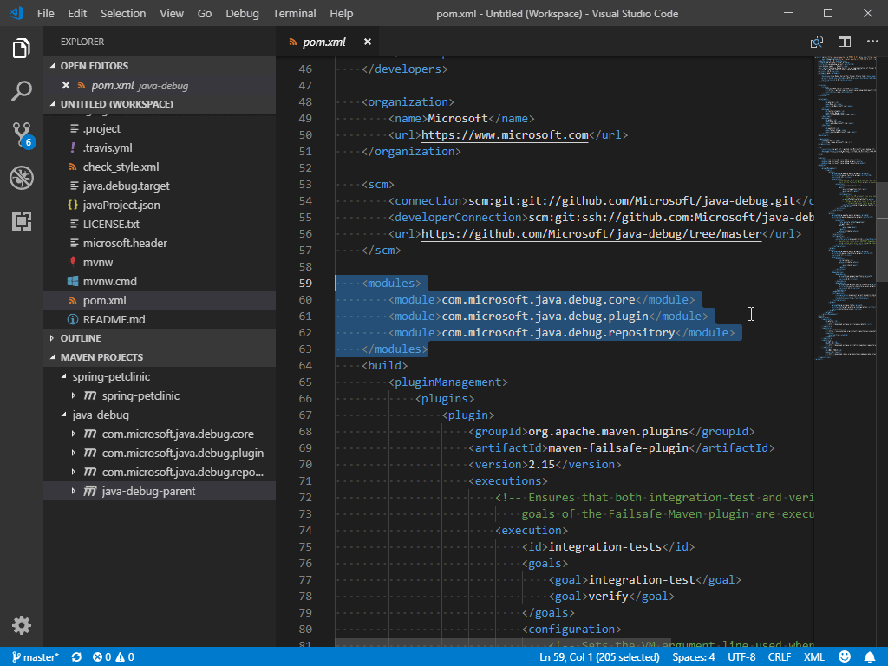
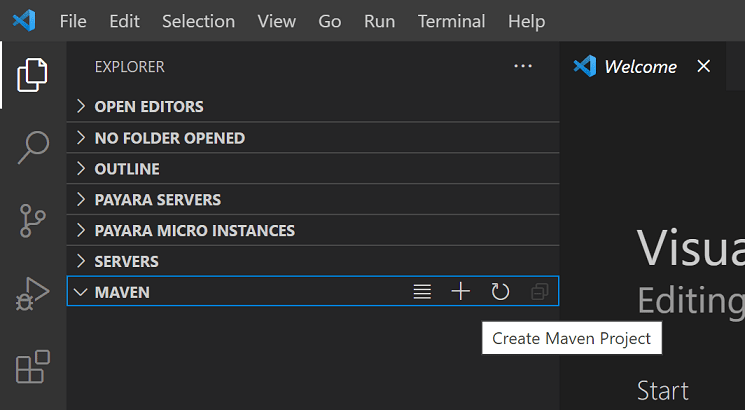
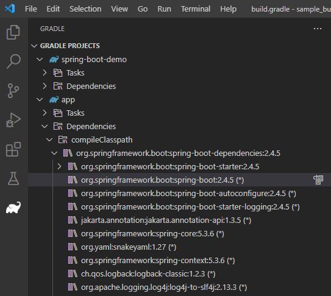
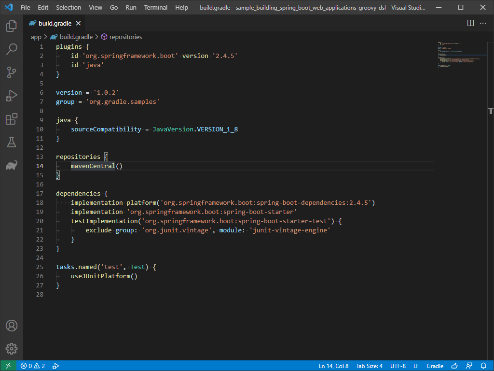
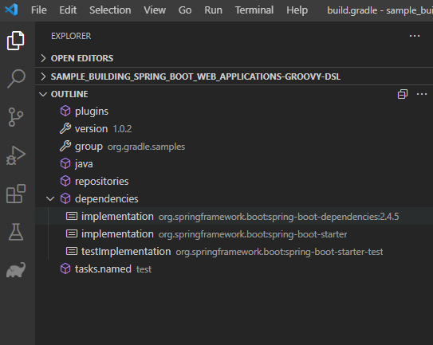
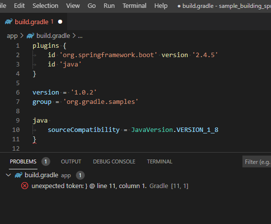

+++
title = "10.6.6 Java 构建工具"
date = 2026-11-06T07:53:25+08:00
weight = 6
type = "docs"
description = ""
isCJKLanguage = true
draft = false
+++

> 原文链接: [https://code.visualstudio.com/docs/java/java-build](https://code.visualstudio.com/docs/java/java-build)

# 10.6.6 Java 构建工具

　　本文介绍在 VS Code 中使用 [Maven for Java](https://marketplace.visualstudio.com/items?itemName=vscjava.vscode-maven)和 [Gradle for Java](https://marketplace.visualstudio.com/items?itemName=vscjava.vscode-gradle)扩展。

遇到问题可以在 [vscode-java-pack](https://github.com/microsoft/vscode-java-pack/issues) 创建议题。

## Maven {#maven}

　　[Maven](https://maven.apache.org/)是管理 Java 项目和自动化构建的工具。Maven for Java 扩展提供完整集成，可以浏览项目、执行命令以及构建生命周期和插件目标。建议安装 [Extension Pack for Java](https://marketplace.visualstudio.com/items?itemName=vscjava.vscode-java-pack)。

### 浏览 Maven 项目 {#exploring-maven-project}

加载 Maven 项目后扩展会自动扫描工作区 `pom.xml`，在侧边栏显示所有 Maven 项目及模块。

### 解析未知类型 {#resolve-unknown-type}

扩展支持搜索 Maven Central 解析源代码中的未知类型。悬停时选择 **Resolve unknown type** 链接。

### 使用 POM.xml {#working-with-pomxml}

扩展为添加 Maven 依赖提供代码片段和基于本地仓库的自动补全：

* 在 `pom.xml` 中添加依赖。
* 生成 effective POM。
* 运行 **Maven: Add a Dependency**（`maven.project.addDependency`）交互式添加。
* 通过项目视图添加依赖。
* 在树视图中查看依赖，检查潜在问题。

### 执行 Maven 命令和目标 {#execute-maven-commands-and-goals}

右键单击 Maven 项目运行目标。扩展保留每个项目的目标历史，可以快速重跑：

* 命令面板运行 **Maven: History**，选择项目和命令。
* 右键项目选择 **History**。

也可以在设置中指定常用命令。每个插件也提供访问其目标的入口。右键单击目标并启动调试，扩展会使用正确参数调用 Java 调试器。

### 从 Maven Archetype 生成项目 {#generate-project-from-maven-archetype}

扩展可以从 [Archetype](https://maven.apache.org/guides/introduction/introduction-to-archetypes.html)生成 Maven 项目。加载本地/远程目录中的 archetype 后，会向终端发送 `mvn archetype:generate -D...`。

创建方式：

1. Maven 资源管理器选择 **+ Create Maven Project**：

   

2. 命令面板搜索 **Create Java Project**。
3. 右键目标文件夹选择 **Create Maven Project**。

## Gradle {#gradle}

　　VS Code 通过 [Gradle for Java](https://marketplace.visualstudio.com/items?itemName=vscjava.vscode-gradle)支持 Gradle Java 项目（不含 Android）：

* **Gradle Build Server**：导入项目并将构建任务委托给 Gradle 守护进程，保证输出与命令行一致。
* **可视化界面**：查看和管理 Gradle 任务与项目依赖，直接在 VS Code 运行任务。
* **Gradle 语言服务器**：为构建文件提供语法高亮、错误报告和自动补全。

### Gradle Build Server {#gradle-build-server}

安装扩展后默认使用 Gradle Build Server 导入项目。可以通过 `java.gradle.buildServer.enabled` 开关。

构建输出位于 **Build Server for Gradle (Build)** 输出通道，交互日志位于 **Build Server for Gradle (Log)** 通道。

### 将测试委托给 Gradle {#delegate-tests-to-gradle}

扩展支持将测试执行委托给 Gradle，可以在测试资源管理器中配置测试配置文件。

> **注意**：需要安装 [Test Runner for Java](https://marketplace.visualstudio.com/items?itemName=vscjava.vscode-java-test)扩展。

### 使用 Gradle 任务 {#working-with-gradle-tasks}

打开 Gradle 项目后，单击 Gradle 侧边栏项查看视图。**Gradle Projects** 列出工作区中的所有 Gradle 项目，可以查看、运行或调试任务。

任务很多时，**Pinned Tasks** 视图可以固定常用任务，**Recent Tasks** 视图显示最近执行的任务。

### 查看 Gradle 依赖 {#viewing-gradle-dependencies}

**Gradle Projects** 视图中每个项目下有 **Dependencies** 项，包含指定配置中的所有依赖。

### 管理 Gradle 守护进程 {#managing-gradle-daemons}

**Gradle Daemons** 视图显示当前工作区的守护进程状态，列出与工作区同版本的所有运行中守护进程，可以停止单个或全部。

### 编写构建文件 {#authoring-build-files}

打开 Groovy Gradle 文件时，扩展会分析文件并提供语义标记，实现更精确的高亮：

**大纲** 视图提供文档符号：

语法错误（缺少字符、找不到类型等）显示在 **问题** 视图：

扩展为 Gradle 闭包和属性提供基本自动补全，声明新依赖时提供候选列表。

## 其他资源 {#additional-resources}

Maven 扩展的配置和故障排除请参阅 [GitHub 仓库](https://github.com/microsoft/vscode-maven)。使用 Bazel 时还有 [Bazel 扩展](https://marketplace.visualstudio.com/items?itemName=BazelBuild.vscode-bazel)。

## 后续步骤 {#next-steps}

* [编辑 Java](10.6.2-Editing/)
* [调试 Java](10.6.7-Debugging/)
* [测试 Java](10.6.8-Testing/)
* [Java 扩展](10.6.14-Extensions/)
