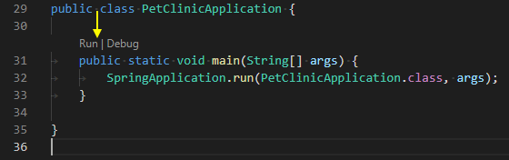
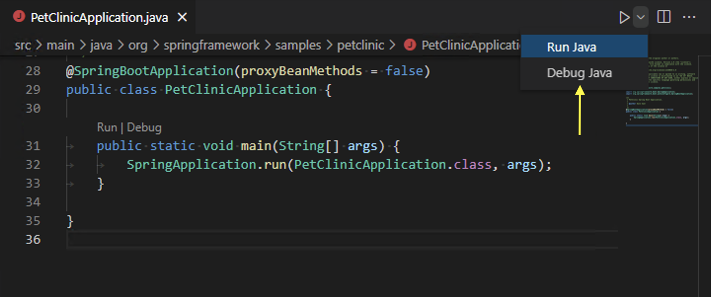
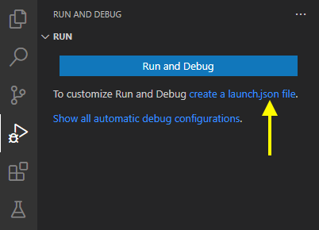
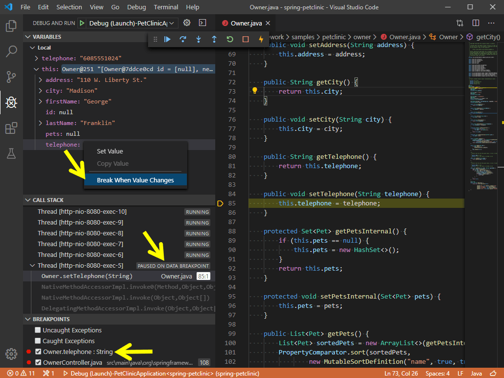

+++
title = "10.6.7 调试 Java"
date = 2026-11-06T07:53:25+08:00
weight = 7
type = "docs"
description = ""
isCJKLanguage = true
draft = false
+++


> 原文链接: [https://code.visualstudio.com/docs/java/java-debugging](https://code.visualstudio.com/docs/java/java-debugging)

# 10.6.7 调试 Java

　　[Debugger for Java](https://marketplace.visualstudio.com/items?itemName=vscjava.vscode-java-debug)扩展支持调试 Java 应用，包括条件断点、数据断点、日志点、表达式求值、Hot Code Replace 和单步过滤。

## 安装 {#install}

安装 [Extension Pack for Java](https://marketplace.visualstudio.com/items?itemName=vscjava.vscode-java-pack)，其中包含 Debugger for Java。

## 配置 {#configure}

在 **运行和调试** 视图选择 **创建 launch.json 文件**，选择 **Java** 环境。VS Code 会根据项目生成默认配置。

## 运行和调试 {#run-and-debug}

### 从 CodeLens 运行 {#run-from-codelens}

编辑器 `main` 方法上方的 **Run|Debug** CodeLens 可以运行或调试：



### 从编辑器菜单运行 {#run-from-editor-menu}

右键单击编辑器，选择 **运行 Java** 或 **调试 Java**。



### 按 F5 运行 {#run-from-pressing-f5}

按 `F5` 或单击 **运行和调试** 视图的绿色箭头：



## 调试单个文件 {#debugging-single-files}

没有项目配置时也可以调试单个 Java 文件。打开文件，设置断点并按 `F5`，VS Code 会使用临时配置启动。

<video src="https://code.visualstudio.com/assets/docs/java/java-debugging/single-file-debugging.mp4" autoplay loop muted playsinline controls title="调试单个文件"></video>

## 调试会话输入 {#debug-session-inputs}

程序使用 `Scanner` 等读取标准输入时，可以在 **调试控制台** 输入，或在 `launch.json` 中设置 `console` 为 `integratedTerminal`。

## 断点 {#breakpoints}

### 条件断点 {#breakpoint---conditional-breakpoint}

右键单击装订线，选择 **添加条件断点**，输入表达式。表达式为真时才暂停。

<video src="https://code.visualstudio.com/assets/docs/java/java-debugging/conditional-bp.mp4" autoplay loop muted playsinline controls title="条件断点"></video>

### 数据断点 {#breakpoint---data-breakpoint}

数据断点在字段被读取或修改时暂停。在 **变量** 视图右键单击字段，选择 **断点 > 数据断点**。



### 日志点 {#breakpoint---logpoints}

日志点在命中时向调试控制台输出消息而不暂停。右键装订线选择 **添加日志点**，消息中可用 `{expression}` 插值。

<video src="https://code.visualstudio.com/assets/docs/java/java-debugging/logpoints.mp4" autoplay loop muted playsinline controls title="日志点"></video>

### 触发断点 {#breakpoint---triggered-breakpoints}

触发断点在另一个断点命中后启用。右键单击字形边距，选择 **添加触发断点**，选择触发它的断点。

<video src="https://code.visualstudio.com/assets/docs/editor/debugging/debug-triggered-breakpoint.mp4" autoplay loop muted playsinline controls title="触发断点"></video>

## 表达式求值 {#expression-evaluation}

调试暂停时，可以在 **监视** 视图或 **调试控制台** 中输入 Java 表达式。支持调用方法、访问字段和创建对象。

<video src="https://code.visualstudio.com/assets/docs/java/java-debugging/expression-evaluation.mp4" autoplay loop muted playsinline controls title="表达式求值"></video>

## Hot Code Replace {#hot-code-replace}

调试会话中修改 Java 源代码并保存时，Debugger for Java 会尝试将新代码替换到运行中的 JVM，无需重启。支持方法体修改；不支持类结构变更（添加/删除方法或字段）。

<video src="https://code.visualstudio.com/assets/docs/java/java-debugging/hcr.mp4" autoplay loop muted playsinline controls title="Hot Code Replace"></video>

## 单步过滤 {#step-filtering}

单步过滤可以跳过不想进入的类或包。在 `launch.json` 中配置 `stepFilters`：

```json
"stepFilters": {
    "classNameFilters": [
        "java.*",
        "javax.*",
        "com.sun.*",
        "sun.*",
        "jdk.*",
        "org.graalvm.*",
        "io.micrometer.shaded.*"
    ],
    "skipSynthetics": false,
    "skipStaticInitializers": true,
    "skipConstructors": true
}
```

也可以在调试时通过 **调试控制台** 或设置动态修改。

<video src="https://code.visualstudio.com/assets/docs/java/java-debugging/step-filter.mp4" autoplay loop muted playsinline controls title="单步过滤"></video>

## 配置选项 {#configuration-options}

### 启动配置 {#launch}

```json
{
    "type": "java",
    "name": "Launch Hello",
    "request": "launch",
    "mainClass": "com.example.Hello",
    "projectName": "hello"
}
```

常用属性：

| 属性 | 说明 |
| --- | --- |
| `mainClass` | 主类全限定名。 |
| `projectName` | 项目名称，用于解析类路径。 |
| `args` | 传给程序的命令行参数，字符串或数组。 |
| `vmArgs` | 传给 JVM 的参数（`-Xmx` 等）。 |
| `cwd` | 程序工作目录。 |
| `env` | 环境变量。 |
| `console` | `internalConsole`、`integratedTerminal`、`externalTerminal`。 |
| `shortenCommandLine` | 长类路径处理方式：`none`、`jarmanifest`、`argfile`。 |
| `modulePaths` | 模块路径。 |
| `classPaths` | 类路径。 |
| `sourcePaths` | 源代码路径。 |
| `preLaunchTask` | 启动前运行的任务。 |
| `noDebug` | 只运行不调试。 |

### 附加配置 {#attach}

```json
{
    "type": "java",
    "name": "Attach to Remote",
    "request": "attach",
    "hostName": "localhost",
    "port": 5005
}
```

远程 JVM 启动时添加：

```bash
java -agentlib:jdwp=transport=dt_socket,server=y,suspend=n,address=*:5005 -jar app.jar
```

### 用户设置 {#user-settings}

| 设置 | 说明 |
| --- | --- |
| `java.debug.settings.hotCodeReplace` | Hot Code Replace 行为：`manual`、`auto`、`never`。 |
| `java.debug.settings.exceptionBreakpoint.exceptionTypes` | 异常断点类型。 |
| `java.debug.settings.exceptionBreakpoint.skipClasses` | 跳过异常的类。 |
| `java.debug.settings.stepping.skipClasses` | 单步跳过类。 |
| `java.debug.settings.stepping.skipSynthetics` | 跳过合成方法。 |
| `java.debug.settings.stepping.skipStaticInitializers` | 跳过静态初始化。 |
| `java.debug.settings.stepping.skipConstructors` | 跳过构造函数。 |
| `java.debug.settings.jdwp.limitOfVariablesPerJdwpRequest` | 每次 JDWP 请求变量数上限。 |
| `java.debug.settings.jdwp.requestTimeout` | JDWP 请求超时。 |
| `java.debug.settings.vmArgs` | 默认 JVM 参数。 |

## 故障排除 {#troubleshooting}

* **断点未命中**：确认类已编译、源代码路径正确、调试配置 `mainClass` 正确。
* **无法附加**：确认远程 JVM 使用 `-agentlib:jdwp`，端口和主机正确，防火墙允许。
* **Hot Code Replace 失败**：类结构变更不支持，重启调试会话。
* **启动慢**：检查 `vmArgs`、类路径和构建任务。
* 查看 **Java** 输出通道和调试控制台错误。

## 反馈和问题 {#feedback-and-questions}

在 [vscode-java-debug](https://github.com/microsoft/vscode-java-debug/issues) 创建议题。

## 后续步骤 {#next-steps}

* [编辑 Java](10.6.2-Editing/)
* [测试 Java](10.6.8-Testing/)
* [Java 项目](10.6.5-ProjectManagement/)
* [通用调试](../../../debugging-and-testing/6.1-Debugging/)
