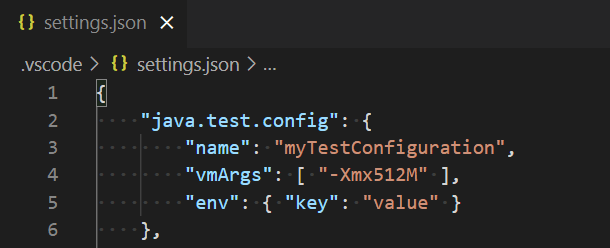
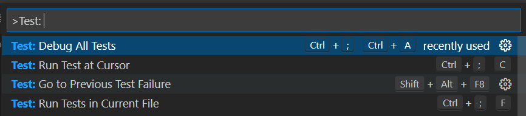
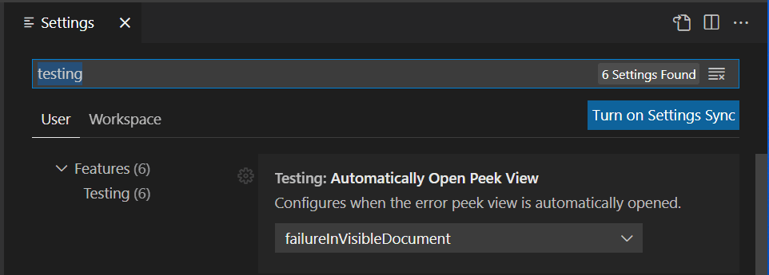

+++
title = "10.6.8 测试 Java"
date = 2026-11-06T07:53:25+08:00
weight = 8
type = "docs"
description = ""
isCJKLanguage = true
draft = false
+++


> 原文链接: [https://code.visualstudio.com/docs/java/java-testing](https://code.visualstudio.com/docs/java/java-testing)

# 10.6.8 测试 Java

　　VS Code Java 测试由 [Test Runner for Java](https://marketplace.visualstudio.com/items?itemName=vscjava.vscode-java-test)扩展提供，用于运行和调试 Java 测试用例。

## 概述 {#overview}

支持框架：

* [JUnit 4](https://junit.org/junit4/)（v4.8.0+）
* [JUnit 5](https://junit.org/junit5/)（v5.1.0+）
* [TestNG](https://testng.org/)（v6.9.13.3+）

Test Runner 与 [Language Support for Java™ by Red Hat](https://marketplace.visualstudio.com/items?itemName=redhat.java)和 [Debugger for Java](https://marketplace.visualstudio.com/items?itemName=vscjava.vscode-java-debug)配合，提供：

* 运行/调试测试
* 自定义测试配置
* 查看测试报告
* 在测试资源管理器中查看测试

## 要求 {#requirements}

* JDK 1.8+
* VS Code 1.59.0+
* [Extension Pack for Java](https://marketplace.visualstudio.com/items?itemName=vscjava.vscode-java-pack)

## 项目设置 {#project-setup}

> **注意**：项目已配置测试框架时可以跳到[功能](#features)。

### 启用测试并添加框架 JAR {#enable-testing-and-adding-test-framework-jars-to-your-project}

Test Runner 0.34.0 起，可以在 **测试** 资源管理器中为没有构建工具的未管理文件夹项目启用测试框架。

<video src="https://code.visualstudio.com/assets/docs/java/java-testing/enable-tests.mp4" autoplay loop muted playsinline controls title="启用测试并添加测试框架 JAR"></video>

> **注意**：目前仅支持不包含测试依赖的未管理文件夹。

### JUnit 4 {#junit-4}

**Maven：**

```xml
<dependency>
  <groupId>junit</groupId>
  <artifactId>junit</artifactId>
  <version>(YOUR_JUNIT_VERSION)</version>
  <scope>test</scope>
</dependency>
```

**Gradle：**

```groovy
plugins {
    java
}

dependencies {
    testImplementation('junit:junit:(YOUR_JUNIT_VERSION)')
}
```

**未管理文件夹：**

可以通过测试资源管理器启用，或手动将 [junit.jar](https://search.maven.org/search?q=g:junit%20AND%20a:junit) 和 [hamcrest-core.jar](https://search.maven.org/artifact/org.hamcrest/hamcrest-core/1.3/jar) 加入项目类路径（`java.project.referencedLibraries`）。

### JUnit 5 {#junit-5}

Maven 或 Gradle 项目请参阅 [junit5-samples](https://github.com/junit-team/junit5-samples)。

**未管理文件夹：**

通过测试资源管理器启用，或将 [junit-platform-console-standalone](https://repo1.maven.org/maven2/org/junit/platform/junit-platform-console-standalone/) JAR 加入类路径。

### TestNG {#testng}

**Maven：**

```xml
<dependency>
  <groupId>org.testng</groupId>
  <artifactId>testng</artifactId>
  <version>(YOUR_TESTNG_VERSION)</version>
  <scope>test</scope>
</dependency>
```

**Gradle：**

```groovy
plugins {
    java
}

dependencies {
    testImplementation('org.testng:testng:(YOUR_TESTNG_VERSION)')
}
```

**未管理文件夹：**

通过测试资源管理器启用，或手动加入 [testng.jar](https://search.maven.org/search?q=g:org.testng%20AND%20a:testng)、[jcommander.jar](https://search.maven.org/search?q=g:com.beust%20AND%20a:jcommander)、[slf4j-api.jar](https://search.maven.org/search?q=g:org.slf4j%20AND%20a:slf4j-api)。

## 功能 {#features}

### 运行/调试测试 {#rundebug-test-cases}

类和方法定义左侧会显示绿色播放按钮。选择运行测试，右键查看更多选项。

<video src="https://code.visualstudio.com/assets/docs/java/java-testing/gutter-icon.mp4" autoplay loop muted playsinline controls title="运行/调试测试"></video>

### 测试资源管理器 {#testing-explorer}

测试资源管理器是显示工作区所有测试的树视图。选择活动栏试管图标打开，可以运行/调试测试并查看结果。

<video src="https://code.visualstudio.com/assets/docs/java/java-testing/test-explorer.mp4" autoplay loop muted playsinline controls title="测试资源管理器"></video>

### 自定义测试配置 {#customize-test-configurations}

在工作区[设置](../../../editor/3.3-ConfigureTheEditor/3.3.4-Settings/)的 `java.test.config` 中添加配置：



支持：

* `args`：传给测试运行器的命令行参数。
* `classPaths`：追加到解析类路径。
* `env`：额外环境变量。
* `envFile`：环境变量文件绝对路径。
* `modulePaths`：追加模块路径。
* `name`：配置名称，可通过 `java.test.defaultConfig` 设置默认配置。
* `preLaunchTask`：测试前运行 `tasks.json` 中的任务。
* `sourcePaths`：调试测试时的额外源路径。
* `vmArgs`：JVM 额外选项和系统属性。
* `workingDirectory`：测试工作目录。
* `testKind`：测试框架，`junit` 或 `testng`。
* `filters`：测试筛选。
  * `tags`：包含或排除标签，前缀 `!` 表示排除（仅 JUnit）。

详情请参阅 [vscode-java-test Wiki](https://github.com/Microsoft/vscode-java-test/wiki/Run-with-Configuration)。

### 查看测试结果 {#view-test-results}

运行/调试后，编辑器装饰和测试资源管理器会更新状态。可以运行 **Test: Peek Output** 查看结果，单击堆栈跟踪链接导航到源代码。

<video src="https://code.visualstudio.com/assets/docs/java/java-testing/test-result.mp4" autoplay loop muted playsinline controls title="查看测试结果"></video>

### 生成测试 {#generate-tests}

编辑器右键选择 **源代码操作...**，然后选择 **生成测试...**。

* 从主源代码触发时，输入测试类全限定名和要测试的方法，扩展生成测试代码。
* 从测试源代码触发时，选择要添加的测试方法类型，包括生命周期方法和测试方法。

<video src="https://code.visualstudio.com/assets/docs/java/java-testing/generate-tests-from-main.mp4" autoplay loop muted playsinline controls title="生成测试"></video>

<video src="https://code.visualstudio.com/assets/docs/java/java-testing/generate-tests-from-test.mp4" autoplay loop muted playsinline controls title="从测试生成"></video>

### 测试导航 {#test-navigation}

源代码位于 `src/main/java` 或 `src/test/java` 时，编辑器右键菜单提供 **转到测试** 或 **转到测试目标**。也可以在命令面板搜索 **Java: Go to Test**。

<video src="https://code.visualstudio.com/assets/docs/java/java-testing/test-navigation.mp4" autoplay loop muted playsinline controls title="测试导航"></video>

### VS Code 测试命令 {#vs-code-testing-commands}

在命令面板搜索 `Test:` 可以找到其他命令（例如 **Run Tests in Current File**）。



### VS Code 测试设置 {#vs-code-testing-settings}

在设置编辑器搜索 `testing` 查看测试相关设置。



## 常见问题 {#faq}

遇到问题请查看 [FAQ](https://github.com/microsoft/vscode-java-test/wiki/FAQ)和[议题列表](https://github.com/microsoft/vscode-java-test/issues)。

## 贡献和反馈 {#contributing-and-feedback}

反馈或贡献代码请阅读 [Contributing to Test Runner for Java](https://github.com/Microsoft/vscode-java-test/blob/main/CONTRIBUTING.md)。

## 后续步骤 {#next-steps}

* [调试 Java](10.6.7-Debugging/)
* [Java 扩展](10.6.14-Extensions/)
