+++
title = "10.2.1 JavaScript"
date = 2026-11-06T07:53:25+08:00
weight = 1
type = "docs"
description = ""
isCJKLanguage = true
draft = false
+++


> 原文链接: [https://code.visualstudio.com/docs/languages/javascript](https://code.visualstudio.com/docs/languages/javascript)

# 10.2.1 JavaScript

　　VS Code 内置 JavaScript IntelliSense、调试、格式化、代码导航、重构和许多其他高级语言功能。

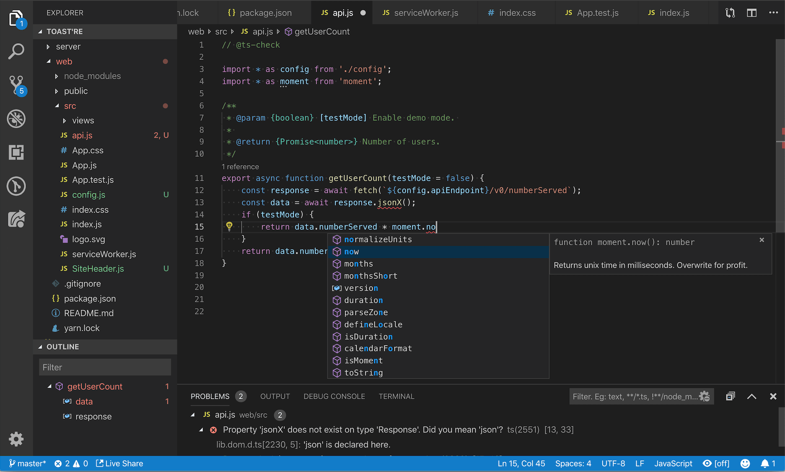

　　大多数功能开箱即用，部分功能可能需要基本配置才能获得最佳体验。本页总结 VS Code 自带的 JavaScript 功能。[Marketplace](https://marketplace.visualstudio.com) 中的扩展可以增强或更改大多数内置功能。这些功能的工作和配置详情请参阅[使用 JavaScript](https://code.visualstudio.com/docs/nodejs/working-with-javascript)。

## IntelliSense {#intellisense}

　　IntelliSense 显示智能代码补全、悬停信息和签名信息，帮助你更快、更正确地编写代码。

<video src="https://code.visualstudio.com/assets/docs/languages/javascript/intellisense.mp4" placeholder="./images/intellisense-placeholder.png" autoplay loop controls muted>
    抱歉，浏览器不支持 HTML5 视频。
</video>

　　VS Code 在 JavaScript 项目中、许多 npm 库（例如 `React`、`lodash` 和 `express`）以及其他平台（例如 `node`、无服务器或 IoT）中提供 IntelliSense。

　　VS Code JavaScript IntelliSense 的工作方式、配置和常见问题排查请参阅[使用 JavaScript](https://code.visualstudio.com/docs/nodejs/working-with-javascript)。

## JavaScript 项目（jsconfig.json） {#javascript-projects-jsconfigjson}

　　[jsconfig.json](https://code.visualstudio.com/docs/languages/jsconfig) 文件在 VS Code 中定义 JavaScript 项目。虽然 `jsconfig.json` 文件不是必需的，但以下情况需要创建：

* 工作区中并非所有 JavaScript 文件都属于同一个 JavaScript 项目。`jsconfig.json` 可以排除某些文件，使其不出现在 IntelliSense 中。
* 需要将工作区中的一部分 JavaScript 文件视为单个项目。处理使用隐式全局依赖而不是 `imports` 的旧代码时很有用。
* 工作区包含多个项目上下文，例如前端和后端 JavaScript 代码。多项目工作区请在每个项目的根文件夹创建 `jsconfig.json`。
* 使用 TypeScript 编译器将 JavaScript 源代码降级编译。

要在工作区根目录定义基本 JavaScript 项目，请添加 `jsconfig.json`：

```json
{
    "compilerOptions": {
        "module": "CommonJS",
        "target": "ES6"
    },
    "exclude": [
        "node_modules"
    ]
}
```

　　更高级的 `jsconfig.json` 配置请参阅[使用 JavaScript](https://code.visualstudio.com/docs/nodejs/working-with-javascript)。

> **提示**：要检查 JavaScript 文件是否属于 JavaScript 项目，请在 VS Code 中打开文件并运行 **JavaScript: Go to Project Configuration** 命令。该命令打开引用该文件的 `jsconfig.json`。文件不属于任何 `jsconfig.json` 项目时会显示通知。

## 代码片段 {#snippets}

　　VS Code 包含基本 JavaScript [代码片段](../../../editor/3.2-WriteCode/3.2.7-Snippets/)，输入时会显示建议：

<video src="https://code.visualstudio.com/assets/docs/languages/javascript/snippets.mp4" placeholder="./images/snippets-placeholder.png" autoplay loop controls muted>
    抱歉，浏览器不支持 HTML5 视频。
</video>

　　许多扩展提供额外代码片段，包括 Redux 或 Angular 等流行框架的片段。也可以[定义自己的代码片段](../../../editor/3.2-WriteCode/3.2.7-Snippets/)。

> **提示**：要禁用代码片段建议，请在[设置](../../../editor/3.3-ConfigureTheEditor/3.3.4-Settings/)文件中将 `editor.snippetSuggestions` 设置为 `"none"`。该设置还可以更改代码片段在建议中的位置：顶部（`"top"`）、底部（`"bottom"`）或按字母顺序内联（`"inline"`）。默认 `"inline"`。

## JSDoc 支持 {#jsdoc-support}

　　VS Code 理解许多标准 [JSDoc](https://jsdoc.app) 注释，并使用这些注释提供丰富的 [IntelliSense](#intellisense)。还可以选择使用 JSDoc 注释中的类型信息[对 JavaScript 进行类型检查](#type-checking)。

<video src="https://code.visualstudio.com/assets/docs/languages/javascript/jsdoc-autofill.mp4" placeholder="./images/jsdoc-autofill-placeholder.png" autoplay loop controls muted>
    抱歉，浏览器不支持 HTML5 视频。
</video>

　　在函数声明前输入 `/**`，并选择 **JSDoc comment** 代码片段建议，可以快速为函数创建 JSDoc 注释。

要禁用 JSDoc 注释建议，请禁用 `js/ts.suggest.jsdoc.enabled` 设置。

## 悬停信息 {#hover-information}

　　将鼠标悬停在 JavaScript 符号上，可以快速查看其类型信息和相关文档。

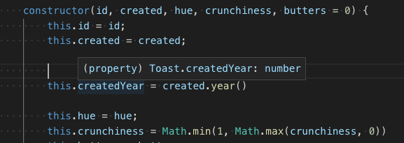

`Ctrl + K Ctrl + I` 快捷键会在当前光标位置显示悬停信息。

## 签名帮助 {#signature-help}

　　编写 JavaScript 函数调用时，VS Code 显示函数签名信息，并高亮当前正在填写的参数：

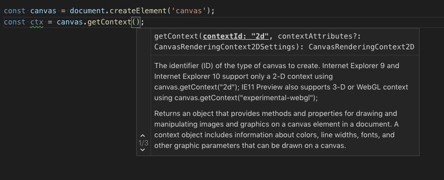

　　在函数调用中输入 `(` 或 `,` 时会自动显示签名帮助。按 `Ctrl + Shift + Space` 手动触发。

## 自动导入 {#auto-imports}

　　自动导入会建议项目和依赖项中的可用变量，加快编码速度。选择建议后，VS Code 会自动在文件顶部添加导入。

　　开始输入即可看到当前项目所有可用 JavaScript 符号的[建议](#intellisense)。自动导入建议会显示导入来源：

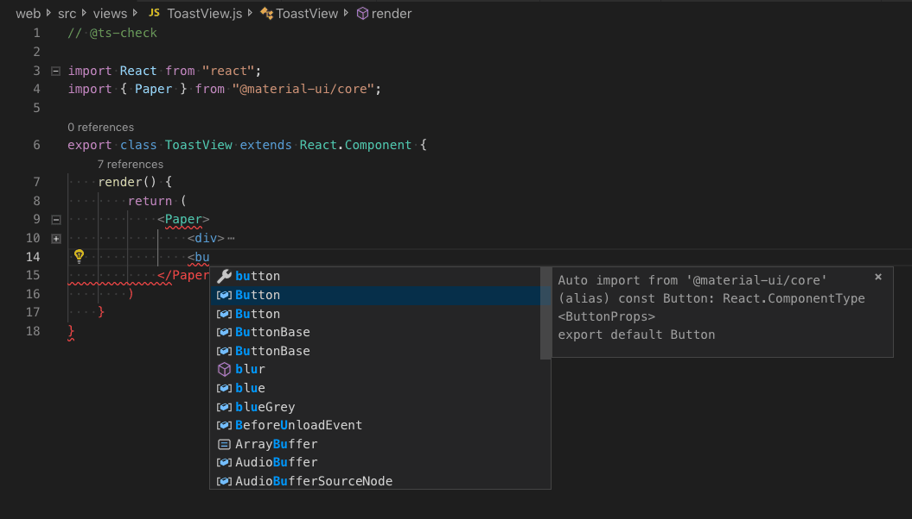

　　选择自动导入建议后，VS Code 会添加导入。

以下示例中，VS Code 在文件顶部添加来自 [material-ui](https://material-ui.com) 的 `Button` 导入：

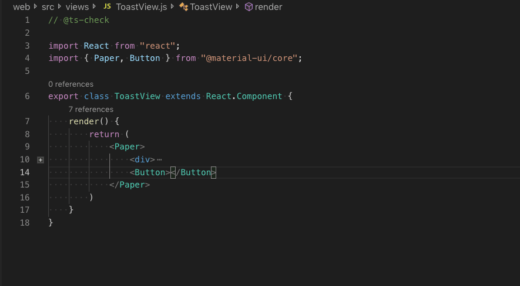

要禁用自动导入，请将 `js/ts.suggest.autoImports` 设置为 `false`。

> **提示**：VS Code 会尝试推断最佳导入样式。可以使用 `js/ts.preferences.quoteStyle` 和 `js/ts.preferences.importModuleSpecifier` 设置，显式配置导入的首选引号和路径样式。

### 粘贴时添加导入 {#add-imports-on-paste}

　　在编辑器之间复制粘贴代码时，VS Code 可以在粘贴时自动添加导入。粘贴包含未定义符号的代码时，会显示粘贴控件，可以选择作为纯文本粘贴或添加导入。

<video src="https://code.visualstudio.com/assets/docs/languages/javascript/jsts-update-imports-paste.mp4" title="从一个编辑器复制代码到另一个编辑器，粘贴控件在粘贴时添加导入。" autoplay loop controls muted></video>

　　此功能默认启用，可以通过 `js/ts.updateImportsOnPaste.enabled` 设置禁用。

　　要默认粘贴并添加导入而不显示粘贴控件，请配置 `editor.pasteAs.preferences` 设置，包含 `text.updateImports.jsts` 或 `text.updateImports`。

## 组织导入 {#organize-imports}

　　**组织导入** 源操作会对 JavaScript 文件中的导入排序，并移除未使用的导入：

<video src="https://code.visualstudio.com/assets/docs/languages/javascript/organize-imports.mp4" placeholder="./images/organize-imports-placeholder.png" autoplay loop controls muted>
    抱歉，浏览器不支持 HTML5 视频。
</video>

　　可以从 **源操作** 上下文菜单或使用 `Shift + Alt + O` 快捷键运行 **组织导入**。

　　也可以通过以下设置在保存 JavaScript 文件时自动组织导入：

```json
"editor.codeActionsOnSave": {
    "source.organizeImports": "explicit"
}
```

## 文件移动时更新导入 {#update-imports-on-file-move}

　　移动或重命名被项目中其他文件导入的文件时，VS Code 可以自动更新引用该文件的所有导入路径：

<video src="https://code.visualstudio.com/assets/docs/languages/javascript/update-imports.mp4" placeholder="./images/update-imports-placeholder.png" autoplay loop controls muted>
    抱歉，浏览器不支持 HTML5 视频。
</video>

　　`js/ts.updateImportsOnFileMove.enabled` 设置控制此行为。有效值：

* `"prompt"`：默认。每次文件移动时询问是否更新路径。
* `"always"`：始终自动更新路径。
* `"never"`：不自动更新路径，也不提示。

## 格式化 {#formatting}

　　VS Code 内置 JavaScript 格式化程序提供合理默认值的基本代码格式化。

　　`js/ts.format.*` [设置](../../../editor/3.3-ConfigureTheEditor/3.3.4-Settings/)配置内置格式化程序。如果内置格式化程序妨碍工作，可以将 `js/ts.format.enable` 设置为 `false` 禁用。

需要更专门的代码格式样式时，请尝试从 [Marketplace](https://marketplace.visualstudio.com/vscode) 安装 JavaScript 格式化扩展。

## JSX 和自动闭合标签 {#jsx-and-auto-closing-tags}

　　VS Code 的所有 JavaScript 功能也适用于 [JSX](https://reactjs.org/docs/introducing-jsx.html)：

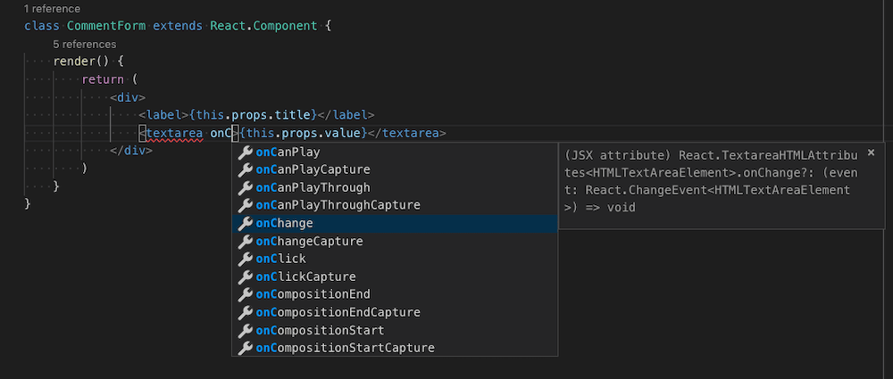

　　可以在普通 `*.js` 文件和 `*.jsx` 文件中使用 JSX 语法。

　　VS Code 还包含 JSX 特定功能，例如自动闭合 JSX 标签：

<video src="https://code.visualstudio.com/assets/docs/languages/javascript/tag-complete.mp4" placeholder="./images/tag-complete-placeholder.png" autoplay loop controls muted>
    抱歉，浏览器不支持 HTML5 视频。
</video>

将 `js/ts.autoClosingTags` 设置为 `false` 可以禁用 JSX 标签闭合。

## 代码导航 {#code-navigation}

　　代码导航可以快速浏览 JavaScript 项目。

* **转到定义**（`F12`）：转到符号定义的源代码。
* **速览定义**（`Alt + F12`）：打开速览窗口显示符号定义。
* **转到引用**（`Shift + F12`）：显示符号的所有引用。
* **转到类型定义**：转到定义符号的类型。对于类实例，会显示类本身，而不是实例定义位置。

可以使用 **命令面板**（`Ctrl + Shift + P`）中的 **转到符号** 命令进行符号搜索：

* **转到文件中的符号**（`Ctrl + Shift + O`）
* **转到工作区中的符号**（`Ctrl + T`）

## 重命名 {#rename}

按 `F2` 可以跨 JavaScript 项目重命名光标下的符号：

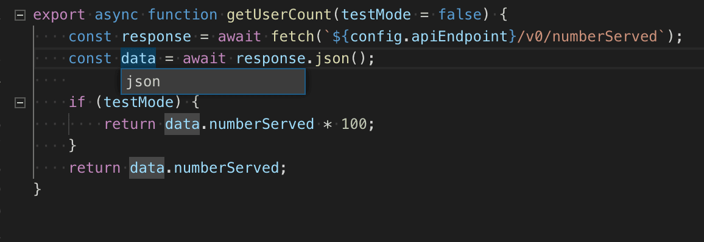

## 重构 {#refactoring}

　　VS Code 包含一些方便的 JavaScript 重构，例如 **提取函数** 和 **提取常量**。选择要提取的源代码，然后单击装订线中的灯泡或按 `Ctrl + .` 查看可用重构。

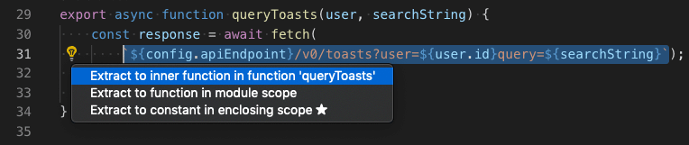

可用重构包括：

* 提取为方法或函数。
* 提取为常量。
* 在命名导入和命名空间导入之间转换。
* 移到新文件。

重构详情以及如何为单个重构配置快捷键，请参阅[重构](../../../editor/3.2-WriteCode/3.2.6-Refactoring/)。

此外，**Code Action Widget: Include Nearby Quick Fixes**（`editor.codeActionWidget.includeNearbyQuickFixes`）默认启用，会从 `Ctrl + .`（命令 ID `editor.action.quickFix`）激活行中最近的快速修复，无论光标在该行的什么位置。

该命令会高亮将通过快速修复重构或修复的源代码。普通代码操作和非修复重构仍可在光标位置激活。

## 未使用变量和不可达代码 {#unused-variables-and-unreachable-code}

　　未使用的 JavaScript 代码（例如始终为 true 的 `if` 语句的 else 块，或未引用的导入）在编辑器中会淡化显示：

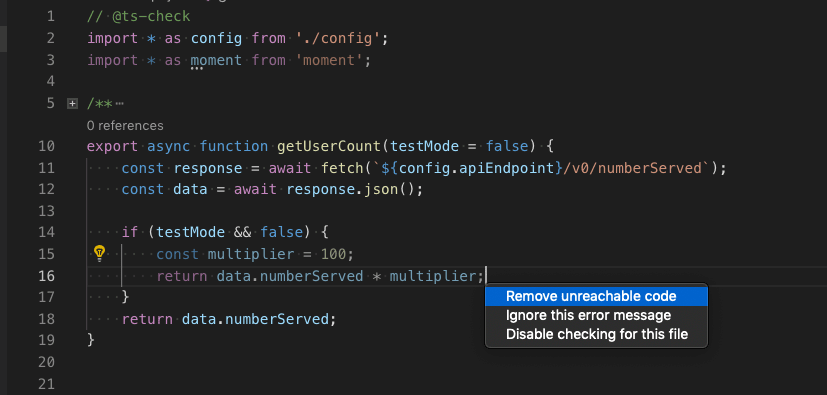

　　将光标放在未使用代码上并触发快速修复命令（`Ctrl + .`）或单击灯泡，可以快速移除。

要禁用未使用代码淡化，请将 `editor.showUnused` 设置为 `false`。也可以仅在 JavaScript 中禁用：

```json
"[javascript]": {
    "editor.showUnused":  false
},
"[javascriptreact]": {
    "editor.showUnused":  false
},
```

## 保存时的代码操作 {#code-actions-on-save}

　　`editor.codeActionsOnSave` 设置可以配置保存文件时运行的一组代码操作。例如，保存时组织导入：

```json
// 显式保存时运行 fixAll 源操作。自动保存（窗口或焦点变化）时运行 organizeImports 源操作。
"editor.codeActionsOnSave": {
    "source.fixAll": "explicit",
    "source.organizeImports": "always",
}
```

目前支持以下枚举：

* `explicit`（默认）：显式保存时触发代码操作。与 `true` 相同。
* `always`：显式保存以及窗口或焦点变化自动保存时触发代码操作。
* `never`：保存时从不触发代码操作。与 `false` 相同。

　　也可以将 `editor.codeActionsOnSave` 设置为按顺序执行的代码操作数组。

部分源操作：

* `"organizeImports"`：保存时组织导入。
* `"fixAll"`：保存时自动修复，一轮计算所有可能的修复（包括 ESLint 在内的所有提供程序）。
* `"fixAll.eslint"`：仅对 ESLint 自动修复。
* `"addMissingImports"`：保存时添加所有缺失导入。

更多信息请参阅 [Node.js/JavaScript](https://code.visualstudio.com/docs/nodejs/working-with-javascript)。

## 代码建议 {#code-suggestions}

　　VS Code 会自动建议一些常见代码简化，例如将 promise 上的 `.then` 调用链转换为使用 `async` 和 `await`：

<video src="https://code.visualstudio.com/assets/docs/languages/javascript/code-suggestions-convert-async.mp4" placeholder="./images/code-suggestions-convert-async-placeholder.png" autoplay loop controls muted>
    抱歉，浏览器不支持 HTML5 视频。
</video>

将 `js/ts.suggestionActions.enabled` 设置为 `false` 可以禁用建议。

## 使用 AI 增强补全 {#enhance-completions-with-ai}

　　GitHub Copilot 可以提供 AI 驱动的内联建议，帮助你更快、更智能地编写代码。GitHub Copilot 为众多语言和框架提供建议，尤其适合 Python、JavaScript、TypeScript、Ruby、Go、C# 和 C++。详细了解[在 VS Code 中开始使用 Copilot](../../../ai-in-vs-code/getting-started/2.1.4-AgentsTutorial/)。

创建新文件，可以使用命令面板（`F1`）中的 **File: New File** 命令。

在 JavaScript 文件中输入以下函数头：

```js
function calculateDaysBetweenDates(begin, end) {
```

　　Copilot 会提供类似以下建议，按 `Tab` 接受：

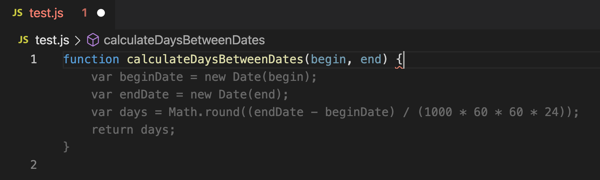

## 内联提示 {#inlay-hints}

　　内联提示为源代码添加额外内联信息，帮助理解代码作用。

**参数名称内联提示** 显示函数调用中的参数名称：

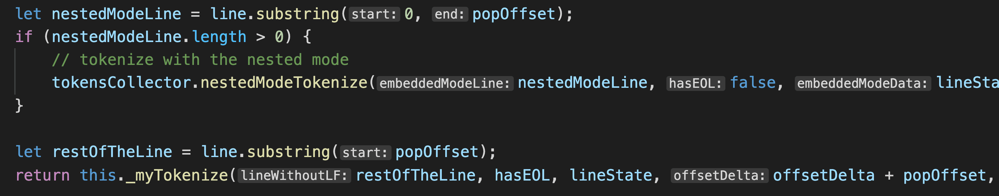

　　这有助于一眼理解每个参数的含义，对带有布尔标志或容易混淆参数的函数尤其有用。

要启用参数名称提示，请设置 `js/ts.inlayHints.parameterNames.enabled`。可能值：

* `none`：禁用参数内联提示。
* `literals`：仅为字面量（字符串、数字、布尔值）显示提示。
* `all`：为所有参数显示提示。

**变量类型内联提示** 显示没有显式类型注解的变量类型。

设置：`js/ts.inlayHints.variableTypes.enabled`

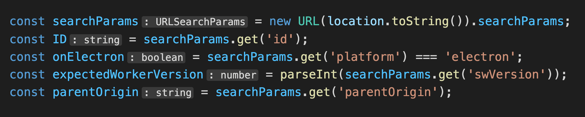

**属性类型内联提示** 显示没有显式类型注解的类属性类型。

设置：`js/ts.inlayHints.propertyDeclarationTypes.enabled`

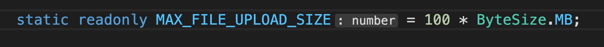

**参数类型提示** 显示隐式类型参数的类型。

设置：`js/ts.inlayHints.parameterTypes.enabled`

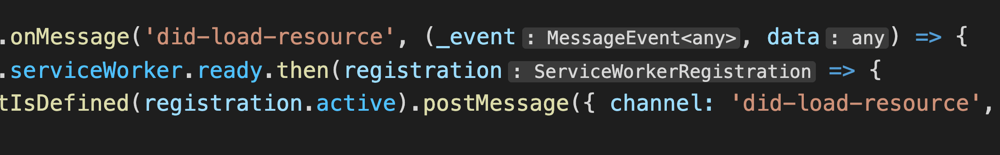

**返回类型内联提示** 显示没有显式类型注解的函数的返回类型。

设置：`js/ts.inlayHints.functionLikeReturnTypes.enabled`

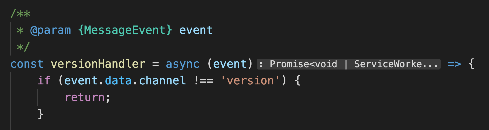

## 引用 CodeLens {#references-codelens}

　　JavaScript 引用 CodeLens 显示类、方法、属性和导出对象的内联引用计数：

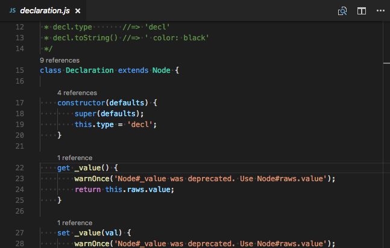

要启用引用 CodeLens，请将 `js/ts.referencesCodeLens.enabled` 设置为 `true`。

单击引用计数可以快速浏览引用列表：

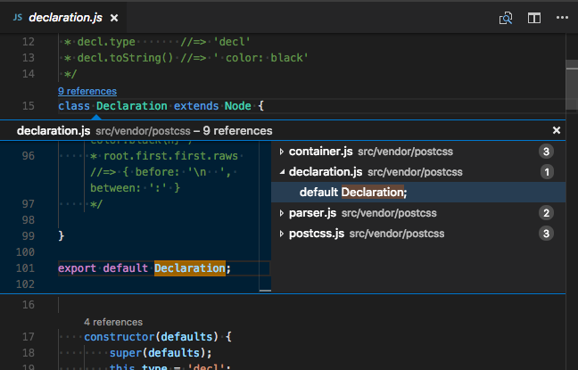

## Linter {#linters}

　　[Linter](https://en.wikipedia.org/wiki/Lint_%28software%29) 为可疑代码提供警告。VS Code 不包含内置 JavaScript linter，但 Marketplace 中有许多 JavaScript linter [扩展](../../../editor/3.3-ConfigureTheEditor/3.3.6-Extensions/3.3.6.2-ExtensionMarketplace/)。

> **提示**：此列表从 [Marketplace](https://marketplace.visualstudio.com) 动态查询。请阅读说明和评论，判断扩展是否适合你。

## 类型检查 {#type-checking}

　　也可以在普通 JavaScript 文件中利用 TypeScript 的一些高级类型检查和错误报告功能。这是捕获常见编程错误的好方法。这些类型检查还为 JavaScript 启用了一些有用的快速修复，包括 **添加缺失导入** 和 **添加缺失属性**。

<video src="https://code.visualstudio.com/assets/docs/languages/javascript/checkjs-example.mp4" title="在 JavaScript 文件中使用类型检查和快速修复。" autoplay loop controls muted></video>

　　TypeScript 会像在 `.ts` 文件中一样尝试推断 `.js` 文件中的类型。无法推断时，可以使用 JSDoc 注释显式指定。TypeScript 如何使用 JSDoc 进行 JavaScript 类型检查，请参阅[使用 JavaScript](https://code.visualstudio.com/docs/nodejs/working-with-javascript)。

　　JavaScript 类型检查是可选的。ESLint 等现有 JavaScript 验证工具可以与内置类型检查一起使用。

## 调试 {#debugging}

　　VS Code 为 JavaScript 提供出色的调试支持。设置断点、检查对象、浏览调用堆栈，并在调试控制台中执行代码。详情请参阅[调试](../../../debugging-and-testing/6.1-Debugging/)。

### 调试客户端 {#debug-client-side}

　　可以使用浏览器调试器调试客户端代码，例如内置的 Edge 和 Chrome 调试器，或 [Debugger for Firefox](https://marketplace.visualstudio.com/items?itemName=hbenl.vscode-firefox-debug)。

### 调试服务器端 {#debug-server-side}

　　使用内置调试器在 VS Code 中调试 Node.js。设置简单，还有 [Node.js 调试教程](https://code.visualstudio.com/docs/nodejs/nodejs-tutorial#debug-your-express-app)帮助入门。

<video src="https://code.visualstudio.com/assets/docs/languages/javascript/debug_data_inspection.mp4" title="调试数据检查。" autoplay loop controls muted></video>

## 热门扩展 {#popular-extensions}

　　VS Code 自带出色的 JavaScript 支持，但还可以通过[扩展](../../../editor/3.3-ConfigureTheEditor/3.3.6-Extensions/3.3.6.2-ExtensionMarketplace/)安装调试器、代码片段、linter 和其他 JavaScript 工具。

> **提示**：上方扩展动态查询。单击扩展卡片阅读说明和评论，判断哪个扩展最适合你。更多内容请参阅 [Marketplace](https://marketplace.visualstudio.com)。

## 后续步骤 {#next-steps}

继续阅读：

* [使用 JavaScript](https://code.visualstudio.com/docs/nodejs/working-with-javascript)：VS Code JavaScript 支持的详细信息以及常见问题排查。
* [jsconfig.json](https://code.visualstudio.com/docs/languages/jsconfig)：`jsconfig.json` 项目文件详解。
* [IntelliSense](../../../editor/3.2-WriteCode/3.2.2-IntelliSense/)：详细了解 IntelliSense 及其有效用法。
* [调试](../../../debugging-and-testing/6.1-Debugging/)：学习为应用程序设置调试。
* [Node.js](https://code.visualstudio.com/docs/nodejs/nodejs-tutorial)：创建 Express Node.js 应用的演练。
* [TypeScript](10.2.6-TypeScript/)：VS Code 对 TypeScript 有出色支持，为 JavaScript 代码带来结构和强类型。

## 常见问题 {#frequently-asked-questions}

### VS Code 支持 JSX 和 React Native 吗？ {#does-vs-code-support-jsx-and-react-native}

　　支持 **JSX** 和 **React Native**。VS Code 会从 [npmjs](https://www.npmjs.com) 类型声明文件仓库自动下载类型声明（typings），为 **React/JSX** 和 **React Native** 提供 IntelliSense。此外，可以从 Marketplace 安装流行的 [React Native 扩展](https://marketplace.visualstudio.com/items?itemName=vsmobile.vscode-react-native)。

　　要为 **React Native** 启用 ES6 导入语句，需要将 `allowSyntheticDefaultImports` 编译器选项设置为 `true`。这会告诉编译器创建合成默认成员，从而获得 IntelliSense。**React Native** 在后台使用 **Babel** 创建带默认成员的运行时代码。如果要调试 **React Native** 代码，也可以安装 [React Native 扩展](https://marketplace.visualstudio.com/items?itemName=vsmobile.vscode-react-native)。

### VS Code 支持 Dart 语言和 Flutter 框架吗？ {#does-vs-code-support-the-dart-programming-language-and-the-flutter-framework}

　　支持，[Dart](https://marketplace.visualstudio.com/items?itemName=Dart-Code.dart-code) 和 [Flutter](https://marketplace.visualstudio.com/items?itemName=Dart-Code.flutter) 开发都有 VS Code 扩展。更多信息请参阅 [Flutter.dev](https://flutter.dev/docs/development/tools/vs-code) 文档。

### IntelliSense 对外部库不工作 {#intellisense-is-not-working-for-external-libraries}

　　`Automatic Type Acquisition` 适用于 npm（`package.json` 中指定）、Bower（`bower.json` 中指定）下载的依赖项，以及文件夹结构中列出的许多常见库（例如 `jquery-3.1.1.min.js`）。

**ES6 风格导入不工作。**

　　想使用 ES6 风格导入，但某些类型声明（typings）文件尚未使用 ES6 风格导出时，请将 [TypeScript 编译器选项](https://www.typescriptlang.org/docs/handbook/compiler-options.html) `allowSyntheticDefaultImports` 设置为 true。

```json
{
    "compilerOptions": {
        "module": "CommonJS",
        "target": "ES6",
        // 要添加的行
        "allowSyntheticDefaultImports": true
    },
    "exclude": [
        "node_modules",
        "**/node_modules/*"
    ]
}
```

### 可以调试压缩/混淆的 JavaScript 吗？ {#can-i-debug-minifieduglified-javascript}

　　可以。使用 JavaScript source map 的示例请参阅 [Node.js 调试](https://code.visualstudio.com/docs/nodejs/nodejs-debugging)。

### 使用非 ES6 语法时如何禁用语法验证？ {#how-do-i-disable-syntax-validation-when-using-non-es6-constructs}

　　某些用户想使用提议的管道（`|>`）运算符等语法结构。但 VS Code 的 JavaScript 语言服务目前不支持这些结构，会标记为错误。仍想使用这些未来功能的用户可以使用 `js/ts.validate.enable` [设置](../../../editor/3.3-ConfigureTheEditor/3.3.4-Settings/)。

　　设置 `js/ts.validate.enable: false` 会禁用所有内置语法检查。这样做时，建议使用 [ESLint](https://eslint.org) 等 linter 验证源代码。

### 可以使用 Flow 等其他 JavaScript 工具吗？ {#can-i-use-other-javascript-tools-like-flow}

　　可以，但 [Flow](https://flow.org) 的类型和错误检查等语言功能可能与 VS Code 内置 JavaScript 支持冲突。禁用内置 JavaScript 支持的方法请参阅[禁用 JavaScript 支持](https://code.visualstudio.com/docs/nodejs/working-with-javascript#disable-javascript-support)。
