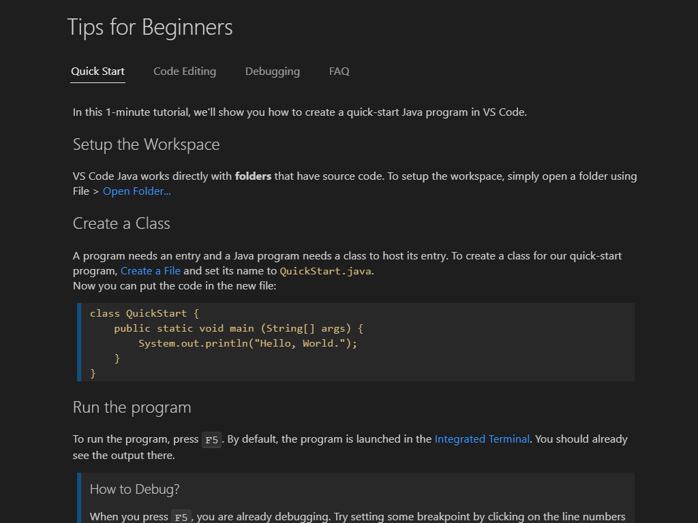
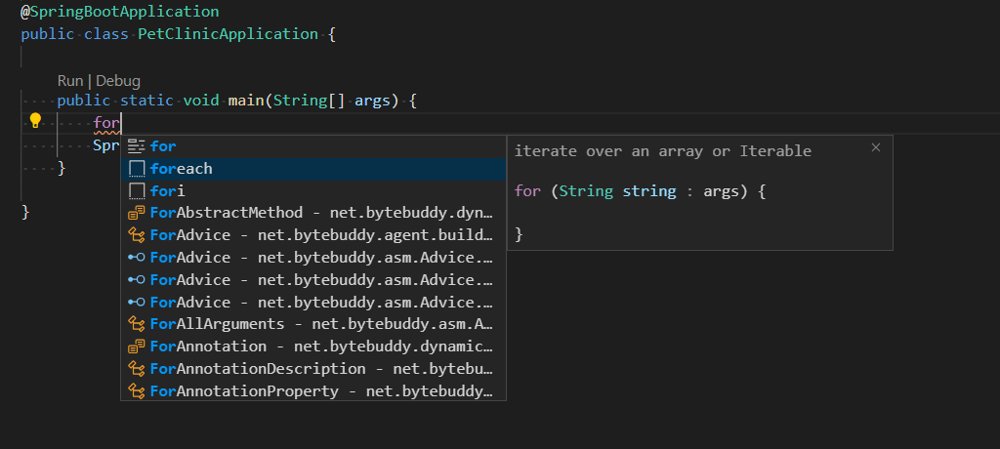

+++
title = "10.2.10 Java"
date = 2026-11-06T07:53:25+08:00
weight = 10
type = "docs"
description = ""
isCJKLanguage = true
draft = false
+++

> 原文链接: [https://code.visualstudio.com/docs/languages/java](https://code.visualstudio.com/docs/languages/java)

# 10.2.10 Java

　　VS Code 中的 Java 支持由多种[扩展](https://code.visualstudio.com/docs/java/extensions)提供。结合 VS Code 核心功能，这些扩展提供轻量高效的代码编辑器，同时支持许多常见 Java 开发技术。

　　本文概述 VS Code 为 Java 开发者提供的不同能力。要快速演练编辑、运行和调试 Java 程序，请使用下方的 **Java 入门教程** 按钮。

<a class="next-topic-btn" href="https://code.visualstudio.com/docs/java/java-tutorial">Java 入门教程</a>

## 概述 {#overview}

　　VS Code 提供代码补全、重构、lint、格式化和代码片段等基本语言功能，以及方便的调试和单元测试支持。VS Code 还集成了 Maven、Tomcat、Jetty 和 Spring Boot 等工具和框架。借助 VS Code 的能力，Java 开发者可以获得适合快速代码编辑以及完整调试和测试周期的优秀工具。如果你在寻找满足以下条件的工具，它是 Java 工作的好选择：

* 快速、轻量、免费且开源。
* 支持许多其他语言，不仅是 Java。
* 无需安装和学习复杂 IDE 即可开始 Java 之旅。
* 提供出色的微服务支持，包括流行框架、容器工具和云集成。
* 提供基于团队的协作功能，例如 [Visual Studio Live Share](https://visualstudio.microsoft.com/services/live-share)。
* 通过 IntelliSense 和其他代码感知编辑功能提高生产力。

## 安装适用于 Java 的 VS Code {#install-vs-code-for-java}

　　为帮助快速设置，建议使用 **Coding Pack for Java**，它包含 VS Code、Java Development Kit（JDK）和 Microsoft 推荐扩展集合。Coding Pack 也可用于修复现有开发环境。

<a class="install-extension-btn" href="https://aka.ms/vscode-java-installer-win">安装 Coding Pack for Java - Windows</a>

<a class="install-extension-btn" href="https://aka.ms/vscode-java-installer-mac">安装 Coding Pack for Java - macOS</a> 

> **注意**：Coding Pack for Java 仅适用于 Windows 和 macOS。其他操作系统需要手动安装 JDK、VS Code 和 Java 扩展。

　　已安装 VS Code 并希望添加 Java 支持时，建议使用 [Extension Pack for Java](https://marketplace.visualstudio.com/items?itemName=vscjava.vscode-java-pack)，这是 Microsoft 推荐的扩展集合：

1. [Language Support for Java™ by Red Hat](https://marketplace.visualstudio.com/items?itemName=redhat.java)
2. [Debugger for Java](https://marketplace.visualstudio.com/items?itemName=vscjava.vscode-java-debug)
3. [Test Runner for Java](https://marketplace.visualstudio.com/items?itemName=vscjava.vscode-java-test)
4. [Maven for Java](https://marketplace.visualstudio.com/items?itemName=vscjava.vscode-maven)
5. [Project Manager for Java](https://marketplace.visualstudio.com/items?itemName=vscjava.vscode-java-dependency)
6. [Visual Studio IntelliCode](https://marketplace.visualstudio.com/items?itemName=VisualStudioExptTeam.vscodeintellicode)

<a class="install-extension-btn" href="vscode:extension/vscjava.vscode-java-pack">安装 Extension Pack for Java</a>

　　也可以自行安装流行的 Java 扩展来添加 Java 语言支持。

> [下载 VS Code](https://code.visualstudio.com/download)：如果尚未下载 VS Code，请快速为平台（Windows、macOS、Linux）安装。

还有其他可根据需要选择的流行 Java 扩展：

1. [Spring Boot Extension Pack](https://marketplace.visualstudio.com/items?itemName=vmware.vscode-boot-dev-pack)
2. [Gradle for Java](https://marketplace.visualstudio.com/items?itemName=vscjava.vscode-gradle)
3. [Community Server Connectors](https://marketplace.visualstudio.com/items?itemName=redhat.vscode-community-server-connector)（用于 Apache Felix、Karaf、Tomcat、Jetty 等）
4. [Server Connector](https://marketplace.visualstudio.com/items?itemName=redhat.vscode-server-connector)（Red Hat 服务器，例如 Wildfly）
5. [Extension Pack for MicroProfile](https://marketplace.visualstudio.com/items?itemName=MicroProfile-Community.vscode-microprofile-pack)
6. [CheckStyle](https://marketplace.visualstudio.com/items?itemName=shengchen.vscode-checkstyle)
7. [SonarLint](https://marketplace.visualstudio.com/items?itemName=SonarSource.sonarlint-vscode)

　　感谢 VS Code 周围庞大的 Java 社区，列表不止这些。可以在 VS Code 中轻松搜索更多 Java 扩展：

1. 转到 **扩展** 视图（`Ctrl + Shift + X`，macOS：`Cmd + Shift + X`）。
2. 输入“java”筛选扩展列表。

　　本文介绍这些 Java 扩展包含的一些关键功能。

> **注意**：可以使用 [Java General 配置文件模板](../../../editor/3.3-ConfigureTheEditor/3.3.8-Profiles/)安装有用扩展。配置文件详情以及如何为不同语言和工作流快速重新配置编辑器，请参阅 [VS Code 中的配置文件](../../../editor/3.3-ConfigureTheEditor/3.3.8-Profiles/)。

## 入门 {#getting-started}

**注意**：在 Windows 上使用 VS Code 并希望利用 Windows Subsystem for Linux 时，请参阅[在 WSL 中开发](../../../remote/8.6-WSL/)。

### 安装 Java Development Kit（JDK） {#install-a-java-development-kit-jdk}

　　Java Development Kit（JDK）是用于开发 Java 应用程序的软件开发环境。要在 VS Code 中运行 Java，需要安装 JDK。[Extension Pack for Java](https://marketplace.visualstudio.com/items?itemName=vscjava.vscode-java-pack) 支持 Java 1.8 或更高版本。

建议从以下来源之一安装 JDK：

* [Amazon Corretto](https://aws.amazon.com/corretto)
* [Azul Zulu](https://www.azul.com/downloads/?package=jdk)
* [Eclipse Adoptium 的 Temurin](https://adoptium.net/)
* [IBM Semeru Runtimes](https://developer.ibm.com/languages/java/semeru-runtimes)
* [Microsoft Build of OpenJDK](https://www.microsoft.com/openjdk)
* [Oracle Java SE](https://www.oracle.com/java/technologies/javase-downloads.html)
* [Red Hat build of OpenJDK](https://developers.redhat.com/products/openjdk/download)
* [SapMachine](https://sapmachine.io)

> **注意**：安装了多个 JDK 且项目需要使用特定版本时，请参阅[为项目配置运行时](https://code.visualstudio.com/docs/java/java-project#configure-runtime-for-projects)。启用 Java 预览功能请参阅[如何将 VS Code 与新版 Java 配合使用](https://code.visualstudio.com/docs/java/java-faq#how-can-i-use-visual-studio-code-with-new-java-versions)。

　　对于刚接触 Java 或 VS Code 的开发者，扩展提供了一些提示。安装 [Extension Pack for Java](https://marketplace.visualstudio.com/items?itemName=vscjava.vscode-java-pack) 后，可以从 VS Code 命令面板使用 **Java: Tips for Beginners** 命令查看提示。

打开命令面板（`Ctrl + Shift + P`，macOS：`Cmd + Shift + P`），输入“java tips”选择命令。

## 使用 Java 源文件 {#working-with-java-source-files}

　　可以使用 VS Code 读取、编写、运行和调试 Java 源文件，而无需创建项目。VS Code for Java 支持轻量模式和标准模式。轻量模式适合只处理源文件的场景；完整项目需要标准模式。可以按需轻松从轻量模式切换到标准模式。详情请参阅[轻量模式](https://code.visualstudio.com/docs/java/java-project#lightweight-mode)。

## 使用 Java 项目 {#working-with-java-projects}

在 VS Code 中使用 Java 需要理解三件事：

1. VS Code 如何处理工作区？
2. VS Code 如何处理 Java？
3. VS Code 如何处理包含 Java 的工作区？

### VS Code 工作区 {#vs-code-workspaces}

　　在 VS Code 中，“工作区”是一个或多个文件系统文件夹（及其子文件夹）的集合，以及该工作区在 VS Code 中打开时生效的所有 VS Code 配置。VS Code 中有两种“工作区”：“文件夹工作区”和“多根工作区”。

　　“文件夹工作区”是在 VS Code 中打开文件系统文件夹（目录）时呈现的工作区。

　　“多根工作区”可以引用文件系统不同部分的多个文件夹（目录），VS Code 会在[文件资源管理器](../../../editor/3.1-GettingStarted/3.1.2-UserInterface/)中一起显示工作区文件夹内容。详情请参阅[多根工作区](../../../editor/3.2-WriteCode/3.2.8-Workspaces/3.2.8.2-MultiRootWorkspaces/)。

### VS Code 中的 Java 项目 {#java-projects-in-vs-code}

　　与 IntelliJ IDEA、NetBeans 或 Eclipse 等 IDE 不同，“Java 项目”概念完全由扩展提供，不是 VS Code 基础核心概念。在 VS Code 中处理“Java 项目”时，必须安装必要扩展才能处理这些项目文件。

例如，Maven、Eclipse 和 Gradle Java 项目通过 [Language Support for Java™ by Red Hat](https://marketplace.visualstudio.com/items?itemName=redhat.java) 支持，它利用 [M2Eclipse](https://www.eclipse.org/m2e/) 提供 Maven 支持，利用 [Buildship](https://github.com/eclipse/buildship) 通过 [Eclipse JDT Language Server](https://github.com/eclipse/eclipse.jdt.ls) 提供 Gradle 支持。

使用 [Maven for Java](https://marketplace.visualstudio.com/items?itemName=vscjava.vscode-maven)，可以从 [Maven Archetypes](https://maven.apache.org/guides/introduction/introduction-to-archetypes.html)生成项目、浏览工作区所有 Maven 项目，并从嵌入式资源管理器轻松执行 Maven 目标。也可以使用 [Project Manager for Java](https://marketplace.visualstudio.com/items?itemName=vscjava.vscode-java-dependency) 扩展创建和管理项目。

<video autoplay loop muted playsinline controls title="使用 Project Manager for Java 扩展的 Java Projects 视图">
  <source src="https://code.visualstudio.com/assets/docs/languages/java/package-viewer.mp4" type="video/mp4">
</video>

　　VS Code 也支持 Java 项目之外的独立 Java 文件，详见 [Java 入门](https://code.visualstudio.com/docs/java/java-tutorial)教程。

### 包含 Java 项目的 VS Code 工作区 {#vs-code-workspaces-that-contain-java-projects}

　　假设已安装必要 Java 扩展，打开包含 Java 工件的 VS Code 工作区时，这些扩展会理解工件并提供处理选项。

Java 项目支持详情请参阅 [VS Code 中的 Java 项目管理](https://code.visualstudio.com/docs/java/java-project)和 [Java 构建工具](https://code.visualstudio.com/docs/java/java-build)。

## 编辑 {#editing}

### 代码导航 {#code-navigation}

　　VS Code 中的 Java 还支持符号搜索、速览定义和转到定义等源代码导航功能。[Spring Boot Tools](https://marketplace.visualstudio.com/items?itemName=vmware.vscode-spring-boot) 扩展为 [Spring Boot](https://projects.spring.io/spring-boot/) 项目提供增强导航和代码补全。

　　VS Code 的关键优势之一是速度。打开 Java 源文件或文件夹后，借助[轻量模式](https://code.visualstudio.com/docs/java/java-project#lightweight-mode)，几秒内即可使用大纲视图以及 **转到定义**、**转到引用** 等命令导航代码库。首次打开项目时尤其有用。

### 代码补全 {#code-completion}

　　[IntelliSense](../../../editor/3.2-WriteCode/3.2.2-IntelliSense/) 是语言功能的统称，包括跨所有文件的智能代码补全（上下文方法和变量建议），适用于内置和第三方模块。VS Code 通过 [Language Support for Java™ by Red Hat](https://marketplace.visualstudio.com/items?itemName=redhat.java) 支持 Java 代码补全和 IntelliSense。它还通过将最可能使用的内容放在补全列表顶部，提供名为 [IntelliCode](https://visualstudio.microsoft.com/services/intellicode/) 的 AI 辅助 IntelliSense。

<video autoplay loop muted playsinline controls title="Java 内联代码补全和悬停">
  <source src="https://code.visualstudio.com/assets/docs/languages/java/Intellisense.mp4" type="video/mp4">
</video>

## 使用 AI 增强补全 {#enhance-completions-with-ai}

　　GitHub Copilot 会在编辑器中输入时提供编码建议。也可以向 Copilot 询问与编码相关的问题，例如如何更好地编写代码、如何修复错误，或他人的代码如何工作。

　　请参阅 [VS Code 中的 AI](../../../ai-in-vs-code/)了解入门方法。

## 代码片段 {#code-snippets}

　　VS Code 支持多种流行 Java 代码片段，提高生产力，例如类/接口、syserr、sysout、if/else、try/catch、静态 main 方法。它使用 Java 语言服务器信息，在选择时提供代码片段预览。

例如，输入“**sout**”或“**sysout**”会生成 `System.out.println()` 代码片段。类似地，输入“**main**”或“**psvm**”会生成 `public static void main(String[] args) {}`。

　　我们支持多种代码片段快捷方式和后缀补全。完整列表请参阅[代码片段](https://code.visualstudio.com/docs/java/java-editing#code-snippets)。VS Code 还支持多种[重构](https://code.visualstudio.com/docs/java/java-refactoring)和 [Lint](https://code.visualstudio.com/docs/java/java-linting)功能。

## 调试 {#debugging}

　　[Debugger for Java](https://marketplace.visualstudio.com/items?itemName=vscjava.vscode-java-debug) 是基于 [Java Debug Server](https://github.com/microsoft/java-debug) 的轻量 Java 调试器。它与 [Language Support for Java™ by Red Hat](https://marketplace.visualstudio.com/items?itemName=redhat.java) 配合，让用户在 VS Code 中调试 Java 代码。

启动调试会话很简单：单击 `main()` 函数 CodeLens 中的 **Run|Debug** 按钮，或按 `F5`。调试器会自动生成适当配置。

<video autoplay loop muted playsinline controls title="设置断点、启动调试并使用热代码替换">
  <source src="https://code.visualstudio.com/assets/docs/languages/java/resolve-main.mp4" type="video/mp4">
</video>

　　Java 调试器虽然轻量，但支持表达式求值、条件断点和[热代码替换](https://code.visualstudio.com/docs/java/java-debugging#hot-code-replace)等高级功能。更多调试信息请参阅 [Java 调试](https://code.visualstudio.com/docs/java/java-debugging)。

## 测试 {#testing}

　　借助 [Test Runner for Java](https://marketplace.visualstudio.com/items?itemName=vscjava.vscode-java-test) 扩展，可以轻松运行、调试和管理 JUnit 和 TestNG 测试用例。

<video autoplay loop muted playsinline controls title="运行测试并调查失败测试">
  <source src="https://code.visualstudio.com/assets/docs/languages/java/testng.mp4" type="video/mp4">
</video>

测试详情请参阅[测试 Java](https://code.visualstudio.com/docs/java/java-testing)。

## Spring Boot、Tomcat 和 Jetty {#spring-boot-tomcat-and-jetty}

　　为进一步提高 VS Code 中的 Java 生产力，社区为大多数流行框架和工具提供了扩展，例如 [Spring Boot](https://projects.spring.io/spring-boot/)、[Tomcat](https://tomcat.apache.org/) 和 [Jetty](https://www.eclipse.org/jetty/)。

　　请参阅[应用服务器](https://code.visualstudio.com/docs/java/java-tomcat-jetty)，了解 VS Code 对 Tomcat、Jetty 和其他应用服务器的支持。

　　[Spring Boot](https://projects.spring.io/spring-boot/) 支持由 [VMware](https://marketplace.visualstudio.com/search?term=publisher%3A%22VMware%22&target=VSCode&category=All%20categories&sortBy=Relevance) 提供。Microsoft 还提供 [Spring Initializr Java Support](https://marketplace.visualstudio.com/items?itemName=vscjava.vscode-spring-initializr) 和 [Spring Boot Dashboard](https://marketplace.visualstudio.com/items?itemName=vscjava.vscode-spring-boot-dashboard) 扩展，进一步改善 VS Code 中的 Spring Boot 体验。

　　请参阅[在 VS Code 中使用 Spring Boot](https://code.visualstudio.com/docs/java/java-spring-boot)，了解 Spring Boot 支持；以及[部署到 Azure Web Apps](https://code.visualstudio.com/docs/java/java-webapp)或[部署到 Azure Spring Apps](https://code.visualstudio.com/docs/java/java-spring-apps)，了解如何从 VS Code 将 Spring 应用部署到 Azure。

## 后续步骤 {#next-steps}

更多 VS Code 中的 Java：

* [Java 入门](https://code.visualstudio.com/docs/java/java-tutorial)
* [代码编辑和导航](https://code.visualstudio.com/docs/java/java-editing)
* [Java 调试](https://code.visualstudio.com/docs/java/java-debugging)
* [Java 测试](https://code.visualstudio.com/docs/java/java-testing)
* [Java 项目管理](https://code.visualstudio.com/docs/java/java-project)
* [在 VS Code 中使用 Spring Boot](https://code.visualstudio.com/docs/java/java-spring-boot)
* [应用服务器](https://code.visualstudio.com/docs/java/java-tomcat-jetty)
* [在 VS Code 中使用 Azure](https://code.visualstudio.com/docs/java/java-on-azure)

继续了解 VS Code：

* [基本编辑](../../../editor/3.2-WriteCode/3.2.1-BasicEditing/)：了解 VS Code 编辑器。
* [代码导航](../../../editor/3.2-WriteCode/3.2.5-CodeNavigation/)：快速浏览源代码。
* [任务](../../../debugging-and-testing/6.3-Tasks/)：使用任务构建项目等。
* [调试](../../../debugging-and-testing/6.1-Debugging/)：了解如何用调试器处理项目。
