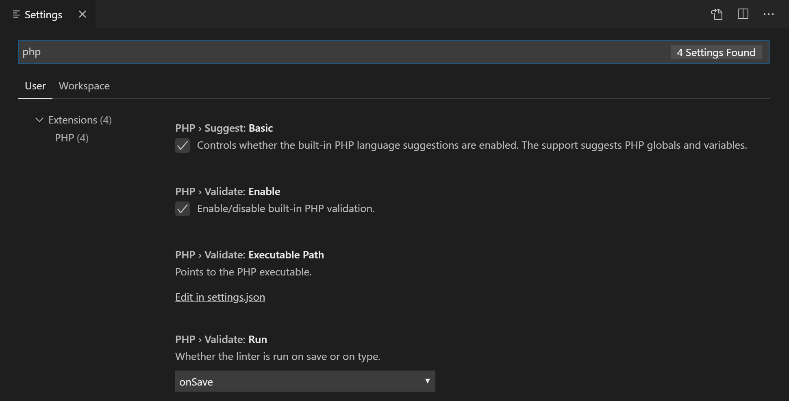
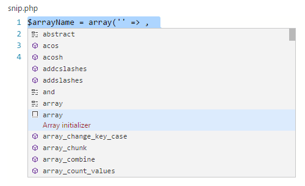
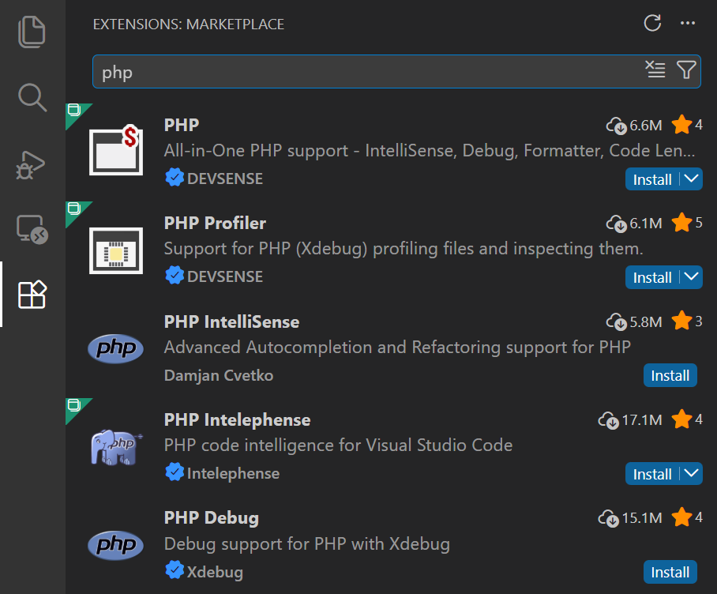

+++
title = "10.2.11 PHP"
date = 2026-11-06T07:53:25+08:00
weight = 11
type = "docs"
description = ""
isCJKLanguage = true
draft = false
+++


> 原文链接: [https://code.visualstudio.com/docs/languages/php](https://code.visualstudio.com/docs/languages/php)

# 10.2.11 PHP

　　VS Code 是出色的 PHP 开发编辑器。开箱即用提供语法高亮、括号匹配、IntelliSense（代码补全）和代码片段，还可以通过社区创建的 VS Code [扩展](../../../editor/3.3-ConfigureTheEditor/3.3.6-Extensions/3.3.6.2-ExtensionMarketplace/)添加更多功能。

## Lint {#linting}

　　VS Code 使用官方 PHP linter（`php -l`）进行 PHP 语言诊断，因此能持续获得 PHP linter 的改进。

> **提示**：使用 XAMPP？请安装完整版 PHP 以获得开发库。

有三个[设置](../../../editor/3.3-ConfigureTheEditor/3.3.4-Settings/)控制 PHP linter：

* `php.validate.enable`：控制是否启用 PHP lint，默认启用。
* `php.validate.executablePath`：指向磁盘上的 PHP 可执行文件。PHP 可执行文件不在系统路径中时设置。
* `php.validate.run`：控制验证在保存时（`"onSave"`）还是输入时（`"onType"`）触发，默认保存时。

要更改 PHP 设置，请打开 **用户或工作区设置**（`Ctrl + ,`）并输入“php”筛选可用设置。



要设置 PHP 可执行文件路径，请选择 **PHP > Validate: Executable Path** 下的 **在 settings.json 中编辑** 链接，打开用户 `settings.json`。添加 `php.validate.executablePath` 设置和 PHP 安装路径：

### Windows {#windows}

```json
{
    "php.validate.executablePath": "c:/php/php.exe"
}
```

### Linux 和 macOS {#linux-and-macos}

```json
{
    "php.validate.executablePath": "/usr/bin/php"
}

or

{
    "php.validate.executablePath": "/usr/local/bin/php"
}
```

## 代码片段 {#snippets}

　　VS Code 包含一组常用 PHP 代码片段。按 `Ctrl + Space` 获取上下文相关列表。



## PHP 扩展 {#php-extensions}

　　[Marketplace](https://marketplace.visualstudio.com/VSCode) 中有许多 PHP 语言扩展，并且还在不断增加。可以在 VS Code **扩展** 视图（`Ctrl + Shift + X`）中输入“php”筛选扩展下拉列表。



### 禁用内置 PHP 支持 {#disable-built-in-php-support}

　　要禁用以安装在 PHP 扩展提供的建议替代内置 PHP 智能补全，请取消选中 **PHP > Suggest: Basic**，这会在 `settings.json` 中将 `php.suggest.basic` 设置为 false。

## 调试 {#debugging}

　　VS Code 通过 [PHP Debug 扩展](https://marketplace.visualstudio.com/items?itemName=xdebug.php-debug)支持 **XDebug** 调试 PHP。请遵循扩展说明配置 **XDebug** 与 VS Code 配合工作。

## 后续步骤 {#next-steps}

继续阅读：

* [扩展 Marketplace](../../../editor/3.3-ConfigureTheEditor/3.3.6-Extensions/3.3.6.2-ExtensionMarketplace/)：浏览其他人共享的扩展。
* [调试](../../../debugging-and-testing/6.1-Debugging/)：了解更多 VS Code 调试功能。
