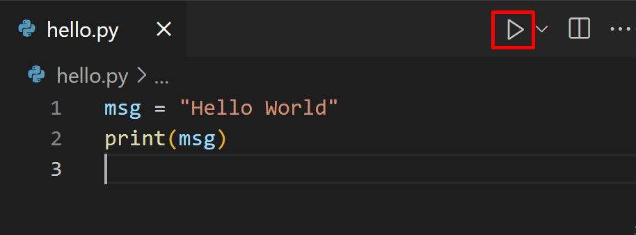
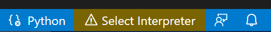
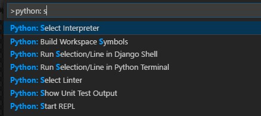
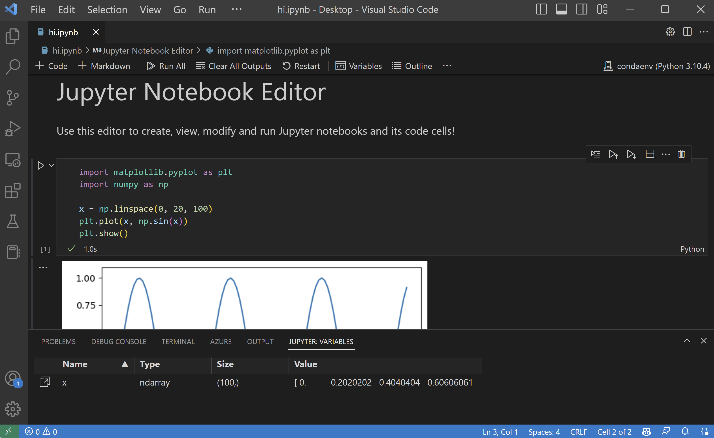
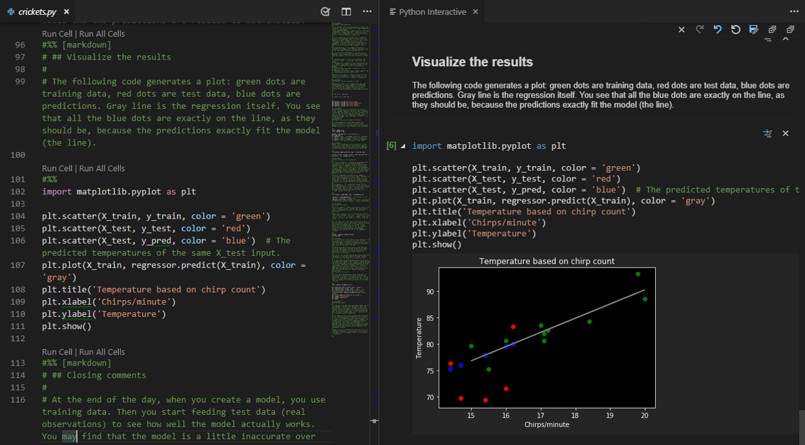
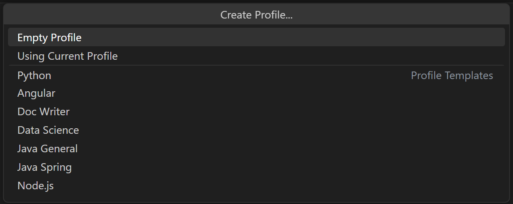

+++
title = "10.2.12 Python"
date = 2026-11-06T07:53:25+08:00
weight = 12
type = "docs"
description = ""
isCJKLanguage = true
draft = false
+++


> 原文链接: [https://code.visualstudio.com/docs/languages/python](https://code.visualstudio.com/docs/languages/python)

# 10.2.12 Python

　　使用 [Microsoft Python 扩展](https://marketplace.visualstudio.com/items?itemName=ms-python.python)在 VS Code 中处理 Python 简单、有趣且高效。该扩展使 VS Code 成为出色的 Python 编辑器，可在任何操作系统上配合多种 Python 解释器工作。它利用 VS Code 的全部能力提供自动补全、IntelliSense、lint、调试和单元测试，并可轻松切换 Python 环境，包括虚拟环境和 conda 环境。

　　本文仅概述 Python 扩展为 VS Code 提供的不同能力。编辑、运行和调试代码的演练请使用下方按钮。

<a class="next-topic-btn" href="https://code.visualstudio.com/docs/python/python-tutorial">Python 教程</a>

## 安装 Python 和 Python 扩展 {#install-python-and-the-python-extension}

　　[教程](https://code.visualstudio.com/docs/python/python-tutorial)指导安装 Python 并使用扩展。必须单独安装 Python 解释器。快速安装可以使用 [python.org 的 Python](https://www.python.org/downloads/)，并从 [Marketplace 安装扩展](https://marketplace.visualstudio.com/items?itemName=ms-python.python)。

> **注意**：为帮助开始 Python 开发，可以使用 [Python 配置文件模板](../../../editor/3.3-ConfigureTheEditor/3.3.8-Profiles/)，其中包含有用扩展、设置和 Python 代码片段。

安装 Python 后，使用 **Python: Select Interpreter** 命令选择解释器。VS Code 未自动找到所需解释器时，请参阅[选择环境](https://code.visualstudio.com/docs/python/environments#select-an-environment)。

可以通过设置配置 Python 扩展。详情请参阅 [Python 设置参考](https://code.visualstudio.com/docs/python/settings-reference)。

> **Windows Subsystem for Linux**：Windows 上 WSL 是进行 Python 开发的好方法。可以在 Windows 上运行 Linux 发行版，通常已安装 Python。配合 [WSL 扩展](https://marketplace.visualstudio.com/items?itemName=ms-vscode-remote.remote-wsl)，在 WSL 上下文中运行时可以获得完整的 VS Code 编辑和调试支持。详情请参阅[在 WSL 中开发](../../../remote/8.6-WSL/)，或尝试[在 WSL 中工作](../../../remote/8.7-WSLTutorial/)教程。

## 运行 Python 代码 {#run-python-code}

　　要体验 Python，请创建名为 `hello.py` 的文件（使用[文件资源管理器](../../../editor/3.1-GettingStarted/3.1.2-UserInterface/)）并粘贴：

```python
print("Hello World")
```

　　Python 扩展随后提供使用当前所选解释器运行 Python 代码的快捷方式（命令面板中的 **Python: Select Interpreter**）。要运行活动 Python 文件，请单击编辑器右上角的 **Run Python File** 播放按钮。



　　也可以使用 **Python: Run Selection/Line in Python Terminal** 命令（`Shift + Enter`）运行单独行或选中代码。没有选择时，Smart Send 会将光标所在行周围最小的可运行代码块发送到 Python 终端（`Shift + Enter`）。编辑器选择上下文菜单中也有相同的 **Run Python > Run Selection/Line in Python Terminal** 命令。每次在终端/REPL 中运行选择或行时都会使用同一终端，直到关闭。**Run Python File in Terminal** 也使用同一终端。如果终端仍在运行 REPL，请在运行 Python 文件前退出 REPL（`exit()`）或切换到其他终端。

　　Python 扩展会根据选择的第一非空行自动移除缩进，必要时将所有其他行左移。

　　命令会在需要时打开 Python 终端；也可以使用 **Python: Start Terminal REPL** 命令直接打开交互式 REPL，它会激活当前所选解释器的终端并运行 Python REPL。

更具体的演练和其他运行代码方式请参阅[运行代码教程](https://code.visualstudio.com/docs/python/python-tutorial)。

## 自动补全和 IntelliSense {#autocomplete-and-intellisense}

　　Python 扩展使用当前所选解释器支持代码补全和 IntelliSense。[IntelliSense](../../../editor/3.2-WriteCode/3.2.2-IntelliSense/)是多项功能的统称，包括跨所有文件以及内置和第三方模块的智能代码补全（上下文方法和变量建议）。

　　IntelliSense 会在输入时快速显示方法、类成员和文档。也可以随时按 `Ctrl + Space` 触发补全。悬停在标识符上会显示更多信息。

<video src="https://code.visualstudio.com/assets/docs/languages/python/python-editing.mp4" title="Python 代码的 IntelliSense 和自动补全。" autoplay loop controls muted></video>

## 使用 AI 增强补全 {#enhance-completions-with-ai}

　　GitHub Copilot 会在编辑器中输入时提供编码建议。也可以向 Copilot 询问与编码相关的问题，例如如何更好地编写代码、如何修复错误，或他人的代码如何工作。

　　请参阅 [VS Code 中的 AI](../../../ai-in-vs-code/)了解入门方法。

## Lint {#linting}

　　Lint 分析 Python 代码中的潜在错误，便于导航到并修正不同问题。

　　Python 扩展可以应用多种 linter，包括 Pylint、pycodestyle、Flake8、mypy、pydocstyle、prospector 和 pylama。请参阅 [Lint](https://code.visualstudio.com/docs/python/linting)。

<video autoplay loop muted playsinline controls title="Python lint 视频">
  <source src="https://code.visualstudio.com/assets/docs/languages/python/python-linting.mp4" type="video/mp4">
</video>

## 调试 {#debugging}

　　不再需要用 `print` 调试！VS Code 通过 [Python Debugger 扩展](https://marketplace.visualstudio.com/items?itemName=ms-python.debugpy)为 Python 提供出色的调试支持，可以设置断点、检查变量并使用调试控制台深入了解程序逐步执行情况。可以调试多种 Python 应用，包括多线程、Web 和远程应用。

Python 调试的更多信息（例如配置 `launch.json` 和实现远程调试）请参阅[调试](https://code.visualstudio.com/docs/python/debugging)。通用 VS Code 调试信息请参阅[调试](../../../debugging-and-testing/6.1-Debugging/)。

此外，[Django](https://code.visualstudio.com/docs/python/tutorial-django) 和 [Flask](https://code.visualstudio.com/docs/python/tutorial-flask) 教程提供了在 Web 应用中实现调试的示例，包括调试 Django 模板。

<video autoplay loop muted playsinline controls title="Python 调试视频">
  <source src="https://code.visualstudio.com/assets/docs/languages/python/python-debugging.mp4" type="video/mp4">
</video>

## 环境 {#environments}

　　Python 扩展会自动检测安装在标准位置的 Python 解释器，也会检测工作区文件夹中的 conda 环境和虚拟环境。请参阅[配置 Python 环境](https://code.visualstudio.com/docs/python/environments)。

当前环境显示在 VS Code 状态栏右侧：


状态栏还会指示未选择解释器：



　　所选环境用于 IntelliSense、自动补全、lint、格式化以及其他语言相关功能。在终端运行或调试 Python，或使用 **Terminal: Create New Terminal** 命令创建新终端时，也会激活该环境。

要更改当前解释器（包括切换到 conda 或虚拟环境），请选择状态栏中的解释器名称，或使用 **Python: Select Interpreter** 命令。



　　VS Code 会提示检测到的环境列表以及手动添加到用户设置的环境（请参阅[配置 Python 环境](https://code.visualstudio.com/docs/python/environments)）。

## Jupyter 笔记本 {#jupyter-notebooks}

　　要为 VS Code 中的 [Jupyter 笔记本](https://jupyter.org/)文件（`.ipynb`）启用 Python 支持，可以安装 [Jupyter 扩展](https://marketplace.visualstudio.com/items?itemName=ms-toolsai.jupyter)。Python 和 Jupyter 扩展共同提供出色的笔记本体验，可以直接查看和修改代码单元格，支持 IntelliSense，并运行和调试。



　　也可以通过 **Jupyter: Export to Python Script** 命令将笔记本转换并打开为 Python 代码文件。笔记本单元格在 Python 文件中以 `#%%` 注释分隔，Jupyter 扩展显示 **Run Cell** 或 **Run Below** CodeLens。选择任一 CodeLens 会启动 Jupyter 服务器并在 Python 交互窗口中运行单元格：



　　也可以连接远程 Jupyter 服务器运行笔记本。详情请参阅 [Jupyter 支持](https://code.visualstudio.com/docs/datascience/jupyter-notebooks)。

## 测试 {#testing}

　　Python 扩展支持使用 Python 内置 unittest 框架和 pytest 进行[测试](https://code.visualstudio.com/docs/python/testing)。

要运行测试，必须在项目设置中启用一种受支持的测试框架。每种框架有自己的设置，例如用于识别测试发现路径和模式的参数。

发现测试后，VS Code 提供多种命令（状态栏、命令面板等）运行和调试测试，也可以运行单个测试文件和方法。

## 配置 {#configuration}

　　Python 扩展为其各种功能提供多种设置。相关设置在各主题中描述，例如[编辑代码](https://code.visualstudio.com/docs/python/editing)、[Lint](https://code.visualstudio.com/docs/python/linting)、[调试](https://code.visualstudio.com/docs/python/debugging)和[测试](https://code.visualstudio.com/docs/python/testing)。完整列表请参阅[设置参考](https://code.visualstudio.com/docs/python/settings-reference)。

## Python 配置文件模板 {#python-profile-template}

　　[配置文件](../../../editor/3.3-ConfigureTheEditor/3.3.8-Profiles/)可以根据当前项目或任务快速切换扩展、设置和 UI 布局。为帮助开始 Python 开发，可以使用 [Python 配置文件模板](../../../editor/3.3-ConfigureTheEditor/3.3.8-Profiles/)，其中包含有用的扩展、设置和代码片段。可以按原样使用，或作为进一步自定义的起点。

通过 **配置文件** > **创建配置文件...** 下拉列表选择模板：



　　选择模板后，可以审查设置和扩展，并移除不想包含的项。基于模板创建新配置文件后，对设置、扩展或 UI 的更改会保存在配置文件中。

## 其他流行 Python 扩展 {#other-popular-python-extensions}

　　[Microsoft Python 扩展](https://marketplace.visualstudio.com/items?itemName=ms-python.python)提供本文前述所有功能。安装其他流行 Python 扩展可以为 VS Code 添加更多 Python 语言支持。

1. 打开 **扩展** 视图（`Ctrl + Shift + X`）。
2. 输入“python”筛选扩展列表。

　　上方扩展动态查询。单击扩展卡片阅读说明和评论，判断哪个扩展最适合你。更多内容请参阅 [Marketplace](https://marketplace.visualstudio.com/vscode)。

## 后续步骤 {#next-steps}

* [Python Hello World 教程](https://code.visualstudio.com/docs/python/python-tutorial)：在 VS Code 中开始使用 Python。
* [编辑 Python](https://code.visualstudio.com/docs/python/editing)：了解 Python 自动补全、格式化和重构。
* [基本编辑](../../../editor/3.2-WriteCode/3.2.1-BasicEditing/)：了解 VS Code 编辑器。
* [代码导航](../../../editor/3.2-WriteCode/3.2.5-CodeNavigation/)：快速浏览源代码。
* [Django 教程](https://code.visualstudio.com/docs/python/tutorial-django)
* [Flask 教程](https://code.visualstudio.com/docs/python/tutorial-flask)
