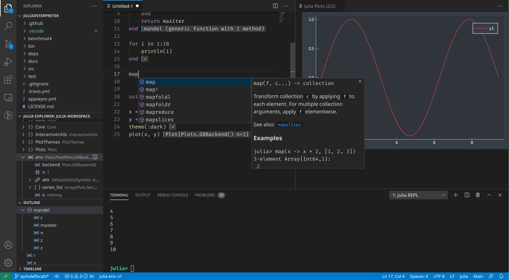
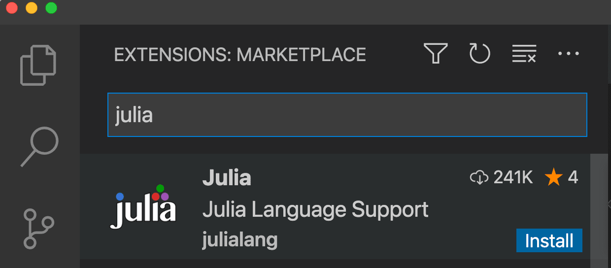
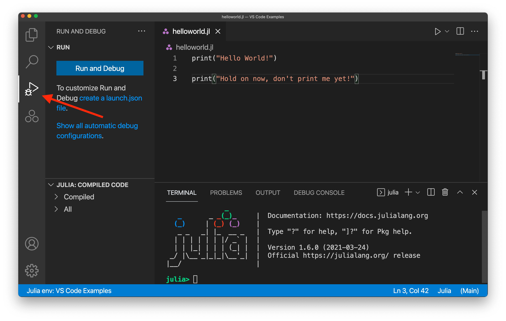
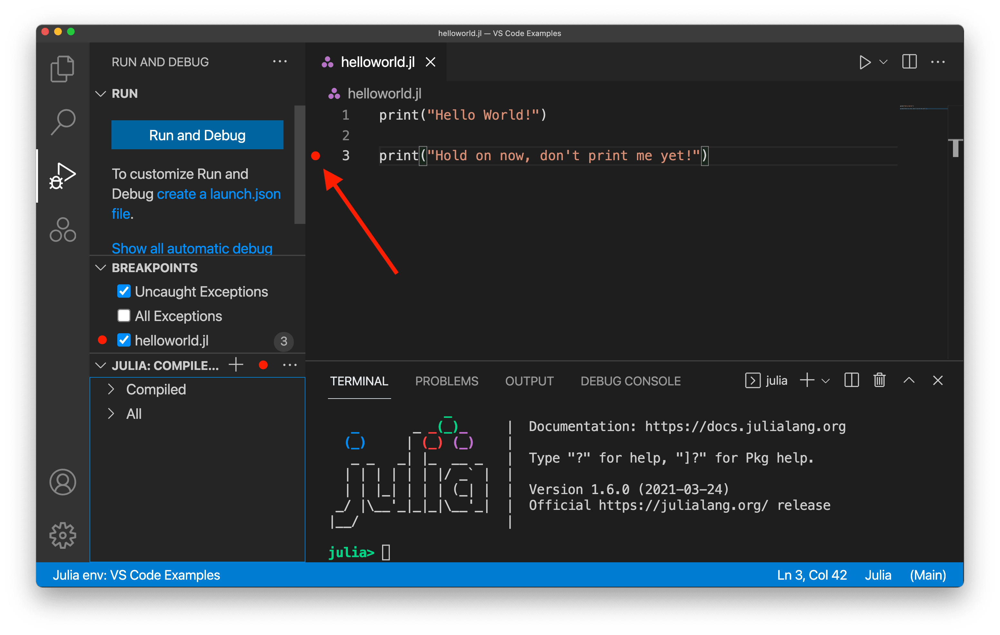
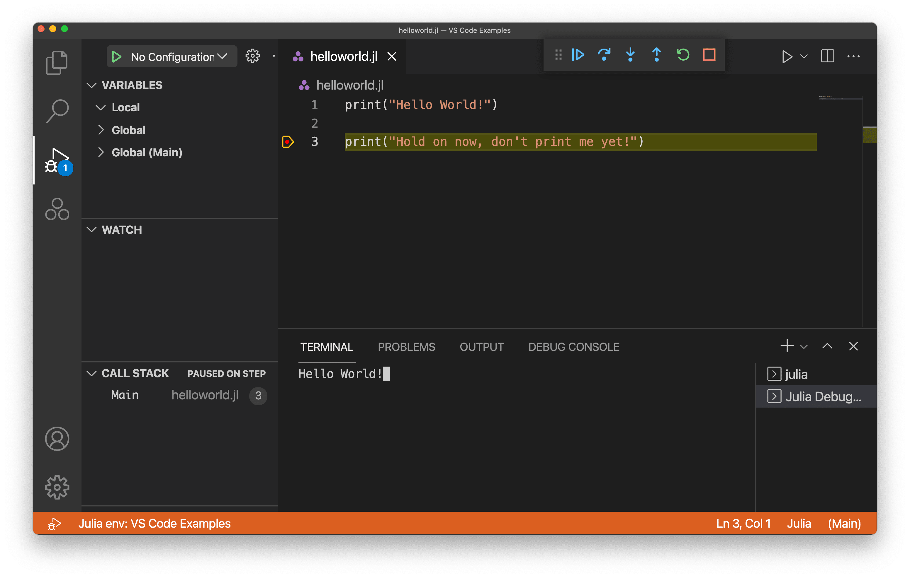
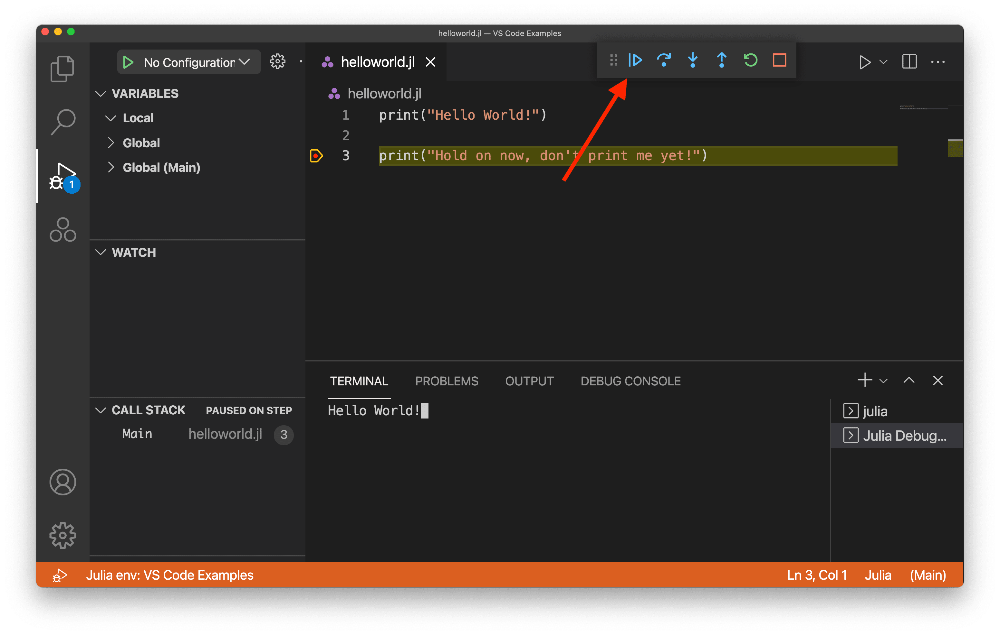
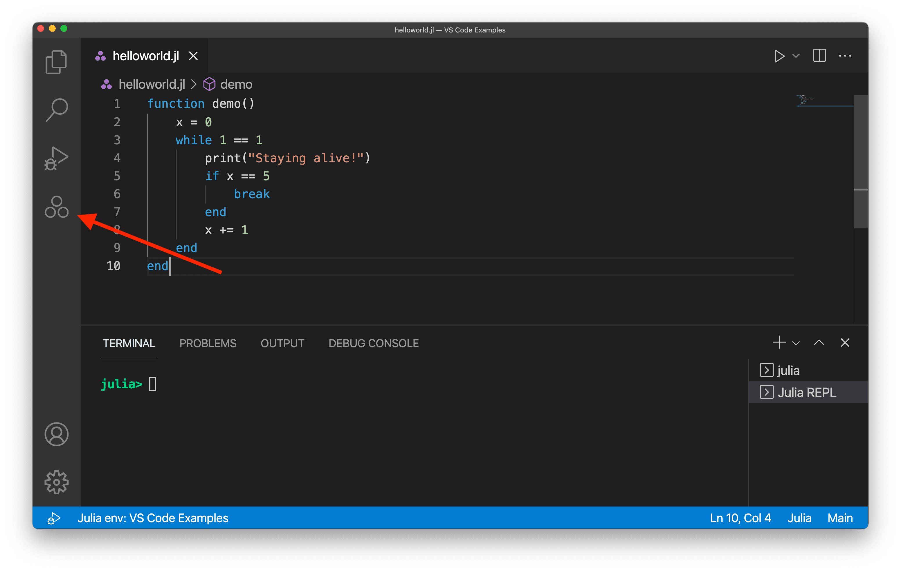
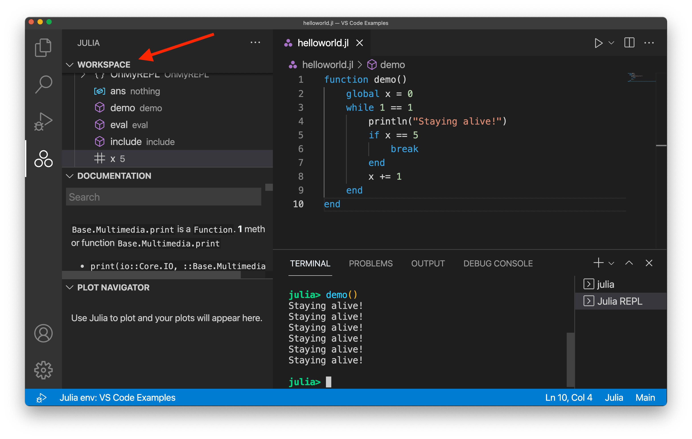
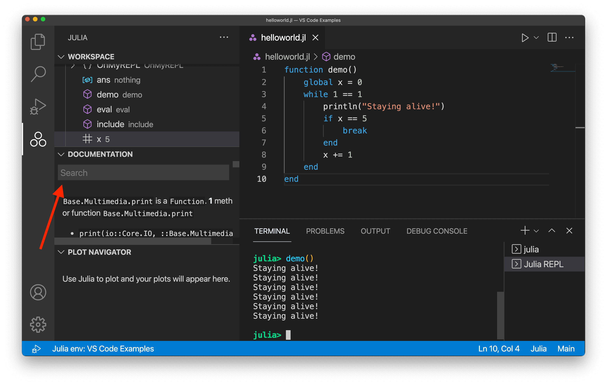

+++
title = "10.2.13 Julia"
date = 2026-11-06T07:53:25+08:00
weight = 13
type = "docs"
description = ""
isCJKLanguage = true
draft = false
+++

> 原文链接: [https://code.visualstudio.com/docs/languages/julia](https://code.visualstudio.com/docs/languages/julia)

# 10.2.13 Julia

　　[Julia 编程语言](https://julialang.org)是为速度和简洁而构建的高级动态语言。Julia 常用于数据科学、机器学习和科学计算等领域，但仍是可处理大多数编程用例的通用语言。

　　适用于 VS Code 的 [Julia 扩展](https://marketplace.visualstudio.com/items?itemName=julialang.language-julia)包含动态自动补全、内联结果、绘图窗格、集成 REPL、变量视图、代码导航和许多其他高级语言功能。

　　大多数功能开箱即用，部分功能可能需要基本配置才能获得最佳体验。本页总结 Julia VS Code 扩展包含的功能。这些功能的工作和配置详情请参阅 [VS Code 中的 Julia](https://www.julia-vscode.org/docs/stable/)文档。

## 入门 {#getting-started}

1. 为平台安装 Julia：[https://julialang.org/install](https://julialang.org/install)。
2. 为平台安装 VS Code：[https://code.visualstudio.com/download](https://code.visualstudio.com/download)。
3. 在 [Marketplace](https://marketplace.visualstudio.com/items?itemName=julialang.language-julia)打开 Julia 扩展并单击 **安装**；或按以下步骤手动安装：
    1. 启动 VS Code。
    2. 在 VS Code 中单击顶部菜单栏 **视图**，选择 **扩展**，打开扩展视图。
    3. 在扩展视图的 Marketplace 搜索框搜索“julia”，选择 Julia 扩展（julialang.language-julia）并单击 **安装**。
    4. 重启 VS Code。

　　安装 Julia VS Code 扩展遇到问题时，请参阅[安装扩展](../../../editor/3.3-ConfigureTheEditor/3.3.6-Extensions/3.3.6.2-ExtensionMarketplace/)。

## 运行代码 {#running-code}

　　在 VS Code 中有几种运行 Julia 代码的方式。可以运行 Julia 文件（通过 `Ctrl + F5`，运行当前打开并活动的 Julia 文件）、通过 REPL 执行 Julia 命令，甚至执行打开文件中特定代码块。详情请参阅 [VS Code 中的 Julia - 运行代码](https://www.julia-vscode.org/docs/stable/userguide/runningcode/)。

## 调试 {#debugging}

　　打开要调试的 Julia 文件，然后在活动栏选择 **运行和调试** 视图：

接下来，单击行号左侧添加断点：

　　选择行号旁区域后才会显示红点。

　　添加断点（或任何其他调试配置）后，选择左侧 **运行和调试** 按钮。首次运行可能需要几秒钟。随后会看到使用调试配置运行代码的输出。此示例添加了断点，因此会看到：

　　注意第二条 print 命令尚未执行，终端中只有第一条 print 命令的文本。选择 **继续** 按钮完成程序执行：

　　更多 VS Code 调试 Julia 代码的信息请参阅 [VS Code 中的 Julia - 调试](https://www.julia-vscode.org/docs/stable/userguide/debugging/)。

## 代码补全（IntelliSense） {#code-completion-intellisense}

　　Julia VS Code 扩展通过 IntelliSense 提供代码补全。此功能开箱即用，对经验丰富的 Julia 开发者和初学者都有用。

<video src="https://code.visualstudio.com/assets/docs/languages/julia/code-completion.mp4" title="使用 IntelliSense 的代码补全。" autoplay loop controls muted></video>

更多信息请参阅 [VS Code IntelliSense](../../../editor/3.2-WriteCode/3.2.2-IntelliSense/)主题。

## Julia 视图 {#julia-view}

　　默认情况下，活动栏窗口左侧会显示 Julia 三点徽标：

　　选择 Julia 图标会打开 Julia 视图，显示 **工作区**、**文档** 和 **绘图导航器** 部分。**工作区** 部分显示加载到活动 Julia 会话中的源代码集合。尚未运行代码时默认为空，运行后会看到工作区状态。

　　**文档** 部分可以查看特定 Julia 函数的详细信息，无需打开单独浏览器窗口。可以搜索活动会话中加载的任何 Julia 包文档（通过 `using some_package`），但默认搜索栏只显示核心 Julia 文档结果。

　　还有内置 **绘图导航器**，处理带可视化组件的项目时非常有用。可以将绘图默认渲染在 VS Code 中，然后方便地前后导航。

## 后续步骤 {#next-steps}

　　本文简要概述了 VS Code 中 Julia 扩展的功能。更多信息请参阅 Julia 扩展 [README](https://github.com/julia-vscode/julia-vscode#julia)。

了解 Julia 扩展最新功能/缺陷修复，请参阅 [CHANGELOG](https://github.com/julia-vscode/julia-vscode/blob/master/CHANGELOG.md)。

有问题或功能请求，请在 Julia 扩展 [GitHub 仓库](https://github.com/julia-vscode/julia-vscode/issues)记录。

想了解更多 VS Code，请尝试：

* [基本编辑](../../../editor/3.2-WriteCode/3.2.1-BasicEditing/)：VS Code 编辑器基础快速介绍。
* [安装扩展](../../../editor/3.3-ConfigureTheEditor/3.3.6-Extensions/3.3.6.2-ExtensionMarketplace/)：了解 [Marketplace](https://marketplace.visualstudio.com/vscode)中的其他扩展。
* [代码导航](../../../editor/3.2-WriteCode/3.2.5-CodeNavigation/)：快速浏览源代码。
