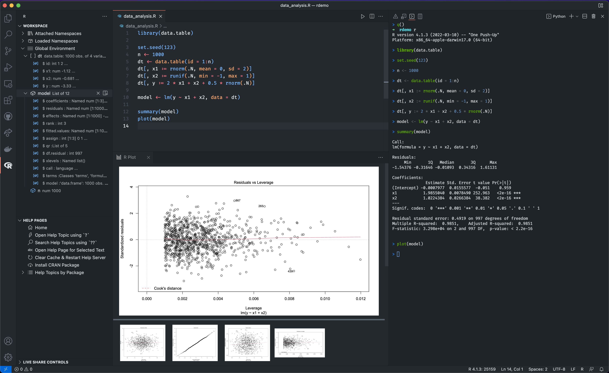

+++
title = "10.2.14 R"
date = 2026-11-06T07:53:25+08:00
weight = 14
type = "docs"
description = ""
isCJKLanguage = true
draft = false
+++


> 原文链接: [https://code.visualstudio.com/docs/languages/r](https://code.visualstudio.com/docs/languages/r)

# 10.2.14 R

　　[R 编程语言](https://www.r-project.org/)是为统计计算和图形构建的动态语言。R 常用于统计分析、科学计算、机器学习和数据可视化。

　　适用于 VS Code 的 [R 扩展](https://marketplace.visualstudio.com/items?itemName=REditorSupport.r)支持扩展语法高亮、代码补全、lint、格式化、与 R 终端交互、查看数据、绘图、工作区变量、帮助页面、管理包以及处理 [R Markdown](https://github.com/REditorSupport/vscode-R/wiki/R-Markdown) 文档。

[](./images/r-overview.png)

## 入门 {#getting-started}

1. 为平台[安装 R](https://cloud.r-project.org/)（>= 3.4.0）。Windows 用户建议安装时勾选 **Save version number in registry**，以便 R 扩展自动找到 R 可执行文件。

2. 在 R 中安装 [`languageserver`](https://github.com/REditorSupport/languageserver)：

    ```r
    install.packages("languageserver")
    ```

3. 安装 [VS Code 的 R 扩展](https://marketplace.visualstudio.com/items?itemName=REditorSupport.r)。

4. 创建 R 文件并开始编码。

为改善 VS Code 中的 R 体验，建议使用以下软件和包：

* [radian](https://github.com/randy3k/radian)：现代 R 控制台，修正官方 R 终端的许多限制，支持语法高亮和自动补全等功能。

* [httpgd](https://github.com/nx10/httpgd)：提供通过 HTTP 和 WebSocket 异步提供 SVG 图形的图形设备。R 扩展的交互式绘图查看器需要此包。

　　安装 R 包或 VS Code R 扩展遇到问题时，请参阅安装 wiki 页面（[Windows](https://github.com/REditorSupport/vscode-R/wiki/Installation:-Windows) | [macOS](https://github.com/REditorSupport/vscode-R/wiki/Installation:-macOS) | [Linux](https://github.com/REditorSupport/vscode-R/wiki/Installation:-Linux)）。

## 运行 R 代码 {#running-r-code}

　　运行 R 代码就是将代码发送到 R 终端。运行前，可以通过命令面板中的 **R: Create R terminal** 命令创建 R 终端。

R 终端就绪后，可以选择代码或将光标放在要运行代码的开头或结尾，按 `Ctrl + Enter`，代码会发送到活动 R 终端。

要运行整个 R 文件，请在编辑器中打开文件并按 `Ctrl + Shift + S`，文件会在活动 R 终端中 source。

更高级用法（例如多个 R 终端或自管理 R 终端）请参阅[与 R 终端交互](https://github.com/REditorSupport/vscode-R/wiki/Interacting-with-R-terminals)。

## 代码补全（IntelliSense） {#code-completion-intellisense}

　　R 扩展通过 R 语言服务器支持代码补全和许多其他代码编辑功能。补全会显示作用域和当前 R 工作区中的可用函数与变量，以及包文档或作为注释提供的文档。

<video src="https://code.visualstudio.com/assets/docs/languages/r/completion.mp4" title="代码补全。" autoplay loop controls muted></video>

## Lint {#linting}

　　Lint 是检查代码警告和潜在错误的功能。R 代码 lint 由 [lintr](https://github.com/r-lib/lintr) 包提供。可以通过[配置文件](https://lintr.r-lib.org/articles/lintr.html#configuring-linters)从[可用 linter 列表](https://lintr.r-lib.org/reference/index.html#individual-linters)中选择自定义。

<video src="https://code.visualstudio.com/assets/docs/languages/r/linting.mp4" title="Lint。" autoplay loop controls muted></video>

　　除代码补全和 lint，R 扩展还支持代码格式化、转到定义、重命名符号、查找引用等功能。详情请参阅 [R 语言服务](https://github.com/REditorSupport/vscode-R/wiki/R-Language-Service)。

## 工作区查看器 {#workspace-viewer}

　　工作区查看器位于 VS Code 侧边栏，包含活动 R 会话中使用的包和全局变量。选择活动栏中的 R 图标会显示工作区查看器和帮助页面查看器。它便于查看 R 工作区、预览现有 R 对象、查找帮助主题并交互阅读帮助页面。

<video src="https://code.visualstudio.com/assets/docs/languages/r/workspace-viewer.mp4" title="工作区查看器。" autoplay loop controls muted></video>

　　除工作区查看器，还有数据查看器、绘图查看器和 widget 查看器。详情请参阅[交互式查看器](https://github.com/REditorSupport/vscode-R/wiki/Interactive-viewers)。

## 调试 {#debugging}

　　R 调试功能由 [R Debugger](https://marketplace.visualstudio.com/items?itemName=RDebugger.r-debugger) 扩展提供。它支持通过启动新 R 进程或附加到运行中进程来调试 R 代码或 R 项目。

　　命中断点时，可以查看或修改当前所选堆栈帧的变量，或在堆栈帧的调试控制台中求值表达式。

更多详情请参阅项目 [README](https://github.com/ManuelHentschel/VSCode-R-Debugger)。

## 后续步骤 {#next-steps}

　　本文是 VS Code R 扩展的快速介绍。详细功能列表请参阅扩展 [README](https://github.com/REditorSupport/vscode-R#features)。

有问题、建议或功能请求，请在 [GitHub 仓库](https://github.com/REditorSupport/vscode-R/issues)创建议题。

想了解更多 VS Code，请尝试：

* [基本编辑](../../../editor/3.2-WriteCode/3.2.1-BasicEditing/)：VS Code 编辑器基础快速介绍。
* [安装扩展](../../../editor/3.3-ConfigureTheEditor/3.3.6-Extensions/3.3.6.2-ExtensionMarketplace/)：了解 [Marketplace](https://marketplace.visualstudio.com/vscode)中的其他扩展。
* [代码导航](../../../editor/3.2-WriteCode/3.2.5-CodeNavigation/)：快速浏览源代码。
