+++
title = "10.2.15 Ruby"
date = 2026-11-06T07:53:25+08:00
weight = 15
type = "docs"
description = ""
isCJKLanguage = true
draft = false
+++


> 原文链接: [https://code.visualstudio.com/docs/languages/ruby](https://code.visualstudio.com/docs/languages/ruby)

# 10.2.15 Ruby

　　[Ruby](https://www.ruby-lang.org) 是动态开源编程语言，以简洁和高效著称。其表达式丰富、语法优雅，Ruby 哲学的一部分就是让开发者快乐。它常用于各种 Web 框架开发以及脚本编写，构建原型时可以快速迭代。

　　本主题详细介绍如何在 VS Code 中使用 [Ruby LSP](https://marketplace.visualstudio.com/items?itemName=Shopify.ruby-lsp) 扩展设置和使用 Ruby。

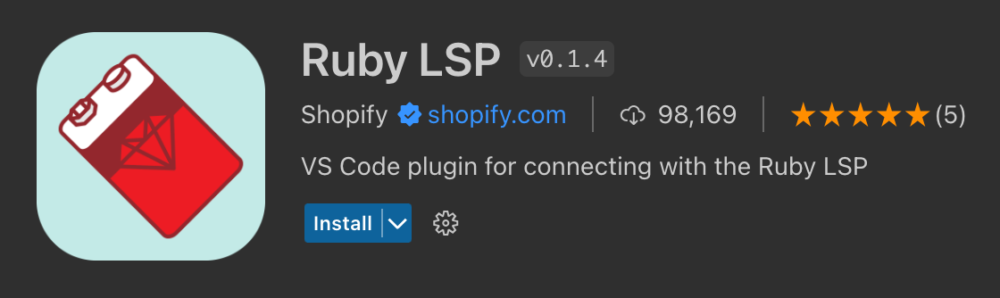

## 安装 {#installation}

### 通过版本管理器安装 Ruby {#install-ruby-through-a-version-manager}

　　某些操作系统（例如 macOS 和部分 Linux 发行版）默认安装 Ruby，但建议使用版本管理器获取较新 Ruby 版本，例如 macOS 和 Linux 上的 [rbenv](https://github.com/rbenv/rbenv)，Windows 上的 [rbenv for Windows](https://github.com/RubyMetric/rbenv-for-windows)。请遵循平台的[安装指南](https://github.com/rbenv/rbenv#installation)。

> **注意**：与安装任何新工具集一样，请重启终端/命令提示符和 VS Code 实例，使平台 PATH 变量使用更新后的工具集位置。

### 在 VS Code 中安装 Ruby LSP 扩展 {#install-the-ruby-lsp-extension-in-vs-code}

　　可以在 VS Code **扩展** 视图（`Ctrl + Shift + X`）搜索“Ruby LSP”查找并安装 Ruby LSP 扩展。

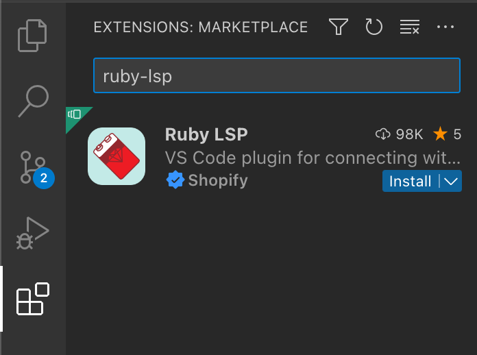

　　本文讨论 Ruby LSP 的许多功能，也可以参阅扩展[文档](https://shopify.github.io/ruby-lsp)和[仓库](https://github.com/Shopify/ruby-lsp)。

### 检查安装 {#check-your-installation}

　　安装后，检查 **状态栏** 中的语言状态项，查看 Ruby LSP 服务器状态。版本管理器配置正确时应显示项目正确的 Ruby 版本。服务器状态应显示正在启动或正在运行，而不是错误。

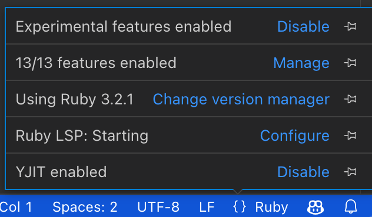

　　扩展会自动生成 `.ruby-lsp` 文件夹，其中包含语言服务器 gem `ruby-lsp` 的自定义 bundle，无需配置。

　　默认情况下，扩展会尝试自动检测使用的 Ruby 版本管理器，并使用正确的版本和路径。要自定义此行为，请在用户[设置](../../../editor/3.3-ConfigureTheEditor/3.3.4-Settings/)中设置：

```json
{
  "rubyLsp.rubyVersionManager": {
    "identifier": "rbenv"
  }
}
```

　　扩展会定期自动更新 `ruby-lsp` 语言服务器 gem；要强制更新，请从命令面板（`Ctrl + Shift + P`）运行 **Ruby LSP: Update language server gem**。

遇到问题请参阅[故障排除](https://shopify.github.io/ruby-lsp/troubleshooting.html)。

## 主要功能 {#main-features}

### 导航和 IntelliSense {#navigation-and-intellisense}

　　Ruby LSP 提供多项导航和 IntelliSense 功能，例如转到定义、悬停、工作区符号、文档符号、补全和签名帮助。

<video src="https://code.visualstudio.com/assets/docs/languages/ruby/navigation.mp4" placeholder="./images/navigation-placeholder.png" autoplay loop controls
    muted title="导航和 IntelliSense 功能演示">
    抱歉，浏览器不支持 HTML5 视频。
</video>

　　了解如何使用 VS Code 快速浏览源代码，请参阅[代码导航](../../../editor/3.2-WriteCode/3.2.5-CodeNavigation/)。

### 内联提示 {#inlay-hints}

　　Ruby LSP 可以显示推断或隐式值的有用信息。以下示例中，空 `rescue` 调用中隐式捕获的异常类显示为 `StandardError`。

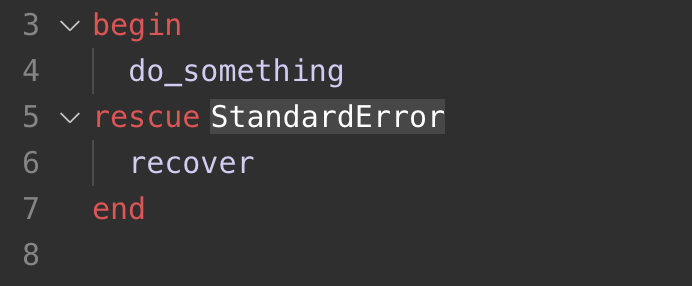

　　内联提示有助于理解代码，但也可以通过 **Editor > Inlay Hints: Enabled** 设置（`editor.inlayHints.enabled`）禁用，或仅在 Ruby LSP 中禁用：

```json
"rubyLsp.enabledFeatures": {
    "inlayHint": false,
}
```

### 语义语法高亮 {#semantic-syntax-highlighting}

　　Ruby LSP 对项目源代码有丰富理解，因此可以使用[语义语法高亮](https://github.com/microsoft/vscode/wiki/Semantic-Highlighting-Overview)和样式。

例如，它可以：

* 一致地高亮方法调用，不与局部变量混淆。
* 在存在作用域内一致地高亮局部参数（方法、块或 lambda 参数）。

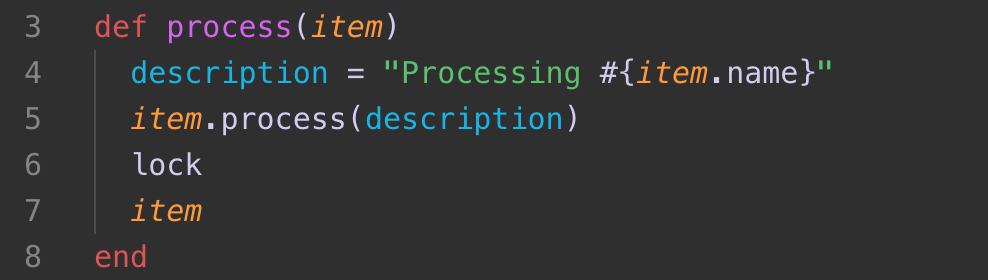

> **注意**：此截图使用 [Ruby 扩展包](https://marketplace.visualstudio.com/items?itemName=Shopify.ruby-extensions-pack)中的 Spinel 主题。主题必须使用 Ruby LSP 提供的信息，才能为 Ruby 文件提供丰富高亮。

要使用此功能，编辑器必须启用语义高亮：

```json
"editor.semanticHighlighting.enabled": true,
```

### Lint 和格式化 {#linting-and-formatting}

　　默认情况下，Ruby LSP 通过集成 [RuboCop](https://github.com/rubocop/rubocop) 提供 lint 和格式化。可以使用 `Shift + Alt + F` 格式化 Ruby 文件，或从命令面板（`Ctrl + Shift + P`）或编辑器上下文菜单运行 **格式化文档**。

项目未使用 RuboCop 时，Ruby LSP 使用 [SyntaxTree](https://ruby-syntax-tree.github.io/syntax_tree) 格式化文件。

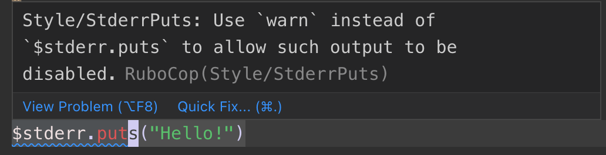

　　也可以每次保存时运行格式化程序（**Editor: Format On Save**），自动保持 Ruby 代码格式。需要启用保存时格式化：

```json
"editor.formatOnSave": true
```

　　Ruby LSP 扩展还通过输入时格式化提供一些便利补全，例如自动续写注释行、自动闭合 `end` 标记、管道或字符串插值大括号。启用输入时格式化：

```json
"editor.formatOnType": true
```

### 快速修复 {#quick-fixes}

　　Linter 发现源代码错误和警告时，Ruby LSP 通常可以提供建议的快速修复（代码操作），通过编辑器灯泡悬停访问。可以使用 `Ctrl + .` 快速打开可用快速修复。

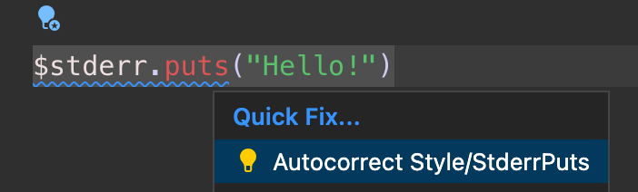

此外，**Code Action Widget: Include Nearby Quick Fixes**（`editor.codeActionWidget.includeNearbyQuickFixes`）默认启用，会从 `Ctrl + .`（命令 ID `editor.action.quickFix`）激活行中最近的快速修复，无论光标在该行什么位置。

该命令会高亮将通过快速修复重构或修复的源代码。普通代码操作和非修复重构仍可在光标位置激活。

### 重构 {#refactoring}

　　除快速修复外，Ruby LSP 还通过代码操作提供重构选项。例如，可以一键将 Ruby 表达式提取为局部变量。

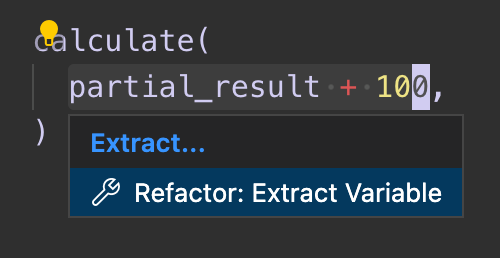

## 运行和调试测试 {#run-and-debug-tests}

　　Ruby LSP 扩展与 VS Code 测试视图集成，可以发现、运行、调试和测量 Ruby 测试覆盖率。

　　Ruby LSP 内置支持 Minitest 和 Test Unit。Rails 项目中，Ruby LSP Rails 插件支持 `ActiveSupport::TestCase`。RSpec 等其他测试框架需要兼容的 Ruby LSP 插件。

发现和运行测试：

1. 打开测试视图（`Ctrl + Shift + ;`）。
2. 展开测试树发现工作区测试。
3. 选择测试、测试组或文件旁的运行按钮。也可以使用编辑器中的测试 CodeLens 操作。

测试视图提供以下测试配置文件：

* **运行**：运行所选测试并在测试结果面板显示结果。
* **在终端中运行**：在 Ruby LSP 配置的终端中运行所选测试。
* **调试**：为所选测试启动调试会话。
* **覆盖率**：启用覆盖率运行测试，并在编辑器中显示覆盖率信息。

　　Ruby LSP 会发现遵循常见 Ruby 约定的测试文件。测试文件必须位于 `test`、`spec` 或 `features` 目录，并使用受支持文件名，例如 `*_test.rb`、`test_*.rb` 或 `*_spec.rb`。通过元编程动态定义的测试可能在运行测试文件后才出现。

框架支持、发现限制和自定义选项请参阅 [Ruby LSP Test Explorer 文档](https://shopify.github.io/ruby-lsp/test_explorer)。

## 调试 {#debugging}

　　Ruby LSP 扩展使用 debug gem（Ruby 官方调试器）支持调试。开发者也可以安装 [VS Code RDBG](https://marketplace.visualstudio.com/items?itemName=KoichiSasada.vscode-rdbg) 扩展获得调试功能。

以下文档适用于 Ruby LSP 调试器客户端。配置 RDBG 请参阅 [RDBG README](https://github.com/ruby/vscode-rdbg)。

### 调试测试 {#debugging-tests}

　　Ruby LSP 在单元测试上方添加 CodeLens 按钮，可以在测试资源管理器中运行示例、在新终端运行或启动调试器。这些用途无需配置。

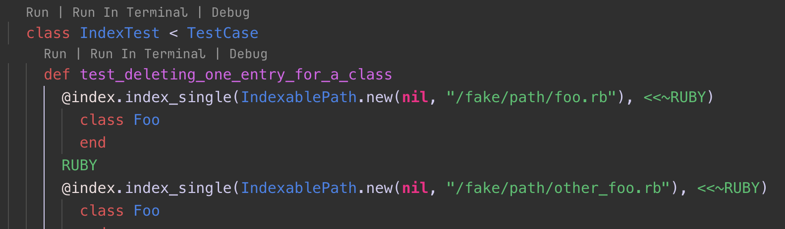

### 通过启动任务调试 {#debugging-through-launch-tasks}

　　要通过启动任务使用调试器，需要在 `launch.json` 文件中创建[调试配置](../../../debugging-and-testing/6.2-DebuggingConfiguration/)。配置可以指定要执行的程序。

为 Ruby 程序创建 `launch.json`：

1. 在调试视图（`Ctrl + Shift + D`）中选择 **创建 launch.json 文件** 链接。
2. 会显示包含几种默认启动配置类型的下拉列表。可以选择第一项，但我们会添加更多配置。
3. 编辑创建的 `.vscode/launch.json`，添加更多启动 Ruby 程序调试的方式。

示例：

```json
{
    "version": "0.2.0",
    "configurations": [
        // 为任意程序启动调试器。此例使用 Ruby 运行当前文件
        {
            "type": "ruby_lsp",
            "name": "Debug",
            "request": "launch",
            "program": "ruby ${file}",
        },
        // 为当前测试文件启动调试器
        {
            "type": "ruby_lsp",
            "request": "launch",
            "name": "Debug test file",
            "program": "ruby -Itest ${relativeFile}"
        },
        // 将调试器客户端附加到已用调试服务器启动的现有 Ruby 进程
        {
            "type": "ruby_lsp",
            "request": "attach",
            "name": "Attach to existing server",
        }
    ]
}
```

　　添加启动配置后，可以通过设置断点并执行启动任务调试 Ruby 程序。

1. 打开 Ruby 文件并单击编辑器左侧装订线设置断点，应显示红点。

   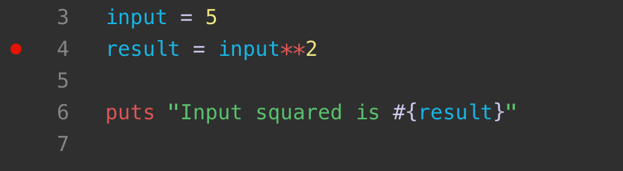

2. 在 **运行和调试** 下选择所需任务并单击开始调试按钮（默认快捷键 `F5`）启动调试。

   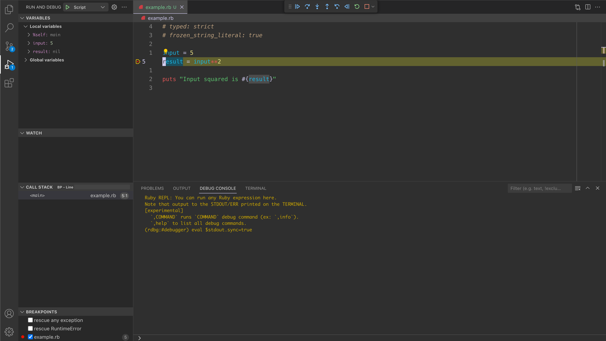

## 后续步骤 {#next-steps}

　　本文简要概述 VS Code 中 Ruby LSP 扩展功能。更多信息请参阅 Ruby LSP [文档](https://shopify.github.io/ruby-lsp)，包括如何调整特定 [VS Code 编辑器](https://github.com/Shopify/ruby-lsp/blob/main/vscode/README.md)配置。

了解 Ruby LSP 扩展最新功能/缺陷修复，请参阅[单体仓库](https://github.com/Shopify/ruby-lsp/releases)的 Releases 页面，其中包含服务器和 VS Code 扩展实现。

有问题或功能请求，请在 Ruby LSP 的 [GitHub 仓库](https://github.com/Shopify/ruby-lsp/issues)记录。

想了解更多 VS Code，请尝试：

* [基本编辑](../../../editor/3.2-WriteCode/3.2.1-BasicEditing/)：VS Code 编辑器基础快速介绍。
* [安装扩展](../../../editor/3.3-ConfigureTheEditor/3.3.6-Extensions/3.3.6.2-ExtensionMarketplace/)：了解 [Marketplace](https://marketplace.visualstudio.com/vscode)中的其他扩展。
* [代码导航](../../../editor/3.2-WriteCode/3.2.5-CodeNavigation/)：快速浏览源代码。
