+++
title = "10.2.16 Rust"
date = 2026-11-06T07:53:25+08:00
weight = 16
type = "docs"
description = ""
isCJKLanguage = true
draft = false
+++


> 原文链接: [https://code.visualstudio.com/docs/languages/rust](https://code.visualstudio.com/docs/languages/rust)

# 10.2.16 Rust

　　[Rust](https://www.rust-lang.org) 是强大的编程语言，常用于对性能和正确性要求很高的系统编程。刚接触 Rust 并想了解更多，[The Rust Programming Language](https://doc.rust-lang.org/book) 在线书籍是很好的起点。本主题详细介绍如何使用 [rust-analyzer](https://marketplace.visualstudio.com/items?itemName=rust-lang.rust-analyzer) 扩展在 VS Code 中设置和使用 Rust。

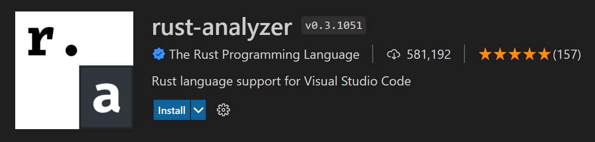

> **注意**：Marketplace 中还有另一个流行的 Rust 扩展（扩展 ID：rust-lang.rust），但该扩展已弃用，rust-analyzer 是 rust-lang.org 推荐的 VS Code Rust 扩展。

## 安装 {#installation}

### 1. 安装 Rust {#1-install-rust}

　　首先需要在机器上安装 Rust 工具集。Rust 通过 [rustup](https://rustup.rs) 安装程序安装，支持 Windows、macOS 和 Linux。请遵循平台的 rustup 安装指南，注意安装构建和运行 Rust 程序所需的额外工具。

> **注意**：与安装任何新工具集一样，请重启终端/命令提示符和 VS Code 实例，使平台 PATH 变量使用更新后的工具集位置。

### 2. 安装 rust-analyzer 扩展 {#2-install-the-rust-analyzer-extension}

　　可以在 VS Code **扩展** 视图（`Ctrl + Shift + X`）搜索“rust-analyzer”查找并安装扩展。应安装 **Release Version**。

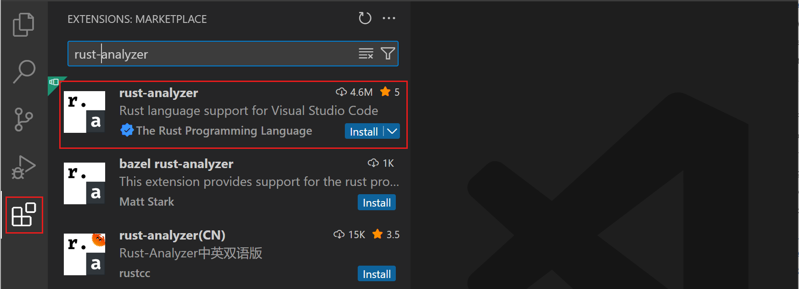

　　本文讨论 rust-analyzer 的许多功能，也可以参阅扩展文档 [https://rust-analyzer.github.io](https://rust-analyzer.github.io)。

### 检查安装 {#check-your-installation}

　　安装 Rust 后，打开新终端/命令提示符并输入以下命令，检查安装是否正确：

```bash
rustc --version
```

　　这会输出 Rust 编译器版本。需要更多详情可以添加 `--verbose` 参数。遇到问题请参阅 Rust [安装指南](https://doc.rust-lang.org/book/ch01-01-installation.html)。

可以通过以下命令将 Rust 安装保持最新：

```bash
rustup update
```

　　Rust 每 6 周发布新的稳定版本，因此这是好习惯。

### 本地 Rust 文档 {#local-rust-documentation}

　　安装 Rust 时也会在本机安装完整 Rust 文档，可以输入 `rustup doc` 查看。Rust 文档（包括 [The Rust Programming Language](https://doc.rust-lang.org/book/title-page.html) 和 [The Cargo Book](https://doc.rust-lang.org/stable/cargo/)）会在本地浏览器打开，离线时也能继续学习 Rust。

## Hello World {#hello-world}

### Cargo {#cargo}

　　使用 rustup 安装 Rust 时，工具集包含 rustc 编译器、rustfmt 源代码格式化程序和 clippy Rust linter，还会安装 [Cargo](https://doc.rust-lang.org/cargo)（Rust 包管理器），帮助下载依赖并构建运行 Rust 程序。使用 Rust 时几乎一切都会用到 `cargo`。

### Cargo new {#cargo-new}

　　创建第一个 Rust 程序的好方法是使用 `cargo new` 搭建新项目。它会创建简单 Hello World 程序以及默认 `Cargo.toml` 依赖文件。将项目创建文件夹作为参数传给 `cargo new`。

创建 Hello World：导航到要创建项目的文件夹并输入：

```bash
cargo new hello_world
```

要在 VS Code 中打开新项目，请进入新文件夹并通过 `code .` 启动：

```bash
cd hello_world
code .
```

> **注意**：你是作者，请为新文件夹启用[工作区信任](../../../editor/3.2-WriteCode/3.2.8-Workspaces/3.2.8.3-WorkspaceTrust/)。可以为整个项目父文件夹启用工作区信任，勾选 **信任“my_projects”父文件夹中所有文件的作者**，创建新项目时就不会再提示。

`cargo new` 创建简单 Hello World 项目，包含 `main.rs` 源代码文件和 `Cargo.toml` [Cargo 清单](https://doc.rust-lang.org/cargo/reference/manifest.html)：

```
src\
    main.rs
.gitignore
Cargo.toml
```

　　`main.rs` 包含程序入口函数 `main()`，并使用 `println!` 向控制台打印“Hello, world!”：

```rust
fn main() {
    println!("Hello, world!");
}
```

　　这个简单 Hello World 程序没有依赖，但可以在 `[dependencies]` 下添加 Rust 包（crate）引用。

### Cargo build {#cargo-build}

　　Cargo 可以用来构建 Rust 项目。打开新的 VS Code [集成终端](../../../terminal/5.2-TerminalBasics/)（`Ctrl + Shift + 反引号`）并输入 `cargo build`：

```bash
cargo build
```

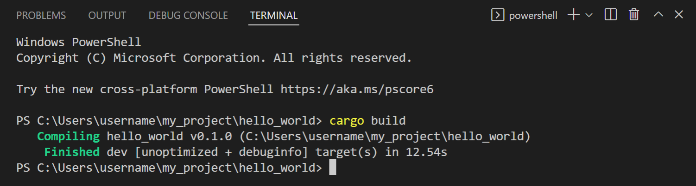

　　现在会有 `target\debug` 文件夹，构建输出包含名为 `hello_world.exe` 的可执行文件。

### 运行 Hello World {#running-hello-world}

　　Cargo 也可以通过 `cargo run` 运行 Rust 项目：

```bash
cargo run
```

　　也可以在终端输入 `.\target\debug\hello_world` 手动运行 `hello_world.exe`。

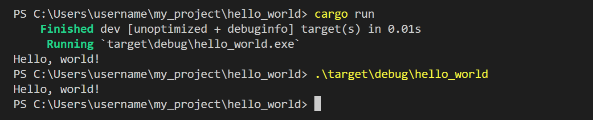

## IntelliSense {#intellisense}

　　IntelliSense 功能由 Rust 语言服务器 [rust-analyzer](https://github.com/rust-lang/rust-analyzer/releases) 提供，它提供详细代码信息和智能建议。

首次打开 Rust 项目时，可以在状态栏左下角查看 rust-analyzer 进度。请等待 rust-analyzer 完全检查项目，以获得语言服务器的全部能力。

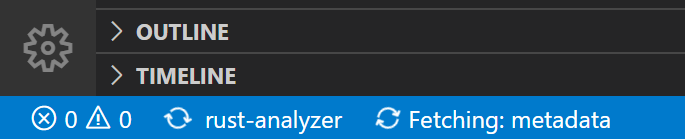

### 内联提示 {#inlay-hints}

　　首先会注意到 rust-analyzer 提供[内联提示](../../../editor/3.2-WriteCode/3.2.5-CodeNavigation/)，在编辑器中以浅色文本显示推断类型、返回值和命名参数。

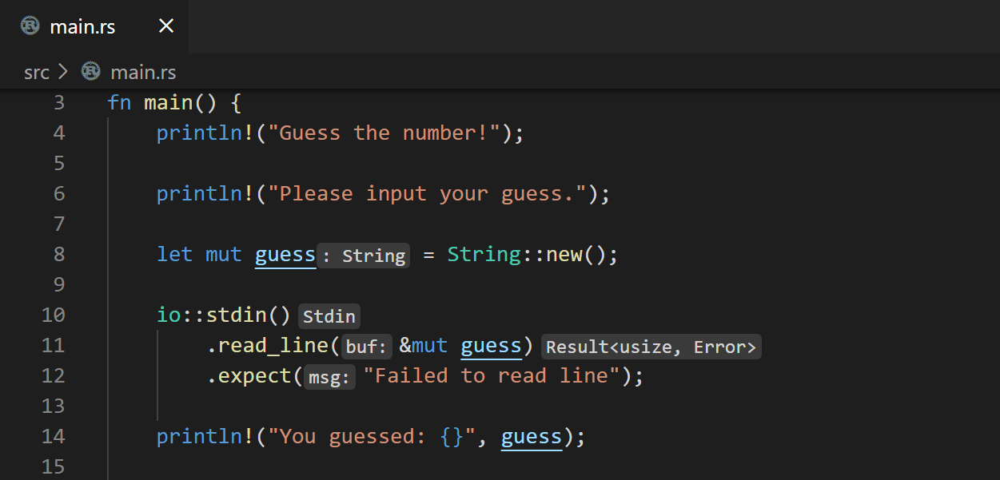

　　内联提示有助于理解代码，也可以通过 **Editor > Inlay Hints: Enabled** 设置（`editor.inlayHints.enabled`）配置。

### 悬停信息 {#hover-information}

　　将鼠标悬停在任何变量、函数、类型或关键字上，会显示文档、签名等信息。也可以跳转到自己代码或标准 Rust 库中的类型定义。

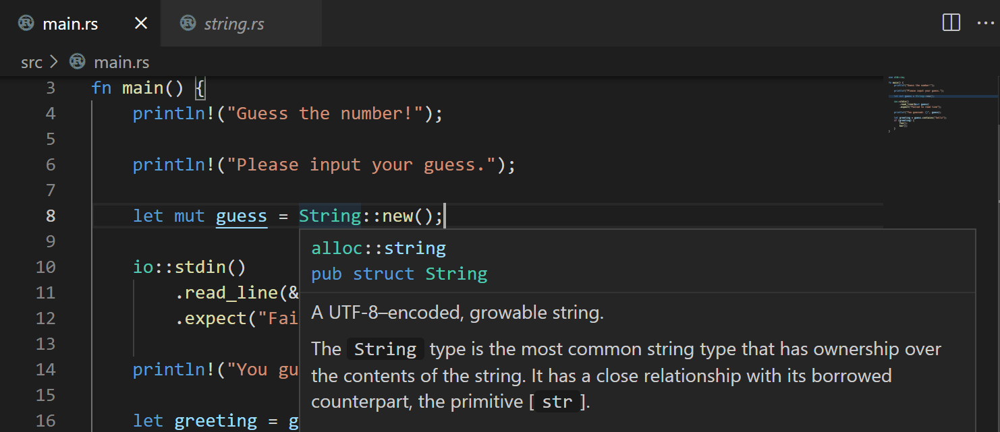

### 自动补全 {#auto-completions}

　　在 Rust 文件中输入时，IntelliSense 提供建议补全和参数提示。

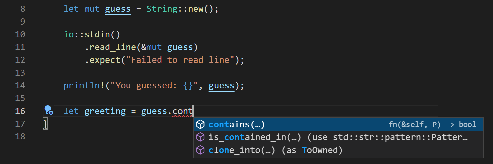

> **提示**：使用 `Ctrl + Space` 手动触发建议。

## 语义语法高亮 {#semantic-syntax-highlighting}

　　rust-analyzer 对项目源代码有丰富理解，因此可以使用[语义语法高亮](https://github.com/microsoft/vscode/wiki/Semantic-Highlighting-Overview)和样式。例如，可能注意到可变变量在编辑器中带下划线。

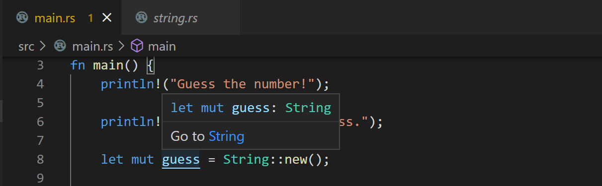

　　快速判断 Rust 变量是否可变有助于理解源代码，也可以使用用户[设置](../../../editor/3.3-ConfigureTheEditor/3.3.4-Settings/)中的 `editor.semanticTokenColorCustomizations` 设置更改样式。

在 `settings.json` 中添加：

```jsonc
{
  "editor.semanticTokenColorCustomizations": {
    "rules": {
      "*.mutable": {
        "fontStyle": "", // 设置为空字符串禁用下划线，这是默认值
      },
    }
  },
}
```

　　rust-analyzer 语义语法自定义详情请参阅 rust-analyzer 文档的[编辑器功能](https://rust-analyzer.github.io/manual.html#editor-features)部分。

## 代码导航 {#code-navigation}

　　代码导航功能可在编辑器上下文菜单中使用。

* **转到定义**（`F12`）：转到类型定义的源代码。
* **速览定义**（`Alt + F12`）：打开速览窗口显示类型定义。
* **转到引用**（`Shift + F12`）：显示类型的所有引用。
* **显示调用层次结构**（`Shift + Alt + H`）：显示函数的所有调用或被调用。

可以使用 **命令面板**（`Ctrl + Shift + P`）中的 **转到符号** 命令进行符号搜索：

* 转到文件中的符号：`Ctrl + Shift + O`
* 转到工作区中的符号：`Ctrl + T`

## Lint {#linting}

　　Rust 工具集包含由 rustc 和 clippy 提供的 lint，用于检测源代码问题。

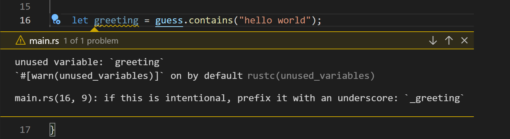

　　rustc linter 默认启用，检测基本 Rust 错误；可以使用 [clippy](https://github.com/rust-lang/rust-clippy) 获得更多 lint。要在 rust-analyzer 中启用 clippy 集成，请将 **Rust-analyzer > Check: Command**（`rust-analyzer.check.command`）设置从默认 `check` 改为 `clippy`。之后保存文件时 rust-analyzer 会运行 `cargo clippy`，并在编辑器和问题视图中显示 clippy 警告和错误。

## 快速修复 {#quick-fixes}

　　Linter 发现源代码错误和警告时，rust-analyzer 通常可以提供建议的快速修复（代码操作），通过编辑器灯泡悬停访问。可以使用 `Ctrl + .` 快速打开可用快速修复。

此外，**Code Action Widget: Include Nearby Quick Fixes**（`editor.codeActionWidget.includeNearbyQuickFixes`）默认启用，会从 `Ctrl + .`（命令 ID `editor.action.quickFix`）激活行中最近的快速修复，无论光标在该行什么位置。

该命令会高亮将通过快速修复重构或修复的源代码。普通代码操作和非修复重构仍可在光标位置激活。

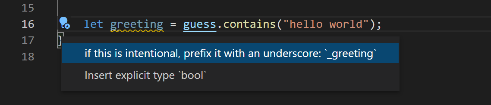

## 重构 {#refactoring}

　　由于 rust-analyzer 对源代码的语义理解，它可以跨 Rust 文件提供智能重命名。将光标放在变量上，从上下文菜单、命令面板或 `F2` 选择 **重命名符号**。

　　rust-analyzer 扩展还支持其他代码重构和代码生成，扩展称之为 [Assists](https://rust-analyzer.github.io/manual.html#assists-code-actions)。

部分可用重构：

* 将 if 语句转换为带卫语句的返回
* 内联变量
* 提取函数
* 添加返回类型
* 添加导入

## 格式化 {#formatting}

　　Rust 工具集包含格式化程序 [rustfmt](https://github.com/rust-lang/rustfmt)，可以按 Rust 约定格式化源代码。可以使用 `Shift + Alt + F` 或从 **命令面板** 或编辑器上下文菜单运行 **格式化文档**。

也可以选择每次保存（**Editor: Format On Save**）或粘贴（**Format On Paste**）时运行格式化程序，自动保持 Rust 代码格式。

## 调试 {#debugging}

　　rust-analyzer 扩展支持在 VS Code 中调试 Rust。

### 安装调试支持 {#install-debugging-support}

开始调试前，需要安装以下两个支持调试的语言扩展之一：

* [Microsoft C++](https://marketplace.visualstudio.com/items?itemName=ms-vscode.cpptools)（ms-vscode.cpptools）：*Windows 上*
* [CodeLLDB](https://marketplace.visualstudio.com/items?itemName=vadimcn.vscode-lldb)（vadimcn.vscode-lldb）：*macOS/Linux 上*

　　忘记安装这些扩展时，尝试启动调试会话，rust-analyzer 会提供包含 Marketplace 链接的通知。

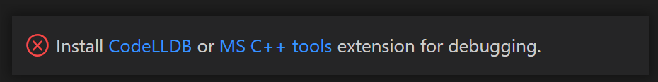

### 使用 Rust Analyzer: Debug {#using-rust-analyzer-debug}

　　rust-analyzer 扩展通过命令面板（`Ctrl + Shift + P`）中的 **Rust Analyzer: Debug** 命令以及编辑器中 **Run|Debug** CodeLens 提供基本调试支持。

调试之前创建的 Hello World 程序。首先在 `main.rs` 中设置断点。

1. 需要启用 **Debug: Allow Breakpoints Everywhere** 设置，可以在设置编辑器（`Ctrl + ,`）搜索“everywhere”找到。

   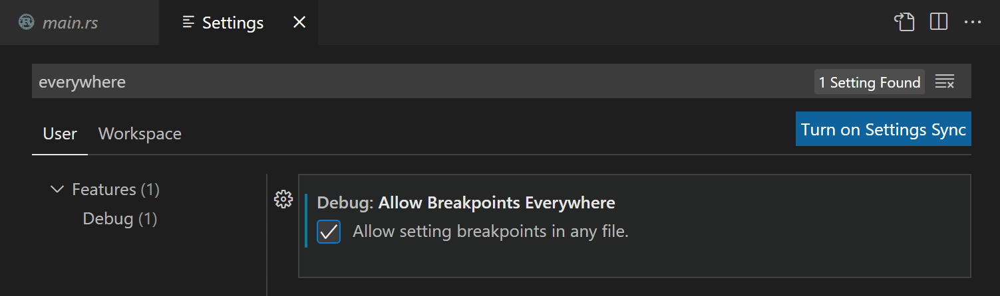

2. 打开 `main.rs`，单击编辑器左侧装订线在 `println!` 行设置断点，应显示红点。

   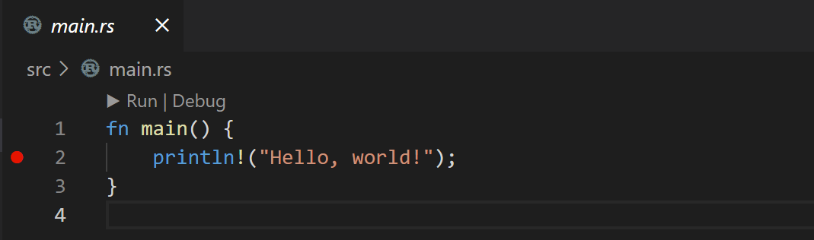

3. 使用 **Rust Analyzer: Debug** 命令，或选择 `main()` 上方的 **Debug** CodeLens 启动调试。

   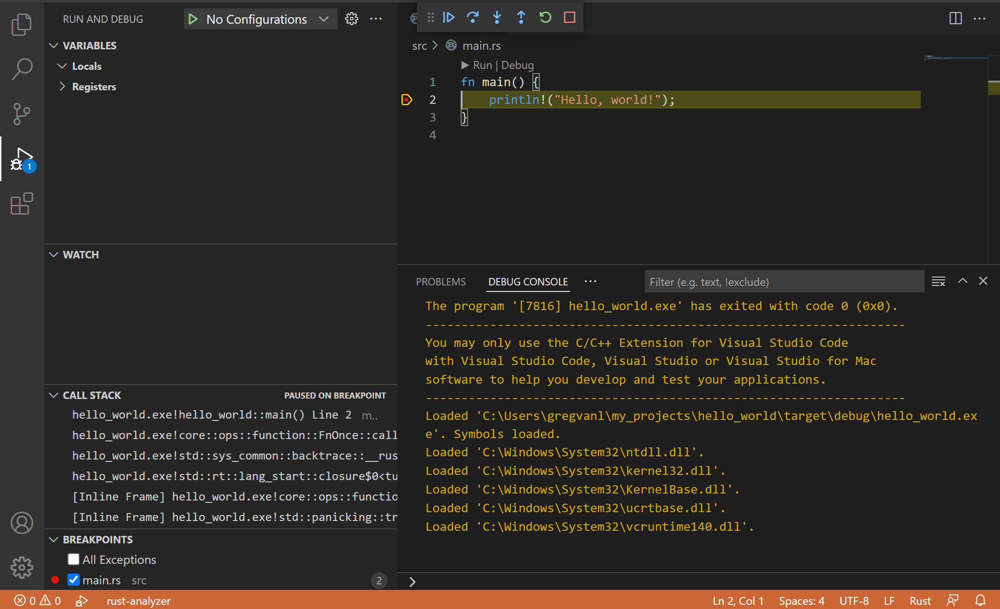

## 后续步骤 {#next-steps}

　　本文简要概述 VS Code 中 rust-analyzer 扩展功能。更多信息请参阅 Rust Analyzer 扩展[用户手册](https://rust-analyzer.github.io/manual.html)，包括如何调整特定 [VS Code 编辑器](https://rust-analyzer.github.io/manual.html#vs-code-2)配置。

了解 rust-analyzer 扩展最新功能/缺陷修复，请参阅 [CHANGELOG](https://rust-analyzer.github.io/thisweek)。也可以从扩展视图 **安装** 下拉列表安装 rust-analyzer **预发布版本**，试用新功能和修复。

有问题或功能请求，请在 rust-analyzer 扩展 [GitHub 仓库](https://github.com/rust-lang/rust-analyzer/issues)记录。

想了解更多 VS Code，请尝试：

* [基本编辑](../../../editor/3.2-WriteCode/3.2.1-BasicEditing/)：VS Code 编辑器基础快速介绍。
* [安装扩展](../../../editor/3.3-ConfigureTheEditor/3.3.6-Extensions/3.3.6.2-ExtensionMarketplace/)：了解 [Marketplace](https://marketplace.visualstudio.com/vscode)中的其他扩展。
* [代码导航](../../../editor/3.2-WriteCode/3.2.5-CodeNavigation/)：快速浏览源代码。

## 常见问题 {#common-questions}

### 链接器错误 {#linker-errors}

　　构建 Rust 程序时看到 **“error: linker `link.exe` not found”** 等链接器错误，可能缺少必要的 C/C++ 工具集。根据平台，需要安装带 C/C++ 链接器的工具集来合并 Rust 编译器输出。

**Windows**

　　Windows 上还需要安装 [Microsoft C++ Build Tools](https://visualstudio.microsoft.com/visual-cpp-build-tools/) 以获得 C/C++ 链接器 `link.exe`。运行 Visual Studio 安装程序时务必选择 **使用 C++ 的桌面开发**。

> **注意**：只要拥有有效的 Visual Studio 许可证（Community、Pro 或 Enterprise），就可以将 Visual Studio Build Tools 的 C++ 工具集与 VS Code 一起用于编译、构建和验证任何代码库。

**macOS**

　　可能需要在终端运行 `xcode-select --install` 安装 XCode 工具集。

**Linux**

　　可能需要通过 `build-essential` 包安装 GCC 工具集，在终端运行 `sudo apt-get install build-essential`。

更多故障排除建议请参阅 [Rust 安装](https://doc.rust-lang.org/book/ch01-01-installation.html)指南。
