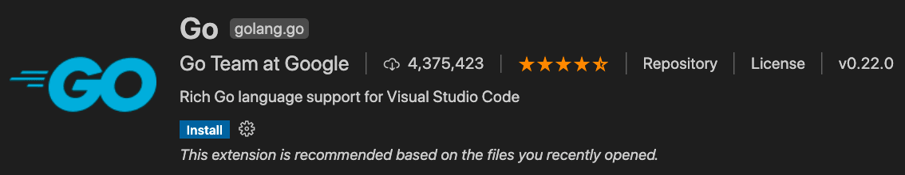
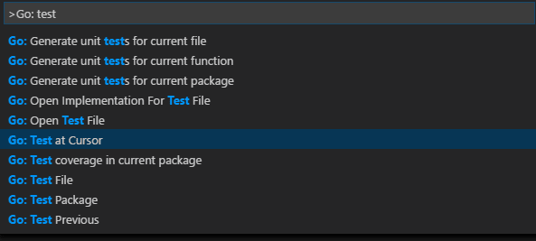

+++
title = "10.2.17 Go"
date = 2026-11-06T07:53:25+08:00
weight = 17
type = "docs"
description = ""
isCJKLanguage = true
draft = false
+++


> 原文链接: [https://code.visualstudio.com/docs/languages/go](https://code.visualstudio.com/docs/languages/go)

# 10.2.17 Go

　　使用 VS Code 的 Go 扩展，可以获得 IntelliSense、代码导航、符号搜索、测试、调试等功能，帮助进行 [Go](https://go.dev/) 开发。



可以从 VS Code [Marketplace](https://marketplace.visualstudio.com/items?itemName=golang.go)安装 Go 扩展。

观看 [“VS Code Go 入门”](https://youtu.be/1MXIGYrMk80)，了解如何使用 VS Code Go 构建第一个 Go 应用。

本文仅介绍 Go 扩展提供的部分功能。完整最新支持功能列表请参阅扩展[文档](https://github.com/golang/vscode-go/wiki/features)。

## IntelliSense {#intellisense}

<video src="https://code.visualstudio.com/assets/docs/languages/go/completion-signature-help.mp4" title="IntelliSense。" autoplay loop controls muted></video>

　　IntelliSense 功能由 Go 团队维护的 Go 语言服务器 [gopls](https://go.dev/s/gopls) 提供。可以使用 [`gopls` 设置](https://github.com/golang/vscode-go/wiki/settings#settings-for-gopls)配置其行为。

### 语义语法高亮 {#semantic-syntax-highlighting}

　　要获得比默认基于 TextMate 的语法高亮更好的效果，建议通过开启 Gopls 的 `ui.semanticTokens` 设置启用[语义高亮](https://code.visualstudio.com/api/language-extensions/semantic-highlight-guide)。

```json
"gopls": { "ui.semanticTokens": true }
```

### 自动补全 {#auto-completions}

　　在 Go 文件中输入时，IntelliSense 会提供建议补全，甚至适用于当前包、已导入包和尚未导入包中的成员。输入任何包名后跟 `.`，即可获得相应包成员建议。

> **提示**：使用 `Ctrl + Space` 手动触发建议。

### 悬停信息 {#hover-information}

　　悬停在任何变量、函数或结构体上，会显示文档、签名等信息。

### 签名帮助 {#signature-help}

　　调用函数时输入 `(`，会弹出函数签名帮助。继续输入参数时，提示（下划线）会移动到下一个参数。

> **提示**：光标在函数调用 `()` 内时，使用 `Ctrl + Shift + Space` 手动触发签名帮助。

## 代码导航 {#code-navigation}

　　代码导航功能可在编辑器上下文菜单中使用。

* **转到定义**（`F12`）：转到类型定义的源代码。
* **转到类型定义**：转到定义符号的类型。
* **速览定义**（`Alt + F12`）：打开速览窗口显示类型定义。
* **转到引用**（`Shift + F12`）：显示类型的所有引用。
* **显示调用层次结构**（`Shift + Alt + H`）：显示函数的所有调用或被调用。
* **转到实现**（`Ctrl + F12`）：打开速览窗口，显示接口的所有实现（对接口类型符号触发时），或类型实现的接口（对具体类型符号触发时）。
* **查找所有实现**：显示接口的所有实现，或类型实现的接口。

可以使用 **命令面板**（`Ctrl + Shift + P`）中的 **转到符号** 命令进行符号搜索：

* **转到文件中的符号**：`Ctrl + Shift + O`
* **转到工作区中的符号**：`Ctrl + T`

还可以使用 **Go: Toggle Test File** 命令在 Go 文件及其测试实现之间来回导航。

## 生成和诊断 {#build-and-diagnose}

　　Go 语言服务器（`gopls`）检测工作区中的构建和 vet 错误。运行上述任何/所有操作产生的错误和警告会以红/绿色波浪线显示在编辑器中，也会显示在 **问题** 面板（**视图** > **问题**）。

可以使用 `go.lintOnSave` 设置添加额外 lint 检查，并通过 `go.lintTool` 设置选择 lint 工具（`staticcheck`、`golangci-lint` 或 `revive`）。

## 格式化 {#formatting}

　　可以使用 `Shift + Alt + F` 或从命令面板或编辑器上下文菜单运行 **格式化文档** 格式化 Go 文件。

　　默认保存 Go 文件时会运行格式化。可以通过为 `[go]` 语言标识符将 `editor.formatOnSave` 设置为 `false` 禁用。可以在 JSON 设置文件中更改：

```json
"[go]": {
        "editor.formatOnSave": false
}
```

　　为 Go 文件启用多个格式化程序时，可以选择 Go 扩展作为默认格式化程序：

```json
"[go]": {
    "editor.defaultFormatter": "golang.go"
}
```

　　格式化由 `gopls` 提供。需要 `gofumpt` 风格格式化时，可以配置 `gopls` 使用 `gofumpt`：

```json
"gopls": {
    "formatting.gofumpt": true
}
```

## 测试 {#test}

　　VS Code [测试 UI](https://code.visualstudio.com/api/extension-guides/testing)和编辑器 [CodeLens](https://code.visualstudio.com/blogs/2017/02/12/code-lens-roundup) 元素可以让用户轻松运行给定函数、文件、包或工作区的测试、基准和性能分析。

也可以通过一组命令使用相同功能：

* [**Go: Test Function At Cursor**](https://github.com/golang/vscode-go/wiki/commands#go-test-function-at-cursor)
* [**Go: Test File**](https://github.com/golang/vscode-go/wiki/commands#go-test-file)
* [**Go: Test Package**](https://github.com/golang/vscode-go/wiki/commands#go-test-package)
* [**Go: Test All Packages in Workspace**](https://github.com/golang/vscode-go/wiki/commands#go-test-all-packages-in-workspace)

　　在命令面板输入“Go: test”可以探索许多测试相关命令。



　　前三个命令可以使用 `gotests` 为当前包、文件或光标处函数生成测试骨架。后几个命令可以使用 `go test` 运行当前包、文件或光标处的测试。还有获取测试覆盖率的命令。

可以使用以下设置配置扩展运行测试和计算覆盖率：

* `go.testOnSave`
* `go.coverOnSave`
* `go.testFlags`

## 导入包 {#import-packages}

　　扩展默认组织导入并移除未使用导入。需要不同行为时，可以按照[这些说明](https://github.com/golang/vscode-go/wiki/advanced#formatting-code-and-organizing-imports)覆盖每种语言的默认设置。

运行 **Go: Add Import** 命令获取可导入 Go 文件的包列表。选择一个包会添加到 Go 文件的导入块。

## 重构 {#refactoring}

　　选择要重构的区域（例如变量、函数体等）。单击所选区域出现的代码操作灯泡图标，或从 VS Code 上下文菜单选择 **重构...** 或 **重命名符号**（`F2`）。

## 调试 {#debugging}

　　Go 扩展通过 [Delve](https://github.com/go-delve/delve) 调试器调试 Go 代码。

设置步骤、支持功能、配置、远程调试信息和故障排除指南请参阅[在 VS Code 中调试 Go 程序](https://github.com/golang/vscode-go/wiki/debugging)。检查变量、设置断点等与语言无关的通用调试功能请参阅 [VS Code 调试](../../../debugging-and-testing/6.1-Debugging/)。

Go 特有功能包括：

* 本地和远程调试
* 使用 [Delve 表达式语法](https://github.com/go-delve/delve/blob/master/Documentation/cli/expr.md)检查数据
* 在调试控制台使用 [`dlv` 命令](https://github.com/golang/vscode-go/wiki/debugging#dlv-command-from-debug-console)动态更改配置和检查选项
* 隐藏/显示系统 goroutine（使用 `hideSystemGoroutines` 配置）
* 反汇编视图支持（右键单击源代码，选择 **打开反汇编视图**）
* 实验性函数调用、核心检查、Mozilla `rr` 支持

## 后续步骤 {#next-steps}

　　本文简要概述 VS Code 中 Go 扩展功能。更多信息请参阅 Go 扩展 [README](https://github.com/golang/vscode-go/blob/master/README.md)。

了解 Go 扩展最新功能/缺陷修复，请参阅 [CHANGELOG](https://github.com/golang/vscode-go/blob/master/CHANGELOG.md)。

有问题或功能请求，请在 Go 扩展 [vscode-go 仓库](https://github.com/golang/vscode-go/issues)记录。

想了解更多 VS Code，请尝试：

* [基本编辑](../../../editor/3.2-WriteCode/3.2.1-BasicEditing/)：VS Code 编辑器基础快速介绍。
* [安装扩展](../../../editor/3.3-ConfigureTheEditor/3.3.6-Extensions/3.3.6.2-ExtensionMarketplace/)：了解 [Marketplace](https://marketplace.visualstudio.com/vscode)中的其他扩展。
* [代码导航](../../../editor/3.2-WriteCode/3.2.5-CodeNavigation/)：快速浏览源代码。
