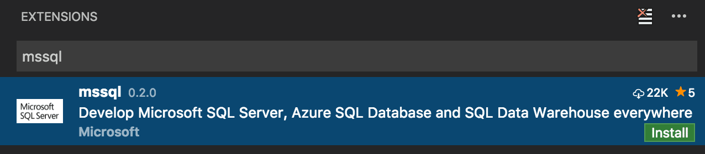

+++
title = "10.2.18 T-SQL"
date = 2026-11-06T07:53:25+08:00
weight = 18
type = "docs"
description = ""
isCJKLanguage = true
draft = false
+++

> 原文链接: [https://code.visualstudio.com/docs/languages/tsql](https://code.visualstudio.com/docs/languages/tsql)

# 10.2.18 T-SQL

　　使用 Marketplace 中的 [mssql](https://aka.ms/mssql-marketplace) 扩展，可以将 VS Code 变成强大的 [Transact-SQL](https://learn.microsoft.com/sql/t-sql/language-reference)（T-SQL）开发编辑器。mssql 扩展针对本地、任意云中、Azure SQL Database 和 Azure SQL Data Warehouse 中运行的 SQL Server 进行了优化。

　　可以连接 SQL 数据库、输入 T-SQL 代码、执行代码、查看结果并将结果保存为 JSON 或 CSV 文件。输入 T-SQL 代码时，可以获得丰富的语言功能，例如 T-SQL IntelliSense（代码补全）、语法高亮、lint、代码导航和代码片段。

> [下载 VS Code](https://code.visualstudio.com/download)：如果尚未下载 VS Code，请快速为平台（Linux、macOS 或 Windows）安装。

## 安装 T-SQL 支持 {#install-t-sql-support}

按照以下步骤从 Marketplace 安装 [mssql](https://aka.ms/mssql-marketplace) 扩展，为 VS Code 添加 T-SQL 语言支持：

1. 从 VS Code 侧边栏打开 **扩展** 视图（`Ctrl + Shift + X`，macOS：`Cmd + Shift + X`）。
2. 在搜索栏输入“mssql”，单击 **安装**，并在提示时重新加载 VS Code。

## 连接并执行 T-SQL {#connect-and-execute-t-sql}

　　可以轻松连接本地、任意云中、Azure SQL Database 和 Azure SQL Data Warehouse 中运行的 SQL Server。然后执行 T-SQL 语句和批处理，查看结果和消息，全部在 VS Code 内完成。最近连接会跨会话保存，便于快速重新连接数据库。

<video src="https://code.visualstudio.com/assets/docs/languages/tsql/execute.mp4" title="执行 T-SQL。" autoplay loop controls muted></video>

## 查看和保存结果 {#view-and-save-results}

　　执行 T-SQL 代码时查看结果和消息。只需几次点击即可将结果保存为 JSON 或 CSV 文件，供应用程序使用。

<video src="https://code.visualstudio.com/assets/docs/languages/tsql/save.mp4" title="保存 T-SQL 结果。" autoplay loop controls muted></video>

## T-SQL IntelliSense {#t-sql-intellisense}

　　在编辑器中输入 T-SQL 代码时，VS Code 提供 T-SQL 关键字的智能代码补全、架构对象名称（表、列、视图）建议，以及连接数据库时函数和过程的参数帮助。

<video src="https://code.visualstudio.com/assets/docs/languages/tsql/intellisense.mp4" title="T-SQL IntelliSense。" autoplay loop controls muted></video>

## Lint {#linting}

　　Lint 是分析 T-SQL 代码潜在语法错误的过程。可以使用 VS Code 在输入时快速导航到 T-SQL 代码中的错误和警告。

<video src="https://code.visualstudio.com/assets/docs/languages/tsql/linting.mp4" title="T-SQL lint。" autoplay loop controls muted></video>

## 速览定义/转到定义 {#peek-definitiongo-to-definition}

　　输入 T-SQL 代码时，使用 **速览定义** 或 **转到定义** 快速浏览数据库中表、函数和过程等架构对象的定义。

<video src="https://code.visualstudio.com/assets/docs/languages/tsql/peekdefinition.mp4" title="T-SQL 速览定义。" autoplay loop controls muted></video>

## 代码片段 {#snippets}

　　T-SQL 代码片段为常用 T-SQL 语句提供代码模板。输入“sql”获取 T-SQL 代码片段列表。

<video src="https://code.visualstudio.com/assets/docs/languages/tsql/snippets.mp4" title="T-SQL 代码片段。" autoplay loop controls muted></video>

## 后续步骤 {#next-steps}

* 下载免费的 [SQL Server 2017 Developer Edition](https://www.microsoft.com/sql-server/sql-server-downloads)。
* 从 VS Code Marketplace 安装 [mssql](https://aka.ms/mssql-marketplace) 扩展。
* [构建应用](https://aka.ms/sqldev)：使用喜欢的编程语言在 macOS、Linux 和 Windows 上开始使用 SQL Server。
* 在 [GitHub](https://github.com/microsoft/vscode-mssql) 上为 mssql 扩展做贡献。在 [GitHub Issue Tracker](https://github.com/microsoft/vscode-mssql/issues) 提交缺陷报告或功能建议。

## 进一步阅读 {#further-reading}

* [SQL Server 文档](https://learn.microsoft.com/sql/sql-server)
* [Linux 上的 SQL Server 文档](https://learn.microsoft.com/sql/linux/sql-server-linux-overview/)
* [SQL Server 博客](https://blogs.technet.microsoft.com/dataplatforminsider/)
