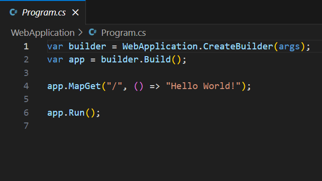
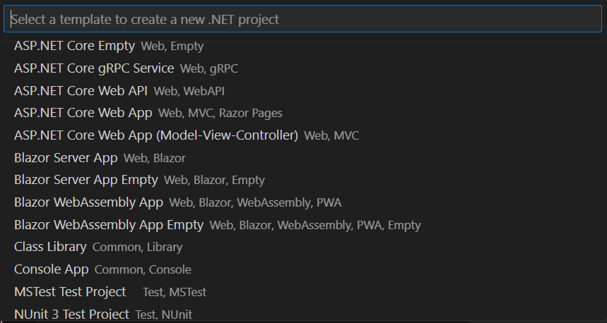
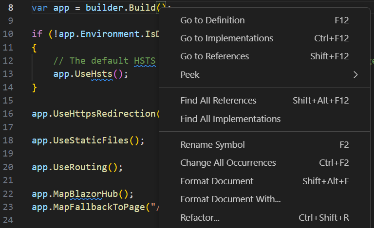
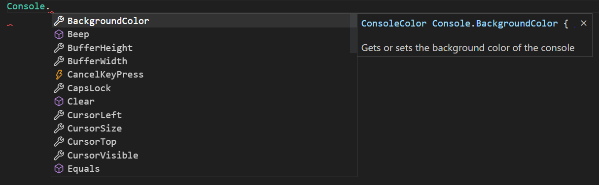
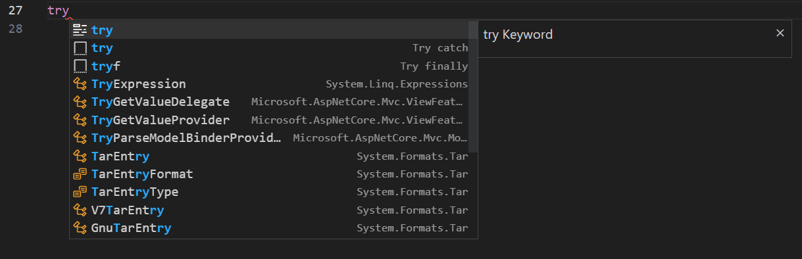
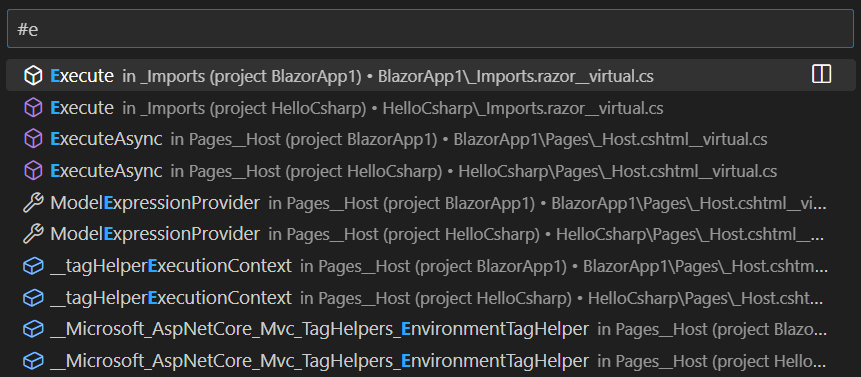
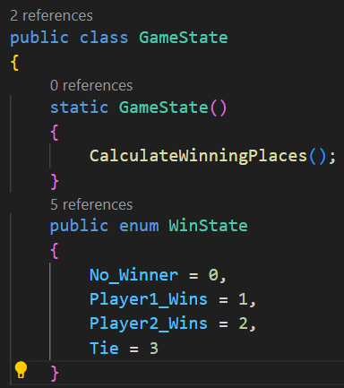
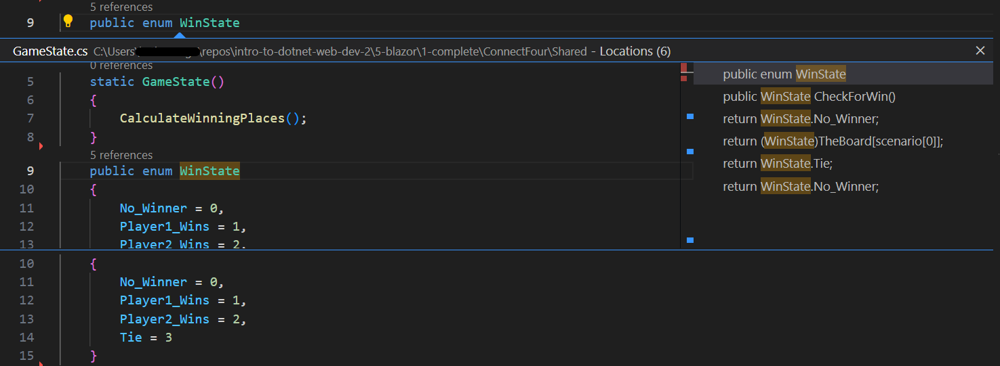
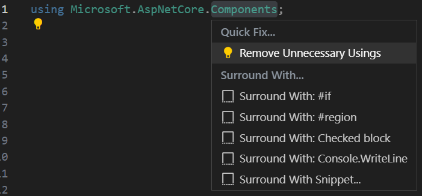

+++
title = "10.2.19 C#"
date = 2026-11-06T07:53:25+08:00
weight = 19
type = "docs"
description = ""
isCJKLanguage = true
draft = false
+++

> 原文链接: [https://code.visualstudio.com/docs/languages/csharp](https://code.visualstudio.com/docs/languages/csharp)

# 10.2.19 C#

　　VS Code 的 C# 支持针对跨平台 .NET 开发进行了优化（另一篇相关文章请参阅[使用 .NET 和 VS Code](10.2.20-NET/)）。VS Code 的重点是成为出色的跨平台 C# 开发编辑器，提供丰富的 C# 编辑体验、AI 驱动开发、解决方案管理和集成测试体验。

　　VS Code 支持调试运行在 .NET 或 Mono 上的 C# 应用程序。

详细说明请参阅：

* .NET 调试：[C# Dev Kit 调试文档](https://code.visualstudio.com/docs/csharp/debugging)。
* Mono 调试：[Mono Debug 扩展 README](https://marketplace.visualstudio.com/items?itemName=ms-vscode.mono-debug)。

## 安装 C# 支持 {#installing-c-support}

　　C# 语言支持由 [C# Dev Kit 扩展](https://marketplace.visualstudio.com/items?itemName=ms-dotnettools.csdevkit)提供。可以在 VS Code **扩展** 视图（`Ctrl + Shift + X`）搜索“C# Dev Kit”安装；已有包含 C# 文件的项目时，打开 C# 文件后 VS Code 会提示安装扩展。

C# Dev Kit 扩展详情请参阅 [C# 文档](https://code.visualstudio.com/docs/csharp/get-started)。

## C# Dev Kit {#c-dev-kit}

　　VS Code 使用 [Roslyn](https://github.com/dotnet/roslyn)和 [C# Dev Kit](https://marketplace.visualstudio.com/items?itemName=ms-dotnettools.csdevkit)提供增强的 C# 体验，支持：

* .NET 项目
* MSBuild 项目
* C# 脚本（CSX）

支持的 .NET 项目类型包括：

* ASP.NET Core 应用
* ASP.NET Core Web API
* ASP.NET Core MVC Web 应用
* Blazor Web 应用
* Blazor Server 应用
* Blazor WebAssembly 应用
* 控制台应用
* 以及更多

要查看 VS Code 支持的完整项目类型列表，请打开 **命令面板** 搜索 **.NET: New Project..**，会显示完整列表。

　　打开包含 .NET 解决方案文件或项目文件的工作区时，解决方案资源管理器会自动出现。工作区中只有一个解决方案文件（.sln）时，解决方案资源管理器会检测该文件并在工作区加载后自动加载。C# 项目管理详情请参阅[项目管理](https://code.visualstudio.com/docs/csharp/project-management)。

## 编辑功能 {#editing-evolved}

　　C# 和编辑器有许多功能可探索，例如输入时格式化、IntelliSense、重命名重构等。

C# Dev Kit 编辑功能详情请参阅[导航和编辑文档](https://code.visualstudio.com/docs/csharp/navigate-edit)。VS Code 编辑功能完整说明请参阅[基本编辑](../../../editor/3.2-WriteCode/3.2.1-BasicEditing/)和[代码导航](../../../editor/3.2-WriteCode/3.2.5-CodeNavigation/)。

以下是几个亮点。

## IntelliSense {#intellisense}

　　IntelliSense 开箱即用：随时按 `Ctrl + Space` 获取上下文相关建议。

## 使用 AI 增强补全 {#enhance-completions-with-ai}

　　GitHub Copilot 会在编辑器中输入时提供编码建议。也可以向 Copilot 询问与编码相关的问题，例如如何更好地编写代码、如何修复错误，或他人的代码如何工作。

　　请参阅 [VS Code 中的 AI](../../../ai-in-vs-code/)了解入门方法。

## C# 代码片段 {#snippets-for-c}

C# Dev Kit 代码片段请参阅[导航和编辑文档](https://code.visualstudio.com/docs/csharp/navigate-edit)。VS Code 还包含多个内置代码片段，输入时会出现，或按 `Ctrl + Space`（触发建议）获取上下文相关建议列表。

> **提示**：可以为 C# 添加自己的用户定义代码片段。请参阅[用户定义代码片段](../../../editor/3.2-WriteCode/3.2.7-Snippets/)。

## 搜索符号 {#search-for-symbols}

　　编辑器之外也有功能。其中之一是可以在任何位置搜索符号。按 `Ctrl + T`，输入内容，查看匹配的 C# 符号列表。选择一个会直接跳转到其代码位置。

## CodeLens {#codelens}

　　另一个有用功能是直接在方法上方查看引用数。单击引用信息可在速览视图中查看引用，引用信息会随输入更新。

> **注意**：`object` 中定义的方法（例如 `equals` 和 `hashCode`）出于性能原因不显示引用信息。

> **提示**：可以使用 `editor.codeLens` [设置](../../../editor/3.3-ConfigureTheEditor/3.3.4-Settings/)关闭 CodeLens 中的引用信息。

## 查找引用/速览定义 {#find-referencespeek-definition}

　　可以单击对象引用，在不丢失上下文的情况下就地查找其使用位置。反过来也可以速览对象定义，在不离开当前位置的情况下内联查看。C# Dev Kit 中速览定义详情请参阅[导航和编辑文档](https://code.visualstudio.com/docs/csharp/navigate-edit)。

## 快速修复/建议 {#quick-fixes--suggestions}

　　VS Code 支持一些基本快速修复。会看到灯泡图标，单击它或按 `Ctrl + .` 会显示简单的修复/建议列表。

## 测试 {#testing}

　　扩展支持以下测试框架：

* [XUnit](https://learn.microsoft.com/dotnet/core/testing/unit-testing-with-dotnet-test)
* [NUnit](https://learn.microsoft.com/dotnet/core/testing/unit-testing-with-nunit)
* [MSTest](https://learn.microsoft.com/dotnet/core/testing/unit-testing-with-mstest)

C# Dev Kit 扩展提供：

* 运行/调试测试用例
* 查看测试报告
* 在测试资源管理器中查看测试

更多信息请参阅 [C# Dev Kit 测试文档](https://code.visualstudio.com/docs/csharp/testing)。

## 后续步骤 {#next-steps}

继续阅读：

* [C# Dev Kit 文档](https://code.visualstudio.com/docs/csharp/get-started)
* [.NET 开发](10.2.20-NET/)：开始跨平台 .NET 开发
* [基本编辑](../../../editor/3.2-WriteCode/3.2.1-BasicEditing/)：了解 VS Code 编辑器
* [任务](../../../debugging-and-testing/6.3-Tasks/)：使用任务构建项目等
* [调试](../../../debugging-and-testing/6.1-Debugging/)：了解如何用调试器处理项目
* [Unity 开发](https://code.visualstudio.com/docs/other/unity)：了解如何将 VS Code 与 Unity 项目配合使用
