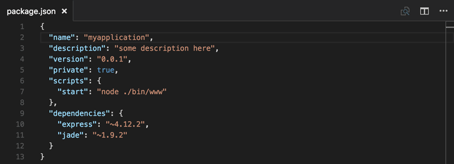
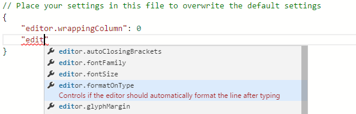
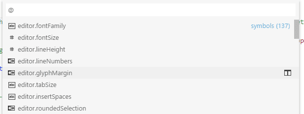
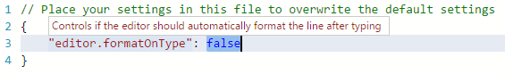
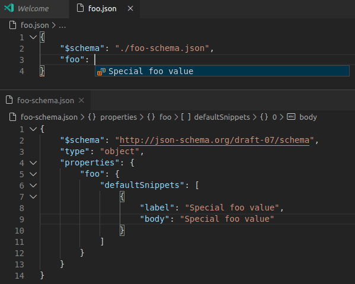

+++
title = "10.2.2 JSON"
date = 2026-11-06T07:53:25+08:00
weight = 2
type = "docs"
description = ""
isCJKLanguage = true
draft = false
+++


> 原文链接: [https://code.visualstudio.com/docs/languages/json](https://code.visualstudio.com/docs/languages/json)

# 10.2.2 JSON

　　JSON 是 `package.json` 或 `project.json` 等配置文件中常见的数据格式。VS Code 也在自己的配置文件中大量使用它。打开以 `.json` 结尾的文件时，VS Code 提供简化编写或修改内容的功能。



## IntelliSense 和验证 {#intellisense-and-validation}

　　对于有无 schema 的 JSON 数据，我们都会在输入属性和值时提供 IntelliSense 建议。也可以使用 **触发建议** 命令（`Ctrl + Space`）手动查看建议。

　　我们还会根据关联的 JSON schema 执行结构和值验证，显示红色波浪线。要禁用验证，请使用 `json.validate.enable` [设置](../../../editor/3.3-ConfigureTheEditor/3.3.4-Settings/)。



### 包和项目依赖 {#package-and-project-dependencies}

　　我们还为特定值集提供 IntelliSense，例如 `package.json`、`project.json` 和 `bower.json` 中的包和项目依赖。

## 快速导航 {#quick-navigation}

　　JSON 文件可能很大，我们支持使用 **转到符号** 命令（`Ctrl + Shift + O`）快速导航到属性。



## 悬停 {#hovers}

　　将鼠标悬停在有无 schema 的 JSON 数据属性和值上时，我们会提供额外上下文。



## 格式化 {#formatting}

可以使用 `Shift + Alt + F` 或上下文菜单中的 **格式化文档** 格式化 JSON 文档。

## 折叠 {#folding}

　　可以使用行号和行首之间装订线上的折叠图标折叠源代码区域。所有对象和数组元素都支持折叠区域。

## 带注释的 JSON {#json-with-comments}

　　除了遵循 [JSON 规范](https://www.json.org/)的默认 JSON 模式，VS Code 还有 **带注释的 JSON**（jsonc）模式。此模式用于 `settings.json`、`tasks.json` 或 `launch.json` 等 VS Code 配置文件。在 **带注释的 JSON** 模式中，可以使用 JavaScript 风格的单行（`//`）和块注释（`/* */`）。该模式也接受尾随逗号，但不建议使用，编辑器会显示警告。

　　当前编辑器模式显示在状态栏中。选择模式指示器可以更改模式，并配置文件扩展名与模式的关联。也可以直接修改 `files.associations` [设置](../../../editor/3.3-ConfigureTheEditor/3.3.4-Settings/)，将文件名或模式关联到 `jsonc`。

## JSON schema 和设置 {#json-schemas-and-settings}

　　为了理解 JSON 文件结构，我们使用 [JSON schema](https://json-schema.org/)。JSON schema 描述 JSON 文件的形状、值集、默认值和说明。VS Code 自带的 JSON 支持支持 draft 4 到 draft 7 的所有草案版本，对 draft 2019-09 和 2020-12 有有限支持。

　　[JSON Schema Store](https://www.schemastore.org) 等服务为大多数常见 JSON 配置文件提供 schema。但 schema 也可以定义在 VS Code 工作区文件和 VS Code 设置文件中。

　　JSON 文件与 schema 的关联可以通过 JSON 文件中的 `$schema` 属性完成，也可以在用户或工作区[设置](../../../editor/3.3-ConfigureTheEditor/3.3.4-Settings/)（**文件** > **首选项** > **设置**）的 `json.schemas` 属性中完成。

　　VS Code 扩展也可以定义 schema 和 schema 映射。因此 VS Code 已经知道 `package.json`、`bower.json` 和 `tsconfig.json` 等知名 JSON 文件的 schema。

### 在 JSON 中映射 {#mapping-in-the-json}

以下示例中，JSON 文件指定其内容遵循 [CoffeeLint](https://coffeelint.github.io/) schema：

```json
{
   "$schema": "https://json.schemastore.org/coffeelint",
   "line_endings": "unix"
}
```

　　注意此语法是 VS Code 特定的，不属于 [JSON Schema 规范](https://json-schema.org/specification)。添加 `$schema` 键会更改 JSON 本身，消费该 JSON 的系统可能不希望如此，例如 schema 验证可能失败。此时可以使用其他映射方法。

### 在用户设置中映射 {#mapping-in-the-user-settings}

以下用户[设置](../../../editor/3.3-ConfigureTheEditor/3.3.4-Settings/)片段展示如何将 `.babelrc` 文件映射到 [https://json.schemastore.org/babelrc](https://json.schemastore.org/babelrc) 上的 [babelrc](https://babeljs.io/docs/usage/babelrc) schema：

```json
"json.schemas": [
    {
        "fileMatch": [
            "/.babelrc"
        ],
        "url": "https://json.schemastore.org/babelrc"
    }
]
```

> **提示**：除了为 `.babelrc` 定义 schema，还要确保 `.babelrc` 关联到 JSON 语言模式。这也可以通过设置中的 `files.association` 数组完成。

### 映射到工作区中的 schema {#mapping-to-a-schema-in-the-workspace}

要映射工作区中的 schema，请使用相对路径。此示例中，工作区根目录的 `myschema.json` 将作为所有以 `.foo.json` 结尾文件的 schema。

```json
"json.schemas": [
    {
        "fileMatch": [
            "**/*.foo.json"
        ],
        "url": "./myschema.json"
    }
]
```

### 映射到设置中定义的 schema {#mapping-to-a-schema-defined-in-settings}

要映射用户或工作区设置中定义的 schema，请使用 `schema` 属性。此示例定义的 schema 将用于所有名为 `.myconfig` 的文件。

```json
"json.schemas": [
    {
        "fileMatch": [
            "/.myconfig"
        ],
        "schema": {
            "type": "object",
            "properties": {
                "name" : {
                    "type": "string",
                    "description": "The name of the entry"
                }
            }
        }
    }
]
```

### 在扩展中映射 schema {#mapping-a-schema-in-an-extension}

　　扩展也可以定义 schema 和 schema 关联。请参阅 [jsonValidation 贡献点](https://code.visualstudio.com/api/references/contribution-points#contributes.jsonValidation)。

### 文件匹配语法 {#file-match-syntax}

　　文件匹配语法支持 `*` 通配符。也可以定义以 `!` 开头的排除模式。关联要匹配，至少需要一个模式匹配，且最后一个匹配模式不能是排除模式。

```json
  "json.schemas": [
    {
      "fileMatch": [
        "/receipts/*.json",
        "!/receipts/*.excluded.json"
      ],
      "url": "./receipts.schema.json"
    }
  ]
```

### 在 JSON schema 中定义代码片段 {#define-snippets-in-json-schemas}

　　JSON schema 描述 JSON 文件形状、值集和默认值，JSON 语言支持用它们提供补全建议。如果你是 schema 作者并希望提供更定制的补全建议，也可以在 schema 中指定代码片段。

以下示例展示键盘快捷键设置文件的 schema，其中定义了代码片段：

```json
{
    "type": "array",
    "title": "Keyboard shortcuts configuration",
    "items": {
        "type": "object",
        "required": ["key"],
        "defaultSnippets": [
            {
                "label": "New keyboard shortcut",
                "description": "Binds a key to a command for a given state",
                "body": { "key": "$1", "command": "$2", "when": "$3" }
            }
        ],
        "properties": {
            "key": {
                "type": "string"
            }
            ...
        }
    }
}
```

以下是 JSON schema 中的示例：



　　使用 `defaultSnippets` 属性为给定 JSON 对象指定任意数量代码片段。

* `label` 和 `description` 显示在补全选择对话框中。未提供 label 时，会显示代码片段的字符串化对象表示作为标签。
* `body` 是用户选择补全时字符串化并插入的 JSON 对象。可以在字符串字面量中使用[代码片段语法](../../../editor/3.2-WriteCode/3.2.7-Snippets/)定义制表位、占位符和变量。字符串以 `^` 开头时，内容会原样插入而不是字符串化，可用于指定数字和布尔值代码片段。

　　注意 `defaultSnippets` 不属于 JSON schema 规范，而是 VS Code 特定的 schema 扩展。

### 在悬停中使用富格式 {#use-rich-formatting-in-hovers}

　　VS Code 使用 [JSON Schema 规范](https://json-schema.org/specification)中的标准 `description` 字段，在悬停和自动补全时提供属性信息。

　　如果希望描述支持链接等格式，可以使用 `markdownDescription` 属性和 [Markdown](10.2.7-Markdown/)：

```json
{
   "$schema": "http://json-schema.org/draft-07/schema#",
   "type": "object",
   "properties": {
       "name" : {
           "type": "string",
           "description": "The name of the entry",
           "markdownDescription": "The name of the entry. [See the documentation](https://example.com)"
       }
   }
}
```

　　注意 `markdownDescription` 不属于 JSON schema 规范，而是 VS Code 特定的 schema 扩展。

### 离线模式 {#offline-mode}

　　`json.schemaDownload.enable` 控制 JSON 扩展是否从 `http` 和 `https` 获取 JSON schema。

　　当前编辑器需要使用无法下载的 schema 时，状态栏会显示警告三角形。
