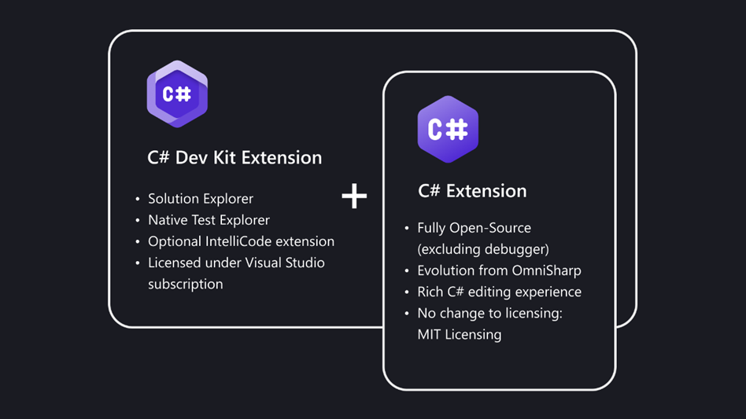

+++
title = "10.2.20 .NET"
date = 2026-11-06T07:53:25+08:00
weight = 20
type = "docs"
description = ""
isCJKLanguage = true
draft = false
+++


> 原文链接: [https://code.visualstudio.com/docs/languages/dotnet](https://code.visualstudio.com/docs/languages/dotnet)

# 10.2.20 .NET

　　[.NET](https://dotnet.microsoft.com)提供快速模块化平台，用于创建在 Windows、Linux 和 macOS 上运行的多种应用程序。将 VS Code 与 C# 和 F# 扩展配合使用，可以获得强大的编辑体验，包括 [C# IntelliSense](https://learn.microsoft.com/visualstudio/ide/visual-csharp-intellisense)、F# IntelliSense（智能代码补全）和调试。

## 为 .NET 开发设置 VS Code {#setting-up-vs-code-for-net-development}

　　已有 VS Code 用户可以通过安装 [C# Dev Kit](https://marketplace.visualstudio.com/items?itemName=ms-dotnettools.csdevkit) 扩展添加 .NET 支持。C# Dev Kit 将高效可靠的 C# 体验带入 VS Code，便于进行 C# 或多语言开发。该扩展包由一组协同工作的 VS Code 扩展组成，提供丰富的 C# 编辑体验、AI 驱动开发、解决方案管理和集成测试体验。如下图所示，C# Dev Kit 包含：

* [C# 扩展](https://marketplace.visualstudio.com/items?itemName=ms-dotnettools.csharp)，提供基础语言服务支持，并继续独立维护。
* [C# Dev Kit 扩展](https://marketplace.visualstudio.com/items?itemName=ms-dotnettools.csdevkit)，基于与 Visual Studio 相同的基础，提供解决方案管理、模板、测试发现/调试。
* IntelliCode for C# Dev Kit 扩展（可选），为编辑器提供 AI 驱动开发体验。



　　项目需要 F# 支持时，也可以下载 [.NET Extension Pack](https://marketplace.visualstudio.com/items?itemName=ms-dotnettools.vscode-dotnet-pack)，其中包含：

* [VS Code 的 C# Dev Kit](https://marketplace.visualstudio.com/items?itemName=ms-dotnettools.csdevkit)
* [Ionide for F#](https://marketplace.visualstudio.com/items?itemName=Ionide.Ionide-fsharp)
* [Jupyter Notebooks](https://marketplace.visualstudio.com/items?itemName=ms-toolsai.jupyter)

也可以单独安装扩展。

## 安装 .NET 软件开发工具包 {#installing-the-net-software-development-kit}

　　单独下载扩展时，请确保本地环境也安装了 .NET SDK。.NET SDK 是用于开发 .NET 应用程序的软件开发环境。

<a class="install-extension-btn" href="https://aka.ms/vscDocs/dotnet/download">安装 .NET SDK</a>

## 创建 C# “Hello World”应用 {#create-a-c-hello-world-app}

1. 初始化 C# 项目：

   * 打开终端/命令提示符，导航到要创建应用的文件夹。
   * 在命令 shell 输入：

   ```bat
     dotnet new console
   ```

2. 首次在 VS Code 中打开项目文件夹时：

   * 窗口右下角会出现“Required assets to build and debug are missing. Add them?”通知。
   * 选择 **是**。

3. 在命令 shell 输入以下命令运行应用：

   ```bat
   dotnet run
   ```

## 创建 F# “Hello World”应用 {#create-an-f-hello-world-app}

1. 初始化 F# 项目：

   * 打开终端/命令提示符，导航到要创建应用的文件夹。
   * 在命令 shell 输入：

   ```bat
   dotnet new console -lang "F#"
   ```

2. 完成后在 VS Code 中打开项目：

   ```bat
   code .
   ```

3. 在命令 shell 输入以下命令运行应用：

   ```bat
    dotnet run
   ```

## 后续步骤 {#next-steps}

* [C# Dev Kit 文档](https://code.visualstudio.com/docs/csharp/get-started)
* 继续探索 C# 开发：[使用 VS Code 和 .NET 调试](https://learn.microsoft.com/dotnet/core/tutorials/debugging-with-visual-studio-code)
* [基本编辑](../../../editor/3.2-WriteCode/3.2.1-BasicEditing/)：了解 VS Code 编辑器。
* [代码导航](../../../editor/3.2-WriteCode/3.2.5-CodeNavigation/)：快速浏览源代码。
* [使用 C#](10.2.19-CSharp/)：了解 .NET 应用开发中的 C# 支持。
* [任务](../../../debugging-and-testing/6.3-Tasks/)：运行 Gulp、Grunt 和 Jake 任务，显示错误和警告。
* [.NET 文档](https://learn.microsoft.com/dotnet)：了解这个强大的跨平台开发解决方案。
* [将应用部署到 Azure](https://code.visualstudio.com/docs/azure/deployment)：将应用部署到 [Azure](https://azure.microsoft.com)。
* [在 VS Code 中开始使用 F#](https://learn.microsoft.com/dotnet/fsharp/get-started/get-started-vscode)
