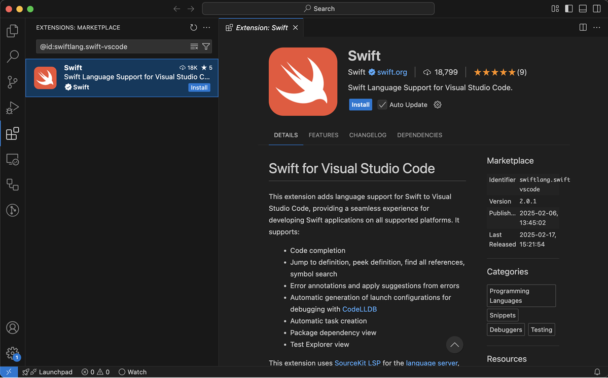
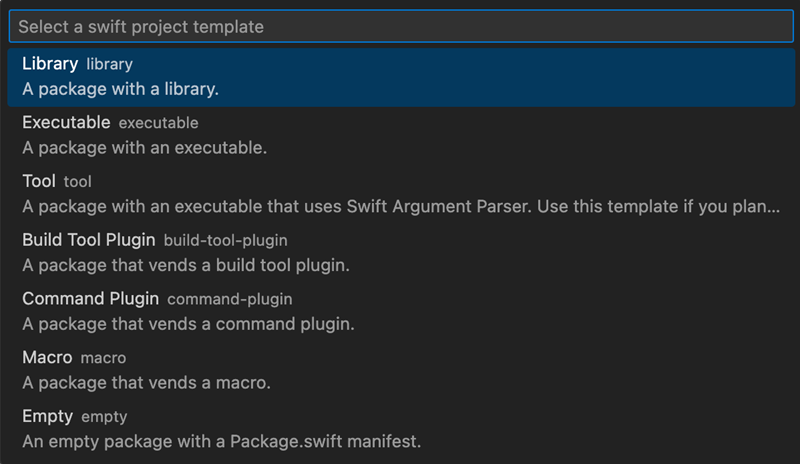
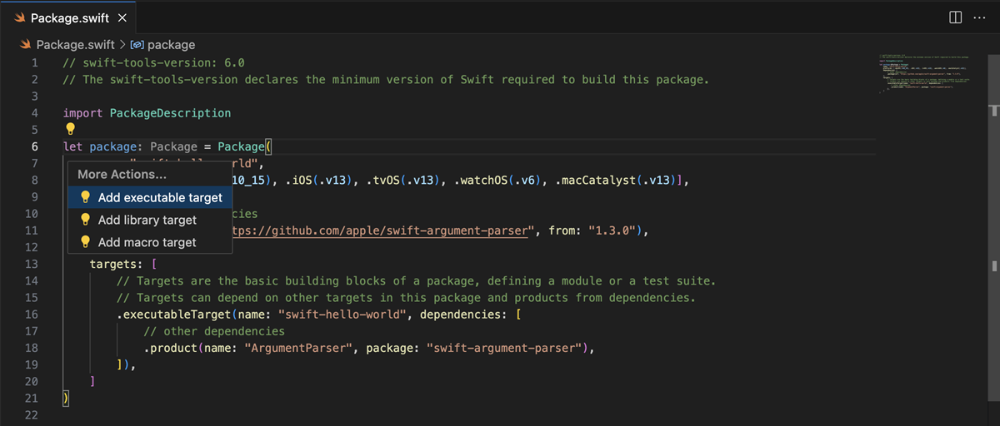
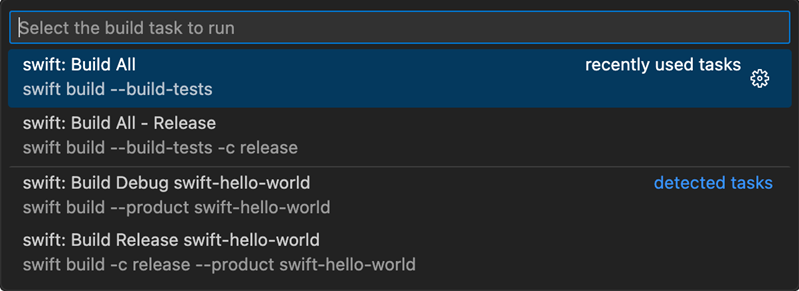
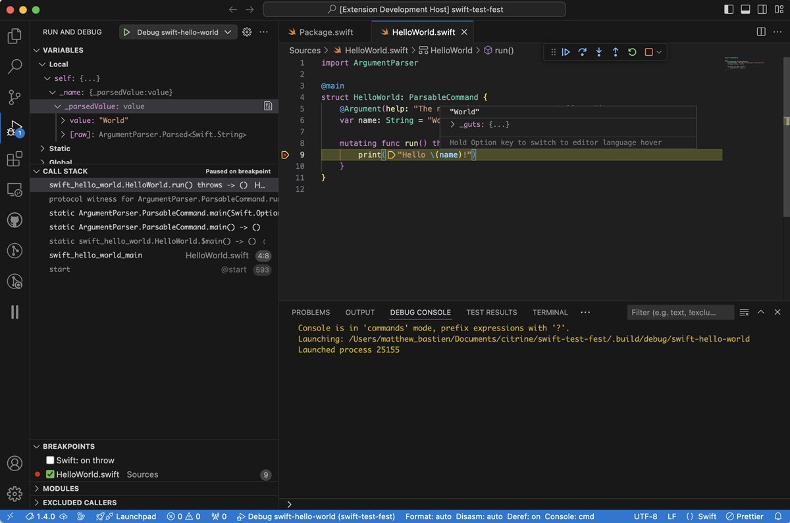
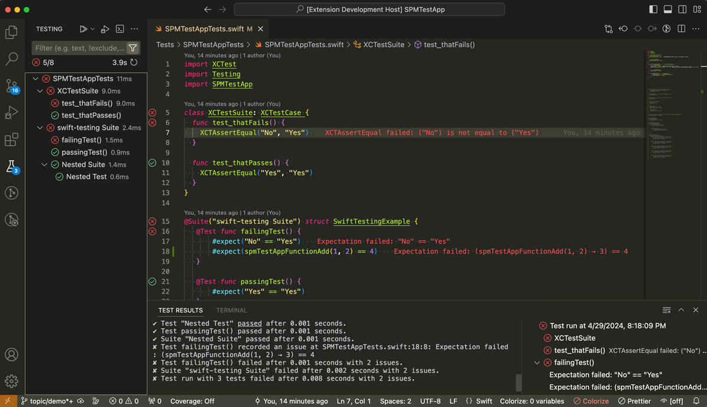
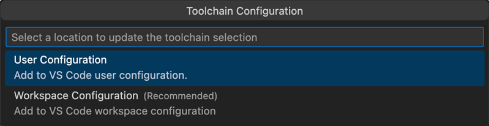
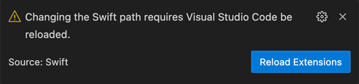

+++
title = "10.2.21 Swift"
date = 2026-11-06T07:53:25+08:00
weight = 21
type = "docs"
description = ""
isCJKLanguage = true
draft = false
+++


> 原文链接: [https://code.visualstudio.com/docs/languages/swift](https://code.visualstudio.com/docs/languages/swift)

# 10.2.21 Swift

　　[Swift](https://www.swift.org)是新手易学、专家强大的通用编程语言。它快速、现代、安全，编写起来令人愉快。本主题详细介绍如何使用 [swiftlang.swift-vscode](https://marketplace.visualstudio.com/items?itemName=swiftlang.swift-vscode) 扩展在 VS Code 中设置和使用 Swift。

Swift 扩展包括：

* 语法高亮和代码补全
* 转到定义、查找所有引用等代码导航功能
* 重构和代码快速修复
* 通过 Swift Package Manager 支持包管理和任务
* 丰富的调试支持
* 使用 XCTest 或 Swift Testing 框架测试

Swift 扩展设计支持以下项目：

* Swift Package Manager 项目（例如使用 `Package.swift`）
* 可生成 `compile_commands.json` 的项目（例如使用 CMake）

## 安装扩展 {#install-the-extension}

1. 首先安装 Swift。系统尚未安装 Swift 时，请参阅 [Swift.org 入门指南](https://www.swift.org/getting-started/)。
2. 下载并安装 [VS Code](https://code.visualstudio.com/Download)。
3. 从 [Marketplace](https://marketplace.visualstudio.com/items?itemName=swiftlang.swift-vscode)或直接在 VS Code 扩展窗格安装 Swift 扩展。



## 创建新的 Swift 项目 {#create-a-new-swift-project}

　　要创建新的 Swift 项目，可以使用 Swift 扩展中的 `Swift: Create New Project...` 命令引导完成。打开命令面板并按以下方式查找：

* macOS：`Cmd + Shift + P`
* 其他平台：`Ctrl + Shift + P`



1. 从模板列表选择项目类型。
2. 选择项目存储目录。
3. 为项目命名。
4. 打开新创建的项目。系统会提示在当前窗口打开、在新窗口打开或添加到当前工作区。可以使用 `swift.openAfterCreateNewProject` 设置配置默认行为。

## 语言功能 {#language-features}

　　Swift 扩展使用 [SourceKit LSP](https://github.com/apple/sourcekit-lsp)提供语言功能。SourceKit LSP 在编辑器中提供以下功能：

* [代码补全](../../../editor/3.2-WriteCode/3.2.2-IntelliSense/)
* [转到定义](../../../editor/3.2-WriteCode/3.2.5-CodeNavigation/#go-to-definition)
* [查找所有引用](../../../editor/3.2-WriteCode/3.2.5-CodeNavigation/#peek)
* [重命名重构](../../../editor/3.2-WriteCode/3.2.6-Refactoring/#rename-symbol)
* [诊断](../../../editor/3.2-WriteCode/3.2.5-CodeNavigation/#errors-and-warnings)
* [快速修复](../../../editor/3.2-WriteCode/3.2.5-CodeNavigation/#code-action)

　　SourceKit LSP 还提供代码操作自动执行常见任务。VS Code 中的代码操作显示为编辑器边距附近的灯泡。单击灯泡会显示可用操作，例如：

* 向 `Package.swift` 添加目标
* 将 JSON 转换为协议
* 为函数添加文档



> **重要**：Swift 6.1 之前，必须先在命令行或使用 VS Code 任务对项目执行 `swift build`，才能使用语言功能。这会填充 SourceKit-LSP 索引。

## Swift 任务 {#swift-tasks}

　　VS Code 提供任务来运行外部工具。详情请参阅[通过任务集成外部工具](../../../debugging-and-testing/6.3-Tasks/)。

　　Swift 扩展提供一些内置任务，可以通过 Swift Package Manager 构建。也可以在项目根文件夹创建 `tasks.json` 配置自定义任务。例如，以下 `tasks.json` 以发布模式构建 Swift 目标：

```json
{
  "version": "2.0.0",
  "tasks": [
    {
      "type": "swift",
      "label": "Swift Build All - Release",
      "detail": "swift build --build-tests",
      "args": ["build", "--build-tests", "-c", "release"],
      "env": {},
      "cwd": "${workspaceFolder}",
      "group": "build"
    }
  ]
}
```

　　上述任务配置在 `build` 组中，因此会出现在 macOS 上 `Cmd + Shift + B` 或其他平台上 `Ctrl + Shift + B` 打开的 **运行生成任务** 菜单中：



　　构建期间的任何错误会作为诊断显示在编辑器中，与 SourceKit-LSP 提供的诊断并列。运行另一个生成任务会清除上一个生成任务的诊断。

## 调试 {#debugging}

　　VS Code 提供丰富的调试体验。详情请参阅[调试](../../../debugging-and-testing/6.1-Debugging/)。

　　Swift 扩展依赖 [LLDB DAP 扩展](https://marketplace.visualstudio.com/items?itemName=llvm-vs-code-extensions.lldb-dap)启用调试支持。

　　默认情况下，扩展为 Swift 包中每个可执行目标创建启动配置。可以在项目根文件夹添加 `launch.json` 自行配置。例如，以下 `launch.json` 使用自定义参数启动 Swift 可执行文件：

```json
{
  "configurations": [
    {
      "type": "swift",
      "name": "Debug swift-executable",
      "request": "launch",
      "args": ["--hello", "world"],
      "cwd": "${workspaceFolder}",
      "program": "${workspaceFolder}/.build/debug/swift-executable",
      "preLaunchTask": "swift: Build Debug swift-executable"
    }
  ]
}
```

可以通过 VS Code 调试视图启动调试会话：

1. 选择要调试的启动配置。
2. 单击绿色播放按钮启动调试会话。

　　可执行文件启动后，可以在 Swift 代码中设置断点，代码执行到断点时会暂停。

以下截图展示调试 Hello World 程序的示例。程序在断点处暂停，调试视图显示作用域变量值。也可以将鼠标悬停在编辑器中的标识符上查看变量值：



## 测试资源管理器 {#test-explorer}

　　VS Code 左侧边栏提供测试资源管理器视图，可以：

* 导航到测试
* 运行测试
* 调试测试

　　Swift 扩展支持 [XCTest](https://developer.apple.com/documentation/xctest)和 [Swift Testing](https://swiftpackageindex.com/swiftlang/swift-testing)。编写测试时会自动添加到测试资源管理器。



调试测试：

1. 设置断点。
2. 使用 `Debug Test` 配置文件运行测试、测试套件或整个测试目标。

　　`Run Test with Coverage` 配置文件会插桩被测代码，并在测试运行完成后打开代码覆盖率报告。浏览已覆盖文件时，测试期间执行的行号显示绿色，未执行的行号显示红色。悬停行号会显示覆盖行执行次数。可以使用 `Test: Show Inline Coverage` 命令显示或隐藏行执行次数。

　　带有[标签](https://swiftpackageindex.com/swiftlang/swift-testing/6.2.0/documentation/testing/addingtags)的 Swift Testing 测试可以在测试资源管理器中使用 `@TestTarget:tagName` 筛选，然后运行或调试筛选后的测试列表。

> **重要**：Swift VS Code 扩展不支持在 Swift 5.10 及更早版本中运行 Swift Testing 测试。

## 高级工具链选择 {#advanced-toolchain-selection}

　　Swift 扩展会自动检测已安装的 Swift 工具链，但也提供 `Swift: Select Toolchain...` 命令，在安装多个工具链时进行选择。

> **重要**：这是高级功能，用于为 VS Code 配置机器默认之外的工具链。建议在 macOS 上使用 `xcode-select`，在 Linux 上使用 `swiftly` 全局切换工具链。

　　系统可能提示选择新路径的配置位置：

* 保存到用户设置
* 保存到工作区设置

　　请记住工作区设置优先于用户设置：



　　Swift 扩展随后会提示重新加载扩展以使用新工具链。必须这样做，否则扩展无法正常工作：


