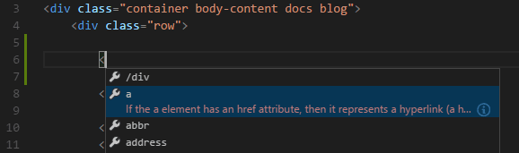
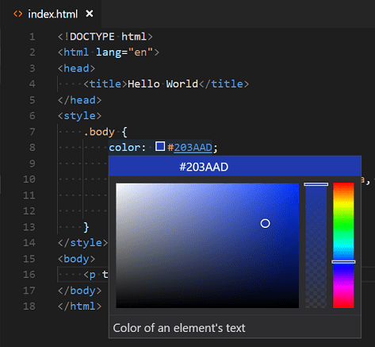
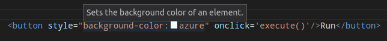

+++
title = "10.2.3 HTML"
date = 2026-11-06T07:53:25+08:00
weight = 3
type = "docs"
description = ""
isCJKLanguage = true
draft = false
+++


> 原文链接: [https://code.visualstudio.com/docs/languages/html](https://code.visualstudio.com/docs/languages/html)

# 10.2.3 HTML

　　VS Code 开箱即用提供基本 HTML 支持，包括语法高亮、IntelliSense 智能补全和可自定义格式化。VS Code 还包含出色的 Emmet 支持。

## IntelliSense {#intellisense}

　　输入 HTML 时，我们通过 HTML IntelliSense 提供建议。下图中可以看到建议的 HTML 元素闭合 `</div>`，以及上下文相关的建议元素列表。



　　HTML 还支持文档符号，可以按 id 和类名快速导航到 DOM 节点。

　　也可以处理嵌入的 CSS 和 JavaScript。但注意不会跟踪其他文件的 script 和 style 引用，语言支持只查看 HTML 文件内容。

可以随时按 `Ctrl + Space` 触发建议。

　　也可以控制哪些内置代码补全提供程序处于活动状态。不希望看到相应建议时，请在用户或工作区[设置](../../../editor/3.3-ConfigureTheEditor/3.3.4-Settings/)中覆盖。

```json
// 配置内置 HTML 语言是否建议 HTML5 标签、属性和值。
"html.suggest.html5": true
```

## 闭合标签 {#close-tags}

　　输入开始标签的 `>` 时，会自动闭合标签元素。

<video src="https://code.visualstudio.com/assets/docs/languages/html/auto-close1.mp4" title="HTML 自动闭合标签。" autoplay loop controls muted></video>

　　输入结束标签的 `/` 时会插入匹配的结束标签。

<video src="https://code.visualstudio.com/assets/docs/languages/html/auto-close2.mp4" title="HTML 自动插入结束标签。" autoplay loop controls muted></video>

可以使用以下[设置](../../../editor/3.3-ConfigureTheEditor/3.3.4-Settings/)关闭自动闭合标签：

```json
"html.autoClosingTags": false
```

## 自动更新标签 {#auto-update-tags}

　　修改标签时，链接编辑功能会自动更新匹配的结束标签。此功能可选，可通过以下设置启用：

```json
"editor.linkedEditing": true
```

## 颜色选择器 {#color-picker}

　　VS Code 颜色选择器 UI 现在可用于 HTML style 部分。



　　它支持配置从编辑器拾取颜色的色相、饱和度和不透明度，还可以单击选择器顶部颜色字符串在不同颜色模式之间切换。将鼠标悬停在颜色定义上时显示选择器。

## 悬停 {#hover}

　　将鼠标悬停在 HTML 标签或嵌入样式和 JavaScript 上，可以查看光标下符号的更多信息。



## 验证 {#validation}

　　HTML 语言支持会验证所有嵌入的 JavaScript 和 CSS。

可以使用以下设置关闭验证：

```json
// 配置内置 HTML 语言支持是否验证嵌入脚本。
"html.validate.scripts": true,

// 配置内置 HTML 语言支持是否验证嵌入样式。
"html.validate.styles": true
```

## 折叠 {#folding}

　　可以使用行号和行首之间装订线上的折叠图标折叠源代码区域。所有 HTML 元素和源代码中的多行注释都支持折叠区域。

此外，可以使用以下区域标记定义折叠区域：`<!-- #region -->` 和 `<!-- #endregion -->`

如果希望 HTML 使用基于缩进的折叠：

```json
"[html]": {
    "editor.foldingStrategy": "indentation"
},
```

## 在集成浏览器中预览 HTML 文件 {#preview-html-files-in-the-integrated-browser}

　　可以在 VS Code 内的[集成浏览器](../../../debugging-and-testing/6.5-IntegratedBrowser/)中预览 HTML 文件。

要在集成浏览器中打开 HTML 文件，请右键单击文件资源管理器或编辑器选项卡中的文件，选择 **在集成浏览器中打开**。HTML 文件处于活动状态时，也可以选择编辑器标题栏中的 **显示预览** 图标。

　　修改 HTML 文件时，预览会实时更新以反映更改。

## 格式化 {#formatting}

　　要改善 HTML 源代码格式，可以使用 **格式化文档** 命令（`Shift + Alt + F`，macOS：`Shift + Option + F`）格式化整个文件，或使用 **格式化选定内容**（`Ctrl + K Ctrl + F`，macOS：`Cmd + K Cmd + F`）仅格式化所选文本。

　　HTML 格式化程序基于 [js-beautify](https://www.npmjs.com/package/js-beautify)。该库提供的格式化选项显示在 VS Code [设置](../../../editor/3.3-ConfigureTheEditor/3.3.4-Settings/)中：

* `html.format.wrapLineLength`：每行最大字符数。
* `html.format.unformatted`：不应重新格式化的标签列表。
* `html.format.contentUnformatted`：内容不应重新格式化的标签列表，逗号分隔。
* `html.format.extraLiners`：前面应额外添加换行符的标签列表。
* `html.format.preserveNewLines`：是否保留元素前现有换行。
* `html.format.maxPreserveNewLines`：一个块中最多保留的换行数。
* `html.format.indentInnerHtml`：缩进 `<head>` 和 `<body>` 部分。
* `html.format.wrapAttributes`：属性换行策略：
  * `auto`：超过行长度时换行
  * `force`：除第一个外所有属性换行
  * `force-aligned`：除第一个外所有属性换行并对齐
  * `force-expand-multiline`：所有属性换行
  * `aligned-multiple`：超过行长度时换行，垂直对齐属性
  * `preserve`：保留属性换行
  * `preserve-aligned`：保留属性换行并保持对齐
* `html.format.wrapAttributesIndentSize`：`html.format.wrapAttributes` 使用 `force aligned` 和 `aligned multiple` 时的对齐大小，`null` 表示使用默认缩进大小。
* `html.format.templating`：识别 django、erb、handlebars 和 php 模板语言标签。
* `html.format.unformattedContentDelimiter`：在此字符串之间保持文本内容在一起。

> **提示**：格式化程序不会格式化 `html.format.unformatted` 和 `html.format.contentUnformatted` 设置中列出的标签。除非排除 `script` 标签，否则嵌入 JavaScript 会格式化。

　　Marketplace 中有多个替代格式化程序。要使用其他格式化程序，请在设置中定义 `"html.format.enable": false` 关闭内置格式化程序。

## Emmet 代码片段 {#emmet-snippets}

　　VS Code 支持 [Emmet 代码片段](https://emmet.io/)展开。Emmet 缩写会与其他建议和代码片段一起出现在编辑器自动补全列表中。

<video src="https://code.visualstudio.com/assets/docs/languages/html/emmetsnippet.mp4" title="内置 Emmet HTML 支持。" autoplay loop controls muted></video>

> **提示**：有效缩写请参阅 [Emmet 速查表](https://docs.emmet.io/cheat-sheet)的 HTML 部分。

要在其他语言中使用 HTML Emmet 缩写，可以使用 `emmet.includeLanguages` [设置](../../../editor/3.3-ConfigureTheEditor/3.3.4-Settings/)将一种 Emmet 模式（例如 `css`、`html`）关联到其他语言。该设置接受[语言标识符](../../10.1-Overview/#language-identifier)，并将其关联到 Emmet 支持模式的语言 ID。

例如，在 JavaScript 中使用 Emmet HTML 缩写：

```json
{
    "emmet.includeLanguages": {
        "javascript": "html"
     }
}
```

　　我们也支持[用户定义代码片段](../../../editor/3.2-WriteCode/3.2.7-Snippets/)。

## HTML 自定义数据 {#html-custom-data}

　　可以通过声明式[自定义数据格式](https://github.com/microsoft/vscode-html-languageservice/blob/main/docs/customData.md)扩展 VS Code 的 HTML 支持。将 `html.customData` 设置为遵循自定义数据格式的 JSON 文件列表，可以增强 VS Code 对新 HTML 标签、属性和属性值的理解。VS Code 随后会为提供的标签、属性和属性值提供补全和悬停信息。

　　使用自定义数据的更多信息请参阅 [vscode-custom-data](https://github.com/microsoft/vscode-custom-data) 仓库。

## HTML 扩展 {#html-extensions}

　　安装扩展以添加更多功能。转到 **扩展** 视图（`Ctrl + Shift + X`，macOS：`Cmd + Shift + X`）并输入“html”，查看有助于创建和编辑 HTML 的相关扩展列表。

> **提示**：单击上方扩展卡片阅读说明和评论，判断哪个扩展最适合你。更多内容请参阅 [Marketplace](https://marketplace.visualstudio.com)。

## 后续步骤 {#next-steps}

继续阅读：

* [CSS、SCSS 和 Less](10.2.5-CSS/)：VS Code 对 CSS（包括 Less 和 SCSS）提供一流支持。
* [Emmet](10.2.4-Emmet/)：了解 VS Code 强大的内置 Emmet 支持。
* [Emmet 官方文档](https://docs.emmet.io/)：面向 Web 开发者的必备工具包。
