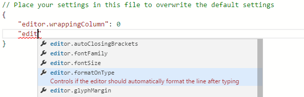
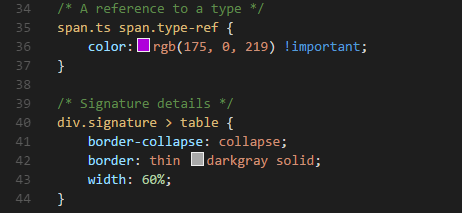
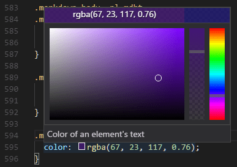
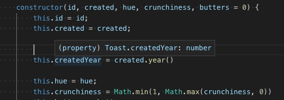

+++
title = "10.2.5 CSS、SCSS 和 Less"
date = 2026-11-06T07:53:25+08:00
weight = 5
type = "docs"
description = ""
isCJKLanguage = true
draft = false
+++


> 原文链接: [https://code.visualstudio.com/docs/languages/css](https://code.visualstudio.com/docs/languages/css)

# 10.2.5 CSS、SCSS 和 Less

　　VS Code 内置对 CSS `.css`、SCSS `.scss` 和 Less `.less` 样式表的编辑支持。也可以安装扩展获得更多功能。

> **提示**：单击上方扩展卡片阅读说明和评论，判断哪个扩展最适合你。更多内容请参阅 [Marketplace](https://marketplace.visualstudio.com)。

## IntelliSense {#intellisense}

　　VS Code 支持选择器、属性和值。使用 `Ctrl + Space` 获取上下文相关选项列表。



　　建议包含详细文档，包括支持该属性的浏览器列表。要查看所选条目的完整描述，请使用 `Ctrl + Space`。

## 语法着色和颜色预览 {#syntax-coloring--color-preview}

　　输入时会显示语法高亮以及颜色的上下文预览。



　　单击颜色预览会启动集成颜色选择器，支持配置色相、饱和度和不透明度。



> **提示**：单击选择器顶部颜色字符串可以在不同颜色模式之间切换。

可以通过以下[设置](../../../editor/3.3-ConfigureTheEditor/3.3.4-Settings/)隐藏 VS Code 颜色预览：

```json
"editor.colorDecorators": false
```

仅对 CSS、Less 和 SCSS 禁用：

```json
"[css]": {
    "editor.colorDecorators": false
}

```

## 折叠 {#folding}

　　可以使用行号和行首之间装订线上的折叠图标折叠源代码区域。所有声明（例如规则声明）和源代码中的多行注释都支持折叠区域。

此外，可以使用以下区域标记定义折叠区域：CSS/SCSS/Less 中使用 `/*#region*/` 和 `/*#endregion*/`，SCSS/Less 中使用 `// #region` 和 `// #endregion`。

如果希望 CSS、Less 和 SCSS 使用基于缩进的折叠：

```json
"[css]": {
    "editor.foldingStrategy": "indentation"
},
```

## Emmet 代码片段 {#emmet-snippets}

　　VS Code 内置 [Emmet 缩写支持](10.2.4-Emmet/)，建议会与其他建议和代码片段一起出现在编辑器自动补全列表中。

> **提示**：有效缩写请参阅 [Emmet 速查表](https://docs.emmet.io/cheat-sheet)的 CSS 部分。

　　VS Code 也支持[用户定义代码片段](../../../editor/3.2-WriteCode/3.2.7-Snippets/)。

## 语法验证和 Lint {#syntax-verification--linting}

支持 CSS 2.1 及以下、Sass 3.2 及以下、Less 2.3 及以下。

> **注意**：可以将相应的 `.validate` 用户或工作区[设置](../../../editor/3.3-ConfigureTheEditor/3.3.4-Settings/)设置为 false，禁用 VS Code 默认 CSS、Sass 或 Less 验证。
> ```json
> "css.validate": false
> ```

## 转到文件中的符号 {#go-to-symbol-in-file}

按 `Ctrl + Shift + O` 可以快速导航到当前文件中相关的 CSS 符号。

## 悬停 {#hovers}

　　将鼠标悬停在选择器或属性上，会提供匹配该 CSS 规则的 HTML 片段。



## 转到声明和查找引用 {#go-to-declaration-and-find-references}

　　同一文件中的 Sass 和 Less 变量支持此功能。也支持 [CSS 变量](https://developer.mozilla.org/docs/Web/CSS/Using_CSS_variables)（按[草案标准提案](https://drafts.csswg.org/css-variables/)）。

　　CSS、SCSS 和 Less 中的 `@import` 和 `url()` 链接支持跳转到定义。

## CSS 自定义数据 {#css-custom-data}

　　可以通过声明式[自定义数据格式](https://github.com/microsoft/vscode-css-languageservice/blob/main/docs/customData.md)扩展 VS Code 的 CSS 支持。将 `css.customData` 设置为遵循自定义数据格式的 JSON 文件列表，可以增强 VS Code 对新 CSS 属性、at 指令、伪类和伪元素的理解。VS Code 随后会为提供的属性、at 指令、伪类和伪元素提供补全和悬停信息。

　　使用自定义数据的更多信息请参阅 [vscode-custom-data](https://github.com/microsoft/vscode-custom-data) 仓库。

## 格式化 {#formatting}

　　CSS 语言功能扩展也提供格式化程序，适用于 CSS、LESS 和 SCSS。它由 [JS Beautify 库](https://github.com/beautify-web/js-beautify)实现，包含以下设置：

* `css.format.enable`：启用/禁用默认 CSS 格式化程序。
* `css.format.newlineBetweenRules`：用空行分隔规则集。
* `css.format.newlineBetweenSelectors`：用换行分隔选择器。
* `css.format.spaceAroundSelectorSeparator`：确保选择器分隔符 `>`、`+`、`~` 周围有空格（例如 `a > b`）。

　　`less` 和 `scss` 也有相同设置。

## 将 Sass 和 Less 转译为 CSS {#transpiling-sass-and-less-into-css}

　　VS Code 可以通过集成[任务运行器](../../../debugging-and-testing/6.3-Tasks/)与 Sass 和 Less 转译器集成，将 `.scss` 或 `.less` 文件转译为 `.css` 文件。下面演示转译一个简单的 Sass/Less 文件。

### 第 1 步：安装 Sass 或 Less 转译器 {#step-1-install-a-sass-or-less-transpiler}

本演练使用 [sass](https://www.npmjs.com/package/sass) 或 [less](https://www.npmjs.com/package/less) Node.js 模块。

> **注意**：如果尚未安装 [Node.js](https://nodejs.org) 和 [npm](https://www.npmjs.com/)，需要先安装。[为平台安装 Node.js](https://nodejs.org/en/download/)。Node.js 发行版包含 npm。需要打开新终端（命令提示符）使 `npm` 出现在 PATH 中。

```bash
npm install -g sass less
```

### 第 2 步：创建简单的 Sass 或 Less 文件 {#step-2-create-a-simple-sass-or-less-file}

在空文件夹中打开 VS Code，创建 `styles.scss` 或 `styles.less` 文件，放入以下代码：

```scss
$padding: 6px;

nav {
  ul {
    margin: 0;
    padding: $padding;
    list-style: none;
  }

  li { display: inline-block; }

  a {
    display: block;
    padding: $padding 12px;
    text-decoration: none;
  }
}
```

　　Less 版本只需将 `$padding` 改为 `@padding`。

> **注意**：这是非常简单的示例，因此两种文件类型的源代码几乎相同。更复杂的场景中，语法和结构会有很大不同。

### 第 3 步：创建 tasks.json {#step-3-create-tasksjson}

接下来设置任务配置。运行 **终端** > **配置任务**，单击 **从模板创建 tasks.json 文件**，在选择对话框中选择 **Others**。

这会在工作区 `.vscode` 文件夹创建示例 `tasks.json`。初始版本包含运行任意命令的示例。我们将其修改为转译 Sass/Less：

```json
// Sass 配置
{
    // 有关 tasks.json 格式的文档，请参阅 https://go.microsoft.com/fwlink/?LinkId=733558
    "version": "2.0.0",
    "tasks": [
        {
            "label": "Sass Compile",
            "type": "shell",
            "command": "sass styles.scss styles.css",
            "group": "build"
        }
    ]
}
```

```json
// Less 配置
{
    // 有关 tasks.json 格式的文档，请参阅 https://go.microsoft.com/fwlink/?LinkId=733558
    "version": "2.0.0",
    "tasks": [
        {
            "label": "Less Compile",
            "type": "shell",
            "command": "lessc styles.less styles.css",
            "group": "build"
        }
    ]
}
```

### 第 4 步：运行生成任务 {#step-4-run-the-build-task}

　　这是文件中唯一命令，按 `Ctrl + Shift + B`（**运行生成任务**）即可执行。示例 Sass/Less 文件不应有编译问题，运行任务只会生成相应的 `styles.css` 文件。

　　更复杂环境中可能有多个生成任务，按 `Ctrl + Shift + B` 后会提示选择任务。还可以扫描输出中的编译问题（错误和警告）。根据编译器，在列表中选择适当条目扫描工具输出。不想扫描时，选择 **Never scan the build output**。

此时文件列表中会出现 `styles.css`。

要将任务设为默认生成任务，请从全局 **终端** 菜单运行 **配置默认生成任务**，并在列表中选择相应的 **Sass** 或 **Less** 任务。

> **注意**：生成失败或看到“An output directory must be specified when compiling a directory”等错误时，请确保 `tasks.json` 中的文件名与磁盘文件名一致。始终可以在命令行运行 `sass styles.scss styles.css` 测试。

## 自动化 Sass/Less 编译 {#automating-sassless-compilation}

　　进一步使用 VS Code 自动化 Sass/Less 编译。仍然使用任务运行器集成，但需要一些修改。

### 第 1 步：安装 Gulp 和插件 {#step-1-install-gulp-and-some-plug-ins}

使用 [Gulp](https://gulpjs.com/) 创建自动化 Sass/Less 编译的任务，并使用 [gulp-sass](https://www.npmjs.com/package/gulp-sass) 插件简化操作。Less 插件为 [gulp-less](https://www.npmjs.com/package/gulp-less)。

需要全局（`-g` 开关）和本地安装 gulp：

```bash
npm install -g gulp
npm install gulp gulp-sass gulp-less
```

> **注意**：`gulp-sass` 和 `gulp-less` 是之前使用的 `sass` 和 `lessc` 模块的 Gulp 插件。还有许多其他 Gulp Sass 和 Less 插件，以及 Grunt 插件。

可以在终端输入 `gulp -v` 测试安装是否成功。应看到全局（CLI）和本地安装的版本。

### 第 2 步：创建简单的 Gulp 任务 {#step-2-create-a-simple-gulp-task}

在同一文件夹（包含 `styles.scss`/`styles.less` 和 `.vscode` 下的 `tasks.json`）中打开 VS Code，在根目录创建 `gulpfile.js`。

将以下代码放入 `gulpfile.js`：

```javascript
// Sass 配置
var gulp = require('gulp');
var sass = require('gulp-sass')(require('sass'));

gulp.task('sass', function(cb) {
    gulp.src('*.scss')
        .pipe(sass())
        .pipe(gulp.dest(function(f) {
            return f.base;
        }));
    cb();
});

gulp.task('default', gulp.series('sass', function(cb) {
    gulp.watch('*.scss', gulp.series('sass'));
    cb();
}));
```

```javascript
// Less 配置
var gulp = require('gulp');
var less = require('gulp-less');

gulp.task('less', function(cb) {
    gulp.src('*.less')
        .pipe(less())
        .pipe(gulp.dest(function(f) {
            return f.base;
        }));
    cb();
});

gulp.task('default', gulp.series('less', function(cb) {
    gulp.watch('*.less', gulp.series('less'));
    cb();
}));
```

这里发生了什么？

1. `default` gulp 任务启动时先运行一次 `sass` 或 `less` 任务。
2. 然后监视工作区根目录（例如 VS Code 中打开的当前文件夹）中任何 SCSS/Less 文件的更改。
3. 将更改的 SCSS/Less 文件集通过相应编译器（例如 `gulp-sass`、`gulp-less`）运行。
4. 生成一组 CSS 文件，每个文件以原 SCSS/Less 文件命名，并放在同一目录中。

### 第 3 步：运行 gulp 默认任务 {#step-3-run-the-gulp-default-task}

　　完成 VS Code 任务集成，需要修改之前的任务配置以运行刚创建的默认 Gulp 任务。可以删除 `tasks.json`，或清空只保留 `"version": "2.0.0"`。然后从全局 **终端** 菜单执行 **运行任务**。会看到列出 gulp 文件定义任务的选择器。选择 **gulp: default** 启动任务。可以扫描输出中的编译问题；根据编译器选择适当条目。不想扫描时选择 **Never scan the build output**。此时创建和/或修改 Less 或 SASS 文件，保存时会生成相应 CSS 文件或反映更改。也可以启用[自动保存](../../../editor/3.2-WriteCode/3.2.1-BasicEditing/)进一步简化。

要将 **gulp: default** 设为按 `Ctrl + Shift + B` 执行的默认生成任务，请从全局 **终端** 菜单运行 **配置默认生成任务**，并选择 **gulp: default**。

### 第 4 步：终止 gulp 默认任务 {#step-4-terminate-the-gulp-default-task}

　　**gulp: default** 任务在后台运行并监视 Sass/Less 文件更改。要停止任务，请从全局 **终端** 菜单使用 **终止任务**。

## 自定义 CSS、SCSS 和 Less 设置 {#customizing-css-scss-and-less-settings}

可以将以下 lint 警告配置为[用户和工作区设置](../../../editor/3.3-ConfigureTheEditor/3.3.4-Settings/)。

`validate` 设置可以关闭内置验证。如果想使用其他 linter，可以这样做。

| ID | 说明 | 默认值 |
|---|------|--------|
| css.validate | 启用或禁用所有 CSS 验证 | true |
| less.validate | 启用或禁用所有 Less 验证 | true |
| scss.validate | 启用或禁用所有 SCSS 验证 | true |

要配置 CSS 选项，请使用 `css.lint.` 作为 ID 前缀；SCSS 和 Less 使用 `scss.lint.` 和 `less.lint.`。

将设置设为 `warning` 或 `error` 启用 lint 检查，使用 `ignore` 禁用。Lint 检查在输入时执行。

| ID | 说明 | 默认值 |
|---|------|--------|
| validate | 启用或禁用所有验证 | true |
| compatibleVendorPrefixes | 使用带供应商前缀的属性（例如 `-webkit-transition`）时，确保也包含其他供应商特定属性，例如 `-moz-transition`、`-ms-transition` 和 `-o-transition` | ignore |
| vendorPrefix | 使用带供应商前缀的属性（例如 `-webkit-transition`）时，确保也包含标准属性（如果存在），例如 `transition` | warning |
| duplicateProperties | 警告同一规则集中的重复属性 | ignore |
| emptyRules | 警告空规则集 | warning |
| importStatement | 警告使用 `import` 语句，因为导入语句按顺序加载，对网页性能有负面影响 | ignore |
| boxModel | 使用 `padding` 或 `border` 时不要使用 `width` 或 `height` | ignore |
| universalSelector | 警告使用通用选择器 `*`，因为它已知较慢，应避免使用 | ignore |
| zeroUnits | 警告零值带单位（例如 `0em`），因为零不需要单位 | ignore |
| fontFaceProperties | 警告使用 `@font-face` 规则但未定义 `src` 和 `font-family` 属性 | warning |
| hexColorLength | 警告十六进制颜色不是三位或六位 | error |
| argumentsInColorFunction | 警告颜色函数（例如 `rgb`）参数数量无效 | error |
| unknownProperties | 警告使用未知属性 | warning |
| ieHack | 警告使用 IE hack `*propertyName` 或 `_propertyName` | ignore |
| unknownVendorSpecificProperties | 警告使用未知供应商特定属性 | ignore |
| propertyIgnoredDueToDisplay | 警告使用因 display 而被忽略的属性。例如 `display: inline` 时 `width`、`height`、`margin-top`、`margin-bottom` 和 `float` 无效 | warning |
| important | 警告使用 `!important`，因为这表明整个 CSS 的优先级已失控，需要重构 | ignore |
| float | 警告使用 `float`，因为浮动会导致脆弱的 CSS，布局某方面变化时容易破坏 | ignore |
| idSelector | 警告使用 id 选择器 `#id`，因为选择器不应包含 ID，这些规则与 HTML 耦合过紧 | ignore |

## 后续步骤 {#next-steps}

继续阅读：

* [配置任务](../../../debugging-and-testing/6.3-Tasks/)：深入了解任务，帮助将 SCSS 和 Less 转译为 CSS。
* [基本编辑](../../../editor/3.2-WriteCode/3.2.1-BasicEditing/)：了解 VS Code 编辑器。
* [代码导航](../../../editor/3.2-WriteCode/3.2.5-CodeNavigation/)：快速浏览源代码。
* [HTML](10.2.3-HTML/)：CSS 只是开始，VS Code 也非常支持 HTML。

## 常见问题 {#common-questions}

### VS Code 提供颜色选择器吗？ {#does-vs-code-provide-a-color-picker}

　　提供。将鼠标悬停在 CSS 颜色引用上会显示颜色选择器。

### 支持基于缩进的 Sass 语法（.sass）吗？ {#is-there-support-for-the-indentation-based-sass-syntax-sass}

　　不支持，但 Marketplace 中有多个扩展支持缩进式 Sass，例如最初由 Robin Bentley 创建、现由 Leonard Grosoli 维护的 [Sass](https://marketplace.visualstudio.com/items?itemName=Syler.sass-indented) 扩展。
