+++
title = "10.2.6 TypeScript"
date = 2026-11-06T07:53:25+08:00
weight = 6
type = "docs"
description = ""
isCJKLanguage = true
draft = false
+++


> 原文链接: [https://code.visualstudio.com/docs/languages/typescript](https://code.visualstudio.com/docs/languages/typescript)

# 10.2.6 TypeScript

　　[TypeScript](https://www.typescriptlang.org) 是编译为普通 JavaScript 的带类型 JavaScript 超集。它提供类、模块和接口，帮助你构建健壮的组件。

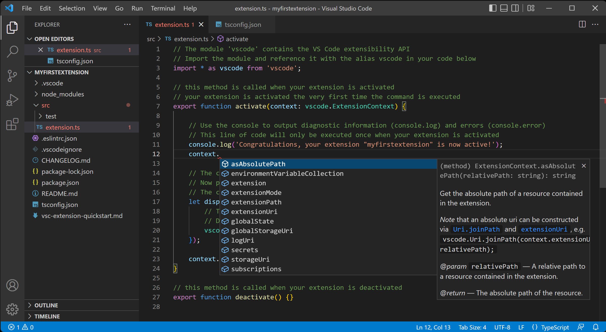

## 安装 TypeScript 编译器 {#installing-the-typescript-compiler}

　　VS Code 包含 TypeScript 语言支持，但不包含 TypeScript 编译器 `tsc`。需要全局或在工作区安装 TypeScript 编译器，才能将 TypeScript 源代码转译为 JavaScript（`tsc HelloWorld.ts`）。

安装 TypeScript 最简单的方法是通过 npm（[Node.js 包管理器](https://www.npmjs.com/)）。已安装 npm 时，可以通过以下命令在计算机上全局（`-g`）安装 TypeScript：

```bash
npm install -g typescript
```

可以通过检查版本测试安装：

```bash
tsc --version
```

另一种选择是在项目中本地安装 TypeScript 编译器（`npm install --save-dev typescript`），好处是避免与可能存在的其他 TypeScript 项目交互。

## Hello World {#hello-world}

从一个简单的 Hello World Node.js 示例开始。创建新文件夹 `HelloWorld` 并启动 VS Code：

```bash
mkdir HelloWorld
cd HelloWorld
code .
```

在文件资源管理器中创建新文件 `helloworld.ts`。

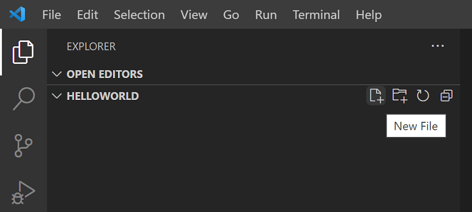

添加以下 TypeScript 代码。注意 TypeScript 关键字 `let` 和 `string` 类型声明：

```typescript
let message : string = "Hello World";
console.log(message);
```

要编译 TypeScript 代码，可以打开[集成终端](../../../terminal/5.2-TerminalBasics/)（`Ctrl + 反引号`）并输入 `tsc helloworld.ts`。这会编译并创建新的 `helloworld.js` JavaScript 文件。

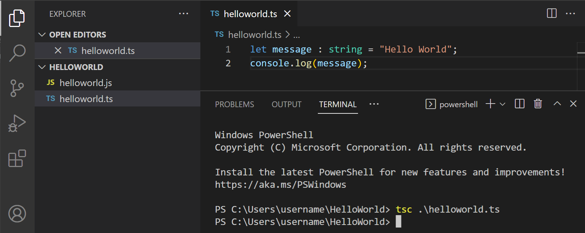

已安装 Node.js 时，可以运行 `node helloworld.js`。

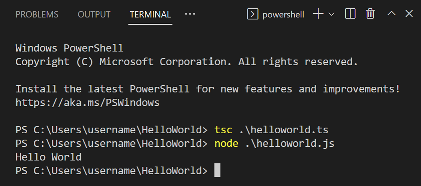

打开 `helloworld.js` 会看到它与 `helloworld.ts` 差别不大：类型信息已移除，`let` 变成了 `var`。

```javascript
var message = "Hello World";
console.log(message);
```

## IntelliSense {#intellisense}

　　IntelliSense 显示智能代码补全、悬停信息和签名帮助，帮助你更快、更正确地编写代码。

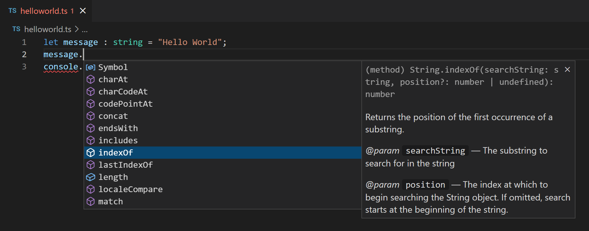

　　VS Code 为单个 TypeScript 文件以及 TypeScript `tsconfig.json` 项目提供 IntelliSense。

### 悬停信息 {#hover-information}

将鼠标悬停在 TypeScript 符号上，可以快速查看其类型信息和相关文档：

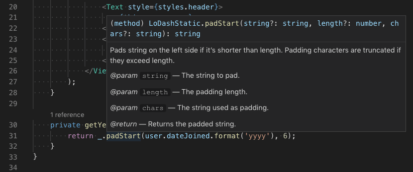

也可以使用 `Ctrl + K Ctrl + I` 快捷键在当前光标位置显示悬停信息。

### 签名帮助 {#signature-help}

　　编写 TypeScript 函数调用时，VS Code 显示函数签名信息，并高亮当前正在填写的参数：

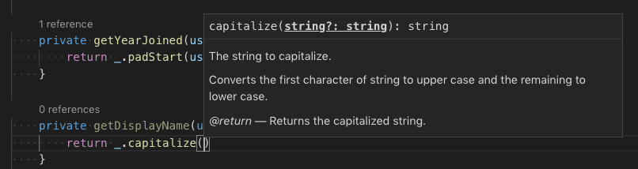

　　在函数调用中输入 `(` 或 `,` 时会自动显示签名帮助。按 `Ctrl + Shift + Space` 手动触发。

## 代码片段 {#snippets}

　　除了智能代码补全，VS Code 还包含基本 TypeScript [代码片段](../../../editor/3.2-WriteCode/3.2.7-Snippets/)，输入时会显示建议。

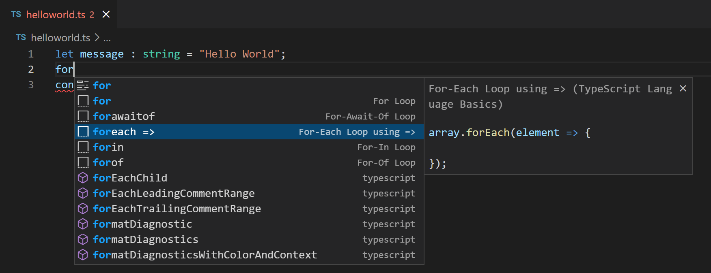

可以安装扩展获取额外代码片段，或为 TypeScript 定义自己的代码片段。详情请参阅[用户定义代码片段](../../../editor/3.2-WriteCode/3.2.7-Snippets/)。

> **提示**：可以在[设置](../../../editor/3.3-ConfigureTheEditor/3.3.4-Settings/)文件中将 `editor.snippetSuggestions` 设置为 `"none"` 禁用代码片段。如果希望看到代码片段，可以指定其相对建议的顺序：顶部（`"top"`）、底部（`"bottom"`）或按字母顺序内联（`"inline"`）。默认 `"inline"`。

## 错误和警告 {#errors-and-warnings}

　　TypeScript 语言服务会分析程序中的编码问题并报告错误和警告：

* 状态栏显示所有错误和警告数量的摘要。
* 可以单击摘要或按 `Ctrl + Shift + M` 显示 **问题** 面板及当前所有错误列表。
* 打开有错误或警告的文件时，它们会内联显示在文本和概览标尺中。

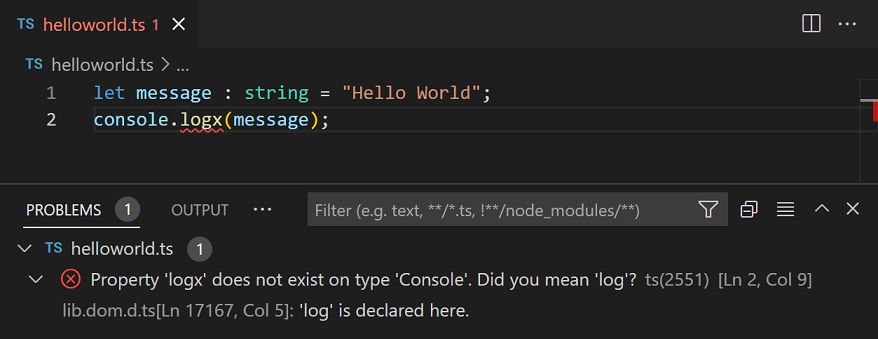

　　要循环浏览当前文件中的错误或警告，可以按 `F8` 或 `Shift + F8`，会显示内联区域，详细说明问题及可能的代码操作（如果可用）：

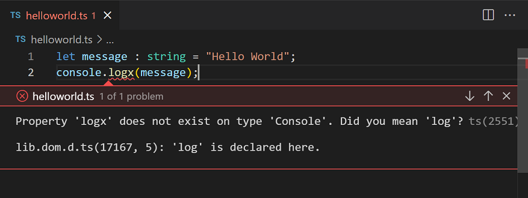

## 代码导航 {#code-navigation}

　　代码导航可以快速浏览 TypeScript 项目。

* **转到定义**（`F12`）：转到符号定义的源代码。
* **速览定义**（`Alt + F12`）：打开速览窗口显示符号定义。
* **转到引用**（`Shift + F12`）：显示符号的所有引用。
* **转到类型定义**：转到定义符号的类型。对于类实例，会显示类本身，而不是实例定义位置。
* **转到实现**（`Ctrl + F12`）：转到接口或抽象方法的实现。

可以使用 **命令面板**（`Ctrl + Shift + P`）中的 **转到符号** 命令进行符号搜索：

* **转到文件中的符号**（`Ctrl + Shift + O`）
* **转到工作区中的符号**（`Ctrl + T`）

## 格式化 {#formatting}

　　VS Code 包含 TypeScript 格式化程序，提供合理默认值的基本代码格式化。

使用 `js/ts.format.*` [设置](../../../editor/3.3-ConfigureTheEditor/3.3.4-Settings/)配置内置格式化程序，例如让大括号单独占一行。如果内置格式化程序妨碍工作，可以将 `js/ts.format.enable` 设置为 `false` 禁用。

需要更专门的代码格式样式时，请尝试从 Marketplace 安装格式化扩展。

## 重构 {#refactoring}

　　VS Code 包含一些方便的 TypeScript 重构，例如 **提取函数** 和 **提取常量**。选择要提取的源代码，然后单击装订线中的灯泡或按 `Ctrl + .` 查看可用重构。

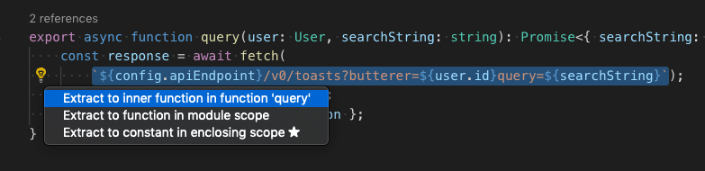

重构详情以及如何为单个重构配置快捷键，请参阅[重构 TypeScript](https://code.visualstudio.com/docs/typescript/typescript-refactoring)。

### 重命名 {#rename}

最简单的重构之一是重命名方法或变量。按 `F2` 可以跨 TypeScript 项目重命名光标下的符号：

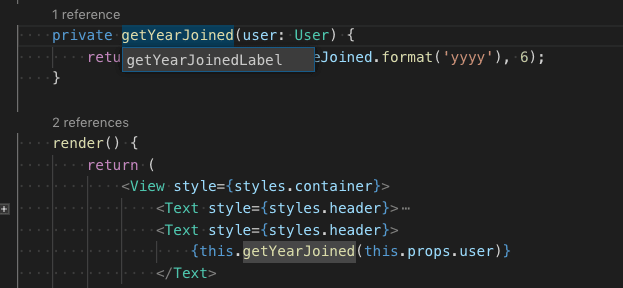

## 调试 {#debugging}

　　VS Code 为 TypeScript 提供出色的调试支持，包括 sourcemap。设置断点、检查对象、浏览调用堆栈，并在调试控制台中执行代码。详情请参阅[调试 TypeScript](https://code.visualstudio.com/docs/typescript/typescript-debugging)和[调试](../../../debugging-and-testing/6.1-Debugging/)主题。

### 调试客户端 {#debug-client-side}

　　可以使用浏览器调试器调试客户端代码，例如[内置 Edge 和 Chrome 调试器](https://code.visualstudio.com/docs/nodejs/browser-debugging)，或 [Debugger for Firefox](https://marketplace.visualstudio.com/items?itemName=hbenl.vscode-firefox-debug)。

### 调试服务器端 {#debug-server-side}

　　使用内置调试器在 VS Code 中调试 Node.js。设置简单，还有 [Node.js 调试教程](https://code.visualstudio.com/docs/nodejs/nodejs-tutorial#debug-your-express-app)帮助入门。

<video src="https://code.visualstudio.com/assets/docs/languages/javascript/debug_data_inspection.mp4" title="调试数据检查。" autoplay loop controls muted></video>

## Linter {#linters}

　　[Linter](https://en.wikipedia.org/wiki/Lint_%28software%29) 为可疑代码提供警告。VS Code 不包含内置 TypeScript linter，但 Marketplace 中有 TypeScript linter [扩展](../../../editor/3.3-ConfigureTheEditor/3.3.6-Extensions/3.3.6.2-ExtensionMarketplace/)。

　　[ESLint](https://eslint.org) 是流行的 linter，也支持 TypeScript。[ESLint 扩展](https://marketplace.visualstudio.com/items?itemName=dbaeumer.vscode-eslint)将 ESLint 集成到 VS Code，可以直接在编辑器中看到 lint 错误，甚至使用[快速修复](https://code.visualstudio.com/docs/typescript/typescript-refactoring#quick-fixes)快速修复许多问题。[ESLint 插件指南](https://github.com/typescript-eslint/typescript-eslint/tree/main/packages/eslint-plugin#readme)详细介绍如何为 TypeScript 项目配置 ESLint。

## TypeScript 扩展 {#typescript-extensions}

　　VS Code 开箱即用提供许多 TypeScript 功能。除了内置功能，还可以安装扩展获得更多功能。

> **提示**：单击上方扩展卡片阅读说明和评论，判断哪个扩展最适合你。更多内容请参阅 [Marketplace](https://marketplace.visualstudio.com)。

## 后续步骤 {#next-steps}

更多信息请参阅：

* [TypeScript 教程](https://code.visualstudio.com/docs/typescript/typescript-tutorial)：在 VS Code 中创建简单的 Hello World TypeScript。
* [编辑 TypeScript](https://code.visualstudio.com/docs/typescript/typescript-editing)：TypeScript 特定编辑功能。
* [重构 TypeScript](https://code.visualstudio.com/docs/typescript/typescript-refactoring)：TypeScript 语言服务的有用重构。
* [转译 TypeScript](https://code.visualstudio.com/docs/typescript/typescript-transpiling)：将 TypeScript 编译到 JavaScript 目标版本。
* [调试 TypeScript](https://code.visualstudio.com/docs/typescript/typescript-debugging)：了解如何在 VS Code 中调试服务器端和客户端 TypeScript。

## 常见问题 {#common-questions}

### 可以使用 VS 2022 自带的 TypeScript 版本吗？ {#can-i-use-the-version-of-typescript-that-ships-with-vs-2022}

　　不可以。Visual Studio 2019 和 2022 自带的 TypeScript 语言服务与 VS Code 不兼容。需要从 [npm](https://www.npmjs.com/package/typescript) 安装单独的 TypeScript 版本。

### 如何在 VS Code 中使用最新 TypeScript beta？ {#how-can-i-use-the-latest-typescript-beta-with-vs-code}

　　在 VS Code 中试用最新 TypeScript 功能的最简单方法是安装 [JavaScript and TypeScript Nightly 扩展](https://marketplace.visualstudio.com/items?itemName=ms-vscode.vscode-typescript-next)。

也可以[配置 VS Code 使用特定 TypeScript 版本](https://code.visualstudio.com/docs/typescript/typescript-transpiling#using-newer-typescript-versions)。
