+++
title = "10.2.7 Markdown"
date = 2026-11-06T07:53:25+08:00
weight = 7
type = "docs"
description = ""
isCJKLanguage = true
draft = false
+++


> 原文链接: [https://code.visualstudio.com/docs/languages/markdown](https://code.visualstudio.com/docs/languages/markdown)

# 10.2.7 Markdown

　　在 VS Code 中处理 Markdown 文件简单、直接且有趣。除了 VS Code 的基本编辑功能，还有许多 Markdown 特定功能帮助提高效率。

> **注意**：可以使用 [Doc Writer 配置文件模板](../../../editor/3.3-ConfigureTheEditor/3.3.8-Profiles/)安装有用的扩展（拼写检查、Markdown linter）并配置适当设置，快速开始编辑 Markdown。

## 编辑 Markdown {#editing-markdown}

### 文档大纲 {#document-outline}

　　大纲视图是文件资源管理器底部的独立部分。展开后会显示当前活动编辑器的符号树。Markdown 文件的符号树是文件标题层级。

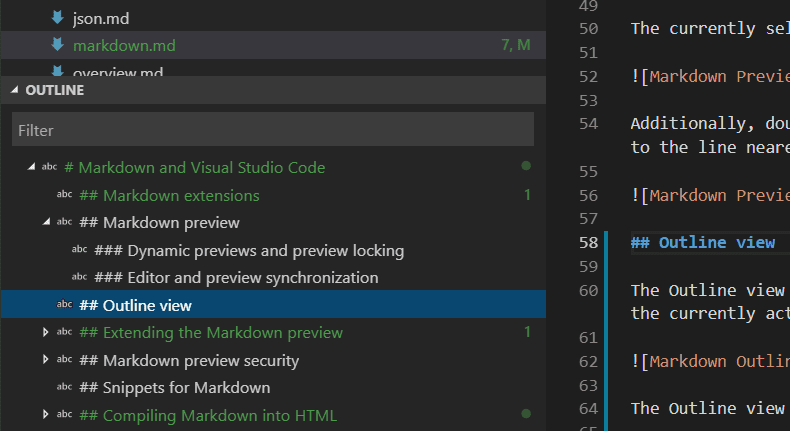

　　大纲视图是审查文档标题结构和纲要的好方法。

### Markdown 代码片段 {#snippets-for-markdown}

　　VS Code 包含一些有用的代码片段，可加快 Markdown 编写，包括代码块、图片等片段。编辑时按 `Ctrl + Space`（触发建议）查看建议的 Markdown 代码片段列表。也可以使用命令面板中的 **插入代码片段** 打开专用代码片段选择器。

> **提示**：可以为 Markdown 添加自己的用户定义代码片段。请参阅[用户定义代码片段](../../../editor/3.2-WriteCode/3.2.7-Snippets/)。

### 转到文件中的标题 {#go-to-header-in-file}

使用 `Ctrl + Shift + O` 快速跳转到当前文件中的标题。

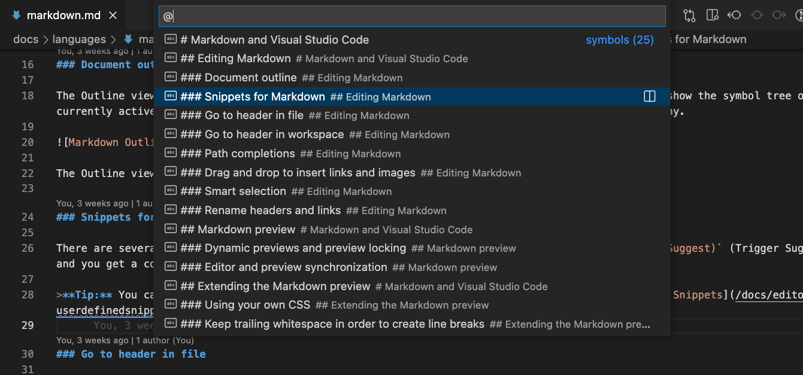

　　可以浏览文件中的所有标题，或输入标题名查找。找到后按 `Enter` 将光标移到该标题，按 `Esc` 取消。

### 转到工作区中的标题 {#go-to-header-in-workspace}

使用 `Ctrl + T` 搜索当前工作区所有 Markdown 文件中的标题。

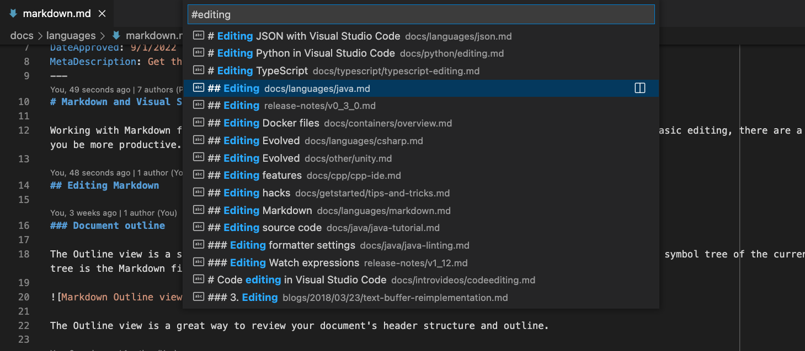

　　开始输入标题名可筛选列表。

### 路径补全 {#path-completions}

　　路径补全帮助创建文件和图片链接。输入图片或链接路径时，[IntelliSense](../../../editor/3.2-WriteCode/3.2.2-IntelliSense/) 会自动显示这些路径，也可以按 `Ctrl + Space` 手动请求。

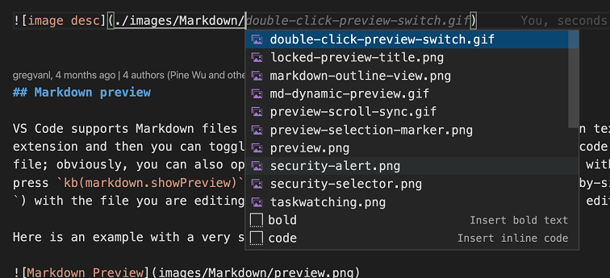

　　以 `/` 开头的路径相对于当前工作区根目录解析，以 `./` 开头或无前缀的路径相对于当前文件解析。输入 `/` 时自动显示路径建议，也可以按 `Ctrl + Space` 手动调用。

　　路径 IntelliSense 还可以链接到当前文件或其他 Markdown 文件中的标题。以 `#` 开头可查看文件中所有标题的补全（根据设置，可能需要按 `Ctrl + Space`）：

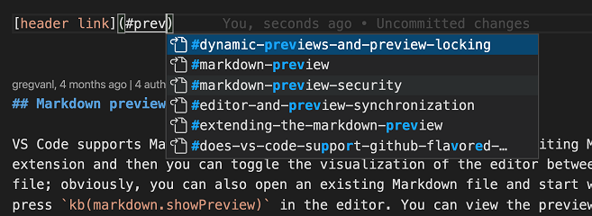

可以使用 `"markdown.suggest.paths.enabled": false` 禁用路径 IntelliSense。

### 创建指向其他文件中标题的链接 {#creating-links-to-a-header-in-another-file}

　　需要链接到其他 Markdown 文档中的标题，但不想输入完整文件路径时，可以使用工作区标题补全。在 Markdown 链接中输入 `##`，查看当前工作区所有 Markdown 标题列表：

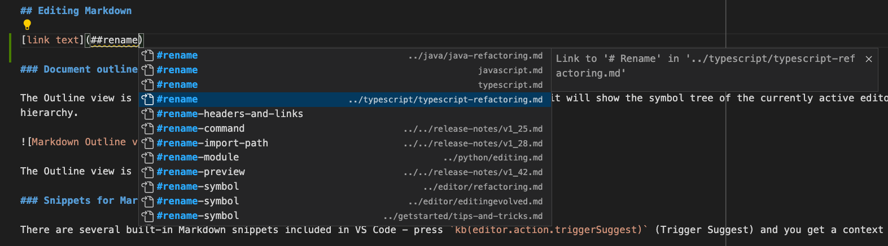

　　接受建议会插入指向该标题的完整链接，即使标题在其他文件中：

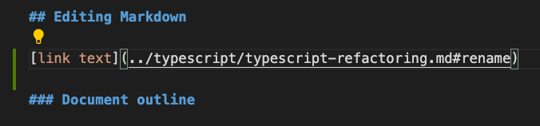

可以使用 `markdown.suggest.paths.includeWorkspaceHeaderCompletions` 设置配置工作区标题补全的显示时机：

* `onDoubleHash`（默认）：仅在输入 `##` 后显示。
* `onSingleOrDoubleHash`：输入 `#` 或 `##` 后显示。
* `never`：从不显示。

　　查找当前工作区所有标题可能开销较大，首次请求时可能稍有延迟，尤其是 Markdown 文件很多的工作区。

### 插入图片和文件链接 {#inserting-images-and-links-to-files}

　　除了[路径补全](#path-completions)，VS Code 还支持其他方式将图片和文件链接插入 Markdown 文档：

可以从 VS Code 资源管理器或操作系统将文件**拖放到** Markdown 编辑器。将文件拖到 Markdown 代码上并按住 `Shift` 开始放入，预览光标会显示插入位置。

<video src="https://code.visualstudio.com/assets/docs/languages/Markdown/drop-link.mp4" title="从资源管理器拖放插入 Markdown 链接。" autoplay loop controls muted></video>

如果更喜欢键盘，也可以**复制粘贴**文件或图片数据到 Markdown 编辑器。粘贴文件、文件链接或 URL 时，可以选择插入 Markdown 链接或作为纯文本包含。

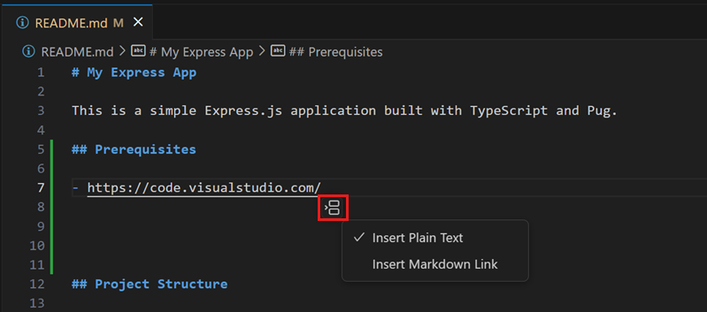

也可以使用 **Markdown: Insert Image from Workspace** 命令插入图片，使用 **Markdown: Insert Link to File in Workspace** 插入文件链接。

　　插入图片使用 Markdown 图片语法 ``，链接使用普通 Markdown 链接 `[](path/to/file.md)`。

　　默认情况下，VS Code 会自动将拖放或粘贴到工作区外的图片复制到工作区。`markdown.copyFiles.destination` 设置控制新图片文件创建位置。该设置将匹配当前 Markdown 文档的 [glob](https://code.visualstudio.com/docs/editor/glob-patterns) 映射到图片目标，目标也可以使用简单变量。可用变量请参阅 `markdown.copyFiles.destination` 设置说明。

例如，希望 `/docs` 下每个 Markdown 文件将新媒体文件放到当前文件专用的 `images` 目录：

```jsonc
"markdown.copyFiles.destination": {
  "/docs/**/*": "images/${documentBaseName}/"
}
```

　　现在将新文件粘贴到 `/docs/api/readme.md` 时，图片会创建在 `/docs/api/images/readme/image.png`。

　　甚至可以使用简单正则表达式以[类似代码片段的方式](../../../editor/3.2-WriteCode/3.2.7-Snippets/)转换变量。例如，只使用文档文件名首字母创建媒体文件：

```jsonc
"markdown.copyFiles.destination": {
  "/docs/**/*": "images/${documentBaseName/(.).*/$1/}/"
}
```

　　将新文件粘贴到 `/docs/api/readme.md` 时，图片会创建在 `/docs/api/images/r/image.png`。

### 为图片生成替代文本 {#generating-alt-text-for-images}

　　可以使用 AI 为 Markdown 文件中的图片生成或更新替代文本：

1. 确保已在 VS Code 环境中[设置 Copilot](../../../ai-in-vs-code/getting-started/2.1.2-SetUpCopilot/)。可以免费开始使用 Copilot。
2. 打开 Markdown 文件。
3. 将光标放在图片链接上。
4. 选择代码操作（灯泡）图标，选择 **生成替代文本**。

    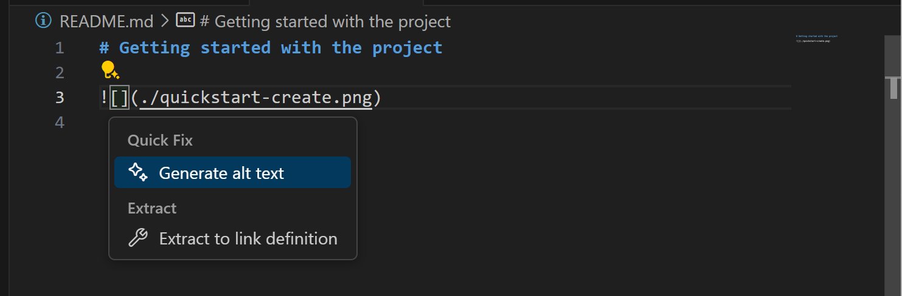

5. 已有替代文本时，选择代码操作，然后选择 **优化替代文本**。

### 智能选择 {#smart-selection}

　　智能选择可以快速扩大和缩小 Markdown 文档中的选择范围，例如选择整个块元素（代码块或表格），或选择标题节的全部内容。

智能选择使用以下命令：

* 扩大：`Ctrl + Shift + →`
* 缩小：`Ctrl + Shift + ←`

　　选择适用于以下结构，并遵循传统层级模式：

* 标题
* 列表
* 块引用
* 围栏代码块
* HTML 代码块
* 段落

<video src="https://code.visualstudio.com/assets/docs/languages/Markdown/smart-select.mp4" title="Markdown 智能选择从块元素扩展到包含它的块、标题下其余内容，再到标题本身。" autoplay loop controls muted></video>

### 链接验证 {#link-validation}

　　链接验证检查 Markdown 代码中的本地链接是否有效，可以捕获常见错误，例如链接到已重命名的标题或磁盘上不存在的文件。

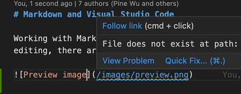

　　链接验证默认关闭。要启用，请设置 `"markdown.validate.enabled": true`。VS Code 随后分析指向标题、图片和其他本地文件的 Markdown 链接。无效链接报告为警告或错误。所有验证都在本地进行，不检查外部 http(s) 链接。

可以使用以下设置自定义链接验证：

* `markdown.validate.fileLinks.enabled`：启用/禁用本地文件链接验证：`[link](/path/to/file.md)`
* `markdown.validate.fragmentLinks.enabled`：启用/禁用当前文件标题链接验证：`[link](#some-header)`
* `markdown.validate.fileLinks.markdownFragmentLinks`：启用/禁用其他 Markdown 文件标题链接验证：`[link](other-file.md#some-header)`
* `markdown.validate.referenceLinks.enabled`：启用/禁用引用链接验证：`[link][ref]`
* `markdown.validate.ignoredLinks`：跳过验证的链接 glob 列表。链接到磁盘上不存在但发布后存在的文件时很有用。

### 查找标题和链接的所有引用 {#find-all-references-to-headers-and-links}

使用 **查找所有引用**（`Shift + Alt + F12`）命令查找当前工作区中引用某个 Markdown 标题或链接的所有位置：

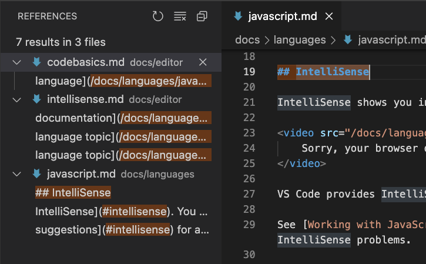

**查找所有引用** 支持：

* 标题：`# My Header`。显示指向 `#my-header` 的所有链接。
* 外部链接：`[text](http://example.com)`。显示指向 `http://example.com` 的所有链接。
* 内部链接：`[text](./path/to/file.md)`。显示指向 `./path/to/file.md` 的所有链接。
* 链接片段：`[text](./path/to/file.md#my-header)`。显示 `./path/to/file.md` 中指向 `#my-header` 的所有链接。

### 重命名标题和链接 {#rename-headers-and-links}

　　厌倦了更改 Markdown 标题时意外破坏链接？请改用 **重命名符号**（`F2`）。输入新标题名并按 `Enter` 后，VS Code 会更新标题并自动更新所有指向该标题的链接：

<video src="https://code.visualstudio.com/assets/docs/languages/Markdown/rename-header.mp4" title="重命名 Markdown 标题并更新所有链接。" autoplay loop controls muted></video>

也可以对以下内容使用 `F2`：

* 标题：`# My Header`。更新所有指向 `#my-header` 的链接。
* 外部链接：`[text](http://example.com/page)`。更新所有链接到 `http://example.com/page` 的位置。
* 内部链接：`[text](./path/to/file.md)`。重命名文件 `./path/to/file.md` 并更新所有指向它的链接。
* 链接片段：`[text](./path/to/file.md#my-header)`。重命名 `./path/to/file.md` 中的标题并更新所有指向它的链接。

### 文件移动或重命名时自动更新链接 {#automatic-link-updates-on-file-move-or-rename}

　　使用自动 Markdown 链接更新，VS Code 会在链接文件移动或重命名时自动更新 Markdown 链接。使用 `markdown.updateLinksOnFileMove.enabled` 设置启用：

* `never`（默认）：不自动更新链接。
* `prompt`：更新前确认。
* `always`：自动更新，不确认。

　　自动链接更新会检测 Markdown 文件、图片和目录的重命名。可以使用 `markdown.updateLinksOnFileMove.include` 为其他文件类型启用。

## Markdown 编辑器 {#markdown-editor}

　　Markdown 编辑器可以直接编辑渲染后的 Markdown，无需在文本编辑器和独立预览之间切换。它适用于普通编辑器窗口和智能体窗口。

在实验性编辑器中打开 Markdown 文件：

1. 打开 `.md` 文件。
2. 在面包屑栏中选择编辑器类型下拉列表，例如 **文本编辑器**。

    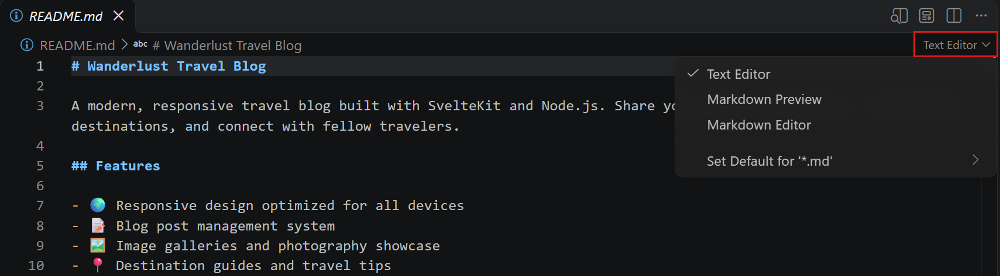

3. 选择 **Markdown 编辑器**。

也可以在编辑器标题中选择 **更多操作**（`...`）> **重新打开编辑器方式** > **Markdown 编辑器**，或从命令面板（`Ctrl + Shift + P`）运行 **View: Reopen Editor With...**。

要将实验性编辑器设为智能体窗口中 Markdown 文件的默认编辑器，请参阅[在智能体窗口中查看和编辑 Markdown 文件](../../../ai-in-vs-code/work-with-ai/2.2.9-ConfigureTheAgentsWindow/)。

### 使用 Markdown 编辑器 {#use-the-markdown-editor}

　　编辑器有切换编辑和锁定模式的控件。锁定模式下文档只读并渲染，编辑模式下可以直接修改内容。

1. 模式控件显示 **已锁定** 时，选择它切换到 **编辑**。

    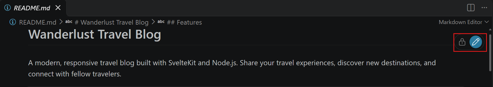

2. 光标位置的文本可编辑，Markdown 语法可见。将光标放在文档中并输入即可直接编辑，使用 Markdown 语法格式化内容。

    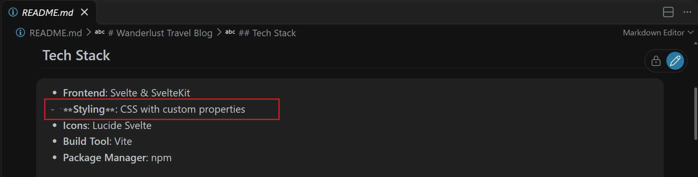

3. 照常保存文件。要阅读而不意外更改文档，选择模式控件切换回 **已锁定**。文档保持渲染和只读。

　　编辑时，边距中的 Git 更改标记显示添加、修改和删除的内容。撤销或还原相应更改可移除标记。

要复制代码示例而不编辑，请将鼠标悬停在渲染的围栏代码块上并选择 **复制**，会复制完整代码块。

要返回原始 Markdown 源，请从面包屑栏的编辑器类型下拉列表选择 **文本编辑器**。

## Markdown 预览 {#markdown-preview}

　　VS Code 开箱即用支持 Markdown 文件。编写 Markdown 文本并以 `.md` 扩展名保存后，可以在代码和 Markdown 预览之间切换；也可以打开现有 Markdown 文件开始工作。要在视图之间切换，请在编辑器中按 `Ctrl + Shift + V`。可以与正在编辑的文件并排查看预览（`Ctrl + K V`），编辑时实时看到更改。

以下是一个简单文件示例：

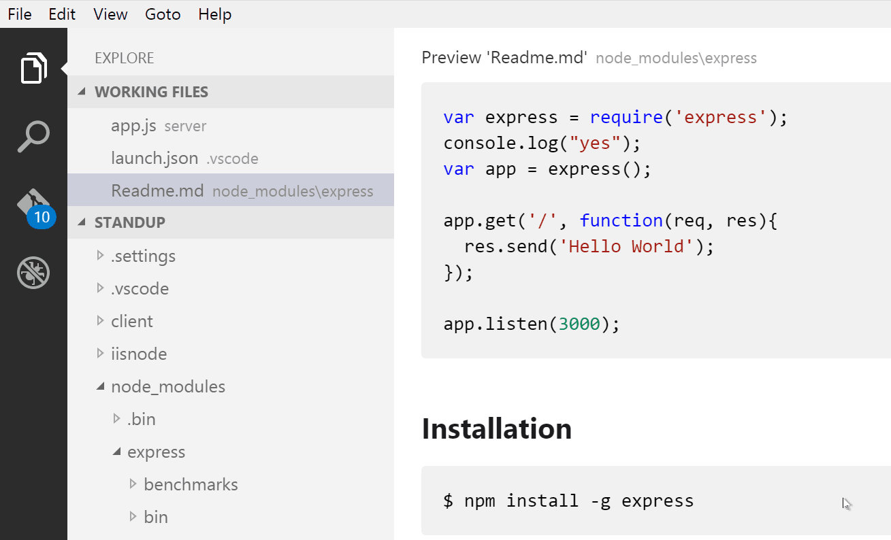

> **提示**：也可以右键单击编辑器选项卡选择 **打开预览**（`Ctrl + Shift + V`），或使用 **命令面板**（`Ctrl + Shift + P`）运行 **Markdown: Open Preview to the Side** 命令（`Ctrl + K V`）。

### 动态预览和预览锁定 {#dynamic-previews-and-preview-locking}

　　默认情况下，Markdown 预览会自动更新为预览当前活动的 Markdown 文件：

<video src="https://code.visualstudio.com/assets/docs/languages/Markdown/md-dynamic-preview.mp4" title="预览自动切换到当前 Markdown 文档。" autoplay loop controls muted></video>

可以使用 **Markdown: Toggle Preview Locking** 命令锁定 Markdown 预览，使其保持当前文档。锁定的预览标题中显示 **\[Preview]**：


> **注意**：**Markdown: Toggle Preview Locking** 命令仅在 Markdown 预览是活动选项卡时可用。

### 编辑器和预览同步 {#editor-and-preview-synchronization}

　　VS Code 会自动同步 Markdown 编辑器和预览窗格。滚动预览时编辑器会滚动到匹配视口，滚动编辑器时预览也会同步：

<video src="https://code.visualstudio.com/assets/docs/languages/Markdown/preview-scroll-sync.mp4" title="Markdown 预览与编辑器选择滚动同步。" autoplay loop controls muted></video>

可以使用 `markdown.preview.scrollPreviewWithEditor` 和 `markdown.preview.scrollEditorWithPreview` [设置](../../../editor/3.3-ConfigureTheEditor/3.3.4-Settings/)禁用滚动同步。

　　编辑器中当前选择的行在 Markdown 预览左边距用浅灰色条指示：

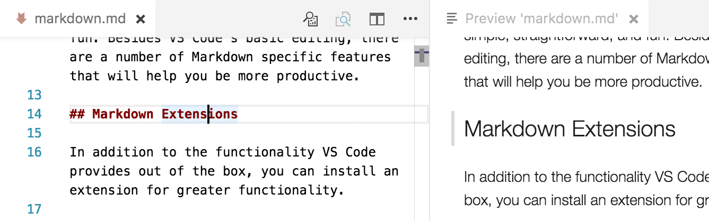

此外，双击 Markdown 预览中的元素会自动打开文件编辑器并滚动到最接近点击元素的行。

<video src="https://code.visualstudio.com/assets/docs/languages/Markdown/double-click-preview-switch.mp4" title="双击 Markdown 预览切换到编辑器。" autoplay loop controls muted></video>

### 差异视图中的 Markdown 预览 {#markdown-preview-in-diff-view}

　　Markdown 预览也可以渲染差异，显示带更改高亮的渲染文档，而不是原始 Markdown 源。

　　此行为需要选择加入。可以将单个差异切换到预览，或更改 Markdown 差异的默认编辑器。

#### 在 Markdown 预览中打开单个差异 {#open-a-single-diff-in-the-markdown-preview}

要将打开的 Markdown 差异（例如从 **源代码管理** 视图打开的文件）切换到渲染预览：

1. 差异编辑器活动时，从命令面板（`Ctrl + Shift + P`）运行 **View: Reopen Editor With...**。
2. 选择 **Markdown Preview**。

要切换回来，再次运行 **View: Reopen Editor With...** 并选择默认文本编辑器。

#### 将 Markdown 预览设为默认编辑器 {#set-the-markdown-preview-as-the-default-editor}

要将 Markdown 预览设为所有 `.md` 文件（包括差异）的默认编辑器，请配置 `workbench.editorAssociations`：

```json
"workbench.editorAssociations": {
    "*.md": "vscode.markdown.preview.editor"
}
```

　　此设置下，从资源管理器打开 Markdown 文件或从源代码管理打开 Markdown 差异时，默认打开渲染预览。仍可以使用 **View: Reopen Editor With...** 将单个编辑器切换回文本视图。

#### 仅对差异使用 Markdown 预览 {#use-the-markdown-preview-only-for-diffs}

要仅在预览中渲染 Markdown 差异，普通文件仍用文本编辑器打开，请使用 `workbench.diffEditorAssociations`：

```json
"workbench.diffEditorAssociations": {
    "*.md": "vscode.markdown.preview.editor"
}
```

　　`workbench.diffEditorAssociations` 在差异视图中优先于 `workbench.editorAssociations`。可以组合两个设置，使普通文件默认使用预览，而差异保持文本编辑器：

```json
"workbench.editorAssociations": {
    "*.md": "vscode.markdown.preview.editor"
},
"workbench.diffEditorAssociations": {
    "*.md": "default"
}
```

#### 内联和并排布局 {#inline-and-side-by-side-layouts}

　　Markdown 差异预览支持并排和内联布局，与文本差异编辑器类似。切换布局会更新之后打开的新 Markdown 差异编辑器的默认值。

　　并排预览中，两个编辑器保持滚动同步，使匹配内容对齐。更改行会高亮，行内更改会更强高亮，指出修改的确切单词或短语。

### Mermaid 图表渲染 {#mermaid-diagram-rendering}

　　VS Code 内置 Markdown 预览会在 `mermaid` 围栏代码块中渲染 [Mermaid](https://mermaid.js.org) 图表。

````markdown
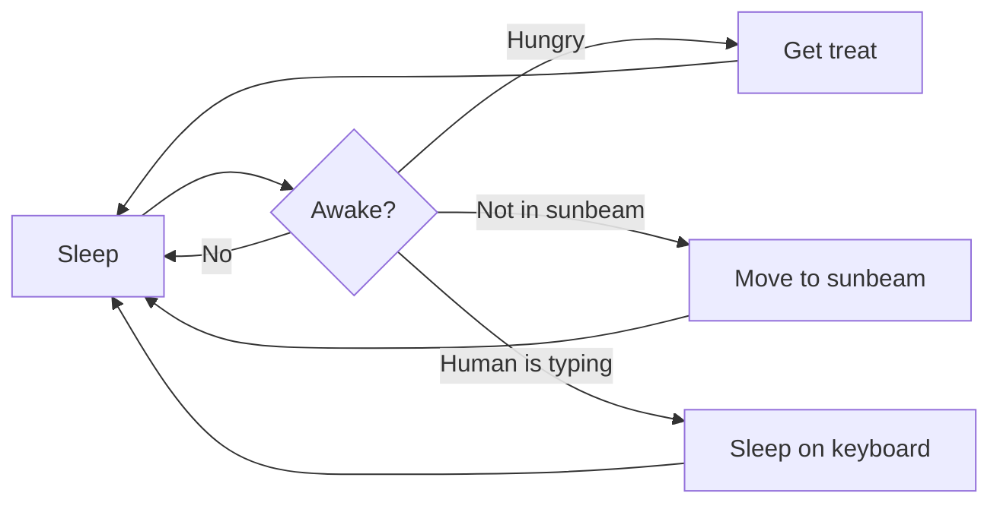
````

　　渲染预览中，可以平移和缩放较大图表。默认鼠标导航使用 `Alt`（macOS 上 `Option`）：按住拖动平移，滚动缩放，单击图表放大；按住 `Alt`+`Shift` 单击缩小。也可以使用捏合手势缩放，无需按住 `Alt`。

　　悬停或聚焦图表会显示控件，用于切换平移模式、放大、缩小和重置平移缩放。打开渲染图表的上下文菜单，选择 **复制图表源** 复制 Mermaid 源。

### 数学公式渲染 {#math-formula-rendering}

　　VS Code 内置 Markdown 预览使用 [KaTeX](https://katex.org/) 渲染数学公式。

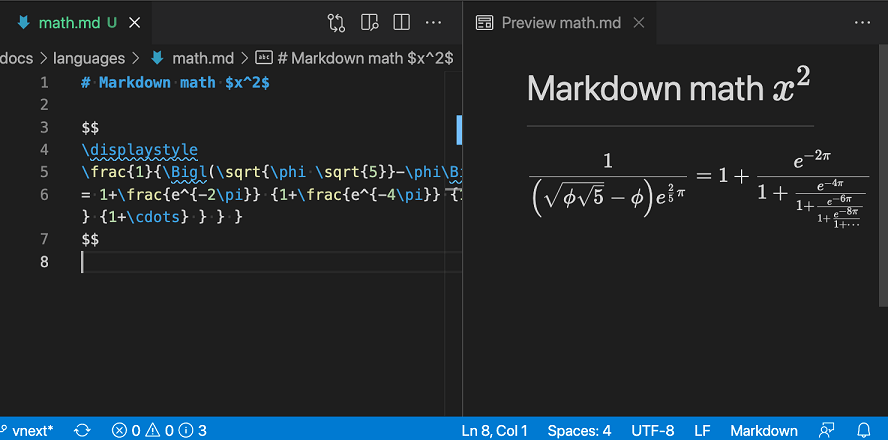

行内数学公式用单美元符号包围：

```markdown
Inline math: $x^2$
```

可以使用双美元符号创建数学公式块：

```markdown
Math block:

$$
\displaystyle
\left( \sum_{k=1}^n a_k b_k \right)^2
\leq
\left( \sum_{k=1}^n a_k^2 \right)
\left( \sum_{k=1}^n b_k^2 \right)
$$
```

可以设置 `"markdown.math.enabled": false` 禁用 Markdown 文件中的数学公式渲染。

## 扩展 Markdown 预览 {#extending-the-markdown-preview}

　　扩展可以为 Markdown 预览贡献自定义样式和脚本，改变外观并添加新功能。以下是一些自定义预览的扩展示例。

### 使用自己的 CSS {#using-your-own-css}

　　也可以通过 `"markdown.styles": []` [设置](../../../editor/3.3-ConfigureTheEditor/3.3.4-Settings/)在 Markdown 预览中使用自己的 CSS。该设置列出预览中加载的样式表 URL，可以是 `https` URL 或当前工作区本地文件的相对路径。

例如，加载当前工作区根目录的 `Style.css`，请使用 **文件** > **首选项** > **设置** 打开工作区 `settings.json` 并更新：

```json
// 在此文件中放置设置以覆盖默认和用户设置。
{
    "markdown.styles": [
        "Style.css"
    ]
}
```

### 保留尾随空白以创建换行 {#keep-trailing-whitespace-in-order-to-create-line-breaks}

　　要创建[硬换行](https://spec.commonmark.org/0.29/#hard-line-breaks)，Markdown 要求行末至少两个空格。根据用户或工作区设置，VS Code 可能配置为移除尾随空白。仅在 Markdown 文件中保留尾随空白，请在 `settings.json` 中添加：

```json
{
  "[markdown]": {
    "files.trimTrailingWhitespace": false
  }
}
```

## Markdown 预览安全 {#markdown-preview-security}

　　出于安全原因，VS Code 限制 Markdown 预览中显示的内容，包括禁用脚本执行，仅允许通过 `https` 加载资源。

　　Markdown 预览阻止页面内容时，预览窗口右上角会显示警报弹窗：

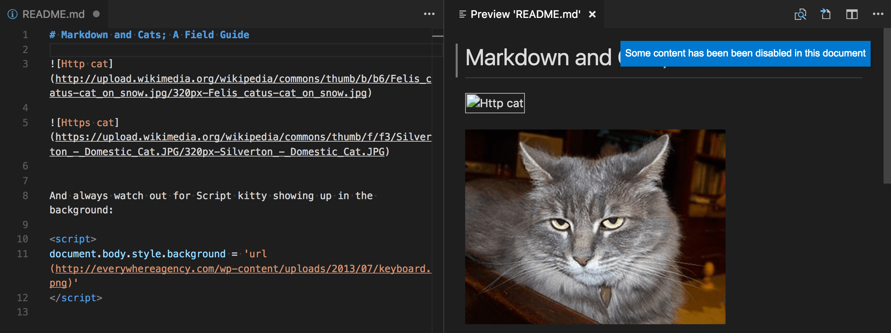

可以单击弹窗或在任意 Markdown 文件中运行 **Markdown: Change preview security settings** 命令，更改允许的内容：

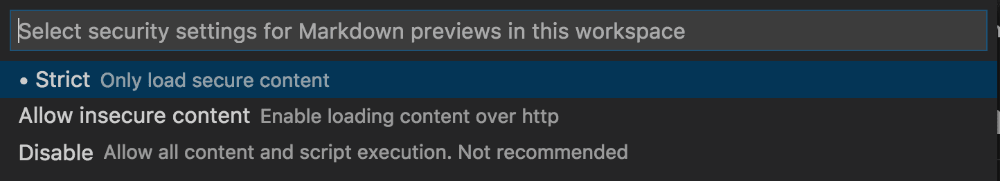

　　Markdown 预览安全设置适用于工作区所有文件。

各安全级别详情：

### 严格 {#strict}

　　默认设置。仅加载受信任内容并禁用脚本执行，阻止 `http` 图片。

　　建议保持 **严格** 安全级别，除非有充分理由更改并且信任工作区所有 Markdown 文件。

### 允许不安全内容 {#allow-insecure-content}

　　保持脚本禁用，但允许通过 `http` 加载内容。

### 禁用 {#disable}

　　禁用预览窗口的额外安全限制，允许脚本执行并通过 `http` 加载内容。

## Doc Writer 配置文件模板 {#doc-writer-profile-template}

　　[配置文件](../../../editor/3.3-ConfigureTheEditor/3.3.8-Profiles/)可以根据当前项目或任务快速切换扩展、设置和 UI 布局。为帮助开始编辑 Markdown，可以使用 [Doc Writer 配置文件模板](../../../editor/3.3-ConfigureTheEditor/3.3.8-Profiles/)，这是包含有用扩展和设置的精选配置文件。可以按原样使用，或作为进一步自定义的起点。

通过 **配置文件** > **创建配置文件...** 下拉列表选择配置文件模板：

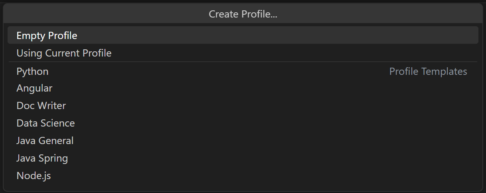

　　选择模板后，可以审查设置和扩展，并移除不想包含的项。基于模板创建新配置文件后，对设置、扩展或 UI 的更改会保存在配置文件中。

## Markdown 扩展 {#markdown-extensions}

　　除了 VS Code 开箱即用的功能，还可以安装扩展获得更多功能。

> **提示**：选择扩展卡片阅读说明和评论，判断哪个扩展最适合你。更多内容请参阅 [Marketplace](https://marketplace.visualstudio.com)。

## 后续步骤 {#next-steps}

继续阅读：

* [CSS、SCSS 和 Less](10.2.5-CSS/)：想编辑 CSS？VS Code 对 CSS、SCSS 和 Less 编辑提供出色支持。

## 常见问题 {#common-questions}

### 有拼写检查吗？ {#is-there-spell-checking}

　　VS Code 未内置拼写检查，但有拼写检查扩展。请在 [Marketplace](https://marketplace.visualstudio.com/vscode) 查找有助于工作流的扩展。

### VS Code 支持 GitHub Flavored Markdown 吗？ {#does-vs-code-support-github-flavored-markdown}

　　不支持。VS Code 使用 [markdown-it](https://github.com/markdown-it/markdown-it) 库，以 [CommonMark](https://commonmark.org) Markdown 规范为目标。GitHub 正在向 CommonMark 规范靠拢，详情请参阅这篇[更新](https://github.blog/2017-03-14-a-formal-spec-for-github-markdown/)。
