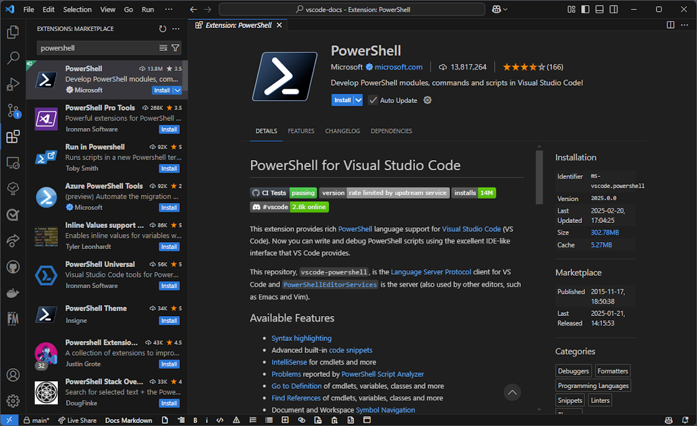
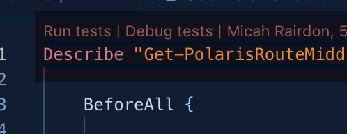
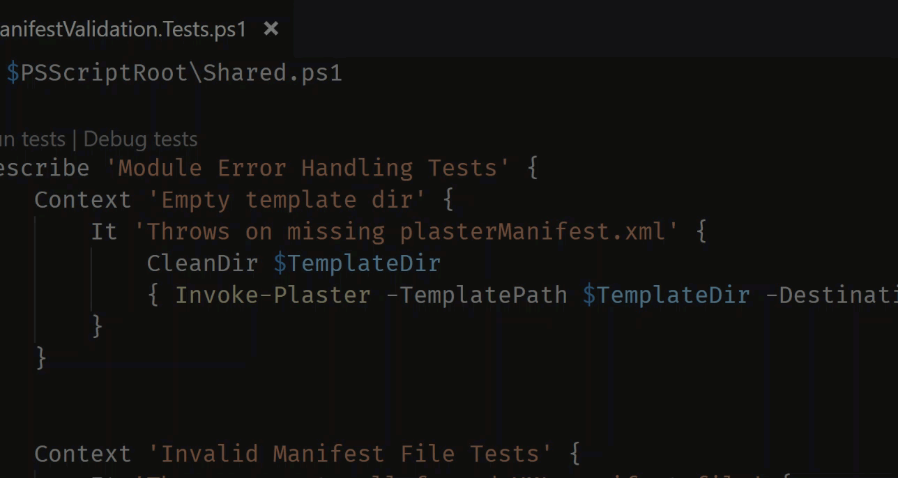
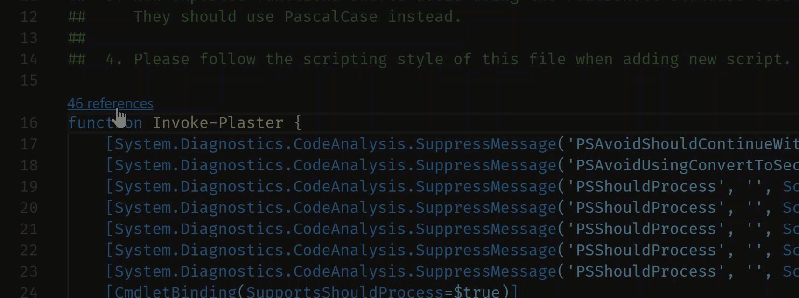
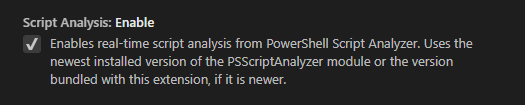
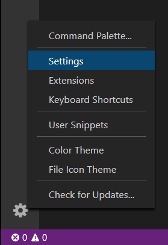
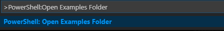
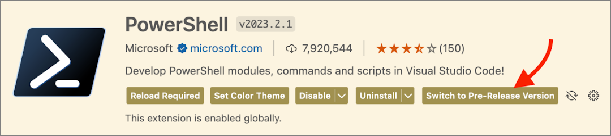

+++
title = "10.2.8 PowerShell"
date = 2026-11-06T07:53:25+08:00
weight = 8
type = "docs"
description = ""
isCJKLanguage = true
draft = false
+++


> 原文链接: [https://code.visualstudio.com/docs/languages/powershell](https://code.visualstudio.com/docs/languages/powershell)

# 10.2.8 PowerShell

　　[PowerShell](https://learn.microsoft.com/powershell/) 是基于 [.NET](https://learn.microsoft.com/dotnet) 的任务型命令行 shell 和脚本语言，为任何平台上的管理员提供强大工具集。

　　Microsoft 的 [PowerShell 扩展](https://marketplace.visualstudio.com/items?itemName=ms-vscode.PowerShell)为 VS Code 提供丰富的语言支持，包括语法补全、定义跟踪和 PowerShell lint。扩展应在 VS Code 支持的所有环境中工作，当前使用[受支持的 PowerShell 7+ 版本](https://docs.microsoft.com/en-us/powershell/scripting/powershell-support-lifecycle)。

　　Windows PowerShell 5.1 支持以尽力而为方式提供，需要 [.NET Framework 4.8](https://dotnet.microsoft.com/download/dotnet-framework) 或更高版本。

　　支持 [VS Code 远程开发](https://code.visualstudio.com/docs/remote/remote-overview)环境，包括 [GitHub Codespaces](https://github.com/features/codespaces)和 [VS Code Server](../../../remote/8.9-VSCodeServer/)。

> **重要**：[VS Code for the Web](../../../remote/8.1-VSCodeForTheWeb/)仅支持有限功能（例如基本语法高亮），因为 PowerShell 引擎无法在此环境中运行。

我们积极测试以下配置：

* **Windows Server 2022** 配合 Windows PowerShell 5.1 和 PowerShell 7+
* **macOS 14.7** 配合 PowerShell 7+
* **Ubuntu 24.04** 配合 PowerShell 7+

Windows 上还会在启用和未启用受限语言模式的情况下测试。

## 安装 PowerShell 扩展 {#installing-the-powershell-extension}

　　可以从 VS Code Marketplace 单击[安装按钮](vscode:extension/ms-vscode.PowerShell)安装 PowerShell 扩展。也可以在 VS Code 中打开 **扩展** 视图（`Ctrl + Shift + X`，macOS：`Cmd + Shift + X`），输入 *PowerShell*，选择 PowerShell 扩展：



## 主要功能 {#major-features}

* [语法高亮](https://github.com/PowerShell/EditorSyntax)
* 高级内置[代码片段](../../../editor/3.2-WriteCode/3.2.7-Snippets/)
* cmdlet 等的 [IntelliSense](../../../editor/3.2-WriteCode/3.2.2-IntelliSense/)
* [PowerShell Script Analyzer](http://github.com/PowerShell/PSScriptAnalyzer)报告的[问题](../../../editor/3.1-GettingStarted/3.1.3-TipsAndTricks/#errors-and-warnings)
* 转到 cmdlet、变量、类等的[定义](../../../editor/3.2-WriteCode/3.2.5-CodeNavigation/#go-to-definition)
* 查找 cmdlet、变量、类等的[引用](../../../editor/3.2-WriteCode/3.2.5-CodeNavigation/#go-to-references)
* 文档和工作区[符号导航](../../../editor/3.2-WriteCode/3.2.5-CodeNavigation/)
* 基于符号的[大纲视图](../../../editor/3.1-GettingStarted/3.1.2-UserInterface/#outline-view)
* 使用 `F8` 在当前终端运行选中的 PowerShell 代码
* 使用 `Ctrl + F1` 为光标下符号启动在线帮助
* PowerShell [调试器](https://learn.microsoft.com/powershell/scripting/dev-cross-plat/vscode/using-vscode#debugging-with-visual-studio-code)集成
* 可与调试器交互的扩展终端（试试 `Set-PSBreakpoint`！）
* [主题选择器](../../../editor/3.3-ConfigureTheEditor/3.3.7-Themes/)中提供 PowerShell ISE 主题
* 也可以通过 `Ctrl + Shift + P`（macOS：`Cmd + Shift + P`） 搜索“Enable ISE Mode”尝试 ISE 模式

### 调试 {#debugging}

　　PowerShell 扩展使用 VS Code 内置[调试接口](../../../debugging-and-testing/6.1-Debugging/)调试 PowerShell 脚本和模块。详情请参阅[使用 VS Code](https://learn.microsoft.com/powershell/scripting/dev-cross-plat/vscode/using-vscode#debugging-with-visual-studio-code)。

### 多版本支持 {#multi-version-support}

　　可以按照[这些说明](https://learn.microsoft.com/powershell/scripting/dev-cross-plat/vscode/using-vscode#choosing-a-version-of-powershell-to-use-with-the-extension)配置 PowerShell 扩展使用机器上安装的任何受支持 PowerShell 版本。

或从命令面板（`Ctrl + Shift + P`，macOS：`Cmd + Shift + P`）运行 **PowerShell: Show Session Menu** 命令。

### CodeLens 支持 {#codelens-support}

　　CodeLens 是 VS Code 功能，在源代码中显示可操作的上下文信息。

CodeLens 功能包括：

* Pester **运行测试** 和 **调试测试**。

  

* Pester 符号支持

  

* 函数、变量、类和其他符号引用

  CodeLens 引用支持显示符号在代码中被引用的次数，并允许跳转到特定引用。

  

### PSScriptAnalyzer 集成 {#psscriptanalyzer-integration}

　　[PSScriptAnalyzer](https://learn.microsoft.com/powershell/utility-modules/psscriptanalyzer/overview) 是为模块和脚本提供静态源代码检查器的 PowerShell 模块。**PSScriptAnalyzer** 的规则验证 PowerShell 代码质量，这些规则基于 PowerShell 团队和社区总结的最佳实践。**PSScriptAnalyzer** 生成诊断记录（错误和警告），告知潜在代码缺陷并建议改进方案。

　　PowerShell 扩展默认包含 **PSScriptAnalyzer**，会自动分析在 VS Code 中编辑的 PowerShell 脚本文件。

　　**PSScriptAnalyzer** 自带一组内置规则，检查未初始化变量、**PSCredential** 类型使用、`Invoke-Expression` 使用等方面。该模块也允许包含或排除特定规则。

要禁用 **PSScriptAnalyzer**，请打开设置（`Ctrl + ,`，macOS：`Cmd + ,`），浏览 **扩展**，选择 **PowerShell** 扩展，取消选中 **Script Analysis: Enable**（`powershell.scriptAnalysis.enable`）。



　　**PSScriptAnalyzer** 也提供代码格式化。可以使用 **格式化文档** 命令或 `Shift + Alt + F`（macOS：`Shift + Option + F`） 快捷键调用自动文档格式化。

### Pester 集成 {#pester-integration}

　　[Pester](https://pester.dev/) 是运行单元测试的框架，Windows PowerShell 5.1 预装 **Pester** 3.40。要更新 **Pester** 或在其他平台安装最新版本，请遵循 [Pester 安装说明](https://pester.dev/docs/introduction/installation)。

## PowerShell 扩展设置 {#powershell-extension-settings}

　　可以从 **文件** > **首选项** > **设置** 菜单自定义 VS Code [设置](../../../editor/3.3-ConfigureTheEditor/3.3.4-Settings/)。

也可以选择活动栏左下角的齿轮图标。



也可以使用 `Ctrl + ,`（macOS：`Cmd + ,`） 快捷键打开设置。仍可以通过命令面板（`Ctrl + Shift + P`，macOS：`Cmd + Shift + P`）的 **Preferences: Open User Settings (JSON)** 命令，或通过 `workbench.settings.editor` 设置更改默认设置编辑器，打开 `settings.json`。

配置 VS Code 设置的更多信息请参阅[用户和工作区设置](../../../editor/3.3-ConfigureTheEditor/3.3.4-Settings/)。

### Types.ps1xml 和 Format.ps1xml 文件 {#typesps1xml-and-formatps1xml-files}

　　PowerShell `.ps1xml` 文件用于扩展类型系统并定义输出格式。详情请参阅官方 PowerShell 文档中的 [Types.ps1xml](https://learn.microsoft.com/powershell/module/microsoft.powershell.core/about/about_types.ps1xml) 和 [Format.ps1xml](https://learn.microsoft.com/powershell/module/microsoft.powershell.core/about/about_format.ps1xml)。安装 [Red Hat 的 XML 扩展](https://marketplace.visualstudio.com/items?itemName=redhat.vscode-xml)后，在编写 `.ps1xml` 文件时可以获得 IntelliSense。安装后将以下配置添加到用户设置：

```json
"xml.fileAssociations": [
  {
    "systemId": "https://raw.githubusercontent.com/PowerShell/PowerShell/master/src/Schemas/Format.xsd",
    "pattern": "**/*.Format.ps1xml"
  },
  {
    "systemId": "https://raw.githubusercontent.com/PowerShell/PowerShell/master/src/Schemas/Types.xsd",
    "pattern": "**/*.Types.ps1xml"
  }
]
```

　　此配置告诉 XML 扩展对所有 `.ps1xml` 文件使用 PowerShell 仓库的官方 XML schema。配置这些 schema 后，`ps1xml` 文件支持：

* 语法错误报告
* Schema 验证
* 标签和属性补全
* 自动闭合标签
* 符号高亮
* 文档折叠
* 文档符号和大纲
* 重命名支持
* 文档格式化

## 示例脚本 {#example-scripts}

　　扩展包含示例脚本，位于：

`~/.vscode/extensions/ms-vscode.PowerShell-<version>/examples`

要在 VS Code 中打开或查看示例，请在 PowerShell 命令提示符运行：

```powershell
code (Get-ChildItem ~\.vscode\extensions\ms-vscode.PowerShell-*\examples)[-1]
```

也可以从命令面板（`Ctrl + Shift + P`，macOS：`Cmd + Shift + P`）使用 **PowerShell: Open Examples Folder** 命令打开示例。



## 其他资源 {#additional-resources}

　　PowerShell 文档中有更详细的文章，请从[使用 VS Code](https://learn.microsoft.com/powershell/scripting/dev-cross-plat/vscode/using-vscode)开始。

常见问题答案请参阅[故障排除指南](https://github.com/PowerShell/vscode-powershell/blob/main/docs/troubleshooting.md#troubleshooting-powershell-extension-issues)。

调试详情请参阅 [@keithHill](https://twitter.com/r_keith_hill) 撰写的 *Hey, Scripting Guy!* 两篇博客：

* [在 VS Code 中调试 PowerShell 脚本：第 1 部分](https://devblogs.microsoft.com/scripting/debugging-powershell-script-in-visual-studio-code-part-1/)
* [在 VS Code 中调试 PowerShell 脚本：第 2 部分](https://devblogs.microsoft.com/scripting/debugging-powershell-script-in-visual-studio-code-part-2/)

## 测试新功能并提供反馈 {#testing-new-features-and-providing-feedback}

　　建议尽可能试用*预发布*版本。有 *Pre-Release* 可用时，可以从 Marketplace 使用 **切换到预发布版本** 按钮安装。可以使用出现的 **切换到发布版本** 按钮切回稳定版。也可以使用 **卸载** 按钮旁的箭头选择 **安装其他版本...** 降级到其他版本。



发现缺陷时，请[创建议题](https://github.com/PowerShell/vscode-powershell/issues/new/choose)，并在修复期间切回稳定版。
