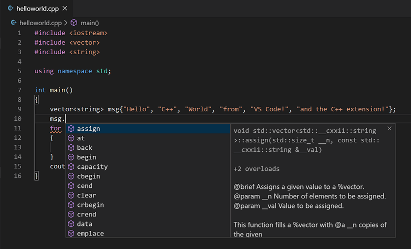
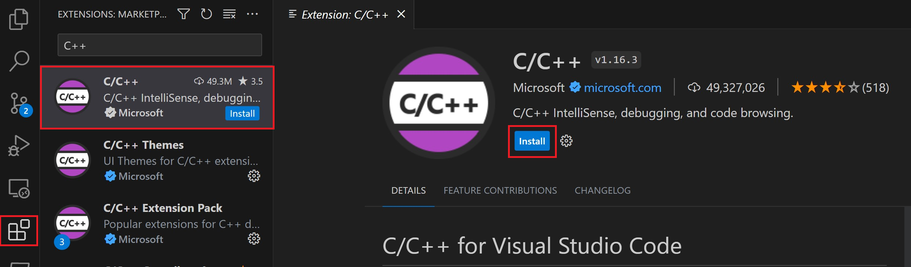
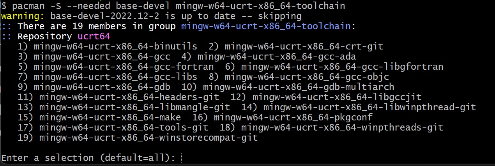
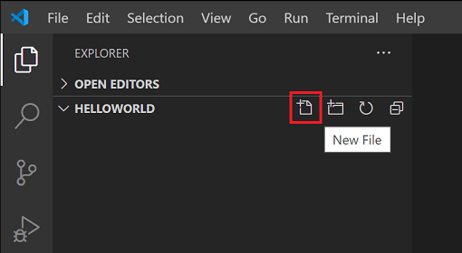
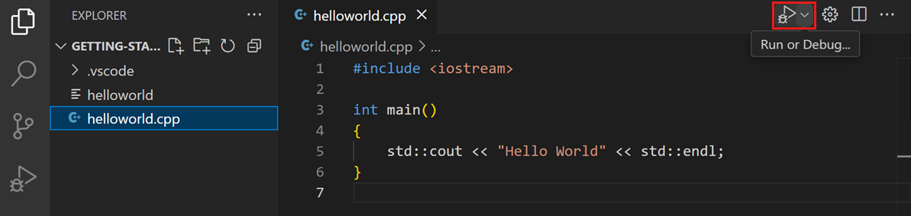
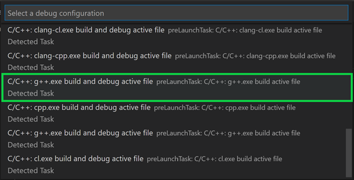
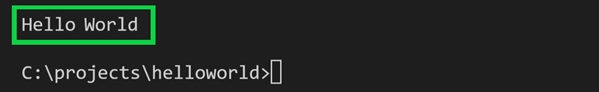
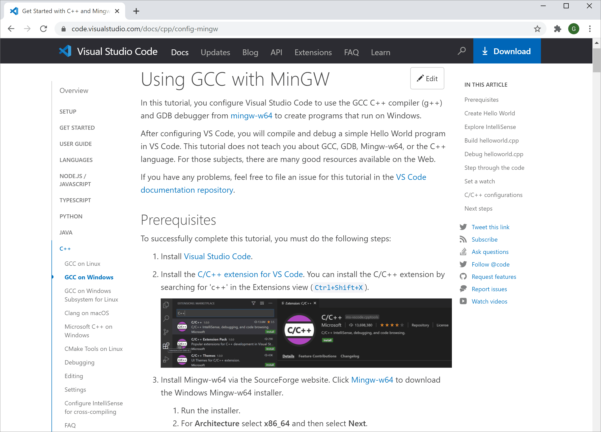

+++
title = "10.2.9 C++"
date = 2026-11-06T07:53:25+08:00
weight = 9
type = "docs"
description = ""
isCJKLanguage = true
draft = false
+++


> 原文链接: [https://code.visualstudio.com/docs/languages/cpp](https://code.visualstudio.com/docs/languages/cpp)

# 10.2.9 C++

　　VS Code 的 C/C++ 支持由 [Microsoft C/C++ 扩展](https://marketplace.visualstudio.com/items?itemName=ms-vscode.cpptools)提供，支持在 Windows、Linux 和 macOS 上进行跨平台 C 和 C++ 开发。创建 `*.cpp` 文件时，扩展会添加语法高亮（着色）、智能补全和悬停（IntelliSense）以及错误检查等功能。



## 安装扩展 {#install-the-extension}

1. 打开 VS Code。
2. 选择活动栏中的扩展视图图标，或使用快捷键 `Ctrl + Shift + X`。
3. 搜索 `'C++'`。
4. 选择 **安装**。



## 设置 C++ 环境 {#set-up-your-c-environment}

　　C++ 是编译语言，程序源代码必须先翻译（编译）才能在计算机上运行。C/C++ 扩展不包含 C++ 编译器或调试器，因为 VS Code 作为编辑器依赖命令行工具完成开发工作流。需要安装这些工具，或使用计算机上已安装的工具。

### 检查是否已安装编译器 {#check-if-you-have-a-compiler-installed}

> **注意**：学术或工作开发环境可能已提供 C++ 编译器和调试器。请咨询讲师或同事，了解如何安装推荐的 C++ 工具集（编译器、调试器、项目系统、linter）。

某些平台预装的常见编译器包括 Linux 上的 [GNU Compiler Collection](https://wikipedia.org/wiki/GNU_Compiler_Collection)（GCC）和 macOS 上 [Xcode](https://developer.apple.com/xcode/) 附带的 [Clang](https://wikipedia.org/wiki/Clang) 工具。

检查是否已安装：

1. 使用 `Ctrl + Shift + 反引号` 打开新的 VS Code 终端窗口。
2. 使用以下命令检查 GCC 编译器 `g++`：

    ```bash
    g++ --version
    ```

    或使用以下命令检查 Clang 编译器 `clang`：

    ```bash
    clang --version
    ```

　　输出应显示编译器版本和详细信息。都找不到时，请确保编译器可执行文件在平台路径中（Windows 为 `%PATH`，Linux 和 macOS 为 `$PATH`），以便 C/C++ 扩展找到它。否则请按下一节说明安装编译器。

### 安装编译器 {#install-a-compiler}

没有编译器时，可以遵循以下安装教程：

**Windows**：

<a class="next-topic-btn" href="https://code.visualstudio.com/docs/cpp/config-msvc#prerequisites">转到 MSVC 教程</a>

<a class="next-topic-btn" href="https://code.visualstudio.com/docs/cpp/config-mingw#prerequisites">转到 MinGW 教程</a>

**Linux**：

<a class="next-topic-btn" href="https://code.visualstudio.com/docs/cpp/config-linux#prerequisites">转到 GCC 教程</a>

**macOS**：

<a class="next-topic-btn" href="https://code.visualstudio.com/docs/cpp/config-clang-mac#prerequisites">转到 Clang 教程</a>

> **注意**：如果更喜欢带内置编译、调试和项目模板（文件 > 新建项目）的完整集成开发环境（IDE），有许多选择，例如 [Visual Studio Community](https://visualstudio.microsoft.com/vs/community) 版。

## 示例：在 Windows 上安装 MinGW-x64 {#example-install-mingw-x64-on-windows}

　　为理解流程，我们通过 [MSYS2](https://www.msys2.org/) 安装 Mingw-w64。Mingw-w64 是 Windows 上流行的免费工具集，提供 GCC、Mingw-w64 和其他有用 C++ 工具及库的最新本机构建。

1. 使用 [**此 MinGW 安装程序直接链接**](https://github.com/msys2/msys2-installer/releases/download/2024-12-08/msys2-x86_64-20241208.exe)下载。

2. 运行安装程序并按照向导步骤操作。MSYS2 需要 64 位 Windows 8.1 或更高版本。

3. 在向导中选择安装文件夹并记录该目录。大多数情况下推荐目录即可。设置开始菜单快捷方式时同理。完成后确保勾选 **立即运行 MSYS2** 并选择 **完成**。随后会自动打开 MSYS2 终端窗口。

4. 在此终端中运行以下命令安装 MinGW-w64 工具链：

    ```sh
    pacman -S --needed base-devel mingw-w64-ucrt-x86_64-toolchain
    ```

5. 会显示可用包列表：

    

6. 按 `Enter` 接受 `toolchain` 组默认包数量。

7. 提示是否继续安装时输入 `Y`。

8. 使用以下步骤将 MinGW-w64 `bin` 文件夹路径添加到 Windows `PATH` 环境变量：
    1. 在 Windows 搜索栏输入 **设置** 打开 Windows 设置。
    2. 搜索 **编辑账户的环境变量**。
    3. 在 **用户变量** 中选择 `Path` 变量，然后选择 **编辑**。
    4. 选择 **新建**，将安装过程中记录的 MinGW-w64 目标文件夹添加到列表。使用默认安装步骤时路径为 `C:\msys64\ucrt64\bin`。
    5. 选择 **确定**，然后在 **环境变量** 窗口中再次选择 **确定** 更新 `PATH`。
        需要重新打开所有控制台窗口，更新后的 `PATH` 才可用。
9. 检查 MinGW-w64 工具是否正确安装并可用：打开**新的**命令提示符并输入：

    ```bash
    gcc --version
    g++ --version
    gdb --version
    ```

    应看到已安装的 GCC、g++ 和 GDB 版本。否则请确保 PATH 条目指向编译器工具所在的 Mingw-w64 二进制位置，或参阅[故障排除部分](https://code.visualstudio.com/docs/cpp/config-mingw#check-your-mingw-installation)。

## 创建 Hello World 应用 {#create-a-hello-world-app}

　　为确认编译器安装和配置正确，创建一个 Hello World C++ 程序。

### 创建 C++ 文件 {#create-a-c-file}

1. Windows 上启动 Windows 命令提示符（在 Windows 搜索栏输入 **Windows 命令提示符**）。macOS 和 Linux 上可以在终端输入这些命令。
2. 运行以下命令。它们创建空文件夹 `projects`，用于放置所有 VS Code 项目。后续命令创建并进入子文件夹 `helloworld`，然后使用 `code` 命令直接在 VS Code 中打开 `helloworld`。

    ```bat
    mkdir projects
    cd projects
    mkdir helloworld
    cd helloworld
    code .
    ```

    “code .”命令在当前工作文件夹中打开 VS Code，该文件夹成为“工作区”。这是你创建的文件夹，请在[工作区信任](../../../editor/3.2-WriteCode/3.2.8-Workspaces/3.2.8.3-WorkspaceTrust/)对话框中选择 **是，我信任此作者**。

3. 使用文件资源管理器的 **新建文件** 按钮或 **文件** > **新建文件** 命令创建 `helloworld.cpp`。

    

### 添加 Hello World 源代码 {#add-hello-world-source-code}

粘贴以下源代码：

```cpp
#include <iostream>

int main()
{
    std::cout << "Hello World" << std::endl;
}
```

按 `Ctrl + S` 保存文件。也可以在 **文件** 主菜单中勾选 **自动保存**，启用[自动保存](../../../editor/3.2-WriteCode/3.2.1-BasicEditing/)自动保存文件更改。

## 运行 helloworld.cpp {#run-helloworldcpp}

1. 确保 `helloworld.cpp` 已打开并是编辑器中的活动文件。
2. 按编辑器右上角的播放按钮。

   

3. 从系统检测到的编译器列表中选择 **C/C++: g++.exe build and debug active file**。

   

    仅在首次运行 `helloworld.cpp` 时提示选择编译器。该编译器会成为 `tasks.json` 中设置的“默认”编译器。

4. 生成成功后，集成 **终端** 中应显示“Hello World”。

    

恭喜！你刚刚在 VS Code 中运行了第一个 C++ 程序！下一步请通过下一节的教程了解 Microsoft C/C++ 扩展的语言功能，例如 IntelliSense、代码导航、生成配置和调试。

## 教程 {#tutorials}

通过适合你的环境教程开始使用 C++ 和 VS Code：

* [通过 MinGW 在 Windows 上使用 GCC](https://code.visualstudio.com/docs/cpp/config-mingw)
* [Windows 上的 Microsoft C++](https://code.visualstudio.com/docs/cpp/config-msvc)
* [Linux 上的 GCC](https://code.visualstudio.com/docs/cpp/config-linux)
* [Windows Subsystem for Linux 上的 GCC](https://code.visualstudio.com/docs/cpp/config-wsl)
* [macOS 上的 Clang/LLVM](https://code.visualstudio.com/docs/cpp/config-clang-mac)
* [Linux 上的 CMake Tools](https://code.visualstudio.com/docs/cpp/cmake-linux)

## 文档 {#documentation}

　　在 VS Code 网站 [C++ 部分](https://code.visualstudio.com/docs/cpp)可以找到更多 Microsoft C/C++ 扩展文档，包括：

* [调试](https://code.visualstudio.com/docs/cpp/cpp-debug)
* [编辑](https://code.visualstudio.com/docs/cpp/cpp-ide)
* [设置](https://code.visualstudio.com/docs/cpp/customize-default-settings-cpp)
* [常见问题](https://code.visualstudio.com/docs/cpp/faq-cpp)



## 远程开发 {#remote-development}

　　VS Code 和 C++ 扩展支持[远程开发](https://code.visualstudio.com/docs/remote/remote-overview)，可以通过 SSH 在远程机器或 VM、Docker 容器或 [Windows Subsystem for Linux](https://learn.microsoft.com/windows/wsl)（WSL）中工作。

安装远程开发支持：

1. 安装 VS Code [Remote Development 扩展包](https://marketplace.visualstudio.com/items?itemName=ms-vscode-remote.vscode-remote-extensionpack)。
2. 远程源文件托管在 WSL 中时，使用 **WSL** 扩展。
3. 通过 SSH 连接远程机器时，使用 **Remote - SSH** 扩展。
4. 远程源文件托管在容器（例如 Docker）中时，使用 **Dev Containers** 扩展。

## 使用 AI 增强补全 {#enhance-completions-with-ai}

　　GitHub Copilot 会在编辑器中输入时提供编码建议。也可以向 Copilot 询问与编码相关的问题，例如如何更好地编写代码、如何修复错误，或他人的代码如何工作。

　　请参阅 [VS Code 中的 AI](../../../ai-in-vs-code/)了解入门方法。

## 反馈 {#feedback}

　　遇到 Microsoft C/C++ 扩展问题或有建议，请在 GitHub 上[提交问题和建议](https://github.com/microsoft/vscode-cpptools/issues)。如果尚未提供反馈，可以参加这个[快速调查](https://www.research.net/r/VBVV6C6)。
