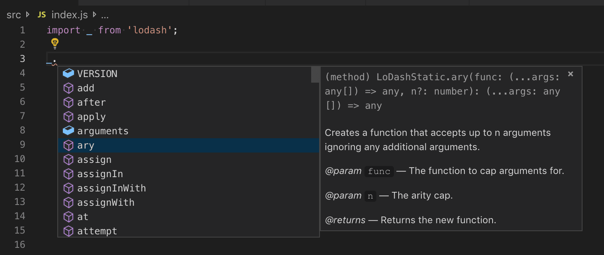
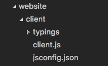
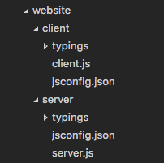
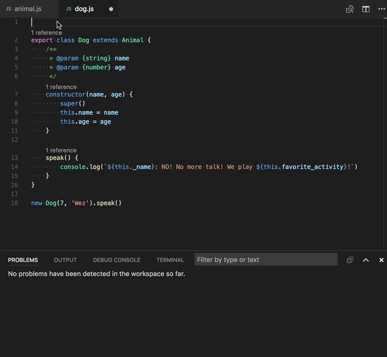
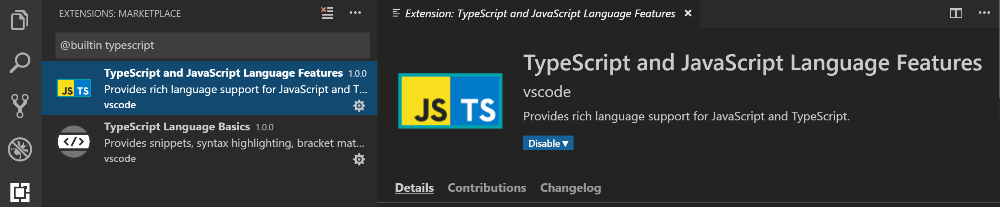
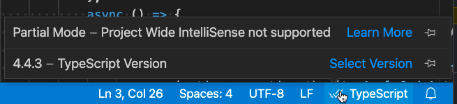

+++
title = "10.3.1 使用 JavaScript"
date = 2026-11-06T07:53:25+08:00
weight = 1
type = "docs"
description = ""
isCJKLanguage = true
draft = false
+++


> 原文链接: [https://code.visualstudio.com/docs/nodejs/working-with-javascript](https://code.visualstudio.com/docs/nodejs/working-with-javascript)

# 10.3.1 使用 JavaScript

　　本主题介绍 VS Code 支持的一些高级 JavaScript 功能。VS Code 使用 TypeScript 语言服务，为 JavaScript 提供智能补全（IntelliSense）和类型检查。

## IntelliSense {#intellisense}

　　VS Code 的 JavaScript [IntelliSense](../../../editor/3.2-WriteCode/3.2.2-IntelliSense/)提供智能代码补全、参数信息、引用搜索和许多其他高级语言功能。JavaScript IntelliSense 由 TypeScript 团队开发的 [JavaScript 语言服务](https://github.com/microsoft/TypeScript/wiki/JavaScript-Language-Service-in-Visual-Studio)提供。大多数 JavaScript 项目无需配置即可使用 IntelliSense，也可以通过 [JSDoc](../../language-support/10.2.1-JavaScript/#jsdoc-support)或 `jsconfig.json` 项目配置增强。

　　JavaScript IntelliSense 的工作方式（包括基于类型推断、JSDoc 注解、TypeScript 声明以及混合 JavaScript 和 TypeScript 项目）请参阅 [JavaScript 语言服务文档](https://github.com/microsoft/TypeScript/wiki/JavaScript-Language-Service-in-Visual-Studio)。

　　类型推断无法提供所需信息时，可以使用 JSDoc 注解显式提供类型信息。当前支持的 [JSDoc 注解](https://www.typescriptlang.org/docs/handbook/type-checking-javascript-files.html#supported-jsdoc)请参阅文档。

　　除了对象、方法和属性，JavaScript IntelliSense 窗口还会为文件中的符号提供基本单词补全。

### 类型声明和自动类型获取 {#typings-and-automatic-type-acquisition}

　　JavaScript 库和框架的 IntelliSense 由 TypeScript 类型声明（typings）文件提供。类型声明文件用 TypeScript 编写，可以表达参数和函数的数据类型，使 VS Code 以高性能方式提供丰富的 IntelliSense。

　　许多流行库自带 typings 文件，因此会自动获得 IntelliSense。不包含 typings 的库，VS Code 的 `Automatic Type Acquisition` 会自动安装社区维护的 typings 文件。

　　自动类型获取需要 [npmjs](https://www.npmjs.com)（Node.js 包管理器，随 [Node.js](https://nodejs.org) 运行时提供）。下图展示流行 [lodash](https://lodash.com/) 库的 IntelliSense，包括方法签名、参数信息和方法文档。



　　VS Code 会为项目 `package.json` 中列出或导入 JavaScript 文件的包自动下载和管理类型声明文件。

```json
{
    "dependencies": {
        "lodash": "^4.17.0"
    }
}
```

也可以在 [jsconfig.json](#javascript-projects-jsconfigjson) 中显式列出要获取类型声明文件的包：

```json
{
    "typeAcquisition": {
        "include": [
            "jquery"
        ]
    }
}
```

　　大多数常见 JavaScript 库自带声明文件或提供可用的类型声明文件。

### 修复自动类型获取的 npm 未安装警告 {#fixing-npm-not-installed-warning-for-automatic-type-acquisition}

　　[自动类型获取](#typings-and-automatic-type-acquisition)使用 [npm](https://www.npmjs.com)安装和管理类型声明（typings）文件。请确保机器已安装 npm。

在终端运行 `npm --version` 检查 npm 是否已安装并在 PATH 中。没有 npm 时，请[安装 Node.js](https://nodejs.org/en/download/)。

仍然看到警告时，可以在 `settings.json` 中显式设置 npm 位置：

```json
"typescript.npm": "C:\\Program Files\\nodejs\\npm.cmd"
```

## JavaScript 项目（jsconfig.json） {#javascript-projects-jsconfigjson}

　　`jsconfig.json` 文件定义 JavaScript 项目。工作区中存在该文件时，JavaScript 语言服务会将其视为项目根，并提供项目级 IntelliSense 和类型检查。

### jsconfig.json 位置 {#location-of-jsconfigjson}

　　将 `jsconfig.json` 放在 JavaScript 项目根目录。项目根由 JavaScript 文件位置和 `jsconfig.json` 决定。



复杂项目可能在工作区中包含多个 `jsconfig.json`，使一个项目的源代码不出现在另一个项目的 IntelliSense 中。下图展示包含 `client` 和 `server` 两个独立 JavaScript 项目的示例：



- **Visual Studio Code**：项目根是包含 `jsconfig.json` 的文件夹。项目根内的所有文件都属于项目，项目外文件不属于。
- **TypeScript 编译器**：项目根是 `tsconfig.json` 或 `jsconfig.json` 所在文件夹。可以通过 `files`、`include` 和 `exclude` 配置包含哪些文件。
- **jsconfig.json**：项目根是 `jsconfig.json` 所在文件夹。

### 编写 jsconfig.json {#writing-jsconfigjson}

　　简单 `jsconfig.json` 可以只包含空 JSON 对象 `{}`。这会使用默认编译器选项，并包含当前文件夹及子文件夹中的 JavaScript 文件。

```json
{}
```

　　基本项目配置，包含 `src` 和 `test` 文件夹：

```json
{
    "compilerOptions": {
        "module": "CommonJS",
        "target": "ES6"
    },
    "include": [
        "src/**/*",
        "test/**/*"
    ]
}
```

　　`exclude` 排除 `node_modules`：

```json
{
    "compilerOptions": {
        "module": "CommonJS",
        "target": "ES6"
    },
    "exclude": [
        "node_modules"
    ]
}
```

　　`compilerOptions` 用于配置语言支持；`include` 和 `exclude` 用于配置项目包含和排除的文件。

　　`compilerOptions` 详情请参阅 [tsconfig.json 文档](https://www.typescriptlang.org/docs/handbook/tsconfig-json.html)。

### 迁移到 TypeScript {#migrating-to-typescript}

　　`jsconfig.json` 文件与 `tsconfig.json` 类似，但 `jsconfig.json` 是专门为 JavaScript 设计的。`jsconfig.json` 中的 `"compilerOptions"` 与 `tsconfig.json` 中相同。

　　将 JavaScript 项目迁移到 TypeScript 时，请将 `jsconfig.json` 重命名为 `tsconfig.json`，并将 `.js` 文件重命名为 `.ts`。

## 在 JavaScript 中进行类型检查 {#type-checking-javascript}

　　可以使用 `// @ts-check` 注释在 JavaScript 文件中启用类型检查：

```javascript
// @ts-check
let itsAsEasyAs = 'abc';
itsAsEasyAs = 123; // 错误：类型 'number' 不能赋给类型 'string'
```

　　`jsconfig.json` 中的 `checkJs` 选项为项目所有 JavaScript 文件启用类型检查：

```json
{
    "compilerOptions": {
        "checkJs": true
    }
}
```

　　可以使用 `// @ts-nocheck` 注释为单个文件禁用类型检查。



　　VS Code 会显示类型检查错误（红色波浪线），并在问题面板中列出。

### 全局变量和类型检查 {#global-variables-and-type-checking}

　　项目包含全局变量时，可以使用 `jsconfig.json` 的 `typeAcquisition` 或声明文件定义。也可以使用 JSDoc 注释和 `@type` 标签。

```javascript
/** @type {number} */
let globalVariable;
```

## 使用任务 {#using-tasks}

　　可以使用 VS Code 任务运行 JavaScript 构建工具。

### 使用 TypeScript 编译器 {#using-the-typescript-compiler}

　　TypeScript 编译器 `tsc` 可以将 JavaScript 文件作为输入并输出 JavaScript 文件。可以在任务中调用：

```json
{
    "version": "2.0.0",
    "tasks": [
        {
            "type": "typescript",
            "tsconfig": "jsconfig.json",
            "problemMatcher": ["$tsc"]
        }
    ]
}
```

### 运行 Babel {#running-babel}

　　Babel 是 JavaScript 编译器，可以将现代 JavaScript 转换为旧版 JavaScript。可以在任务中运行：

```json
{
    "version": "2.0.0",
    "tasks": [
        {
            "label": "Babel",
            "type": "shell",
            "command": "babel src --out-dir dist",
            "problemMatcher": []
        }
    ]
}
```

　　任务详情请参阅[任务](../../../debugging-and-testing/6.3-Tasks/)。

## 禁用 JavaScript 支持 {#disable-javascript-support}

　　可以在用户或工作区[设置](../../../editor/3.3-ConfigureTheEditor/3.3.4-Settings/)中禁用内置 JavaScript 语言服务：

```json
"javascript.validate.enable": false
```

也可以关闭 JavaScript 的 IntelliSense：

```json
"javascript.suggest.enabled": false
```



## 部分 IntelliSense 模式 {#partial-intellisense-mode}

　　某些环境（例如没有项目 `jsconfig.json` 的大文件夹或 Web 版 VS Code）中，VS Code 使用部分 IntelliSense 模式，只分析已打开文件，而不是整个项目。

### 受影响的功能 {#which-features-are-impacted}

部分模式中：

- 转到定义、查找所有引用等命令只对已打开文件生效，而不是整个项目。`node_modules` 中安装的包符号也不会解析。
- 工作区符号搜索只包含已打开文件的符号。
- 自动导入禁用。
- 重命名禁用。
- 许多重构禁用。

`vscode.dev` 和 `github.dev` 还会禁用：

- [自动类型获取](#typings-and-automatic-type-acquisition)。

### 检查是否处于部分模式 {#checking-if-you-are-in-partial-mode}

　　将鼠标悬停在状态栏的 `JavaScript` 或 `TypeScript` 语言状态项上：



当前文件处于部分模式时，状态项会显示 `Partial mode`。
