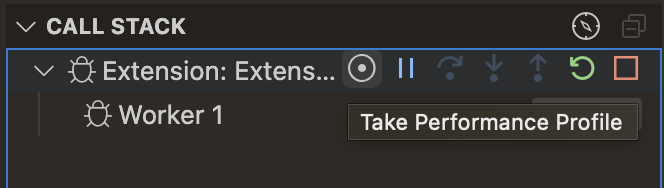
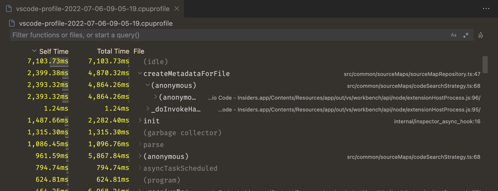
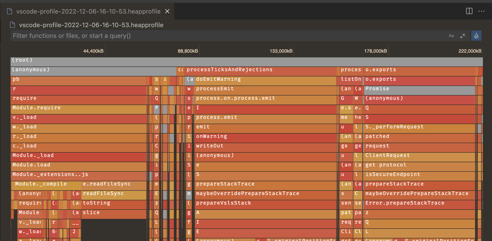
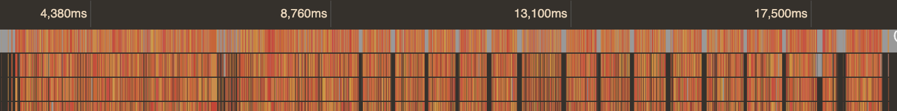
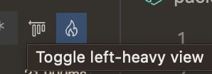
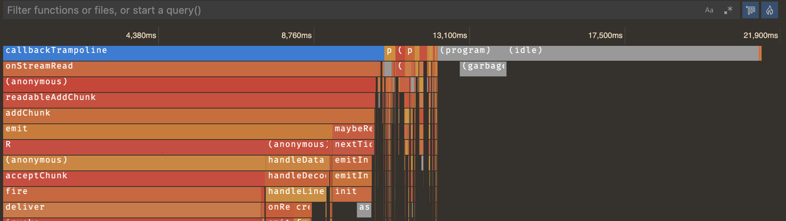

+++
title = "10.3.10 性能分析"
date = 2026-11-06T07:53:25+08:00
weight = 10
type = "docs"
description = ""
isCJKLanguage = true
draft = false
+++


> 原文链接: [https://code.visualstudio.com/docs/nodejs/profiling](https://code.visualstudio.com/docs/nodejs/profiling)

# 10.3.10 性能分析

　　VS Code 支持收集和查看 JavaScript 程序的性能配置文件。首先需要为 [Node.js 程序](10.3.3-NodejsDebugging/)或[浏览器应用](10.3.5-BrowserDebugging/)配置调试器。

## 配置文件类型 {#types-of-profiles}

根据要优化的内容，可以采集不同类型的配置文件。

* **CPU 配置文件**：告诉你程序在 JavaScript 中把时间花在哪里。请记住，虽然可以等待异步 promise 或回调，但同一时间只执行一个 JavaScript 表达式。CPU 配置文件每秒采集约 10,000 个样本，告诉你当时正在执行哪个表达式。
* **堆配置文件**：告诉你程序随时间如何分配内存。分配内存可能代价高昂，减少代码分配的内存量可以提升性能。
* **堆快照**：瞬时显示程序分配内存的位置。发现程序占用大量 RAM 并想找出原因时，堆快照很有用。复杂程序采集堆快照可能需要几分钟，内置编辑器目前不支持查看堆快照。

## 收集配置文件 {#collecting-a-profile}

　　收集配置文件时需要正在调试程序。可以通过几种方式收集：

* 使用 **调用堆栈** 视图中的“记录”按钮，可以采集 CPU 配置文件、堆配置文件和堆快照。
* 在程序中调用 `console.profile()`，会收集 CPU 配置文件。

### 使用记录按钮 {#using-the-record-button}

调试时切换到运行和调试视图（`Ctrl + Shift + D`，macOS：`Cmd + Shift + D`），找到 **调用堆栈** 视图。将鼠标悬停在要调试的会话上，选择 **采集性能配置文件** 按钮。也可以从命令面板（`Ctrl + Shift + P`，macOS：`Cmd + Shift + P`）运行该命令。



　　VS Code 会询问要采集的[性能配置文件类型](#types-of-profiles)，选择相关类型。

然后询问何时停止采集，可以选择：

* 手动停止前一直采集。
* 采集固定时长。
* 采集到命中某个断点。

选择第一项时，可以单击调试工具栏中的红色“记录”图标停止。采集完成后会自动打开[配置文件查看器](#analyzing-a-profile)。

### 使用 console.profile {#using-consoleprofile}

　　可以在代码中手动插桩，用 `console.profile` 开始、`console.profileEnd` 结束。两次调用之间会采集 CPU 配置文件。

```js
console.profile();
doSomeVeryExpensiveWork();
console.profileEnd();
```

生成的 `.cpuprofile` 会自动保存到工作区文件夹。选择该文件可在内置[配置文件查看器](#analyzing-a-profile)中打开。

## 分析配置文件 {#analyzing-a-profile}

### 表格视图 {#table-view}

　　VS Code 集成可视化工具支持查看 JavaScript `.cpuprofile` 和 `.heapprofile` 文件。打开文件后首先显示表格视图：



这是程序的**自底向上**视图。每行表示程序中的一个函数，默认按该函数自身花费的时间排序，也称为“自身时间”。函数的“总时间”是自身时间加上它调用的所有函数的时间。可以展开表格行查看调用来源。

例如以下代码：

```js
function a() {
  doSomethingFor5Seconds();
  b();
}

function b() {
  doSomethingFor3Seconds();
}

a();
```

此例中 `a` 的自身时间是 5 秒，总时间是 8 秒。`b` 的自身时间和总时间都是 3 秒。堆配置文件工作方式相同，但使用自身大小和总大小表示每个函数或其被调用者分配的内存量。

### 火焰视图 {#flame-view}

表格视图适合某些场景，但通常需要更直观的配置文件表示。单击表格视图右上角的火焰 🔥 图标。如果尚未安装，会提示安装提供火焰视图编辑器的扩展。



CPU 配置文件的水平轴是时间线，可以查看程序在每个时刻做什么。堆配置文件的水平轴是程序分配的总内存。

图中每个条形（“火焰”）是一个调用堆栈。最外层顶层函数调用（调用堆栈“底部”）显示在编辑器顶部，它调用的函数显示在下方。条形宽度由总时间或总内存决定。

可以单击火焰图中的条目查看更多信息，使用鼠标滚轮缩放，缩放后拖动图表导航。

### 左重视图 {#left-heavy-view}

处理 CPU 配置文件时，火焰图可能不易理解，可能存在大量独立调用堆栈：



为便于分析，VS Code 提供“左重”视图，将所有相似调用堆栈分组。



这会从按时间顺序的视图切换到类似堆配置文件的视图。水平轴仍是总配置文件时长，但每个条形表示该函数从该堆栈被调用的**所有**次数对应的总时间。



此视图对服务器等应用更有用：单次调用可能很快，但需要找出多次调用中总体最昂贵的函数。
