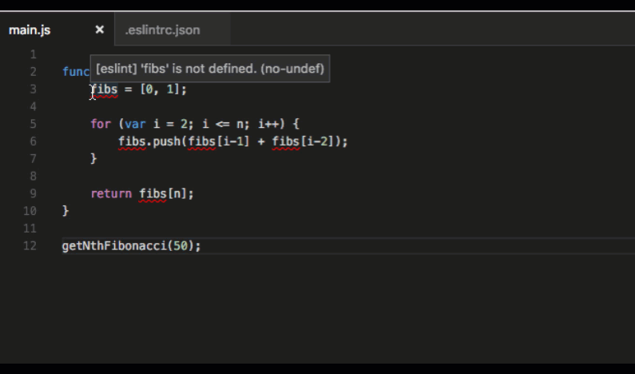
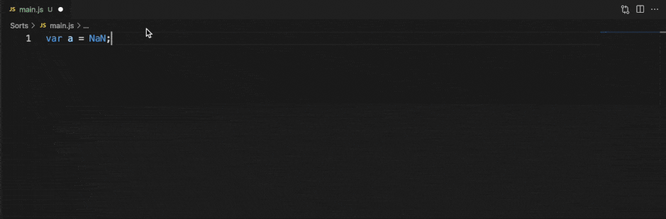
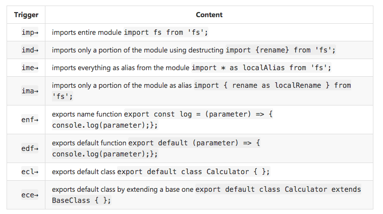
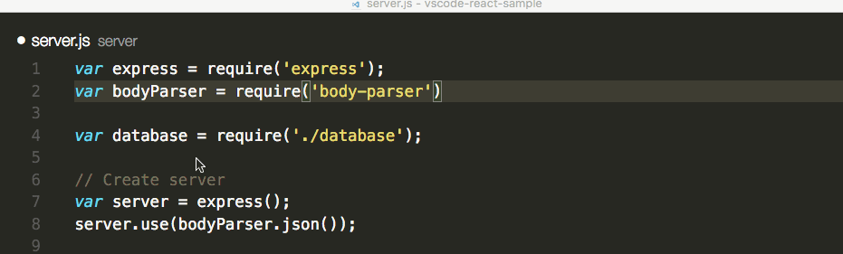

+++
title = "10.3.11 JavaScript 扩展"
date = 2026-11-06T07:53:25+08:00
weight = 11
type = "docs"
description = ""
isCJKLanguage = true
draft = false
+++

> 原文链接: [https://code.visualstudio.com/docs/nodejs/extensions](https://code.visualstudio.com/docs/nodejs/extensions)

# 10.3.11 JavaScript 扩展

　　VS Code 为 JavaScript 和 Node.js 开发支持许多功能。下载产品自带的功能是核心功能：调试、IntelliSense、代码导航等。

　　除核心功能外，还可以安装大量高质量扩展，为 JavaScript 开发添加功能。

> **提示**：扩展安装和管理方法请参阅[扩展文档](../../../editor/3.3-ConfigureTheEditor/3.3.6-Extensions/3.3.6.2-ExtensionMarketplace/)。

## 查找扩展 {#finding-extensions}

　　可以在扩展视图搜索栏输入 `JavaScript` 查找 JavaScript 扩展，也可以使用标签 `tag:javascript`。在 VS Code 或 [Marketplace](https://marketplace.visualstudio.com/vscode)中搜索更多扩展。

也可以搜索 `Node.js` 扩展。

> **提示**：上方扩展动态查询。单击扩展卡片阅读说明和评论，判断哪个扩展最适合你。更多内容请参阅 [Marketplace](https://marketplace.visualstudio.com/vscode)。

## 推荐扩展 {#recommended-extensions}

刚开始使用时，可以尝试以下扩展。

### ESLint {#eslint}

Marketplace：[ESLint](https://marketplace.visualstudio.com/items?itemName=dbaeumer.vscode-eslint)

发布者：[Microsoft](https://marketplace.visualstudio.com/publishers/Microsoft)

　　轻松将 [ESLint](https://eslint.org/)集成到项目。ESLint 不是喜欢的 linter 时，还可以选择 [JSHint](https://marketplace.visualstudio.com/items?itemName=dbaeumer.jshint)、[JSCS](https://marketplace.visualstudio.com/items?itemName=ms-vscode.jscs) 和 [JS Standard](https://marketplace.visualstudio.com/items?itemName=chenxsan.vscode-standardjs) 等其他 linter 扩展。

设置 JavaScript linter 的详情请参阅 [JavaScript 文档](../../language-support/10.2.1-JavaScript/#linters)。

### SonarLint {#sonarlint}

Marketplace：[SonarLint](https://marketplace.visualstudio.com/items?itemName=SonarSource.sonarlint-vscode)

发布者：[SonarSource](https://marketplace.visualstudio.com/publishers/SonarSource)

　　SonarLint 帮助在编码时发现并修复缺陷和安全问题。扩展在后台运行，像拼写检查器一样高亮编码问题。SonarLint 不仅说明问题，还提供上下文指导，解释问题为什么有害、如何修复，并给出示例。扩展支持 [200 多条 JS/TS 规则](https://rules.sonarsource.com/javascript)，包含多个[快速修复](https://rules.sonarsource.com/javascript/quickfix)自动处理编码问题。

在 Marketplace 搜索“SonarLint”安装，无需配置。可以从适合大多数用户的默认配置文件开始，并根据需要自定义。

### JavaScript (ES6) 代码片段 {#javascript-es6-code-snippets}

Marketplace：[JavaScript (ES6) code snippets](https://marketplace.visualstudio.com/items?itemName=xabikos.JavaScriptSnippets)

发布者：[charalampos karypidis](https://marketplace.visualstudio.com/search?term=publisher%3A%22charalampos%20karypidis%22&target=VSCode)

　　VS Code 自带许多代码片段。**JavaScript (ES6) code snippets** 扩展添加 ES6（ECMAScript 6）语法代码片段。以下是部分示例，完整列表请参阅扩展 [README](https://marketplace.visualstudio.com/items?itemName=xabikos.JavaScriptSnippets)。

JavaScript 代码片段详情请参阅 [JavaScript 文档](../../language-support/10.2.1-JavaScript/#snippets)。其他代码片段包（包括 [Angular 1](https://marketplace.visualstudio.com/items?itemName=johnpapa.Angular1)、[Angular 2](https://marketplace.visualstudio.com/items?itemName=johnpapa.Angular2)、[Bootstrap 3](https://marketplace.visualstudio.com/items?itemName=wcwhitehead.bootstrap-3-snippets)、[ReactJs](https://marketplace.visualstudio.com/items?itemName=xabikos.ReactSnippets) 和 [jQuery](https://marketplace.visualstudio.com/items?itemName=donjayamanne.jquerysnippets)）请参阅 Marketplace 的[代码片段类别](https://marketplace.visualstudio.com/vscode/Snippets?sortBy=Installs)。

### npm IntelliSense {#npm-intellisense}

Marketplace：[npm IntelliSense](https://marketplace.visualstudio.com/items?itemName=christian-kohler.npm-intellisense)

发布者：[Christian Kohler](https://marketplace.visualstudio.com/search?term=publisher%3A%22Christian%20Kohler%22&target=VSCode)

　　使用 `import` 或 `require` 时，该扩展为 npm 模块提供 IntelliSense。

