+++
title = "10.3.3 Node.js 调试"
date = 2026-11-06T07:53:25+08:00
weight = 3
type = "docs"
description = ""
isCJKLanguage = true
draft = false
+++


> 原文链接: [https://code.visualstudio.com/docs/nodejs/nodejs-debugging](https://code.visualstudio.com/docs/nodejs/nodejs-debugging)

# 10.3.3 Node.js 调试

　　VS Code 内置 [Node.js](https://nodejs.org/)运行时调试支持，可调试 JavaScript、TypeScript 以及许多转译为 JavaScript 的语言。VS Code 提供适当的启动配置默认值和代码片段，为 Node.js 调试设置项目很直接。

调试 Node.js 程序的方式：

* 使用[自动附加](#auto-attach)调试在 VS Code 集成终端中运行的进程。
* 使用 [JavaScript 调试终端](#javascript-debug-terminal)，类似集成终端。
* 使用[启动配置](#launch-configuration)启动程序，或[附加到进程](#attaching-to-nodejs)。

## 自动附加 {#auto-attach}

　　启用 **自动附加** 后，Node 调试器会自动附加到从 VS Code 集成终端启动的某些 Node.js 进程。可以从命令面板（`Ctrl + Shift + P`，macOS：`Cmd + Shift + P`）运行 **Toggle Auto Attach** 命令，或使用状态栏中的 **Auto Attach** 项启用。

自动附加有三种模式，可在快速选择或 `debug.javascript.autoAttachFilter` 设置中选择：

* `smart`：执行 `node_modules` 外的脚本或使用 mocha、ts-node 等常见“runner”脚本时调试。可以使用 **Auto Attach Smart Pattern** 设置（`debug.javascript.autoAttachSmartPattern`）配置 runner 允许列表。
* `always`：调试集成终端中启动的所有 Node.js 进程。
* `onlyWithFlag`：只调试使用 `--inspect` 或 `--inspect-brk` 标志启动的进程。

启用后需要重新启动终端（单击终端右上角 ⚠ 图标或新建终端）。调试器应在一秒内附加：

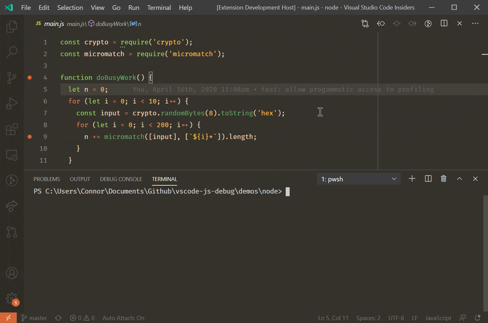

　　自动附加开启时，状态栏显示 **Auto Attach**，可单击更改模式或临时关闭。临时关闭适合运行不需要调试的一次性程序。

### 附加配置 {#additional-configuration}

**其他启动配置属性**

可以在 `debug.javascript.terminalOptions` 设置中为自动附加应用 [launch.json 属性](#launch-configuration-attributes)。例如将 Node 内部模块加入 skipFiles：

```js
  "debug.javascript.terminalOptions": {
    "skipFiles": [
      "<node_internals>/**"
    ]
  },
```

**自动附加智能模式**

`smart` 模式下 VS Code 会匹配主脚本与 [glob 模式](https://code.visualstudio.com/docs/editor/glob-patterns)，避免附加到不感兴趣的构建工具。模式由 `debug.javascript.autoAttachSmartPattern` 设置，默认：

```js
[
  "!**/node_modules/**", // 排除 node_modules 文件夹中的脚本
  "**/$KNOWN_TOOLS$/**"  // 但包含一些常见工具
]
```

`$KNOWN_TOOLS$` 会替换为 `ts-node`、`mocha`、`ava` 等常见代码运行器。可以修改列表，例如排除 mocha、包含自定义测试运行器：

```js
[
  "!**/node_modules/**",
  "**/$KNOWN_TOOLS$/**",
  "!**/node_modules/mocha/**", // 使用 "!" 排除 mocha node_modules 中的所有脚本
  "**/node_modules/my-cool-test-runner/**" // 包含自定义测试运行器中的脚本
]
```

## JavaScript 调试终端 {#javascript-debug-terminal}

与自动附加类似，JavaScript 调试终端会自动调试在其中运行的任何 Node.js 进程。可以从命令面板运行 **Debug: Create JavaScript Debug Terminal**，或从终端切换器下拉列表选择 **Create JavaScript Debug Terminal**。

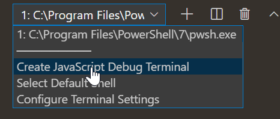

### 附加配置 {#additional-configuration-1}

可以在 `debug.javascript.terminalOptions` 中为调试终端应用其他 `launch.json` 属性。例如：

```js
"debug.javascript.terminalOptions": {
  "skipFiles": [
    "<node_internals>/**"
  ]
},
```

## 启动配置 {#launch-configuration}

　　启动配置是 VS Code 设置调试的传统方式，为运行复杂应用提供最多配置选项。本节详细介绍源映射、单步跳过外部代码、远程调试等高级场景。

入门视频请参阅 [VS Code 调试入门](https://www.youtube.com/watch?v=3HiLLByBWkg)。

> **注意**：刚接触 VS Code 时，可以在[调试](../../../debugging-and-testing/6.1-Debugging/)主题了解通用调试功能和创建 `launch.json`。

## 启动配置属性 {#launch-configuration-attributes}

　　调试配置存储在 `.vscode/launch.json`。创建和使用介绍请参阅[调试配置](../../../debugging-and-testing/6.2-DebuggingConfiguration/)。

Node.js 调试器常见 `launch.json` 属性（完整列表请参阅 [vscode-js-debug 选项](https://github.com/microsoft/vscode-js-debug/blob/main/OPTIONS.md)）：

`launch` 和 `attach` 类型都支持：

* `outFiles`：用于定位生成 JavaScript 文件的 [glob 模式](https://code.visualstudio.com/docs/editor/glob-patterns)数组。请参阅 [Source map](#source-maps)。
* `resolveSourceMapLocations`：应解析 source map 的位置 [glob 模式](https://code.visualstudio.com/docs/editor/glob-patterns)数组。
* `timeout`：重新启动会话时，超过此毫秒数后放弃。
* `stopOnEntry`：程序启动时立即中断。
* `localRoot`：VS Code 根目录，请参阅[远程调试](#remote-debugging)。
* `remoteRoot`：Node 根目录，请参阅[远程调试](#remote-debugging)。
* `smartStep`：尝试自动单步跳过无法映射到源代码的代码。请参阅[智能单步](#smart-stepping)。
* `skipFiles`：自动跳过匹配这些 [glob 模式](https://code.visualstudio.com/docs/editor/glob-patterns)的文件。请参阅[跳过无关代码](#skipping-uninteresting-code)。
* `trace`：启用诊断输出。

仅 `launch` 类型支持：

* `program`：要调试的 Node.js 程序绝对路径。
* `args`：传递给程序的参数数组。
* `cwd`：在该目录启动程序。
* `runtimeExecutable`：运行时可执行文件绝对路径，默认 `node`。
* `runtimeArgs`：传递给运行时可执行文件的可选参数。
* `runtimeVersion`：使用 nvm 或 nvs 管理 Node.js 版本时，选择特定版本。
* `env`：可选环境变量，字符串键值对。
* `envFile`：包含环境变量定义的文件路径。
* `console`：启动程序的终端（`internalConsole`、`integratedTerminal`、`externalTerminal`）。
* `outputCapture`：设置为 `std` 时，stdout/stderr 输出显示在调试控制台，而不是通过调试端口监听。

仅 `attach` 类型支持：

* `restart`：终止时重新启动连接。
* `port`：调试端口。
* `address`：调试端口 TCP/IP 地址。
* `processId`：发送 USR1 信号后附加到此进程。使用此属性时调试端口自动确定，不能同时指定 `port`。
* `continueOnAttach`：附加时如果进程已暂停，是否继续。使用 `--inspect-brk` 启动时有用。

### 常见场景启动配置 {#launch-configurations-for-common-scenarios}

可以在 `launch.json` 中触发 IntelliSense（`Ctrl + Space`）查看常用 Node.js 调试配置片段。

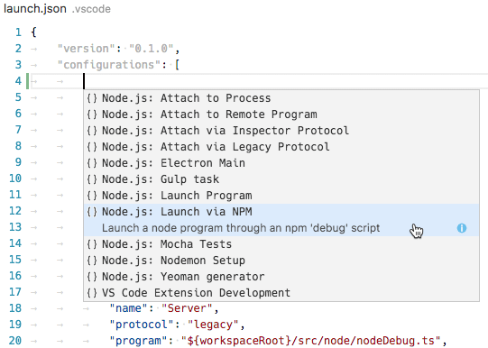

也可以单击 `launch.json` 编辑器右下角 **添加配置...** 按钮打开片段。

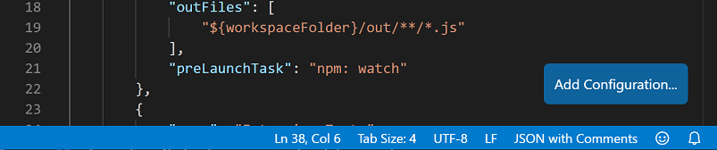

可用片段：

* **Launch Program**：以调试模式启动 Node.js 程序。
* **Launch via npm**：通过 npm `debug` 脚本启动。npm 脚本中的调试端口必须与片段端口一致。
* **Attach**：附加到本地运行中 Node.js 程序的调试端口。
* **Attach to Remote Program**：附加到 `address` 指定主机上的 Node.js 程序，需正确设置 `localRoot` 和 `remoteRoot`。
* **Attach by Process ID**：打开进程选择器选择 node 或 gulp 进程，可附加到未以调试模式启动的进程。
* **Nodemon Setup**：使用 nodemon 在 JavaScript 源更改时自动重新启动调试会话。需全局安装 nodemon。终止调试会话不会终止 nodemon 本身。
* **Mocha Tests**：调试 `test` 文件夹中的 mocha 测试。项目 `node_modules` 中需安装 mocha。
* **Yeoman generator**：调试 yeoman 生成器。项目需安装 `yo`，生成项目需运行 `npm link`。
* **Gulp task**：调试 gulp 任务。项目需安装 gulp。
* **Electron Main**：调试 Electron 应用主 Node.js 进程。假设 Electron 可执行文件位于工作区 `node_modules/.bin`。

### Node 控制台 {#node-console}

　　默认调试会话在内部调试控制台启动目标。调试控制台不支持从控制台读取输入，因此可以将 `console` 属性设为 `externalTerminal` 或 `integratedTerminal` 使用外部或集成终端。默认 `internalConsole`。

外部终端程序可以通过 `terminal.external.windowsExec`、`terminal.external.osxExec` 和 `terminal.external.linuxExec` 设置配置。

### npm 和其他工具的启动配置支持 {#launch-configuration-support-for-npm-and-other-tools}

可以不直接用 node 启动，而通过启动配置使用 npm 脚本或其他任务运行器：

* `runtimeExecutable` 可以使用 PATH 中任何程序（npm、mocha、gulp 等），参数通过 `runtimeArgs` 传递。
* npm 脚本或工具隐式指定要启动的程序时，不必设置 `program`。

例如 `package.json` 有 `debug` 脚本：

```json
  "scripts": {
    "debug": "node myProgram.js"
  },
```

对应启动配置：

```json
{
    "name": "Launch via npm",
    "type": "node",
    "request": "launch",
    "cwd": "${workspaceFolder}",
    "runtimeExecutable": "npm",
    "runtimeArgs": [
        "run-script", "debug"
    ],
}
```

### 多版本支持 {#multi-version-support}

　　使用 nvm 或 nvm-windows 时，可以在启动配置中用 `runtimeVersion` 选择 Node.js 版本：

```json
{
    "type": "node",
    "request": "launch",
    "name": "Launch test",
    "runtimeVersion": "14",
    "program": "${workspaceFolder}/test.js"
}
```

使用 nvs 时还可以指定架构和变体，例如 `"runtimeVersion": "chackracore/8.9.4/x64"`。

　　需要提前安装相应版本，该功能不会自动下载。省略次版本和补丁版本时，使用系统上最新的 `14.x.y`。

### 从外部文件加载环境变量 {#load-environment-variables-from-external-file}

　　可以在启动配置中添加 `envFile` 属性，指定包含环境变量的文件绝对路径：

```json
   //...
   "envFile": "${workspaceFolder}/.env",
   "env": { "USER": "john doe" }
   //...
```

`env` 中指定的变量会覆盖文件中的变量。

`.env` 示例：

```
USER=doe
PASSWORD=abc123

# 注释

# 空值：
empty=

# 引号字符串中的换行：
lines="foo\nbar"
```

## 附加到 Node.js {#attaching-to-nodejs}

要附加到外部 Node.js 程序，请这样启动：

```bash
node --inspect program.js
```

如果程序不应立即运行，而应等待调试器附加：

```bash
node --inspect-brk program.js
```

附加方式：

* 打开进程选择器，列出候选进程并选择一个。
* 创建显式指定配置的“attach”配置，然后按 `F5`。

### 附加到 Node 进程操作 {#attach-to-node-process-action}

命令面板中的 **Attach to Node Process** 命令会打开快速选择菜单，列出 Node.js 调试器可用的进程：

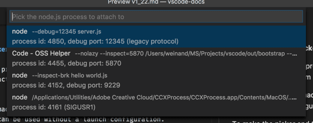

　　列表显示调试端口和进程 ID。选择进程后调试器会尝试附加。除了 Node.js 进程，选择器还显示使用各种 `--inspect` 参数启动的程序，因此可以附加到 Electron 或 VS Code 辅助进程。

### 设置“Attach”配置 {#setting-up-an-attach-configuration}

最简单的附加配置：

```json
{
    "name": "Attach to Process",
    "type": "node",
    "request": "attach",
    "port": 9229
}
```

`9229` 是 `--inspect` 和 `--inspect-brk` 的默认端口。使用其他端口时，例如 `--inspect=12345`，请同步修改 `port`。

附加到未以调试模式启动的 Node.js 进程，可以指定进程 ID：

```json
{
    "name": "Attach to Process",
    "type": "node",
    "request": "attach",
    "processId": "53426"
}
```

为避免每次输入新进程 ID，可以使用 `PickProcess` 命令变量打开进程选择器：

```json
{
    "name": "Attach to Process",
    "type": "node",
    "request": "attach",
    "processId": "${command:PickProcess}"
}
```

## 停止调试 {#stop-debugging}

　　**Debug: Stop** 操作（调试工具栏或命令面板）停止调试会话。

附加模式下（终止按钮显示插头），按 **停止** 会断开调试器，被调试进程继续执行。

启动模式下：

1. 第一次按 **停止** 会发送 `SIGINT`，请求被调试进程优雅关闭。被调试进程可以拦截该信号清理后关闭。关闭代码中没有断点或问题时，进程和调试会话会终止。
2. 如果关闭代码命中断点，或进程未正常终止，调试会话不会结束。再次按 **停止** 会强制终止进程及其子进程（`SIGKILL`）。

Windows 上按 **停止** 会强制终止进程及其子进程。

## Source map {#source-maps}

　　VS Code JavaScript 调试器支持 source map，帮助调试 TypeScript 或压缩/混淆 JavaScript 等转译语言。有 source map 时可以在原始源代码中单步或设置断点。source map 不存在或损坏时，断点显示为未验证的灰色空心圆。

`sourceMaps` 属性默认为 `true`，控制 source map 功能。调试器会尽量使用 source map，因此甚至可以在 `program` 中指定 `app.ts`。需要禁用时设为 `false`。

### 工具配置 {#tool-configuration}

需要确保转译器生成 source map：

**TypeScript**：向 `tsc` 传递 `--sourceMap`，或在 `tsconfig.json` 中设置 `"sourceMap": true`。

```bash
tsc --sourceMap --outDir bin app.ts
```

**Babel**：将 [sourceMaps](https://babeljs.io/docs/en/options#sourcemaps) 设为 `true`，或编译时传递 `--source-maps`。

```bash
npx babel script.js --out-file script-compiled.js --source-maps
```

**Webpack**：建议在 `webpack.config.js` 中设置 `devtool: "source-map"`。如果使用 TypeScript loader 等额外编译步骤，也要确保这些步骤生成 source map，否则 webpack 生成的 map 会映射回 loader 编译结果而不是真实源文件。

### Source map 发现 {#source-map-discovery}

　　默认会在整个工作区（排除 `node_modules`）搜索 source map。大型工作区可能较慢。可以在 `launch.json` 中设置 `outFiles` 限制搜索位置：

```json
{
    "version": "0.2.0",
    "configurations": [
        {
            "name": "Launch TypeScript",
            "type": "node",
            "request": "launch",
            "program": "app.ts",
            "outFiles": [ "${workspaceFolder}/bin/**/*.js" ]
        }
    ]
}
```

`outFiles` 应匹配 JavaScript 文件，而不是 `.map` 文件。

### Source map 解析 {#source-map-resolution}

　　默认只解析 `outFiles` 中的 source map，防止依赖干扰断点。例如依赖的 source map 引用 `webpack:///./src/index.ts` 时，可能错误解析到你的源文件。

可以用 `resolveSourceMapLocations` 配置。设为 `null` 会解析所有 source map。以下配置额外允许解析 `node_modules/some-dependency`：

```js
  "resolveSourceMapLocations": [
    "out/**/*.js",
    "node_modules/some-dependency/**/*.js",
  ]
```

### 智能单步 {#smart-stepping}

`smartStep` 设为 `true` 时，VS Code 会自动跳过“无关代码”——由转译生成、没有 source map 映射回原始源代码的代码。`smartStep` 会单步穿过这些代码，直到再次到达有 source map 的位置。

这对 TypeScript 的 async/await 降级编译尤其有用，因为编译器会注入没有 source map 的辅助代码。`smartStep` 仅适用于有 source map 的生成 JavaScript；没有源映射的 JavaScript 不受影响。

### JavaScript source map 提示 {#javascript-source-map-tips}

　　断点变灰时，悬停会显示“Breakpoint ignored because generated code not found (source map problem?)”。调试适配器会根据 `outFiles` 找到生成的 `.js` 文件，解析 source map 中的 `sources` 和 `sourceRoot`，再查找 `app.ts` 的完整路径。找不到匹配时无法绑定断点。

可以尝试：

* 调试时运行 **Debug: Diagnose Breakpoint Problems** 命令。
* 确认构建启用了 source map，存在 `.js.map` 或内联 source map。
* 检查 `sourceRoot` 和 `sources` 是否正确。
* 检查打开文件夹的大小写是否正确。
* 尝试添加 `debugger` 语句；如果能在 `.ts` 中断，但断点不绑定，请将该信息附到 GitHub 议题。

### 覆盖 source map 路径 {#overriding-source-map-paths}

调试器使用 `sourceMapPathOverrides` 自定义 source map 到磁盘路径的映射。大多数工具有良好默认值：

```js
{
  'webpack:///./~/*': "${workspaceFolder}/node_modules/*",
  'webpack:////*': '/*',
  'webpack://@?:*/?:*/*': "${workspaceFolder}/*",
  // 以及其他模式...
}
```

`?:*` 是非贪婪非捕获匹配，`*` 是贪婪捕获匹配。右侧对应 `*` 会替换为左侧捕获片段。浏览器调试中默认使用 `webRoot` 而不是 `workspaceFolder`。

## 远程调试 {#remote-debugging}

> **注意**：VS Code 现在有通用[远程开发能力](../../../remote/)。使用[远程开发](https://aka.ms/vscode-remote/download/extension)扩展时，远程和容器中的 Node.js 开发与本地相同。**这是远程调试 Node.js 的推荐方式**。

无法使用远程开发扩展时，可以通过 `address` 属性附加到另一台机器或容器中的进程：

```json
{
    "type": "node",
    "request": "attach",
    "name": "Attach to remote",
    "address": "192.168.148.2", // <- 远程地址
    "port": 9229
}
```

默认会将远程源文件流式传输到本地 VS Code 只读编辑器。要打开工作区可编辑源代码，可以配置 `localRoot` 和 `remoteRoot` 映射本地项目与远程 Node.js 文件夹路径。

```json
{
    "type": "node",
    "request": "attach",
    "name": "Attach to remote",
    "address": "TCP/IP address of process to be debugged",
    "port": 9229,
    "localRoot": "${workspaceFolder}",
    "remoteRoot": "C:\\Users\\username\\project\\server"
}
```

## 访问已加载脚本 {#access-loaded-scripts}

需要在不属于工作区的脚本中设置断点时，可以通过 **运行和调试** 视图的 **已加载脚本** 视图访问：

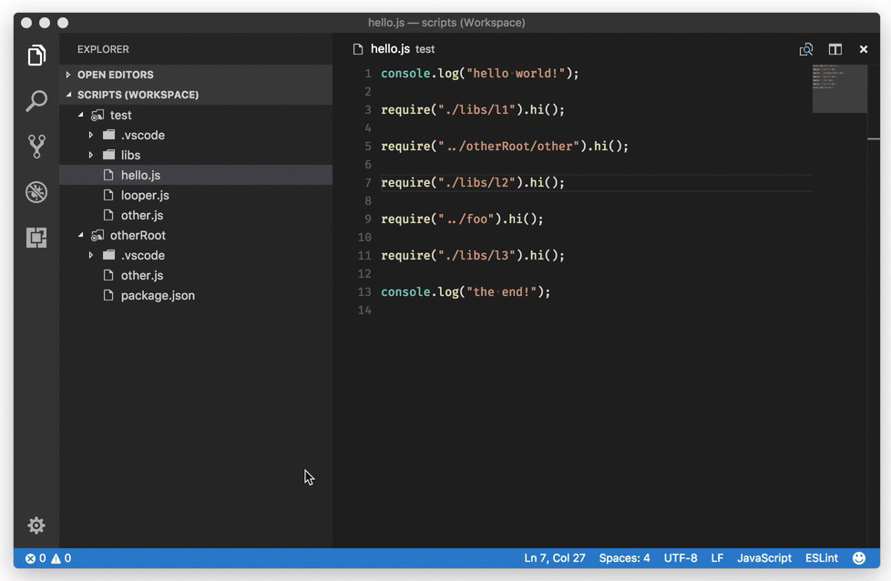

**已加载脚本** 视图可以输入名称快速选择脚本，或开启 **按类型筛选** 过滤列表。脚本加载到只读编辑器，可以设置断点。断点会跨调试会话保留，但仅在调试会话运行时能访问脚本内容。

## 源代码编辑后自动重新启动调试会话 {#restarting-debug-sessions-automatically-when-source-is-edited}

`restart` 属性控制 Node.js 调试器在会话结束后是否自动重新启动。使用 **nodemon** 在文件更改时重启 Node.js 时很有用。将 `restart` 设为 `true`，Node.js 终止后调试器会自动尝试重新附加。

例如通过 nodemon 启动 `server.js`：

```bash
nodemon --inspect server.js
```

使用以下配置附加：

```json
{
    "name": "Attach to node",
    "type": "node",
    "request": "attach",
    "restart": true,
    "port": 9229
}
```

也可以通过启动配置直接使用 nodemon：

```json
{
    "name": "Launch server.js via nodemon",
    "type": "node",
    "request": "launch",
    "runtimeExecutable": "nodemon",
    "program": "${workspaceFolder}/server.js",
    "console": "integratedTerminal",
    "internalConsoleOptions": "neverOpen"
}
```

> **提示**：按 **停止** 会停止调试会话并断开 Node.js，但 nodemon 和 Node.js 仍会运行。需要从命令行终止 nodemon。语法错误时 nodemon 无法启动 Node.js，VS Code 会重试附加约 10 秒后放弃；可以增大 `timeout` 属性。

## 重新启动堆栈帧 {#restart-frame}

Node 调试器支持在堆栈帧重新执行。找到问题并使用 **设置值** 修改变量后，可以重新进入当前函数，避免重启整个会话。**重新启动堆栈帧** 不会回滚函数外的状态突变，因此不一定总按预期工作。

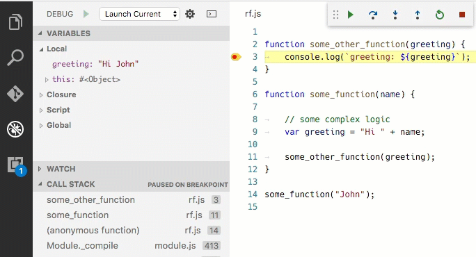

## 断点 {#breakpoints}

### 条件断点 {#conditional-breakpoints}

条件断点仅在表达式返回真值时暂停。右键单击行号旁装订线，选择“条件断点”：

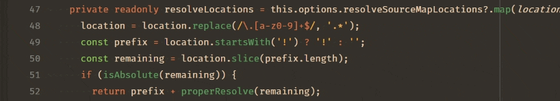

### 日志点 {#logpoints}

日志点在代码命中时记录消息而不暂停。JavaScript 调试器中可以用花括号插入表达式，例如 `current value is: {myVariable.property}`。右键单击装订线选择“日志点”。

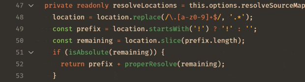

### 命中次数断点 {#hit-count-breakpoints}

命中次数条件控制断点被命中多少次后才中断。右键单击装订线，选择“条件断点”，切换到“命中次数”。

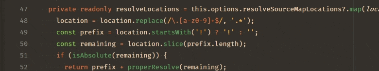

支持整数或 `<`、`<=`、`==`、`>`、`>=`、`%` 后跟整数。例如：

* `>10`：10 次后中断。
* `<3`：仅前两次命中中断。
* `10`：等同于 `>=10`。
* `%2`：每隔一次命中中断。

### 触发断点 {#triggered-breakpoints}

触发断点在另一个断点命中后自动启用，适合诊断特定前置条件后的失败。右键单击字形边距，选择 **添加触发断点**，选择启用该断点的其他断点。

<video src="https://code.visualstudio.com/assets/docs/editor/debugging/debug-triggered-breakpoint.mp4" autoplay loop controls muted></video>

### 断点验证 {#breakpoint-validation}

Node.js 为性能延迟解析 JavaScript 函数，因此未解析区域的断点无法立即生效。VS Code 会自动传递 `--nolazy` 防止延迟解析，确保运行前验证断点。

`--nolazy` 可能显著增加启动时间，可以通过 `runtimeArgs` 传递 `--lazy` 退出。这样某些断点会跳到已解析代码中的下一个可能行。**断点** 区域会显示请求行和实际行之间的箭头。

会话启动或设置新断点时会发生验证。Node.js 解析完代码后，可以使用 **断点** 区域标题中的 **重新应用** 按钮将断点移回请求位置。

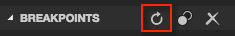

## 跳过无关代码 {#skipping-uninteresting-code}

Node.js 调试支持跳过不想单步进入的源代码（“仅我的代码”）。使用 `skipFiles` 属性，值是脚本路径 [glob 模式](https://code.visualstudio.com/docs/editor/glob-patterns)数组。

```typescript
  "skipFiles": [
    "${workspaceFolder}/node_modules/**/*.js",
    "${workspaceFolder}/lib/**/*.js"
  ]
```

这会跳过 `node_modules` 和 `lib` 中的所有代码。`skipFiles` 也影响 `console.log` 的位置显示：调试控制台会显示堆栈中第一个未跳过的位置。

Node.js 内置核心模块可以用魔术名称 `<node_internals>` 引用：

```json
  "skipFiles": [
     "<node_internals>/**/*.js"
   ]
```

跳过规则：

* 单步进入被跳过文件时不会停下，而会停在下一个未跳过的执行行。
* 启用异常中断时，被跳过文件抛出的异常不会中断，除非冒泡到未跳过文件。
* 在被跳过文件中设置断点仍会停下，可以单步直到离开该文件，之后恢复正常跳过。
* 被跳过文件中的控制台消息显示为调用堆栈中第一个未跳过位置。

被跳过的源代码在调用堆栈视图中以淡化样式显示：

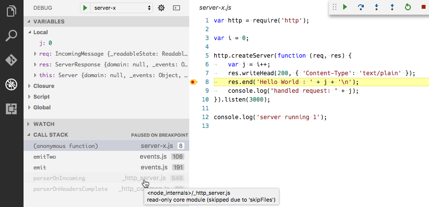

调用堆栈上下文菜单中的 **切换跳过此文件** 可以在运行时跳过文件而不修改启动配置，仅对当前会话有效，也可以停止跳过 `skipFiles` 中的文件。

> **注意**：`legacy` 协议调试器支持否定 [glob 模式](https://code.visualstudio.com/docs/editor/glob-patterns)，但必须**跟在**肯定模式之后。

## 调试 WebAssembly {#debugging-webassembly}

JavaScript 调试器可以调试包含 [DWARF](https://dwarfstd.org) 调试信息的 WebAssembly 代码。工具链支持：

* C/C++ 与 Emscripten：使用 `-g` 编译。
* Zig：Debug 构建模式自动生成 DWARF。
* Rust：生成 DWARF，但 wasm-pack 尚未保留。请手动运行 `cargo install wasm-bindgen-cli`、`cargo build --target wasm32-unknown-unknown`，再运行 `wasm-bindgen --keep-debug --out-dir pkg ...`。

安装 [WebAssembly DWARF Debugging](https://marketplace.visualstudio.com/items?itemName=ms-vscode.wasm-dwarf-debugging)扩展，重启调试会话后即可映射本机代码。源代码会出现在 **已加载源** 视图，断点生效。

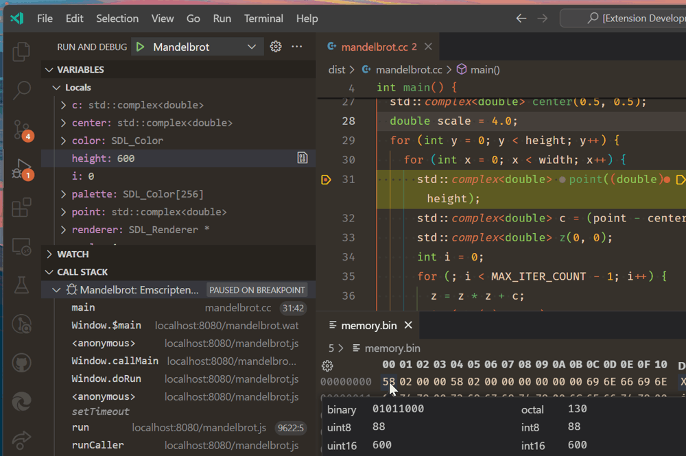

WebAssembly 调试与普通 JavaScript 略有不同：

* **变量** 视图中的变量不能直接编辑，可以选择 **查看二进制数据** 编辑关联内存。
* **调试控制台** 和 **监视** 中的表达式由 [lldb-eval](https://github.com/google/lldb-eval) 求值。
* 未映射位置显示为反汇编 WebAssembly 文本格式。**禁用 Source Map 单步** 命令会让调试器只在反汇编代码中单步。

VS Code WebAssembly 调试基于 Chromium 作者的 [C/C++ 调试扩展](https://github.com/ChromeDevTools/devtools-frontend/tree/main/extensions/cxx_debugging)。

## 支持的类 Node 运行时 {#supported-node-like-runtimes}

当前 VS Code JavaScript 调试器支持 Node 8.x 及以上、较新的 Chrome 和 Edge（`msedge` 启动类型）。

## 后续步骤 {#next-steps}

* [Node.js](10.3.2-NodejsTutorial/)：带示例应用的端到端 Node 场景。
* [VS Code 调试入门视频](https://www.youtube.com/watch?v=3HiLLByBWkg)。
* [任务](../../../debugging-and-testing/6.3-Tasks/)：运行 Gulp、Grunt 和 Jake 任务，显示错误和警告。
* [调试器扩展](https://code.visualstudio.com/api/extension-guides/debugger-extension)：创建 VS Code 调试扩展。

## 常见问题 {#common-questions}

### 使用符号链接时可以调试吗？ {#can-i-debug-if-im-using-symlinks}

可以。项目文件夹创建符号链接（例如 `npm link`）时，可以在 `runtimeArgs` 中传递 `--preserve-symlinks`：

```json
{
    "runtimeArgs": [
        "--preserve-symlinks"
    ]
}
```

主脚本位于符号链接路径中时，还需要添加 `--preserve-symlinks-main`（Node 10+）。

### 如何调试 ECMAScript 模块？ {#how-do-i-debug-ecmascript-modules}

使用 esm 或向 Node.js 传递 `--experimental-modules` 时，可以通过 `runtimeArgs` 传递：

* `"runtimeArgs": ["--experimental-modules"]`：Node v8.5.0+ 的实验性 ECMAScript 模块支持。
* `"runtimeArgs": ["-r", "esm"]`：使用 esm ES 模块加载器（不能写成不带逗号的 `["-r esm"]`）。

### 如何设置 NODE_OPTIONS？ {#how-can-i-set-node_options}

调试器使用特殊 `NODE_OPTIONS` 环境变量设置调试，覆盖它会阻止调试正常工作。应追加而不是覆盖，例如 `.bashrc`：

```bash
export NODE_OPTIONS="$NODE_OPTIONS --some-other-option=here"
```
