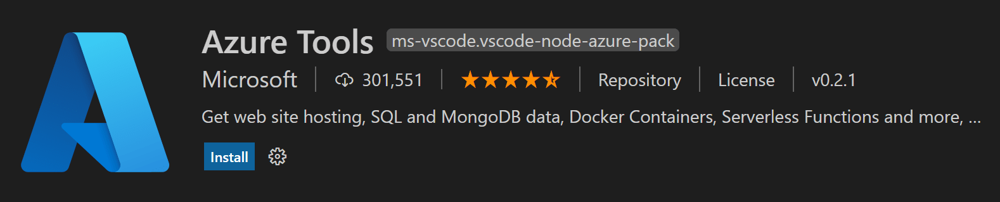

+++
title = "10.3.4 部署 Node.js 应用"
date = 2026-11-06T07:53:25+08:00
weight = 4
type = "docs"
description = ""
isCJKLanguage = true
draft = false
+++

> 原文链接: [https://code.visualstudio.com/docs/nodejs/nodejs-deployment](https://code.visualstudio.com/docs/nodejs/nodejs-deployment)

# 10.3.4 部署 Node.js 应用

　　适用于 VS Code 的 [Azure Tools](https://marketplace.visualstudio.com/items?itemName=ms-vscode.vscode-node-azure-pack)扩展让部署 Node.js 应用变得简单。

## 部署教程 {#deployment-tutorials}

以下 Microsoft Learn 教程介绍通过 VS Code 创建和部署 Node.js 应用到 Azure 的不同方式：

| 教程 | 说明 | 相关工具 |
| --- | --- | --- |
| [部署 Azure Functions](https://learn.microsoft.com/azure/developer/javascript/tutorial/azure-function-cosmos-db-mongo-api) | 直接在 VS Code 中构建和管理 Azure Functions 无服务器应用 | [Azure Resources](https://marketplace.visualstudio.com/items?itemName=ms-azuretools.vscode-azureresourcegroups)   [Azure Functions](https://marketplace.visualstudio.com/items?itemName=ms-azuretools.vscode-azurefunctions)   [Azure Databases](https://marketplace.visualstudio.com/items?itemName=ms-azuretools.vscode-cosmosdb) |
| [使用 Azure 门户和 Azure App Service 部署](https://learn.microsoft.com/azure/app-service/tutorial-nodejs-mongodb-app) | 使用 Azure App Service 直接在 VS Code 中管理 Azure 资源 | [MongoDB](https://www.mongodb.com/docs/manual/installation/)   [Azure 门户](https://portal.azure.com/) |
| [使用 Docker 部署](https://learn.microsoft.com/azure/developer/javascript/tutorial/tutorial-vscode-docker-node/tutorial-vscode-docker-node-01) | 使用容器部署网站 | [容器工具](https://marketplace.visualstudio.com/items?itemName=ms-azuretools.vscode-containers)   [Azure CLI](https://learn.microsoft.com/cli/azure/install-azure-cli)   [Azure App Service](https://marketplace.visualstudio.com/items?itemName=ms-azuretools.vscode-azureappservice)   [Azure Resources](https://marketplace.visualstudio.com/items?itemName=ms-azuretools.vscode-azureresourcegroups) |
