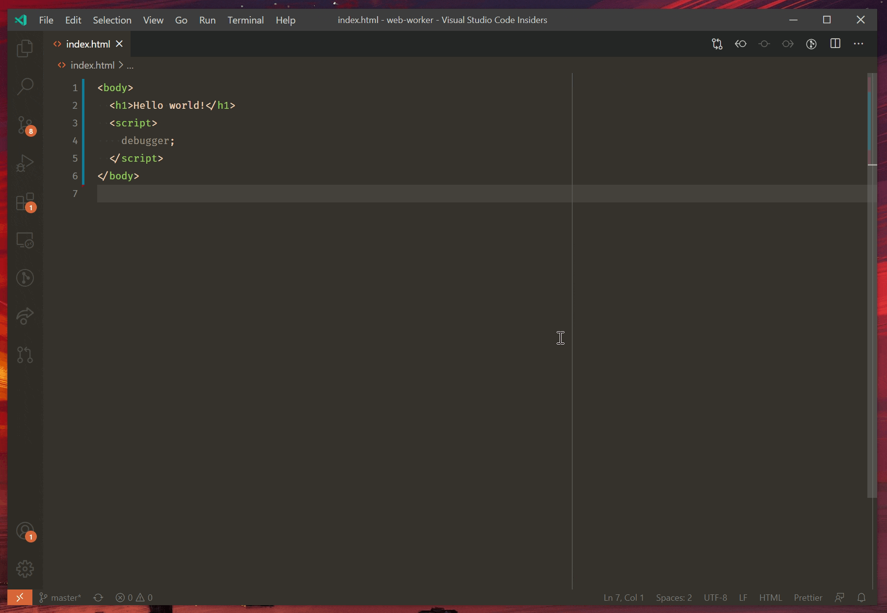

+++
title = "10.3.5 浏览器调试"
date = 2026-11-06T07:53:25+08:00
weight = 5
type = "docs"
description = ""
isCJKLanguage = true
draft = false
+++


> 原文链接: [https://code.visualstudio.com/docs/nodejs/browser-debugging](https://code.visualstudio.com/docs/nodejs/browser-debugging)

# 10.3.5 浏览器调试

　　VS Code 包含用于 Edge 和 Chrome 的内置调试器。可以通过以下方式开始：

* 使用 [Open Link](#open-link-command) 命令调试 URL。
* 单击 [JavaScript 调试终端](10.3.3-NodejsDebugging/#javascript-debug-terminal)中的链接。
* 使用[启动配置](#launch-configuration)启动浏览器并打开应用。

　　也可以在 VS Code 的[集成浏览器](../../../debugging-and-testing/6.5-IntegratedBrowser/)中调试 Web 应用，无需启动外部浏览器。

　　此外还有 [React](10.3.7-ReactTutorial/)、[Angular](10.3.6-AngularTutorial/)和 [Vue](10.3.8-VueTutorial/)入门演练，以及其他调试[配方](10.3.9-DebuggingRecipes/)。

## Open Link 命令 {#open-link-command}

　　调试网页最简单的方法是使用命令面板（`Ctrl + Shift + P`）中的 **Debug: Open Link** 命令。运行命令后会提示输入 URL，调试器会附加到该页面。



　　默认浏览器是 Edge 时，VS Code 会使用 Edge；否则会尝试查找系统上的 Chrome 安装。

## 启动配置 {#launch-configuration}

　　启动配置是 VS Code 设置调试的传统方式，为运行复杂应用提供最大灵活性。

本节详细介绍高级调试场景的配置和功能。Node.js 的[单步跳过外部代码](10.3.3-NodejsDebugging/#skipping-uninteresting-code)说明也适用于浏览器调试。

> **注意**：刚接触 VS Code 时，可以在[调试](../../../debugging-and-testing/6.1-Debugging/)主题了解通用调试功能和创建 `launch.json`。

### 启动浏览器 {#launching-browsers}

　　大多数情况下需要启动新的浏览器实例调试网页或文件。创建 `.vscode/launch.json`：

```json
{
  "version": "0.2.0",
  "configurations": [
    {
      "type": "msedge",
      "request": "launch",
      "name": "Launch my cool app",
      "url": "http://localhost:8000"
    }
  ]
}
```

按 `F5` 或 **运行和调试** 视图中的 **开始** 按钮时，会在调试模式打开 `http://localhost:8000`。想使用 Chrome 而不是 Edge，请将 `msedge` 替换为 `chrome`。

要在 VS Code 内调试而不打开外部浏览器，请使用 `editor-browser` 类型。详情请参阅[在集成浏览器中调试](../../../debugging-and-testing/6.5-IntegratedBrowser/)。

也可以不运行服务器直接调试单个文件：

```json
{
  "version": "0.2.0",
  "configurations": [
    {
      "type": "msedge",
      "request": "launch",
      "name": "Launch hello.html",
      "file": "${workspaceFolder}/hello.html"
    }
  ]
}
```

### 附加到浏览器 {#attaching-to-browsers}

　　要附加到运行中的浏览器，必须用特殊调试模式启动。使用以下命令，将 `edge.exe` 替换为 Edge 或 Chrome 二进制文件路径：

```bash
edge.exe --remote-debugging-port=9222 --user-data-dir=remote-debug-profile
```

`--remote-debugging-port` 让浏览器监听调试连接。单独的 `--user-data-dir` 强制打开新浏览器实例；未提供该标志时，命令会在任何运行中的浏览器打开新窗口，不会进入调试模式。

然后在 `vscode/launch.json` 添加：

```json
{
  "version": "0.2.0",
  "configurations": [
    {
      "type": "msedge",
      "request": "attach",
      "name": "Attach to browser",
      "port": 9222
    }
  ]
}
```

按 `F5` 或 **开始** 按钮附加到运行中的浏览器。也可以添加 `address` 属性调试另一台机器上的浏览器。

### 启动配置属性 {#launch-configuration-attributes}

　　调试配置存储在 `.vscode/launch.json`。创建和使用调试配置的介绍请参阅[调试配置](../../../debugging-and-testing/6.2-DebuggingConfiguration/)。可以启动浏览器打开应用，或附加到已[以调试模式启动](#attaching-to-browsers)的浏览器。

浏览器调试常见 `launch.json` 属性：

* `webRoot`：源代码根目录。通常默认为工作区文件夹，用于 source map 解析。
* `outFiles`：用于定位生成的 JavaScript 文件的 [glob 模式](../../../editor/3.2-WriteCode/3.2.5-CodeNavigation/)数组。请参阅 [Source map](#source-maps)。
* `smartStep`：尝试自动跳过无法映射到源代码的文件。请参阅[智能单步](10.3.3-NodejsDebugging/#smart-stepping)。
* `skipFiles`：自动跳过匹配这些 [glob 模式](https://code.visualstudio.com/docs/editor/glob-patterns)的文件。请参阅[跳过无关代码](10.3.3-NodejsDebugging/#skipping-uninteresting-code)。
* `trace`：启用诊断输出。

这些属性仅适用于 `launch` 请求类型：

* `url`：启动浏览器时自动打开的 URL。
* `runtimeExecutable`：浏览器可执行文件绝对路径或版本。有效版本：`stable`（默认）、`canary`、`beta`、`dev`。
* `runtimeArgs`：启动浏览器时传递的可选参数。

这些属性仅适用于 `attach` 请求类型：

* `url`：提供时 VS Code 附加到该 URL 的选项卡；未提供时附加到所有浏览器选项卡。
* `port`：浏览器远程调试端口，与启动浏览器时的 `--remote-debugging-port` 一致。
* `address`：被调试浏览器监听的 IP 地址或主机名。

## WebAssembly 调试 {#webassembly-debugging}

　　浏览器中的 WebAssembly 调试与 Node.js 相同，请参阅 [WebAssembly 调试](10.3.3-NodejsDebugging/#debugging-webassembly)。

## Source map {#source-maps}

　　VS Code JavaScript 调试器支持 source map，可以调试转换后的代码。例如 TypeScript 编译为 JavaScript，许多 Web 应用将所有 JavaScript 打包在一起。source map 帮助调试器在原始代码和浏览器运行代码之间映射。

大多数现代 Web 构建工具开箱可用。否则请参阅 [Node.js 中的 source map](10.3.3-NodejsDebugging/#source-maps)，同样适用于浏览器调试。

### 加载 source map {#loading-source-maps}

　　每个 JavaScript 文件可以通过 URL 或相对路径引用 source map。Web 应用中请确保 URL 可被 VS Code 调试器访问。无法访问时，**调试控制台**会显示哪些 source map 加载失败及原因。

　　调试器无法直接访问时，VS Code 会尝试使用浏览器网络栈请求 source map。这会应用浏览器的身份验证状态和网络设置。例如 source map 受 cookie 身份验证保护时，只要浏览器会话有正确 cookie，VS Code 就能加载。

## 焦点模拟 {#focus-emulation}

　　调试 Web 应用并将焦点切换到 VS Code 时，浏览器页面会失去焦点，导致 `:focus` CSS 样式消失、`document.hasFocus()` 返回 `false`，焦点事件处理器停止触发。

浏览器调试会话期间，**运行和调试** 视图的 **调试选项** 面板提供 **模拟焦点页面** 选项。启用后，即使 VS Code 在前台，页面也会表现得仍有焦点。该设置会跨调试会话保留。

## 后续步骤 {#next-steps}

* [调试](../../../debugging-and-testing/6.1-Debugging/)：了解 VS Code 通用调试功能。
* [调试配方](10.3.9-DebuggingRecipes/)：为常用平台设置调试。
