+++
title = "10.3.6 Angular 教程"
date = 2026-11-06T07:53:25+08:00
weight = 6
type = "docs"
description = ""
isCJKLanguage = true
draft = false
+++


> 原文链接: [https://code.visualstudio.com/docs/nodejs/angular-tutorial](https://code.visualstudio.com/docs/nodejs/angular-tutorial)

# 10.3.6 Angular 教程

　　[Angular](https://angular.io/)是 Google 开发和维护的流行 Web 开发平台。Angular 使用 [TypeScript](../../language-support/10.2.6-TypeScript/)作为主要编程语言。VS Code 开箱即用支持 TypeScript IntelliSense 和代码导航，因此无需安装其他扩展即可进行 Angular 开发。

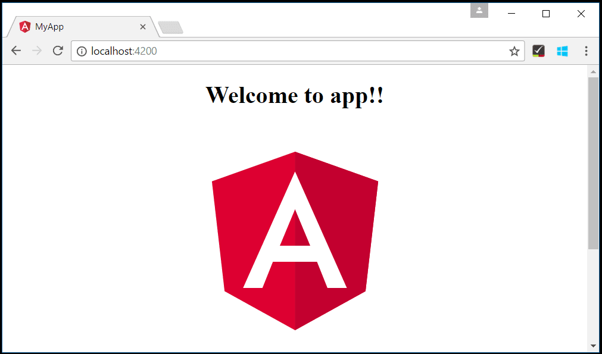

> **注意**：为帮助开始 Angular 开发，可以使用 [Angular 配置文件模板](../../../editor/3.3-ConfigureTheEditor/3.3.8-Profiles/)，其中包含有用扩展、设置和代码片段。

## Angular 入门 {#welcome-to-angular}

　　本教程使用 [Angular CLI](https://cli.angular.io/)。安装和使用命令行界面以及运行 Angular 应用服务器需要 [Node.js](https://nodejs.org/)运行时和 [npm](https://www.npmjs.com/)（Node.js 包管理器）。npm 随 Node.js 提供，可以从 [Node.js 下载](https://nodejs.org/en/download/)安装。

> **提示**：要测试 Node.js 和 npm 是否正确安装，可以输入 `node --version` 和 `npm --version`。

在终端或命令提示符安装 Angular CLI：

```bash
npm install -g @angular/cli
```

安装可能需要几分钟。创建新的 Angular 应用：

```bash
ng new my-app
```

`my-app` 是应用文件夹名称。`ng new` 会提示生成选项，按 `Enter` 接受默认值。这会用 [TypeScript](../../language-support/10.2.6-TypeScript/) 创建 Angular 应用并安装依赖，可能需要几分钟。

进入新文件夹并输入 `ng serve` 启动 Web 服务器并在浏览器打开应用：

```bash
cd my-app
ng serve
```

浏览器 [http://localhost:4200](http://localhost:4200) 应显示“Welcome to app!!”。保持 Web 服务器运行，继续用 VS Code 查看应用。

打开另一个终端，进入 `my-app` 并输入 `code .`：

```bash
cd my-app
code .
```

### 语法高亮和括号匹配 {#syntax-highlighting-and-bracket-matching}

展开 `src\app` 文件夹并选择 `app.component.ts`。VS Code 会为各种源代码元素提供语法高亮，光标放在括号上时会选中匹配括号。

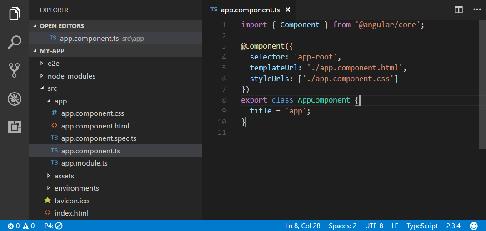

### IntelliSense {#intellisense}

　　将鼠标悬停在文本上时，VS Code 会显示变量、类和 Angular 装饰器等关键项的信息。

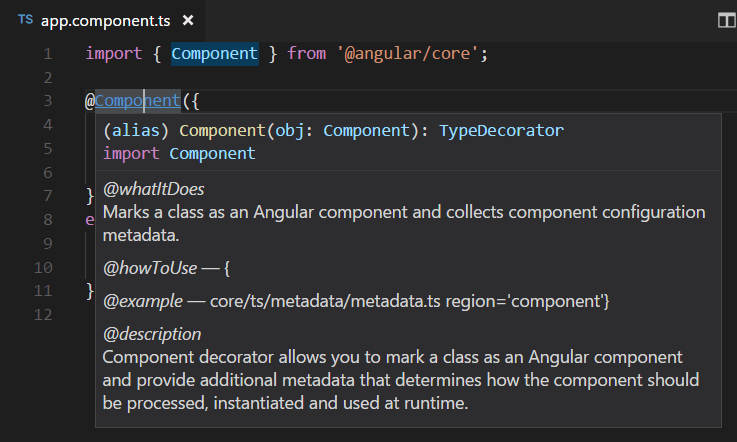

在 `app.component.ts` 中输入时会看到智能建议和代码片段。

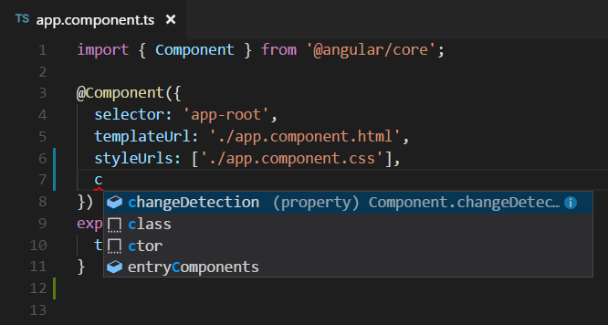

单击信息按钮（`i`）可以查看包含更多文档的浮出控件。

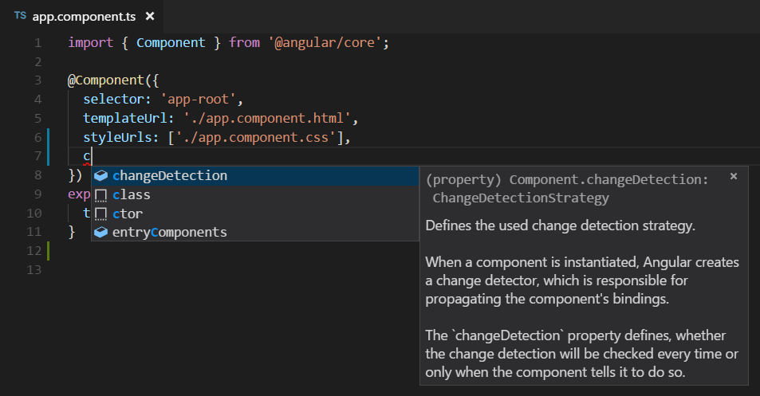

　　VS Code 使用 TypeScript 语言服务提供代码智能（[IntelliSense](../../../editor/3.2-WriteCode/3.2.2-IntelliSense/)），并支持[自动类型获取](10.3.1-WorkingWithJavaScript/#typings-and-automatic-type-acquisition)（ATA）。ATA 会下载 `package.json` 中 npm 模块的 Type Declaration 文件（`*.d.ts`）。

### 转到定义、速览定义 {#go-to-definition-peek-definition}

　　通过 TypeScript 语言服务，VS Code 还可以使用 **转到定义**（`F12`）或 **速览定义**（`Alt + F12`）提供类型定义信息。打开 `app.module.ts`，将光标放在 `bootstrap` 属性声明的 `AppComponent` 上，右键选择 **速览定义**。会打开[速览窗口](../../../editor/3.2-WriteCode/3.2.5-CodeNavigation/#peek)，显示 `app.component.ts` 中的 `AppComponent` 定义。

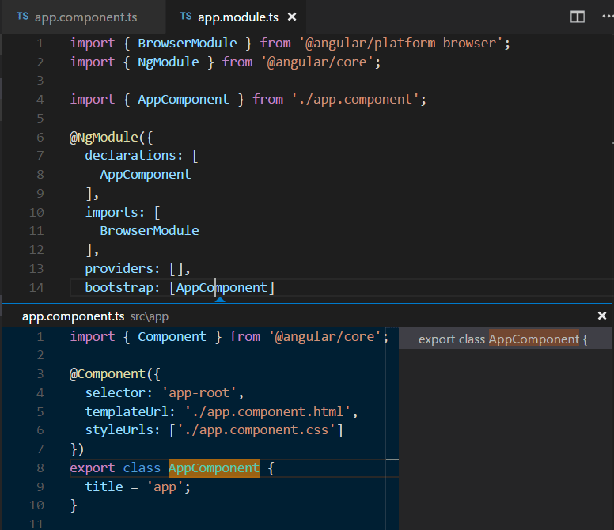

按 `Escape` 关闭速览窗口。

## Hello World {#hello-world}

将示例应用更新为“Hello World”。返回 `app.component.ts`，将 `AppComponent` 中的 `title` 字符串改为 `Hello World`。

```ts
import { Component } from '@angular/core';

@Component({
  selector: 'app-root',
  templateUrl: './app.component.html',
  styleUrls: ['./app.component.css']
})
export class AppComponent {
  title = 'Hello World';
}
```

保存后，运行中的服务器会更新网页，显示“Welcome to Hello World!!”。

> **提示**：VS Code 支持自动保存，默认延迟后保存文件。可以在 **文件** 菜单勾选 **自动保存**，或配置 `files.autoSave` 用户[设置](../../../editor/3.3-ConfigureTheEditor/3.3.4-Settings/)。

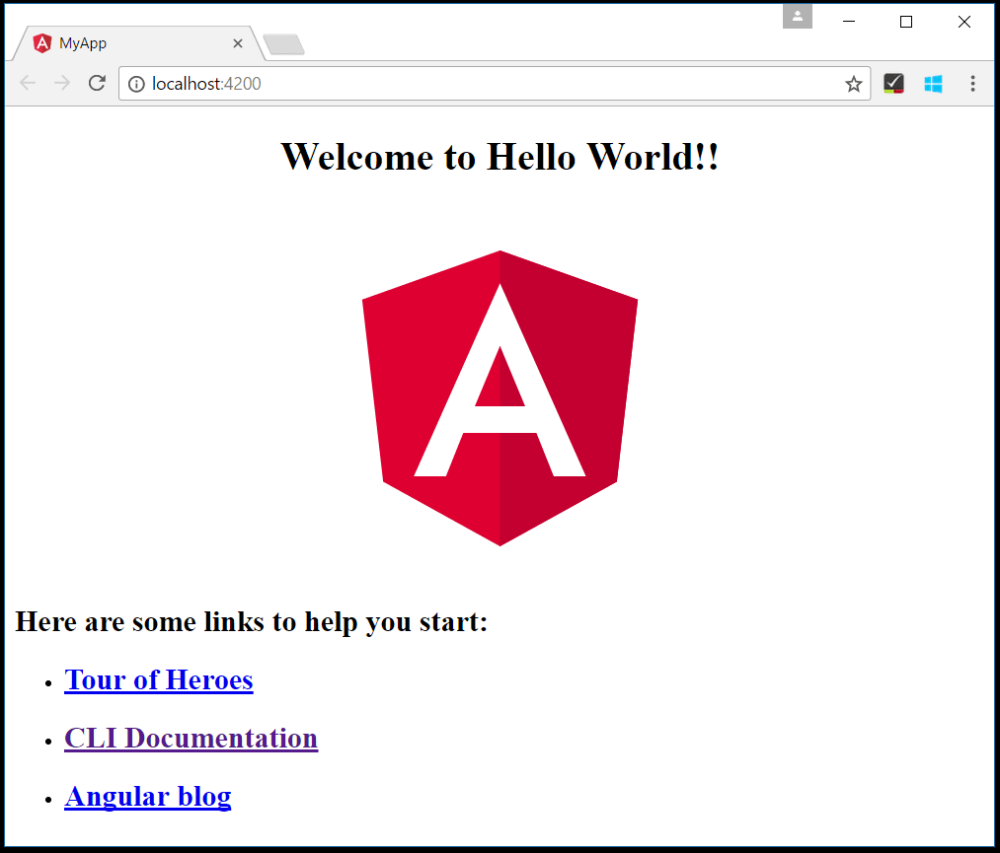

## 调试 Angular {#debugging-angular}

使用内置 JavaScript 调试器调试客户端 Angular 代码。

> **注意**：本教程假设已安装 Edge。想用 Chrome 调试，请将启动 `type` 替换为 `chrome`。也有 [Firefox](https://marketplace.visualstudio.com/items?itemName=hbenl.vscode-firefox-debug) 调试器。

### 设置断点 {#set-a-breakpoint}

在 `app.component.ts` 中单击行号左侧装订线设置断点，显示红圈。

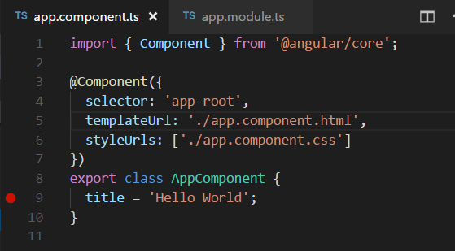

### 配置调试器 {#configure-the-debugger}

需要先配置[调试器](../../../debugging-and-testing/6.1-Debugging/)。转到 **运行和调试** 视图（`Ctrl + Shift + D`），选择 **创建 launch.json 文件** 链接。在 **选择调试器** 下拉列表选择 **Web App (Edge)**。这会在项目 `.vscode` 文件夹创建 `launch.json`，包含启动网站的配置。

本示例需要将 `url` 端口从 `8080` 改为 `4200`：

```json
{
    "version": "0.2.0",
    "configurations": [
        {
            "type": "msedge",
            "request": "launch",
            "name": "Launch Edge against localhost",
            "url": "http://localhost:4200",
            "webRoot": "${workspaceFolder}"
        }
    ]
}
```

按 `F5` 或绿色箭头启动调试器并打开新浏览器实例。设置断点的源代码在调试器附加前已启动运行，因此刷新网页后才会命中断点。

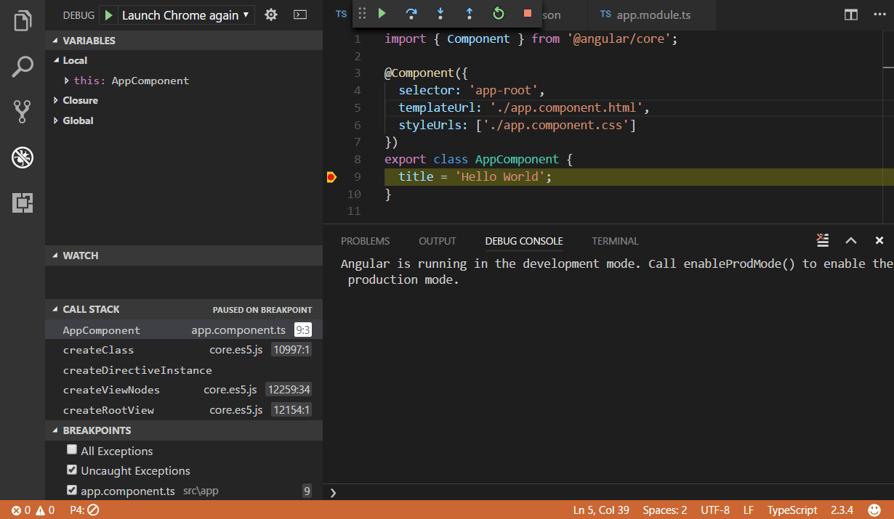

可以单步执行代码（`F10`）、检查 `AppComponent` 等变量并查看客户端 Angular 应用调用堆栈。

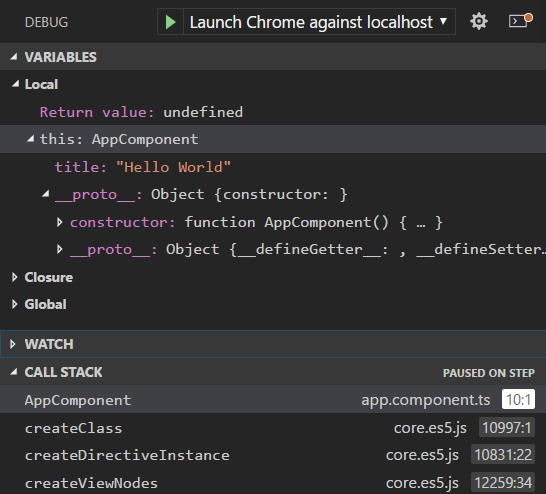

调试器及可用选项详情请参阅[浏览器调试](10.3.5-BrowserDebugging/)。

## Angular 配置文件模板 {#angular-profile-template}

　　[配置文件](../../../editor/3.3-ConfigureTheEditor/3.3.8-Profiles/)可以根据当前项目或任务快速切换扩展、设置和 UI 布局。为帮助开始 Angular 开发，可以使用 [Angular 配置文件模板](../../../editor/3.3-ConfigureTheEditor/3.3.8-Profiles/)，其中包含有用扩展和设置。可以按原样使用，或作为进一步自定义的起点。

通过 **配置文件** > **创建配置文件...** 下拉列表选择模板：

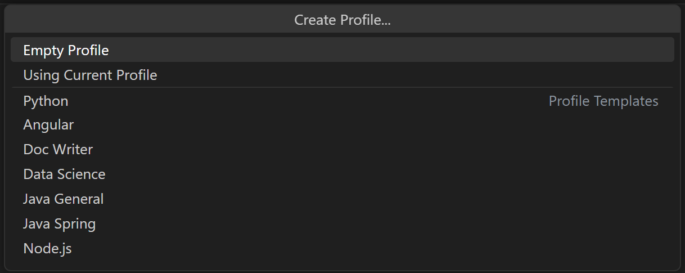

选择模板后，可以审查设置和扩展，并移除不想包含的项。基于模板创建新配置文件后，对设置、扩展或 UI 的更改会保存在配置文件中。

## 热门入门套件 {#popular-starter-kits}

本教程使用 Angular CLI 创建简单 Angular 应用。有许多优秀示例和入门套件可帮助构建第一个 Angular 应用。

### 配方 {#recipes}

　　VS Code 团队为更复杂调试场景创建了[配方](https://github.com/microsoft/vscode-recipes)。其中有[使用 Angular CLI 调试](https://github.com/microsoft/vscode-recipes/tree/main/Angular-CLI)配方，也使用 Angular CLI，并详细介绍调试生成项目的单元测试。

### MEAN Starter {#mean-starter}

　　想查看完整 MEAN（MongoDB、Express、Angular、Node.js）栈示例，请参阅 [MEAN.JS](https://meanjs.org)。其中有文档和示例 MEAN 项目生成器。需要安装并启动 [MongoDB](https://docs.mongodb.com/v3.0/installation/)，但很快就能运行 MEAN 应用。VS Code 还通过 [Azure Databases](https://marketplace.visualstudio.com/items?itemName=ms-azuretools.vscode-cosmosdb) 扩展提供出色的 [MongoDB 支持](https://code.visualstudio.com/docs/azure/mongodb)。

### React {#react}

　　[React](https://reactjs.org)是构建用户界面的库，比 Angular 更精简。想查看 React 与 VS Code 配合示例，请参阅[在 VS Code 中使用 React](10.3.7-ReactTutorial/)教程，了解如何创建 React 应用并为 JavaScript 调试器配置 `launch.json`。

## Angular 扩展 {#angular-extensions}

　　除了 VS Code 内置功能，还可以安装扩展获得更多功能。

在 [Marketplace](https://marketplace.visualstudio.com) 单击扩展卡片阅读说明和评论。

要查找其他 Angular 扩展，请打开扩展视图（`Ctrl + Shift + X`）并输入“angular”筛选 Angular 扩展列表。

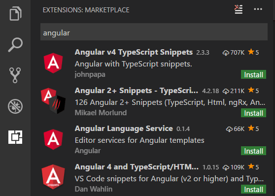

社区还创建了“扩展包”，将有用扩展（例如 linter、调试器和代码片段）打包为一次下载。要查看可用 Angular 扩展包，请在筛选器中添加“extension packs”类别（`angular @category:"extension packs"`）。
