+++
title = "10.3.7 React 教程"
date = 2026-11-06T07:53:25+08:00
weight = 7
type = "docs"
description = ""
isCJKLanguage = true
draft = false
+++


> 原文链接: [https://code.visualstudio.com/docs/nodejs/reactjs-tutorial](https://code.visualstudio.com/docs/nodejs/reactjs-tutorial)

# 10.3.7 React 教程

　　[React](https://reactjs.org)是 Facebook 开发的流行 JavaScript 用户界面库。VS Code 开箱即用支持 React.js IntelliSense 和代码导航。

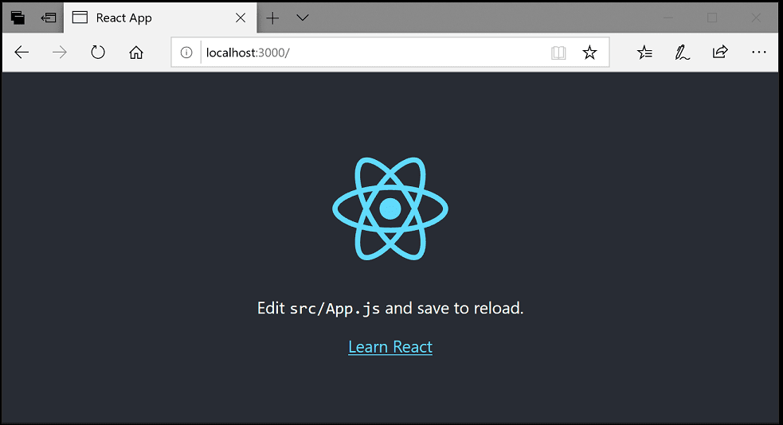

## React 入门 {#welcome-to-react}

> **重要**：`create-react-app` [已不再积极维护](https://react.dev/blog/2025/02/14/sunsetting-create-react-app)。React 团队现在推荐使用 [Vite](https://vite.dev)（`npm create vite@latest my-app -- --template react`）或 [Next.js](https://nextjs.org) 等框架。本教程步骤仍适用于任何 React 项目设置。

　　本教程使用 `create-react-app` [生成器](https://reactjs.org/docs/create-a-new-react-app.html#create-react-app)。使用生成器和运行 React 应用服务器需要 [Node.js](https://nodejs.org/)运行时和 [npm](https://www.npmjs.com/)（Node.js 包管理器）。npm 随 Node.js 提供，可以从 [Node.js 下载](https://nodejs.org/en/download/)安装。

> **提示**：要测试 Node.js 和 npm 是否正确安装，可以在终端输入 `node --version` 和 `npm --version`。

创建新的 React 应用：

```bash
npx create-react-app my-app
```

`my-app` 是应用文件夹名称。创建应用并安装依赖可能需要几分钟。

> **注意**：之前通过 `npm install -g create-react-app` 全局安装过时，建议运行 `npm uninstall -g create-react-app` 卸载，确保 npx 始终使用最新版本。

进入新文件夹并输入 `npm start` 启动 Web 服务器并在浏览器打开应用：

```bash
cd my-app
npm start
```

浏览器 [http://localhost:3000](http://localhost:3000) 应显示 React 标志和“Learn React”链接。保持 Web 服务器运行，继续用 VS Code 查看应用。

打开另一个终端，进入 `my-app` 并输入 `code .`：

```bash
cd my-app
code .
```

### Markdown 预览 {#markdown-preview}

　　文件资源管理器中有应用 `README.md` 文件，包含应用和 React 的大量信息。可以使用 VS Code [Markdown 预览](../../language-support/10.2.7-Markdown/#markdown-preview)查看。可以在当前编辑器组（**Markdown: Open Preview**，`Ctrl + Shift + V`（macOS：`Cmd + Shift + V`））或侧边新编辑器组（**Markdown: Open Preview to the Side**，`Ctrl + K V`（macOS：`Cmd + K V`））打开预览。会获得良好格式、标题超链接导航和代码块语法高亮。

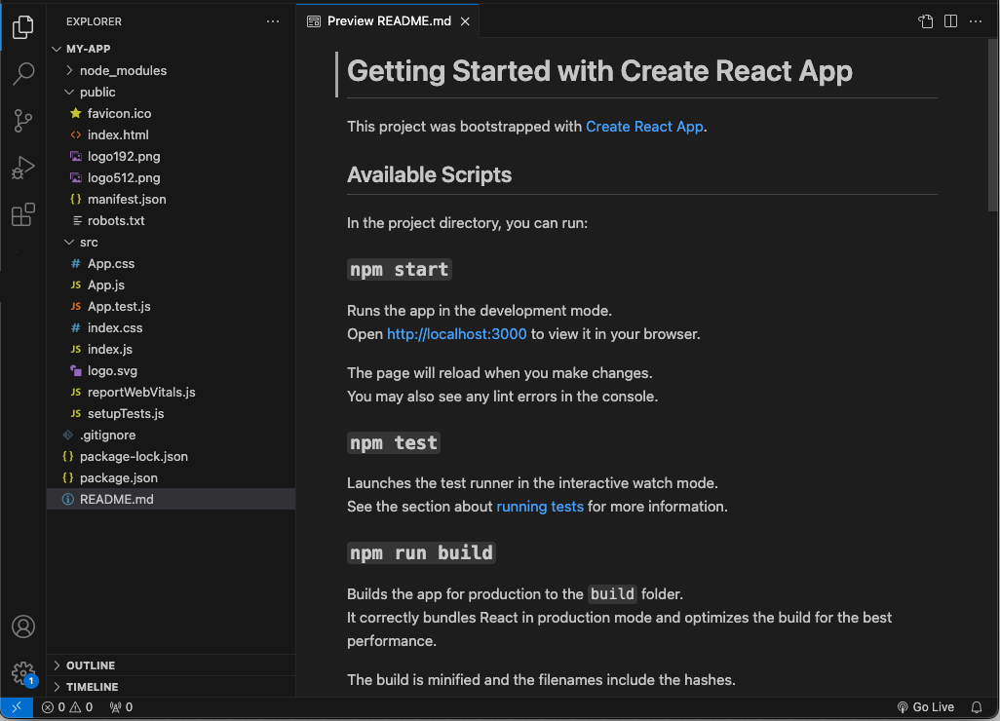

### 语法高亮和括号匹配 {#syntax-highlighting-and-bracket-matching}

展开 `src` 文件夹并选择 `index.js`。VS Code 会为各种源代码元素提供语法高亮，光标放在括号上时会选中匹配括号。

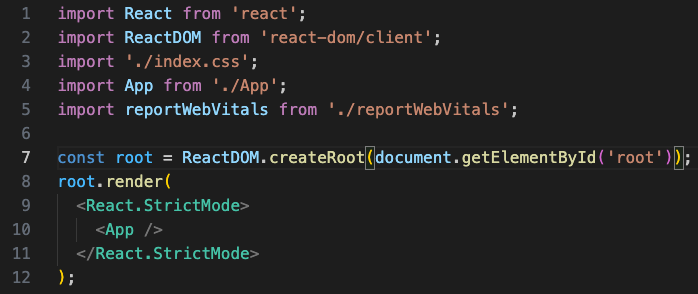

### IntelliSense {#intellisense}

在 `index.js` 中输入时会看到智能建议或补全。

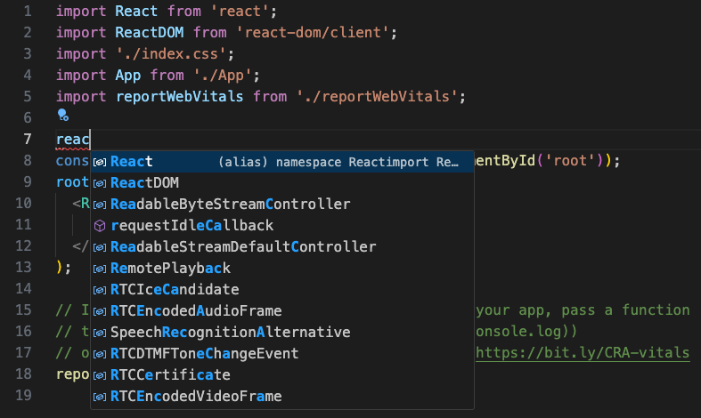

选择建议并输入 `.` 后，可以通过 [IntelliSense](../../../editor/3.2-WriteCode/3.2.2-IntelliSense/)查看对象类型和方法。

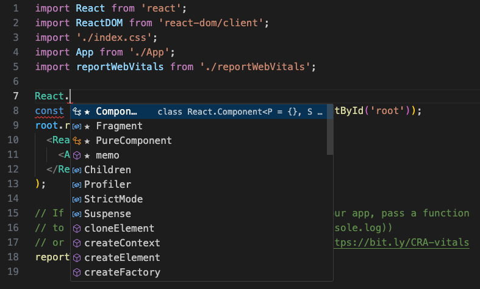

　　VS Code 使用 TypeScript 语言服务提供 JavaScript 代码智能，并支持[自动类型获取](10.3.1-WorkingWithJavaScript/#typings-and-automatic-type-acquisition)（ATA）。ATA 会下载 `package.json` 中 npm 模块的 Type Declaration 文件（`*.d.ts`）。

选择方法时还会获得参数帮助：

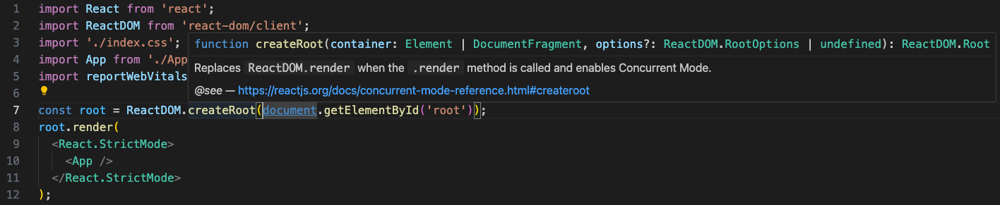

### 转到定义、速览定义 {#go-to-definition-peek-definition}

　　通过 TypeScript 语言服务，VS Code 可以使用 **转到定义**（`F12`）或 **速览定义**（`Alt + F12`，macOS：`Option + F12`）提供类型定义信息。将光标放在 `App` 上，右键选择 **速览定义**。会打开[速览窗口](../../../editor/3.2-WriteCode/3.2.5-CodeNavigation/#peek)，显示 `App.js` 中的 `App` 定义。

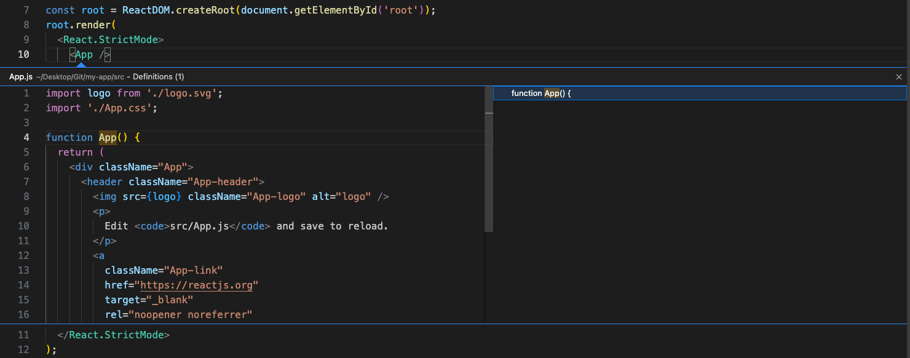

按 `Escape` 关闭速览窗口。

## Hello World {#hello-world}

将示例应用更新为“Hello World!”。在 `index.js` 中创建名为 `HelloWorld` 的组件，包含“Hello, world!”的 H1 标题，并将 `root.render` 中的 `<App />` 替换为 `<HelloWorld />`。

```js
import React from 'react';
import ReactDOM from 'react-dom/client';
import './index.css';
import App from './App';
import reportWebVitals from './reportWebVitals';

function HelloWorld() {
  return <h1 className="greeting">Hello, world!</h1>
}

const root = ReactDOM.createRoot(document.getElementById('root'));
root.render(
  <React.StrictMode>
    <HelloWorld />
  </React.StrictMode>
);

// 要开始测量应用性能，可以传入函数记录结果
// 例如 reportWebVitals(console.log)
// 或发送到分析终结点。了解更多：https://bit.ly/CRA-vitals
reportWebVitals();
```

保存 `index.js` 后，运行中的服务器会更新网页，刷新浏览器即可看到“Hello World!”。

> **提示**：VS Code 支持自动保存，默认延迟后保存文件。可以在 **文件** 菜单勾选 **自动保存**，或配置 `files.autoSave` 用户[设置](../../../editor/3.3-ConfigureTheEditor/3.3.4-Settings/)。

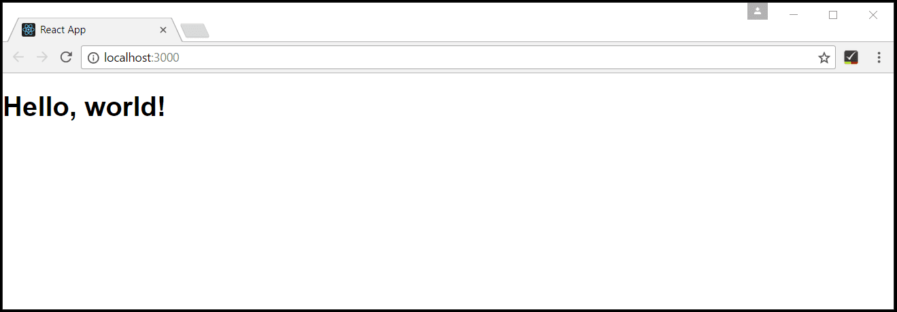

## 调试 React {#debugging-react}

使用内置 JavaScript 调试器调试客户端 React 代码。

> **注意**：本教程假设已安装 Edge。想用 Chrome 调试，请将启动 `type` 替换为 `chrome`。也有 [Firefox](https://marketplace.visualstudio.com/items?itemName=hbenl.vscode-firefox-debug) 调试器。

### 设置断点 {#set-a-breakpoint}

在 `index.js` 中单击行号左侧装订线设置断点，显示红圈。

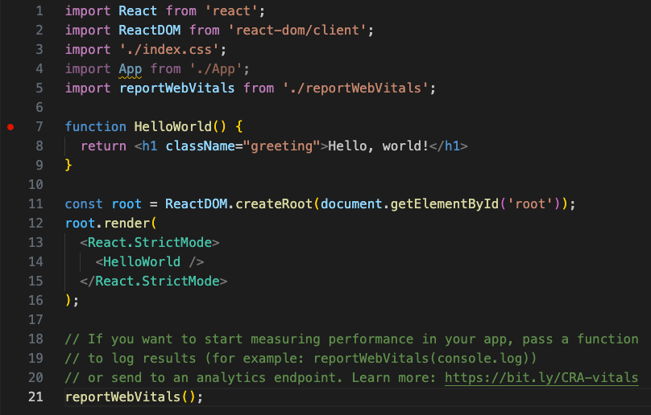

### 配置调试器 {#configure-the-debugger}

转到 **运行和调试** 视图（`Ctrl + Shift + D`，macOS：`Cmd + Shift + D`），选择 **创建 launch.json 文件** 链接。在 **选择调试器** 下拉列表选择 **Web App (Edge)**。这会在项目 `.vscode` 文件夹创建 `launch.json`。

本示例需要将 `url` 端口从 `8080` 改为 `3000`：

```json
{
    "version": "0.2.0",
    "configurations": [
        {
            "type": "msedge",
            "request": "launch",
            "name": "Launch Edge against localhost",
            "url": "http://localhost:3000",
            "webRoot": "${workspaceFolder}"
        }
    ]
}
```

确保开发服务器正在运行（`npm start`）。按 `F5` 或绿色箭头启动调试器并打开新浏览器实例。设置断点的代码在调试器附加前已启动，因此刷新网页后才会命中断点。

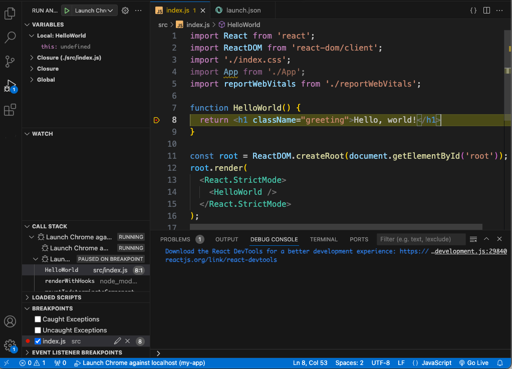

可以单步执行代码（`F10`）、检查 `HelloWorld` 等变量并查看客户端 React 应用调用堆栈。

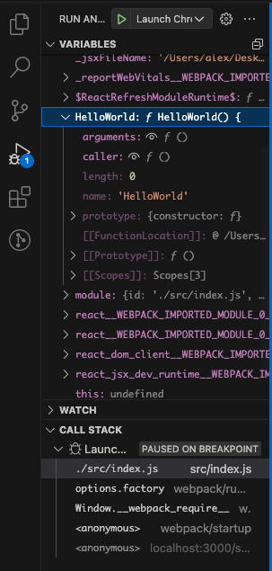

调试器详情请参阅[浏览器调试](10.3.5-BrowserDebugging/)。

### 实时编辑和调试 {#live-editing-and-debugging}

　　使用 [webpack](https://webpack.js.org/) 和 React 应用时，可以利用 webpack HMR 机制实现实时编辑和调试。详情请参阅[直接从 VS Code 实时编辑和调试 React 应用](https://medium.com/@auchenberg/live-edit-and-debug-your-react-apps-directly-from-vs-code-without-leaving-the-editor-3da489ed905f)博客和 [webpack 热模块替换文档](https://webpack.js.org/concepts/hot-module-replacement/)。

## Lint {#linting}

　　Linter 分析源代码并在运行应用前警告潜在问题。VS Code 自带 JavaScript 语言服务默认支持语法错误检查，可以在 **问题** 面板（**视图** > **问题**，`Ctrl + Shift + M`（macOS：`Cmd + Shift + M`））查看。

在 React 源代码中制造小错误，会看到红色波浪线和问题面板中的错误。

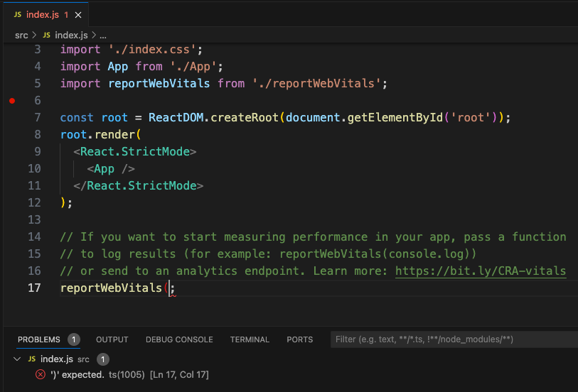

　　Linter 可以提供更复杂的分析，执行编码约定并检测反模式。流行 JavaScript linter 是 [ESLint](https://eslint.org/)。ESLint 配合 VS Code [ESLint 扩展](https://marketplace.visualstudio.com/items?itemName=dbaeumer.vscode-eslint)提供出色的产品内 lint 体验。

安装 ESLint 命令行工具：

```bash
npm install -g eslint
```

然后在扩展视图输入“eslint”安装 ESLint 扩展。

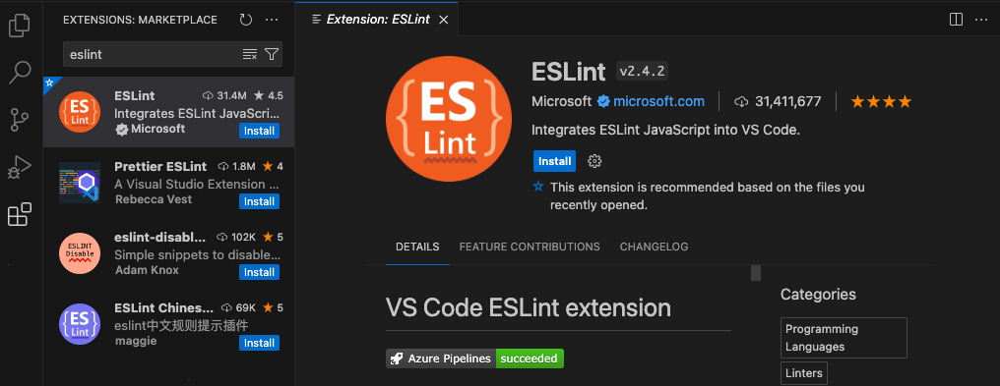

安装扩展并重新加载 VS Code 后，创建 ESLint 配置文件 `.eslintrc.js`。可以使用命令面板（`Ctrl + Shift + P`，macOS：`Cmd + Shift + P`）中的 **ESLint: Create ESLint configuration** 命令创建。

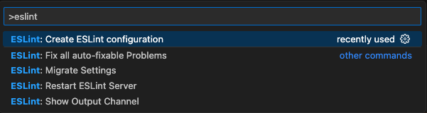

命令会在 **终端** 面板提示回答一系列问题。接受默认值后，会在项目根目录创建类似以下的 `.eslintrc.js`：

```js
module.exports = {
    "env": {
        "browser": true,
        "es2020": true
    },
    "extends": [
        "eslint:recommended",
        "plugin:react/recommended"
    ],
    "parserOptions": {
        "ecmaFeatures": {
            "jsx": true
        },
        "ecmaVersion": 11,
        "sourceType": "module"
    },
    "plugins": [
        "react"
    ],
    "rules": {
    }
};
```

　　ESLint 随后会分析打开的文件，并在 `index.js` 中警告“App”已定义但从未使用。

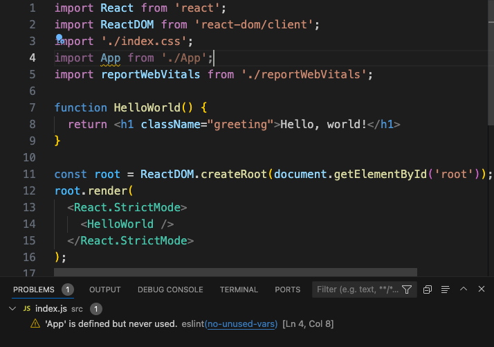

可以在 `.eslintrc.js` 中修改 ESLint [规则](https://eslint.org/docs/rules/)。

添加额外分号错误规则：

```js
 "rules": {
        "no-extra-semi":"error"
    }
```

现在一行中误写多个分号时，编辑器中会显示错误（红色波浪线），问题面板中会出现错误条目。

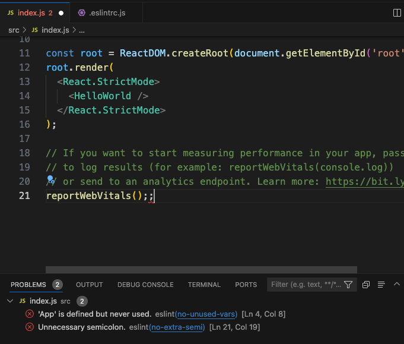

## 热门入门套件 {#popular-starter-kits}

本教程使用 `create-react-app` 生成器创建简单 React 应用。有许多优秀示例和入门套件可帮助构建第一个 React 应用。

### VS Code React 示例 {#vs-code-react-sample}

这是一个 [React 示例应用](https://github.com/microsoft/vscode-react-sample)，创建简单 TODO 应用，并包含 Node.js [Express](https://expressjs.com/)服务器源代码。还展示如何使用 [Babel](https://babeljs.io) ES6 转译器，然后用 [webpack](https://webpack.js.org/) 打包站点资源。

### TypeScript React {#typescript-react}

　　想同时使用 TypeScript 和 React，可以指定 TypeScript 模板创建 `create-react-app` 应用：

```bash
npx create-react-app my-app --template typescript
```

详情请参阅 [Create React App 站点](https://create-react-app.dev)的[添加 TypeScript](https://create-react-app.dev/docs/adding-typescript)。

### Angular {#angular}

　　[Angular](https://angular.io/)是另一个流行 Web 框架。想查看 Angular 与 VS Code 配合示例，请参阅[使用 Angular CLI 调试](https://github.com/microsoft/vscode-recipes/tree/main/Angular-CLI)配方，了解如何创建 Angular 应用并为 JavaScript 调试器配置 `launch.json`。

## 常见问题 {#common-questions}

### 可以在声明式 JSX 中获得 IntelliSense 吗？ {#can-i-get-intellisense-within-declarative-jsx}

　　可以。例如打开 `create-react-app` 项目的 `App.js`，可以在 `render()` 方法的 React JSX 中获得 IntelliSense。

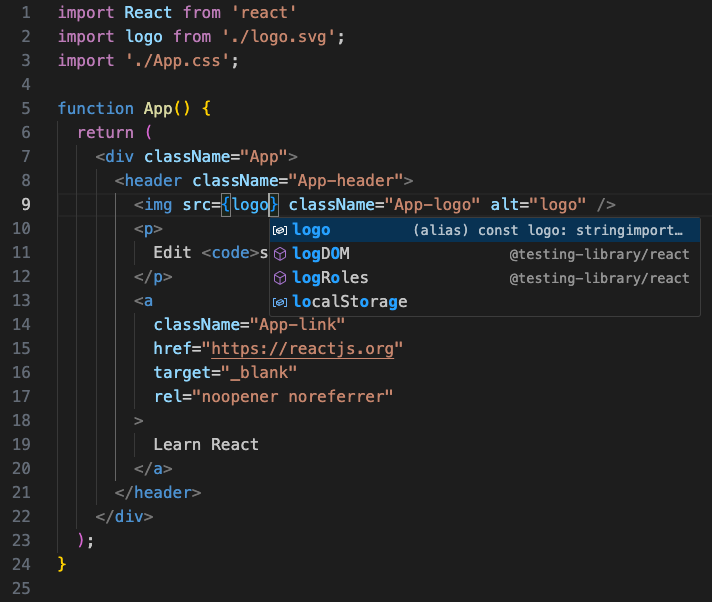
