+++
title = "10.3.8 Vue 教程"
date = 2026-11-06T07:53:25+08:00
weight = 8
type = "docs"
description = ""
isCJKLanguage = true
draft = false
+++


> 原文链接: [https://code.visualstudio.com/docs/nodejs/vuejs-tutorial](https://code.visualstudio.com/docs/nodejs/vuejs-tutorial)

# 10.3.8 Vue 教程

　　[Vue.js](https://vuejs.org/)是构建 Web 应用和用户界面的流行 JavaScript 库。VS Code 内置支持 Vue.js 的 [HTML](../../language-support/10.2.3-HTML/)、[CSS](../../language-support/10.2.5-CSS/)和 [JavaScript](../../language-support/10.2.1-JavaScript/)构建块。需要更丰富的 Vue.js 开发环境时，可以安装 [Vue - Official（原 Volar）](https://marketplace.visualstudio.com/items?itemName=Vue.volar)扩展，获得 IntelliSense、[TypeScript](../../language-support/10.2.6-TypeScript/)、格式化等支持。

> **注意**：[Vue 2 支持已于 2023 年 12 月 31 日结束](https://v2.vuejs.org/lts/)，因此[不建议](https://github.com/vuejs/vetur/discussions/3378)使用 [Vetur](https://marketplace.visualstudio.com/items?itemName=octref.vetur) 扩展。使用 Vue - Official 扩展前需要[禁用 Vetur](https://vuejs.org/guide/typescript/overview.html#ide-support)。

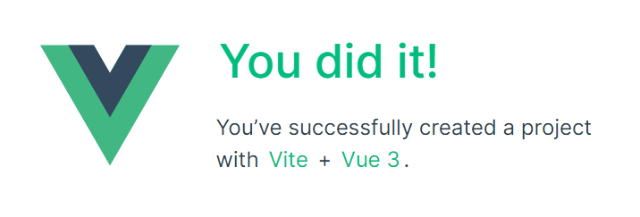

## Vue 入门 {#welcome-to-vue}

　　本教程使用 [Vite](https://vitejs.dev/) 工具。刚接触 Vue.js 框架时，可以在 [vuejs.org](https://vuejs.org) 找到优秀文档和教程。

安装和使用 Vite 与 Vue.js 需要 [Node.js](https://nodejs.org/)运行时和 [npm](https://www.npmjs.com/)（Node.js 包管理器）。npm 随 Node.js 提供，可以从 [Node.js 下载](https://nodejs.org/en/download/)安装。

> **提示**：要测试 Node.js 和 npm 是否正确安装，可以输入 `node --version` 和 `npm --version`。

进入要创建项目的父目录，在终端输入：

```bash
npm create vue@latest
```

系统会提示安装 `create-vue`。

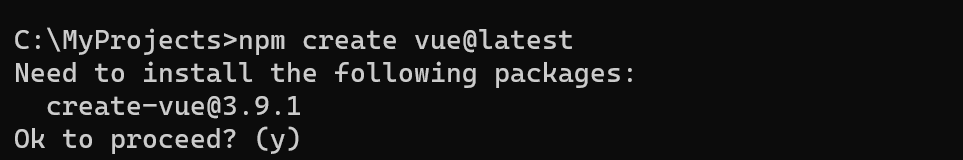

安装和执行 [create-vue](https://github.com/vuejs/create-vue)可能需要几分钟。按照提示选择可选功能，不确定时可以选择“No”。

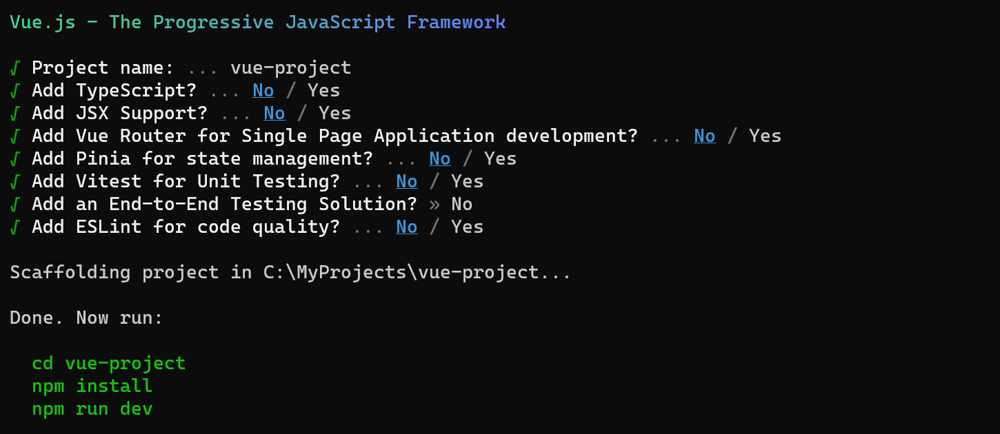

创建项目后，进入项目并安装依赖：

```bash
cd <your-project-name>
npm install
```

运行 Vue 应用，启动 Web 服务器并在浏览器打开：

```bash
npm run dev
```

浏览器 [http://localhost:5173](http://localhost:5173) 应显示“Welcome to your Vue.js App”。

在终端进入 `vue-project` 文件夹并输入 `code .`：

```bash
cd vue-project
code .
```

　　VS Code 会启动并在文件资源管理器中显示 Vue 应用。

## Vue - Official 扩展 {#vue---official-extension}

展开 `src` 文件夹并选择 `App.vue`。此时 VS Code 不会显示语法高亮，而是将文件视为 **纯文本**（状态栏右下角可见），并推荐为 `.vue` 文件安装 [Vue - Official](https://marketplace.visualstudio.com/items?itemName=Vue.volar) 扩展。

Vue 扩展为 VS Code 提供 Vue.js 语言功能（语法高亮、IntelliSense 和格式化）。

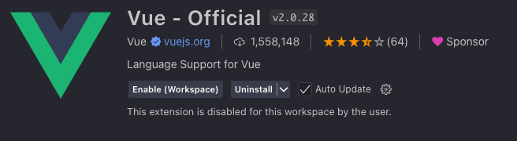

在通知中单击 **安装** 下载并安装 Vue 扩展。扩展视图会显示 **正在安装**。安装完成后（可能需要几分钟），**安装** 按钮变为 **管理** 齿轮按钮。

现在 `.vue` 会被识别为 Vue.js 文件类型，并获得语法高亮、括号匹配和悬停说明等语言功能。

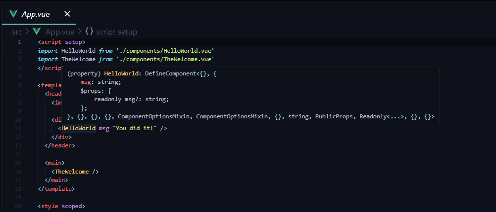

## IntelliSense {#intellisense}

在 `App.vue` 中输入时，会看到 HTML 和 CSS 的智能建议，以及 Vue `template` 部分的声明（`v-bind`、`v-for`）等 Vue.js 特定项：

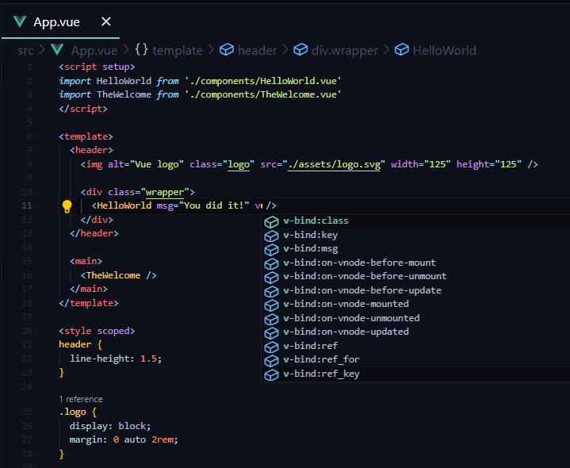

以及 `scripts` 部分的 `computed` 等 Vue 属性：

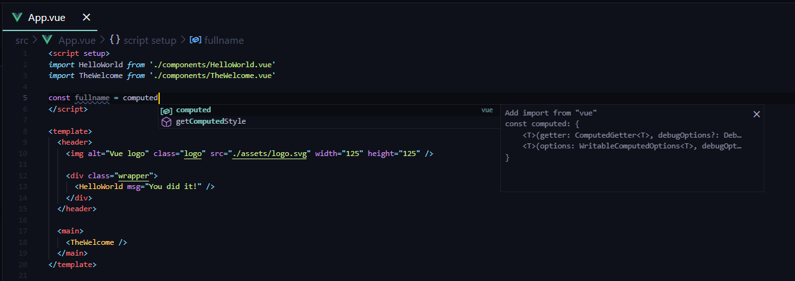

### 转到定义、速览定义 {#go-to-definition-peek-definition}

　　Vue - Official 扩展通过类型定义等语言服务功能增强 Vue.js 开发体验。可以使用：

* **转到定义**（`F12`）：直接导航到代码中的类型定义。
* **速览定义**（`Alt + F12`）：不离开当前上下文就地查看类型定义。

使用速览定义：

1. 将光标放在 `App` 上。
2. 右键单击，在上下文菜单悬停 **速览**，选择 **速览定义**。
3. 会打开[速览窗口](../../../editor/3.2-WriteCode/3.2.5-CodeNavigation/#peek)，显示 `App.js` 中的 `App` 定义。

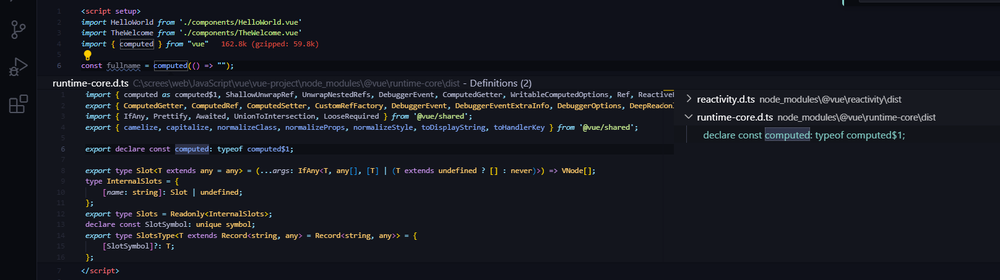

按 `Escape` 关闭速览窗口。

## Hello World {#hello-world}

将示例应用渲染为“Hello World!”。在 `App.vue` 中将 HelloWorld 组件的 `msg` 自定义属性文本替换为“Hello World!”。

```html
<template>
  <header>
    

    <div class="wrapper">
      <HelloWorld msg="Hello World!" />
    </div>
  </header>

  <main>
    <TheWelcome />
  </main>
</template>
```

保存 `App.vue`（`Ctrl + S`）后，Vite 的[热模块替换（HMR）](https://vite.dev/guide/features.html#hot-module-replacement)会立即在浏览器反映更新，显示“Hello World!”。保持服务器运行，继续学习 Vue.js 客户端调试。

> **提示**：VS Code 支持自动保存，默认延迟后保存文件。可以在 **文件** 菜单勾选 **自动保存**，或配置 `files.autoSave` 用户[设置](../../../editor/3.3-ConfigureTheEditor/3.3.4-Settings/)。

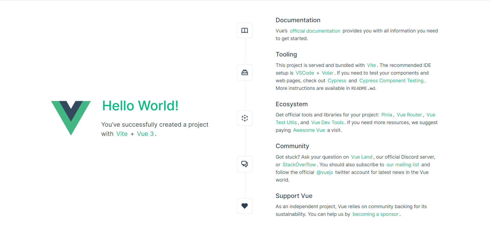

## Lint {#linting}

　　Linter 分析源代码并在运行应用前警告潜在问题。Vue ESLint 插件（[eslint-plugin-vue](https://eslint.vuejs.org/)）检查 Vue.js 特定语法错误，在编辑器中显示红色波浪线，并在 **问题** 面板（**视图** > **问题**，`Ctrl + Shift + M`）显示。

下面展示 Vue linter 检测到模板中多个根元素时的错误：

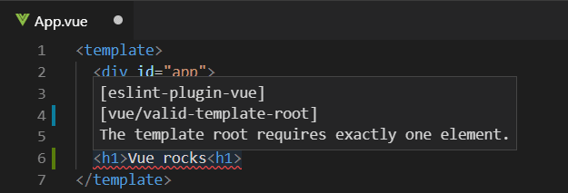

## 调试 {#debugging}

　　可以使用内置 JavaScript 调试器调试客户端 Vue.js 代码。使用 Microsoft Edge 调试 Vite/Vue.js 3 项目请参阅[此讨论](https://github.com/vitejs/vite/discussions/4065#discussioncomment-1359932)。

Vue CLI 已[进入维护模式](https://vuejs.org/guide/scaling-up/tooling#vue-cli)。详情请参阅 VS Code 调试[配方](https://github.com/microsoft/vscode-recipes)站点中的 [Vue.js 调试](https://github.com/microsoft/vscode-recipes/tree/main/vuejs-cli)配方。

另一个流行 Vue.js 调试工具是 [vue-devtools](https://devtools.vuejs.org/) 插件，可用于任何环境。

## 其他扩展 {#other-extensions}

* 在扩展视图（`Ctrl + Shift + X`）输入 *vue* 查找其他 Vue 扩展。

  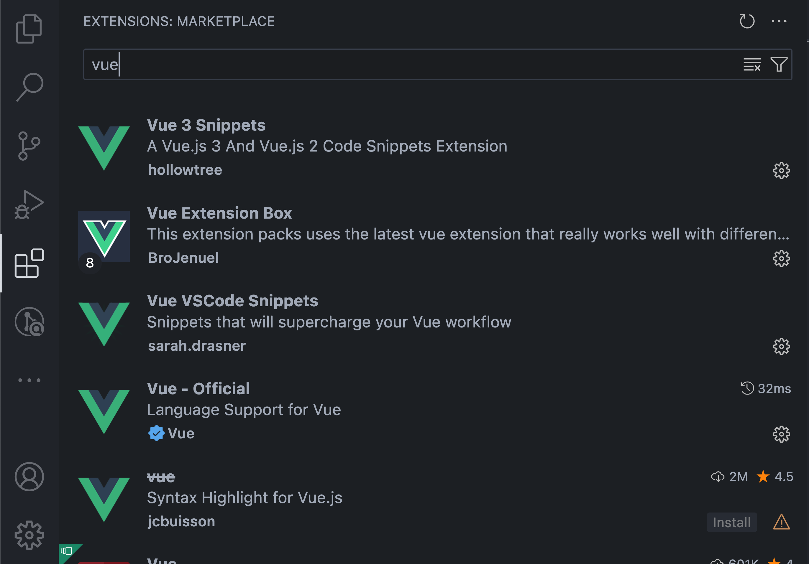

* [Vue VS Code Snippets](https://marketplace.visualstudio.com/items?itemName=sdras.vue-vscode-snippets)等扩展对 Vue 代码片段很有用。

  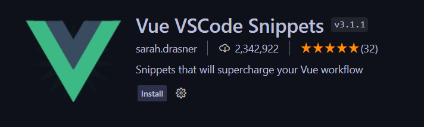

* 还有扩展包，将其他人认为对 Vue.js 开发有用的扩展捆绑在一起。

  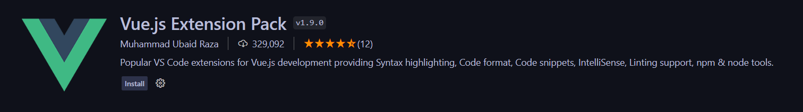
