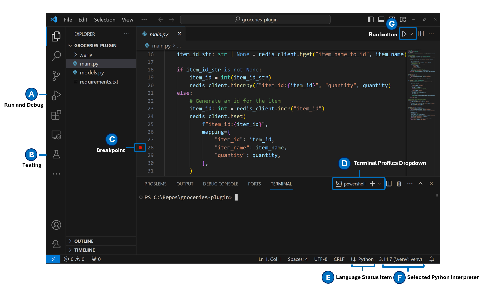
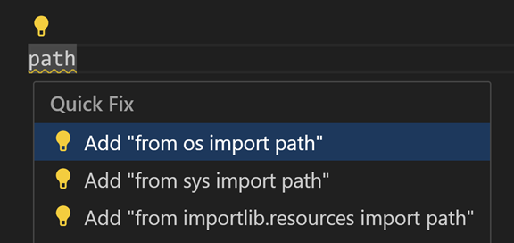
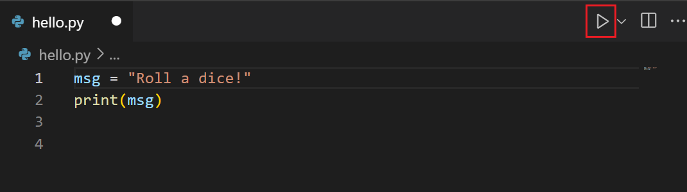
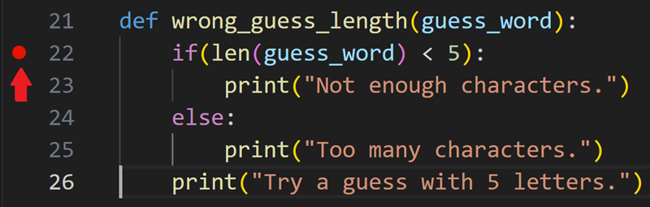

+++
title = "10.5.1 Python 快速开始"
date = 2026-11-06T07:53:25+08:00
weight = 1
type = "docs"
description = ""
isCJKLanguage = true
draft = false
+++

> 原文链接: [https://code.visualstudio.com/docs/python/python-quick-start](https://code.visualstudio.com/docs/python/python-quick-start)

# 10.5.1 Python 快速开始

　　Python 扩展使 VS Code 成为出色的 Python 编辑器，可在任何操作系统上使用，并支持多种 Python 解释器。

请先安装：

* [VS Code](https://code.visualstudio.com/)
* [Python 解释器](10.5.2-Tutorial/#install-a-python-interpreter)（任何[积极支持的 Python 版本](https://devguide.python.org/versions/)）
* Marketplace 中的 [Python 扩展](https://marketplace.visualstudio.com/items?itemName=ms-python.python)

> **提示**：这是三个独立部分：VS Code 是编辑器，Python 扩展为 VS Code 添加 Python 支持，Python 解释器运行代码。通俗说明请参阅[理解 Python 设置](10.5.2-Tutorial/#understand-the-python-setup)。

<video src="https://code.visualstudio.com/assets/docs/python/quick-start/qs-python-ext-install.mp4" title="在全新 VS Code 安装中安装 Python 扩展。" autoplay loop controls muted></video>

要进一步自定义 Python 环境，可以使用 [Python 配置文件模板](../../../editor/3.3-ConfigureTheEditor/3.3.8-Profiles/)，自动安装推荐扩展和设置。数据科学项目可以考虑 [Data Science 配置文件模板](../../../editor/3.3-ConfigureTheEditor/3.3.8-Profiles/)。

<video src="https://code.visualstudio.com/assets/docs/python/quick-start/python-profile-create.mp4" title="将 Python 配置文件模板安装到 VS Code。" autoplay loop controls muted></video>

## 如何创建和打开 Python 项目或文件 {#how-to-create-and-open-a-python-project-or-file}

已有 Python 项目时，可以从 VS Code 欢迎页或文件资源管理器打开文件夹或文件，或选择 **文件 > 打开文件夹**（`Ctrl + K Ctrl + O`）或 **文件 > 打开文件**（`Ctrl + O`，macOS：`Cmd + O`）。

创建新的 Python 文件：在欢迎页选择 **新建文件**，然后选择 **Python 文件**，或转到 **文件 > 新建文件**（`Ctrl + N`，macOS：`Cmd + N`）。

> **提示**：工作区已打开文件夹时，可以直接在现有项目中添加文件或文件夹。使用文件资源管理器顶层文件夹上的 **新建文件夹** 或 **新建文件** 图标。

## UI 导览 {#ui-tour}

第一次启动 VS Code 时需要安装 Python 扩展以获得 Python 特定功能和 UI。安装后的 UI 如下：

## 代码操作 {#code-actions}

　　代码操作（快速修复）帮助修复代码中的警告。提示在编辑器左边距显示为灯泡（💡）。选择灯泡显示代码操作选项。代码操作可以来自 Python、Pylance 或 VS Code 本身。详情请参阅 [Python 快速修复](10.5.4-Editing/#quick-fixes)。

## Python 命令 {#python-commands}

　　Python 命令可以通过[命令面板](../../../editor/3.1-GettingStarted/3.1.2-UserInterface/#command-palette)（`Ctrl + Shift + P`，macOS：`Cmd + Shift + P`）访问。在命令面板输入 **“Python: ”** 可以查找 Python 扩展提供的命令。

<video src="https://code.visualstudio.com/assets/docs/python/quick-start/cmd-plt-v2.mp4" title="在命令面板中访问 Python 命令。" autoplay loop controls muted></video>

## 运行、调试和测试 {#run-debug-and-test}

### 运行 {#run}

几种运行 Python 代码的方式：

运行编辑器中打开的 Python 脚本：单击编辑器右上角的 **在终端中运行 Python 文件** 播放按钮。

也可以在 VS Code 中迭代运行代码片段：

* 选择一行或多行，按 `Shift + Enter`，或右键选择 **在 Python 终端中运行选择/行**。适合只测试文件的一部分。
* 从命令面板（`Ctrl + Shift + P`，macOS：`Cmd + Shift + P`）选择 **Python: Start REPL**，为当前所选解释器打开 REPL 终端，可以逐行输入运行代码。

### 调试 {#debug}

　　调试器可以检查代码执行流、更容易发现错误，并观察程序运行时变量和数据的变化。在 Python 项目行号旁装订线单击设置断点。

按 `F5` 启动调试。第一次调试该文件时会打开配置菜单选择应用类型；Python 脚本请选择 **Python File**。

程序命中断点后会停止，可以在 Python 调试控制台跟踪数据，并使用调试工具栏逐步执行。

<video src="https://code.visualstudio.com/assets/docs/python/quick-start/qs-debug-v2.mp4" title="首次配置 Python 调试器。" autoplay loop controls muted></video>

Python 调试详情请参阅[在 VS Code 中调试 Python](10.5.7-Debugging/)。

### 测试 {#test}

　　Python 扩展为 [Unittest](https://docs.python.org/3.3/library/unittest.html)和 [pytest](https://pytest.org/en/7.4.x/)提供强大测试支持。

可以通过活动栏的测试视图配置 Python 测试：选择 **配置 Python 测试**，选择测试框架。

也可以为 Python 项目创建测试，配置框架后扩展会尝试发现测试。扩展允许在测试视图中运行和调试测试，并在测试结果面板查看输出。

<video src="https://code.visualstudio.com/assets/docs/python/quick-start/qs-testing.mp4" title="测试配置、发现和运行。" autoplay loop controls muted></video>

测试详情请参阅[在 VS Code 中测试 Python](10.5.9-Testing/)。

## 后续步骤 {#next-steps}

使用流行 Python Web 框架构建应用：

* [在 VS Code 中使用 Django](10.5.11-DjangoTutorial/)
* [在 VS Code 中使用 Flask](10.5.13-FlaskTutorial/)
* [在 VS Code 中使用 FastAPI](10.5.12-FastAPITutorial/)

继续探索 VS Code 中的 Python：

* [Python 配置文件模板](../../../editor/3.3-ConfigureTheEditor/3.3.8-Profiles/)：创建包含精选扩展、设置和代码片段的配置文件。
* [编辑代码](10.5.4-Editing/)：Python 自动补全、IntelliSense、格式化和重构。
* [Lint](10.5.5-Linting/)：启用、配置和应用各种 Python linter。
* [调试](10.5.7-Debugging/)：学习在本地和远程调试 Python。
* [测试](10.5.9-Testing/)：配置测试环境并发现、运行和调试测试。
* [设置参考](10.5.17-SettingsReference/)：探索 Python 相关设置。
