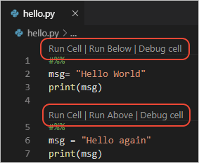
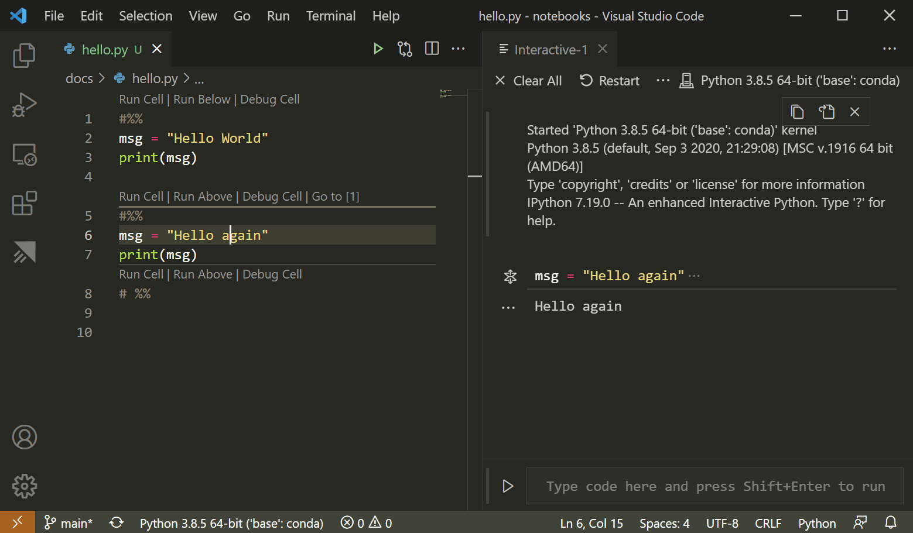
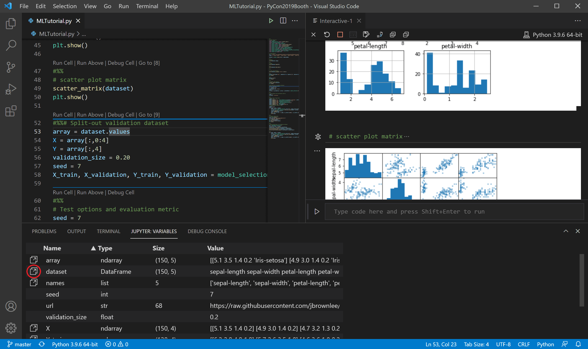
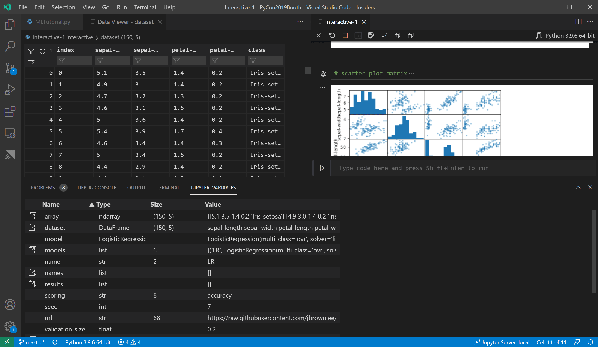
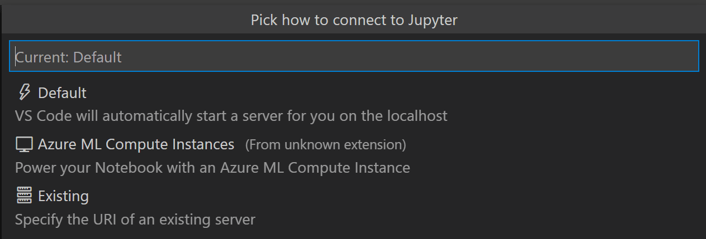
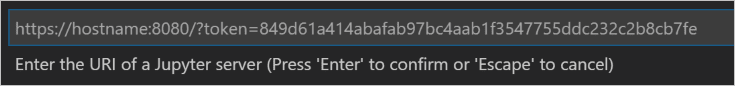
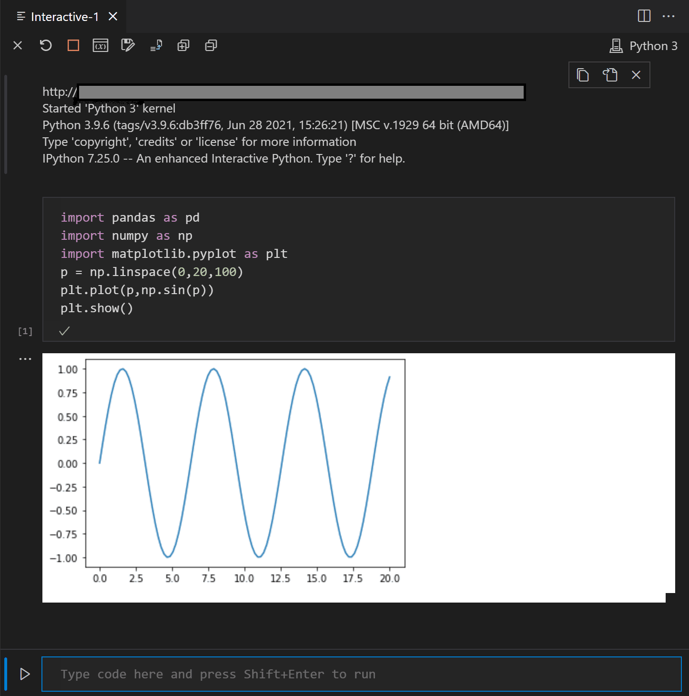
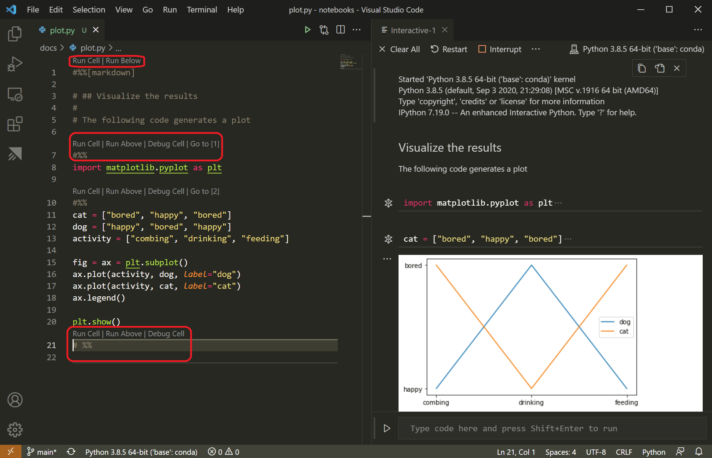

+++
title = "10.5.10 Python 交互窗口"
date = 2026-11-06T07:53:25+08:00
weight = 10
type = "docs"
description = ""
isCJKLanguage = true
draft = false
+++


> 原文链接: [https://code.visualstudio.com/docs/python/jupyter-support-py](https://code.visualstudio.com/docs/python/jupyter-support-py)

# 10.5.10 Python 交互窗口

　　[Jupyter](https://jupyter-notebook.readthedocs.io/en/latest/)（原 IPython Notebook）是开源项目，可以将 Markdown 文本和可执行 Python 源代码组合到称为**笔记本**的画布中。VS Code 原生支持 [Jupyter Notebook](https://code.visualstudio.com/docs/datascience/jupyter-notebooks)，也支持通过 Python 代码文件使用。本文介绍 Python 代码文件中的支持：

* 使用类似 Jupyter 的代码单元格
* 在 Python 交互窗口中运行代码
* 使用变量资源管理器和数据查看器查看、检查和筛选变量
* 连接远程 Jupyter 服务器
* 调试 Jupyter 笔记本
* 导出 Jupyter 笔记本

　　使用 Jupyter 笔记本前，必须激活 Anaconda 环境或安装了 [Jupyter 包](https://pypi.org/project/jupyter/)的其他 Python 环境。使用命令面板（`Ctrl + Shift + P`）中的 **Python: Select Interpreter** 命令选择环境。

激活环境后可以创建和运行类似 Jupyter 的代码单元格、连接远程服务器运行代码并导出 Python 文件为 Jupyter 笔记本。

## Jupyter 代码单元格 {#jupyter-code-cells}

使用 `# %%` 注释在 Python 代码中定义类似 Jupyter 的单元格：

```python
# %%
msg = "Hello World"
print(msg)

# %%
msg = "Hello again"
print(msg)
```

> **注意**：请确保代码保存为 `.py` 扩展名文件。

　　Python 扩展检测到代码单元格后会添加 **Run Cell** 和 **Debug Cell** CodeLens。第一个单元格还包含 **Run Below**，后续单元格包含 **Run Above**：



> **注意**：默认 **Debug Cell** 只单步进入用户代码。需要进入非用户代码时，请在 Jupyter 扩展设置（`Ctrl + ,`）中取消选中 **Debug Just My Code**。

**Run Cell** 只运行一个单元格。**Run Below** 出现在第一个单元格，运行文件中所有代码。**Run Above** 运行到当前单元格之前（不含当前单元格），适合初始化运行时状态。

选择命令后会启动 Jupyter（可能需要一分钟），然后在 **Python 交互**窗口中运行相应单元格：



也可以使用 `Ctrl + Enter` 或 **Python: Run Selection/Line in Python Terminal** 命令（`Shift + Enter`）运行。使用后扩展会自动将光标移到下一个单元格；位于文件最后一个单元格时，会自动插入新的 `# %%` 分隔符，模拟 Jupyter 笔记本行为。

也可以单击行号左侧边距设置断点，然后使用 **Debug Cell** 启动该单元格调试。调试器会在断点停止，允许逐行执行并检查变量（请参阅[调试](../../../debugging-and-testing/6.1-Debugging/)）。

### 其他命令和快捷键 {#additional-commands-and-keyboard-shortcuts}

| 命令 | 快捷键 |
|------|--------|
| Python: Go to Next Cell | `Ctrl + Alt + ]` |
| Python: Go to Previous Cell | `Ctrl + Alt + [` |
| Python: Extend Selection by Cell Above | `Ctrl + Shift + Alt + [` |
| Python: Extend Selection by Cell Below | `Ctrl + Shift + Alt + ]` |
| Python: Move Selected Cells Up | `Ctrl + ; U` |
| Python: Move Selected Cells Down | `Ctrl + ; D` |
| Python: Insert Cell Above | `Ctrl + ; A` |
| Python: Insert Cell Below | `Ctrl + ; B` |
| Python: Insert Cell Below Position | `Ctrl + ; S` |
| Python: Delete Selected Cells | `Ctrl + ; X` |
| Python: Change Cell to Code | `Ctrl + ; C` |
| Python: Change Cell to Markdown | `Ctrl + ; M` |

## 使用 Python 交互窗口 {#using-the-python-interactive-window}

　　**Python 交互**窗口可以作为独立控制台运行任意代码（无论是否包含代码单元格）。从命令面板运行 **Jupyter: Create Interactive Window** 打开。输入代码后按 `Enter` 换行，按 `Shift + Enter` 运行。

要在文件中使用窗口，请从命令面板运行 **Jupyter: Run Current File in Python Interactive Window**。

### IntelliSense {#intellisense}

　　Python 交互窗口有完整 IntelliSense：代码补全、成员列表、方法快速信息和参数提示，键入体验与代码编辑器一致。

<video src="https://code.visualstudio.com/assets/docs/python/jupyter/interactive-window-intellisense.mp4" title="Python 交互窗口中的 IntelliSense。" autoplay loop controls muted></video>

### 绘图查看器 {#plot-viewer}

　　绘图查看器可以更深入处理图表：在当前会话平移、缩放和浏览绘图，并导出为 PDF、SVG 和 PNG。

在 Python 交互窗口中双击任意绘图，或选择绘图左上角展开按钮，即可在查看器中打开。

<video src="https://code.visualstudio.com/assets/docs/python/jupyter/plot-viewer.mp4" title="Python 交互窗口中的绘图查看器。" autoplay loop controls muted></video>

> **注意**：Python 交互窗口支持渲染 [matplotlib](https://matplotlib.org/)和 [Altair](https://altair-viz.github.io/index.html)创建的绘图。

## 变量资源管理器和数据查看器 {#variables-explorer-and-data-viewer}

　　在 Python 交互窗口中可以查看、检查和筛选当前 Jupyter 会话变量。运行代码后选择工具栏中的 **变量** 按钮打开变量资源管理器，会显示当前变量列表，并随代码使用自动更新。



　　双击行或使用 **在数据查看器中显示变量** 按钮可以在数据查看器查看详细内容。打开后可以通过搜索行筛选值。



## 连接远程 Jupyter 服务器 {#connect-to-a-remote-jupyter-server}

　　可以连接远程 Jupyter 服务器，将密集计算转移到其他计算机。连接后代码单元格在远程服务器运行，而不是本地。

连接远程服务器：

1. 从命令面板（`Ctrl + Shift + P`）运行 **Jupyter: Specify local or remote Jupyter server for connections**。
2. 选择连接方式。

    

3. 远程工作时提供服务器 URI（主机名）及认证令牌，使用 `?token=` URL 参数。在 VS Code 终端启动服务器并启用认证令牌时，包含令牌的 URL 通常出现在终端输出中。也可以在提供 URI 后指定用户名和密码。

    

4. Python 交互窗口显示 URI，指示代码运行位置：

    

> **注意**：为提高安全性，Microsoft 建议为 Jupyter 服务器配置 SSL 和令牌支持，确保请求经过认证且远程连接加密。保护 notebook 服务器请参阅 [Jupyter 文档](https://jupyter-server.readthedocs.io/en/latest/operators/public-server.html)。

## 将 Jupyter 笔记本转换为 Python 代码文件 {#convert-jupyter-notebooks-to-python-code-file}

　　激活安装了 Jupyter 的环境后，可以在 VS Code 中打开 `.ipynb` 文件并转换为 Python 代码，然后像普通 Python 文件一样运行和调试。打开笔记本文件时 VS Code 会自动在笔记本编辑器中打开，使用工具栏转换图标将其转换为 `.py` 文件。


选择转换图标，然后选择“Python Script”，几秒后 VS Code 在未命名文件中打开转换结果。笔记本单元格在 Python 文件中以 `# %%` 注释分隔；Markdown 单元格转换为以 `# %% [markdown]` 开头的注释，并在交互窗口中与代码、图形等输出一起渲染为 HTML：



> **注意**：首次在 Python 文件中运行代码单元格时，Python 扩展会启动 Jupyter 服务器。服务器启动和 Python 交互窗口显示结果可能需要一些时间。

## 调试 Jupyter 笔记本 {#debug-a-jupyter-notebook}

　　VS Code 调试器可以单步执行代码、设置断点、检查状态和分析问题，是查找和修正笔记本代码问题的好方法。

1. 在 VS Code 中激活安装了 Jupyter 的 Python 环境。
2. 将 `.ipynb` 文件导入 VS Code（使用 Azure Notebooks 等云 Jupyter 环境时请先下载）。
3. 启动调试器：
   * 整个笔记本：从命令面板（`Ctrl + Shift + P`）运行 **Jupyter: Debug Current File in Python Interactive Window**。
   * 单个单元格：使用单元格上方的 **Debug Cell** 装饰。默认只单步进入用户代码；需要进入非用户代码时，取消选中 Jupyter 扩展设置中的 **Debug Just My Code**。
4. 通用调试功能（检查变量、设置断点等）请参阅 [VS Code 调试](../../../debugging-and-testing/6.1-Debugging/)。
5. 发现问题时停止调试器，修正代码、保存并重新启动。
6. 确认代码正确后保存，并按下一节导出笔记本，然后上传到常规 Jupyter 环境。

## 导出 Jupyter 笔记本 {#export-a-jupyter-notebook}

　　除了打开笔记本，还可以从命令面板使用以下命令将 Python 文件内容导出为 `.ipynb`：

* **Jupyter: Export Current Python File as Jupyter Notebook**：使用 `# %%` 和 `# %% [markdown]` 分隔符创建笔记本。
* **Jupyter: Export Current Python File and Output as Jupyter Notebook**：导出文件内容及代码单元格输出。
* **Jupyter: Export Interactive Window as Jupyter Notebook**：将 Python 交互窗口内容导出为笔记本。

导出后 VS Code 会提示在浏览器中打开笔记本。
