+++
title = "10.5.11 Django 教程"
date = 2026-11-06T07:53:25+08:00
weight = 11
type = "docs"
description = ""
isCJKLanguage = true
draft = false
+++


> 原文链接: [https://code.visualstudio.com/docs/python/tutorial-django](https://code.visualstudio.com/docs/python/tutorial-django)

# 10.5.11 Django 教程

　　Django 是用于快速、安全、可扩展 Web 开发的高级 Python 框架，内置 URL 路由、页面模板和数据处理支持。

　　本教程创建一个包含三个页面并共享基础模板的简单 Django 应用，借此了解如何在 VS Code 终端、编辑器和调试器中使用 Django。本教程不深入 Django 数据模型和管理界面等细节，相关链接见文末。

完整示例代码位于 GitHub：[python-sample-vscode-django-tutorial](https://github.com/microsoft/python-sample-vscode-django-tutorial)。

## 前提条件 {#prerequisites}

1. 安装 [Python 扩展](https://marketplace.visualstudio.com/items?itemName=ms-python.python)。
2. 安装 Python 3：
   * 从 [python.org](https://www.python.org/downloads/)下载。
   * Linux 内置 Python 3 可用，但安装包需要运行 `sudo apt install python3-pip`。
   * macOS 使用 `brew install python3`（不支持系统自带 Python）。
   * 也可以使用 [Anaconda](https://www.anaconda.com/download/)。
3. Windows 上确保 Python 解释器位置在 PATH 中。可以在命令提示符运行 `path` 检查；未包含时在 Windows 设置的 **编辑账户的环境变量** 中修改 **Path**。

## 创建项目环境 {#create-a-project-environment-for-the-django-tutorial}

　　本教程使用 venv 创建安装 Django 的虚拟环境，避免全局安装，并便于生成 `requirements.txt`。其他环境类型步骤类似，请参阅[创建环境](10.5.8-Environments/#create-environments)。

1. 创建项目文件夹 `hello_django`。
2. 在 VS Code 中打开该文件夹（运行 `code .` 或 **文件 > 打开文件夹**）。
3. 使用 **Python: Create Environment** 命令：
   1. 打开命令面板（`Ctrl + Shift + P`，macOS：`Cmd + Shift + P`）。
   2. 搜索并选择 **Python: Create Environment**。
   3. 选择 **Venv**。
   4. 选择基础解释器。

   VS Code 会创建 `.venv` 文件夹并自动选择新环境。

   > **提示**：也可以在 **Python** 侧边栏展开 **环境管理器**，选择 **+** 快速创建。

   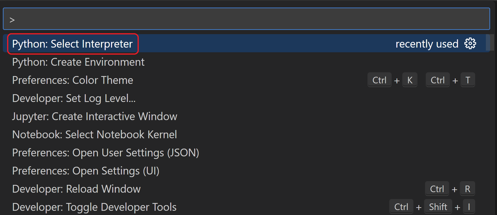

4. 状态栏右侧显示 **('.venv': venv)**，表示正在使用虚拟环境：

   

5. 安装 Django：

   **使用包管理 UI：**

   1. 在 **Python** 侧边栏展开 **环境管理器**。
   2. 右键单击 `.venv`，选择 **管理包**。
   3. 搜索 `django`，选择 **安装**。

   **使用终端：**

   从命令面板运行 **终端: 创建新终端**（`Ctrl + Shift + 反引号`），终端会自动激活环境，然后运行：

   ```bash
   python -m pip install django
   ```

　　现在环境已就绪。VS Code 打开新终端时会自动激活环境。在外部终端使用时，Linux/macOS 运行 `source .venv/bin/activate`，Windows 运行 `.venv\Scripts\Activate.ps1`。提示符出现 **(.venv)** 表示已激活。

## 创建并运行最小 Django 应用 {#create-and-run-a-minimal-django-app}

　　Django 项目由站点级配置文件和一个或多个应用组成。应用是遵循 Django 约定的 Python 包。先创建项目容器，再创建应用，都使用 `django-admin`。

### 创建 Django 项目 {#create-the-django-project}

1. 在已激活环境的终端运行：

   ```bash
   django-admin startproject web_project .
   ```

   `.` 表示当前文件夹为项目文件夹，会创建：

   * `manage.py`：项目管理命令行工具，通过 `python manage.py <command>` 使用。
   * `web_project` 子文件夹：包含 `__init__.py`、`asgi.py`、`settings.py`、`urls.py`、`wsgi.py`。

2. 创建空开发数据库：

   ```bash
   python manage.py migrate
   ```

   首次运行会创建默认 SQLite 数据库 `db.sqlite3`，适合开发及低流量生产应用。

3. 验证项目，启动开发服务器：

   ```bash
   python manage.py runserver
   ```

   默认端口 8000，终端显示类似：

   ```bash
   Watching for file changes with StatReloader
   Performing system checks...

   System check identified no issues (0 silenced).
   June 13, 2023 - 18:38:07
   Django version 4.2.2, using settings 'web_project.settings'
   Starting development server at http://127.0.0.1:8000/
   Quit the server with CTRL-BREAK.
   ```

   Django 自带服务器仅供本地开发，部署时使用主机 Web 服务器，`wsgi.py`/`asgi.py` 负责接入。使用其他端口：`python manage.py runserver 5000`。

4. `Ctrl + 单击`终端中的 `http://127.0.0.1:8000/` 打开浏览器。安装正确时会显示默认页面：

   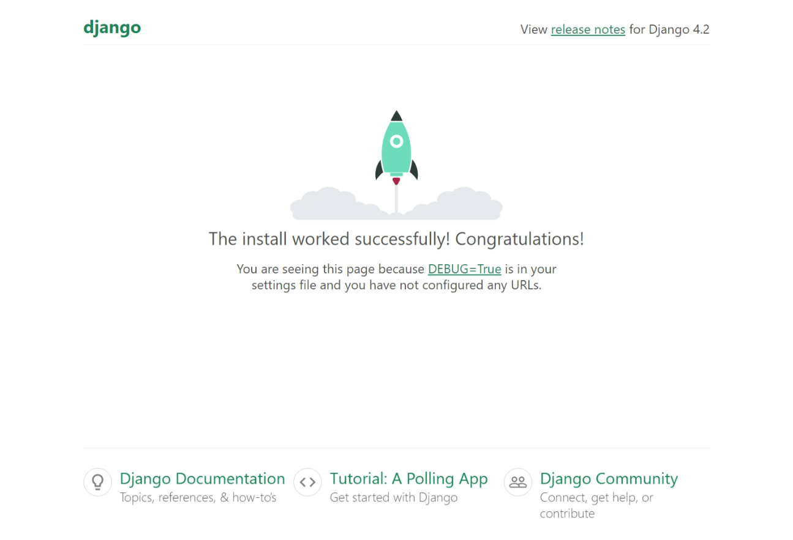

5. 完成后在终端按 `Ctrl + C` 停止服务器。

### 创建 Django 应用 {#create-a-django-app}

1. 在包含 `manage.py` 的项目文件夹运行：

   ```bash
   python manage.py startapp hello
   ```

   会创建 `hello` 文件夹，其中常用文件是 `views.py`（页面函数）和 `models.py`（数据对象类）；`migrations` 用于数据库版本管理，另有 `apps.py`、`admin.py`、`tests.py`。

2. 修改 `hello/views.py`：

   ```python
   from django.http import HttpResponse

   def home(request):
       return HttpResponse("Hello, Django!")
   ```

3. 创建 `hello/urls.py`：

   ```python
   from django.urls import path
   from hello import views

   urlpatterns = [
       path("", views.home, name="home"),
   ]
   ```

4. 修改 `web_project/urls.py`，引入应用路由：

   ```python
   from django.contrib import admin
   from django.urls import include, path

   urlpatterns = [
       path("", include("hello.urls")),
       path('admin/', admin.site.urls)
   ]
   ```

5. 保存所有文件，运行 `python manage.py runserver`，浏览 `http://127.0.0.1:8000/`，应显示“Hello, Django”。

   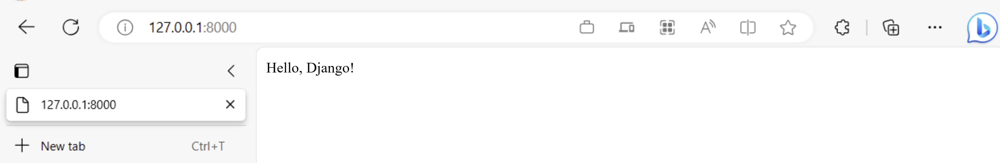

## 创建调试启动配置 {#create-a-debugger-launch-profile}

1. 切换到 **运行** 视图。没有 `launch.json` 时会显示创建链接：

   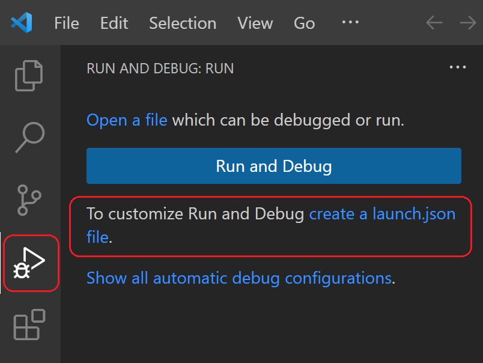

2. 选择链接，在调试配置下拉列表选择 **Django**。VS Code 会创建包含 Django 运行配置的 `launch.json`。

3. 检查 **Python: Django** 配置：

   ```json
   {
       // 使用 IntelliSense 了解可能属性。
       // 悬停查看现有属性说明。
       // 更多信息请访问 https://go.microsoft.com/fwlink/?linkid=830387
       "version": "0.2.0",
       "configurations": [
           {
               "name": "Python Debugger: Django",
               "type": "debugpy",
               "request": "launch",
               "program": "${workspaceFolder}\\manage.py",
               "args": [
                   "runserver"
               ],
               "django": true,
               "justMyCode": true
           }
       ]
   }
   ```

   这等同于用所选解释器运行 `python manage.py runserver`。`"django": true` 启用 Django 页面模板调试。

4. 选择 **运行 > 启动调试** 或绿色箭头测试：

   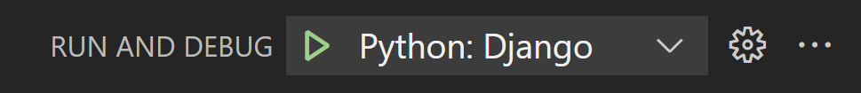

5. 打开终端中的 `http://127.0.0.1:8000/` 验证应用运行。完成后停止调试器（红色方块或 **运行 > 停止调试**）。

## 探索调试器 {#explore-the-debugger}

**开始前**：确保上一个应用已停止。否则端口仍被占用，新调试器不会收到请求，也不会命中断点。

1. 在 `hello/urls.py` 添加路由：

   ```python
   path("hello/<name>", views.hello_there, name="hello_there"),
   ```

   第一个参数定义接受字符串变量 `name` 的 `hello/` 路由，传递给 `views.hello_there`。URL 路由区分大小写。

2. 将 `views.py` 替换为：

   ```python
   import re
   from django.utils.timezone import datetime
   from django.http import HttpResponse

   def home(request):
       return HttpResponse("Hello, Django!")

   def hello_there(request, name):
       now = datetime.now()
       formatted_now = now.strftime("%A, %d %B, %Y at %X")

       # 使用正则表达式将 name 参数限制为字母。URL 参数可以包含任意文本，
       # 因此只允许安全字符。
       match_object = re.match("[a-zA-Z]+", name)

       if match_object:
           clean_name = match_object.group(0)
       else:
           clean_name = "Friend"

       content = "Hello there, " + clean_name + "! It's " + formatted_now
       return HttpResponse(content)
   ```

   始终过滤用户提供的任意信息以避免注入攻击。后续使用模板时 Django 会自动转义。

3. 在 `hello_there` 第一行 `now = datetime.now()` 设置断点（`F9`、右键 **运行 > 切换断点**，或单击行号左侧）。

   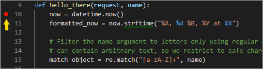

4. 启动调试器。状态栏变色，显示调试工具栏：

   

   

5. 打开浏览器访问 `http://127.0.0.1:8000/hello/VSCode`，程序会在断点暂停：

   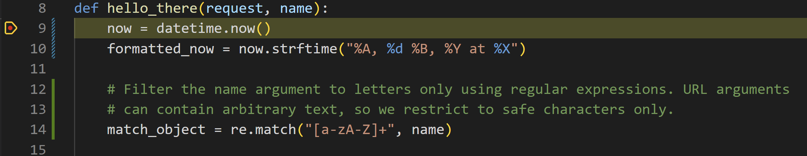

6. 使用 **单步跳过** 执行 `now = datetime.now()`。左侧 **变量** 面板显示 `now`、`name` 等局部变量，下面有 **监视**、**调用堆栈** 和 **断点**。可以展开、双击或使用 `F2` 修改值，但修改 `now` 等变量可能破坏程序。

   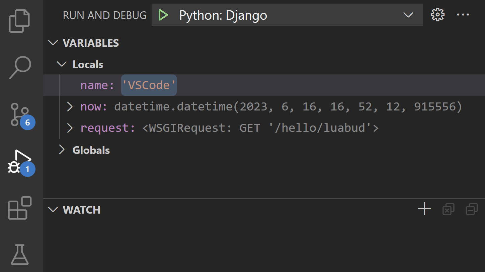

7. 暂停时可以在 **调试控制台**（不是终端中的 Python Debug Console）试验表达式。选中 `now.strftime("%A, %d %B, %Y at %X")`，右键选择 **调试: 求值**：

   ```bash
   now.strftime("%A, %d %B, %Y at %X")
   'Friday, 07 September, 2018 at 07:46:32'
   ```

   也可以在控制台 `>` 提示符下尝试不同格式：

   ```bash
   now.strftime("%A, %d %B, %Y at %X")
   'Tuesday, 13 June, 2023 at 18:03:19'
   now.strftime("%a, %d %b, %Y at %X")
   'Tue, 13 Jun, 2023 at 18:03:19'
   now.strftime("%a, %d %b, %y at %X")
   'Tue, 13 Jun, 23 at 18:03:19'
   ```

8. 选择 **继续** 运行，浏览器显示结果：

   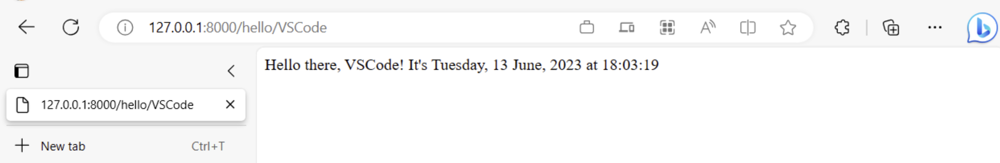

9. 修改代码中的日期格式，例如 `now.strftime("%a, %d %b, %y at %X")`，保存后 Django 服务器会自动重载，无需重启调试器。刷新浏览器查看更新。完成后停止调试器。

> **提示**：需要反复访问特定 URL 时，可以在 `views.py` 中用 `print` 输出 URL，然后在终端中 `Ctrl + 单击` 打开。

## 转到定义和速览定义 {#go-to-definition-and-peek-definition-commands}

* **转到定义**（`F12`）：从代码跳转到对象定义。例如右键 `HttpResponse` 选择 **转到定义**。
* **速览定义**（`Alt + F12`，macOS：`Option + F12`）：在编辑器中直接显示定义。按 `Escape` 或右上角 **x** 关闭。

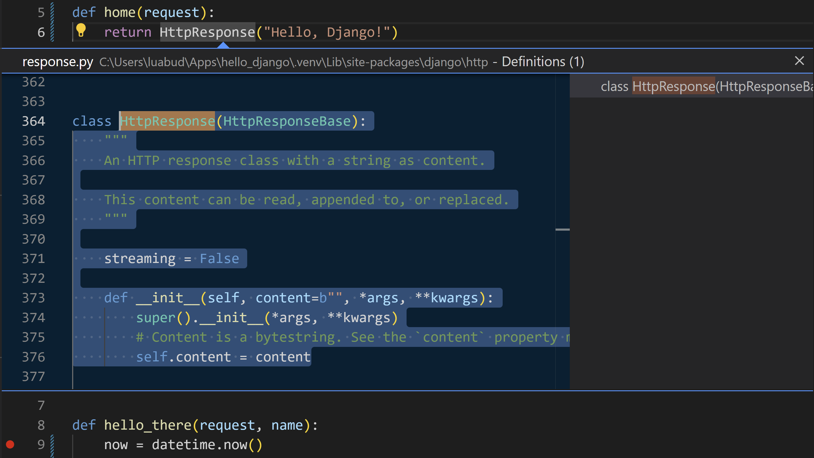

## 使用模板渲染页面 {#use-a-template-to-render-a-page}

　　直接在代码中生成 HTML 容易受到跨站脚本（XSS）攻击。更好的做法是使用**模板**：代码只处理数据值，模板只处理标记。Django 模板引擎负责替换和自动转义。

1. 在 `web_project/settings.py` 的 `INSTALLED_APPS` 添加：

   ```python
   'hello',
   ```

2. 在 `hello` 文件夹创建 `templates`，再创建子文件夹 `hello`（Django 常规结构）。

3. 创建 `templates/hello/hello_there.html`：

   ```html
   <!DOCTYPE html>
   <html>
       <head>
           <meta charset="utf-8" />
           <title>Hello, Django</title>
       </head>
       <body>
           <strong>Hello there, {{ name }}!</strong> It's {{ date | date:"l, d F, Y" }} at {{ date | time:"H:i:s" }}
       </body>
   </html>
   ```

4. 在 `views.py` 顶部添加：

   ```python
   from django.shortcuts import render
   ```

5. 修改 `hello_there` 使用 `render`：

   ```python
   def hello_there(request, name):
       print(request.build_absolute_uri()) # 可选
       return render(
           request,
           'hello/hello_there.html',
           {
               'name': name,
               'date': datetime.now()
           }
       )
   ```

6. 运行程序，访问 `/hello/name` 查看结果。再访问包含 HTML 的名字（例如 `<a%20value%20that%20could%20be%20HTML>`），可以看到 Django 将其作为纯文本转义。

## 提供静态文件 {#serve-static-files}

　　静态文件（例如 CSS）原样返回。`settings.py` 的 `INSTALLED_APPS` 默认包含 `django.contrib.staticfiles`。

### 准备静态文件 {#ready-the-app-for-static-files}

1. 在 `web_project/urls.py` 添加：

   ```python
   from django.contrib.staticfiles.urls import staticfiles_urlpatterns
   ```

2. 在文件末尾添加：

   ```python
   urlpatterns += staticfiles_urlpatterns()
   ```

### 在模板中引用静态文件 {#refer-to-static-files-in-a-template}

1. 在 `hello` 文件夹创建 `static`，再创建子文件夹 `hello`。

   生产环境收集静态文件时，`static/hello` 可避免与其他应用冲突。

2. 创建 `static/hello/site.css`：

   ```css
   .message {
       font-weight: 600;
       color: blue;
   }
   ```

3. 在 `templates/hello/hello_there.html` 的 `<title>` 后添加：

   ```html
   
   <link rel="stylesheet" type="text/css" href="" />
   ```

4. 将 `<body>` 内容替换为：

   ```html
   <span class="message">Hello, there {{ name }}!</span> It's {{ date | date:'l, d F, Y' }} at {{ date | time:'H:i:s' }}.
   ```

5. 运行并访问 `/hello/name`，消息应显示为蓝色。

### 使用 collectstatic {#use-the-collectstatic-command}

1. 在 `web_project/settings.py` 添加：

   ```python
   STATIC_ROOT = BASE_DIR / 'static_collected'
   ```

2. 运行 `python manage.py collectstatic`，`hello/site.css` 会复制到顶层 `static_collected`。

3. 每次修改静态文件并部署生产前运行 `collectstatic`。

## 创建扩展基础模板的多个页面 {#create-multiple-templates-that-extend-a-base-template}

### 创建基础模板和样式 {#create-a-base-page-template-and-styles}

1. 创建 `templates/hello/layout.html`：

   ```html
   <!DOCTYPE html>
   <html>
   <head>
       <meta charset="utf-8"/>
       <title></title>
       
       <link rel="stylesheet" type="text/css" href=""/>
   </head>

   <body>
   <div class="navbar">
       <a href="" class="navbar-brand">Home</a>
       <a href="" class="navbar-item">About</a>
       <a href="" class="navbar-item">Contact</a>
   </div>

   <div class="body-content">
       
       
       <hr/>
       <footer>
           <p>&copy; 2018</p>
       </footer>
   </div>
   </body>
   </html>
   ```

2. 在 `static/hello/site.css` 添加：

   ```css
   .navbar {
       background-color: lightslategray;
       font-size: 1em;
       font-family: 'Trebuchet MS', 'Lucida Sans Unicode', 'Lucida Grande', 'Lucida Sans', Arial, sans-serif;
       color: white;
       padding: 8px 5px 8px 5px;
   }

   .navbar a {
       text-decoration: none;
       color: inherit;
   }

   .navbar-brand {
       font-size: 1.2em;
       font-weight: 600;
   }

   .navbar-item {
       font-variant: small-caps;
       margin-left: 30px;
   }

   .body-content {
       padding: 5px;
       font-family:'Segoe UI', Tahoma, Geneva, Verdana, sans-serif;
   }
   ```

### 创建代码片段 {#create-a-code-snippet}

1. **文件 > 首选项 > 用户代码片段**，选择 **html**。
2. 在 `html.json` 中添加：

   ```json
   "Django Tutorial: template extending layout.html": {
       "prefix": "djextlayout",
       "body": [
           "",
           "",
           "$0",
           "",
           "",
           ""
       ],

       "description": "Boilerplate template that extends layout.html"
   },
   ```

3. 保存。输入 `djext` 即可使用片段，或使用 **插入代码片段** 命令。

### 使用代码片段添加页面 {#use-the-code-snippet-to-add-pages}

1. 创建 `templates/hello/home.html`，输入 `djext` 选择片段：

   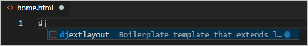

   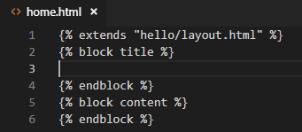

2. 在 title 块输入 `Home`，content 块输入 `<p>Home page for the VS Code Django tutorial.</p>`，保存。
3. 创建 `about.html`，title `About us`，content `<p>About page for the VS Code Django tutorial.</p>`。
4. 创建 `contact.html`，title `Contact us`，content `<p>Contact page for the VS Code Django tutorial.</p>`。
5. 在 `urls.py` 添加：

   ```python
   path("about/", views.about, name="about"),
   path("contact/", views.contact, name="contact"),
   ```

6. 在 `views.py` 添加：

   ```python
   # 用以下函数替换现有 home 函数
   def home(request):
       return render(request, "hello/home.html")

   def about(request):
       return render(request, "hello/about.html")

   def contact(request):
       return render(request, "hello/contact.html")
   ```

### 运行应用 {#run-the-app}

保存并运行，浏览首页并在页面间导航，验证模板继承：

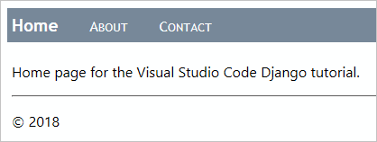

## 使用数据、模型和迁移 {#work-with-data-data-models-and-migrations}

　　Django 模型是继承 `django.db.models.Model` 的 Python 类，通常对应数据库表，放在 `models.py`。工作流：

1. 修改 `models.py`。
2. 运行 `python manage.py makemigrations` 生成迁移脚本。
3. 运行 `python manage.py migrate` 应用脚本。

　　Django 通过模型处理数据库，迁移记录增量变化。不要直接修改数据库架构，请改模型后重新迁移。

### 数据库类型 {#types-of-databases}

默认 `db.sqlite3` 适合开发及每天少于 10 万次访问的低中流量站点，但不适合多服务器。生产可考虑 PostgreSQL、MySQL、SQL Server。

### 定义模型 {#define-models}

在 `models.py` 添加：

```python
from django.db import models
from django.utils import timezone

class LogMessage(models.Model):
    message = models.CharField(max_length=300)
    log_date = models.DateTimeField("date logged")

    def __str__(self):
        """返回消息的字符串表示。"""
        date = timezone.localtime(self.log_date)
        return f"'{self.message}' logged on {date.strftime('%A, %d %B, %Y at %X')}"
```

　　每个模型自动获得唯一 `id`。其他字段使用 `CharField`、`TextField`、`EmailField`、`URLField`、`IntegerField`、`DecimalField`、`BooleanField`、`DateTimeField`、`ForeignKey`、`ManyToMany` 等。`blank=True` 表示可选，`null=True` 表示值可为空，`choices` 限制可选值。

### 迁移数据库 {#migrate-the-database}

```bash
python manage.py makemigrations
python manage.py migrate
```

查看 `migrations` 文件夹生成的脚本。若报错，请确认终端已激活虚拟环境。

### 通过模型使用数据库 {#use-the-database-through-the-models}

1. 在 `hello` 文件夹创建 `forms.py`：

   ```python
   from django import forms
   from hello.models import LogMessage

   class LogMessageForm(forms.ModelForm):
       class Meta:
           model = LogMessage
           fields = ("message",)   # 注意：末尾逗号必需
   ```

2. 创建 `templates/hello/log_message.html`：

   ```html
   
   
       Log a message
   
   
       <form method="POST" class="log-form">
           
           {{ form.as_p }}
           <button type="submit" class="save btn btn-default">Log</button>
       </form>
   
   ```

   `` 提供跨站请求伪造保护。

3. 在 `static/hello/site.css` 添加：

   ```css
   input[name=message] {
       width: 80%;
   }
   ```

4. 在 `urls.py` 添加：

   ```python
   path("log/", views.log_message, name="log"),
   ```

5. 在 `views.py` 添加：

   ```python
   # 在文件顶部现有导入中添加：
   from django.shortcuts import redirect
   from hello.forms import LogMessageForm
   from hello.models import LogMessage

   # 在文件其他位置添加：
   def log_message(request):
       form = LogMessageForm(request.POST or None)

       if request.method == "POST":
           if form.is_valid():
               message = form.save(commit=False)
               message.log_date = datetime.now()
               message.save()
               return redirect("home")
       else:
           return render(request, "hello/log_message.html", {"form": form})
   ```

6. 在 `templates/hello/layout.html` 的 navbar 中添加：

   ```html
   <!-- 插入到 Home 链接下方 -->
   <a href="" class="navbar-item">Log Message</a>
   ```

7. 运行并打开首页，选择 **Log Message**：

   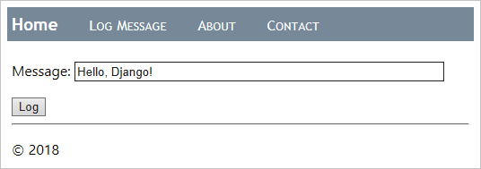

8. 输入消息并选择 **Log**，返回首页。此时还不显示消息。可以多记录几条，并用 SQLite Browser 以只读方式查看数据库。

9. 修改 `templates/hello/home.html`：

   ```html
   
   
       Home
   
   
       <h2>Logged messages</h2>

       
           <table class="message_list">
               <thead>
               <tr>
                   <th>Date</th>
                   <th>Time</th>
                   <th>Message</th>
               </tr>
               </thead>
               <tbody>
               
                   <tr>
                       <td>{{ message.log_date | date:'d M Y' }}</td>
                       <td>{{ message.log_date | time:'H:i:s' }}</td>
                       <td>
                           {{ message.message }}
                       </td>
                   </tr>
               
               </tbody>
           </table>
       
           <p>No messages have been logged. Use the <a href="">Log Message form</a>.</p>
       
   
   ```

10. 在 `static/hello/site.css` 添加：

    ```css
    .message_list th,td {
        text-align: left;
        padding-right: 15px;
    }
    ```

11. 在 `views.py` 导入：

    ```python
    from django.views.generic import ListView
    ```

12. 将 `home` 函数替换为：

    ```python
    # 如果不需要，可以删除旧 home 函数

    class HomeListView(ListView):
        """渲染首页，包含所有消息列表。"""
        model = LogMessage

        def get_context_data(self, **kwargs):
            context = super(HomeListView, self).get_context_data(**kwargs)
            return context
    ```

13. 在 `urls.py` 导入：

    ```python
    from hello.models import LogMessage
    ```

14. 在 `urls.py` 中创建视图变量：

    ```python
    home_list_view = views.HomeListView.as_view(
        queryset=LogMessage.objects.order_by("-log_date")[:5],  # :5 限制为最近五条
        context_object_name="message_list",
        template_name="hello/home.html",
    )
    ```

15. 修改首页路径：

    ```python
        # 替换现有的空字符串路径
        path("", home_list_view, name="home"),
    ```

16. 运行并打开首页，应显示消息：

    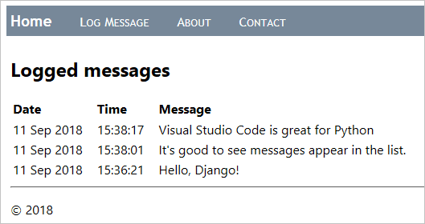

## 使用页面模板调试器 {#use-the-debugger-with-page-templates}

　　`launch.json` 中 `"django": true` 时支持模板调试，可以调试 ``、`` 等过程代码。

1. 在 `templates/hello/home.html` 的 `` 和 `` 行设置断点：

   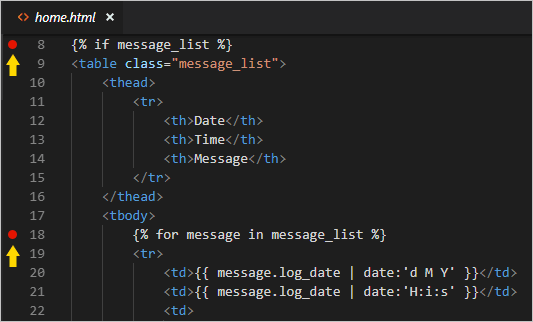

2. 在调试器中运行并打开首页。调试器会在 `` 暂停，变量面板显示上下文：

   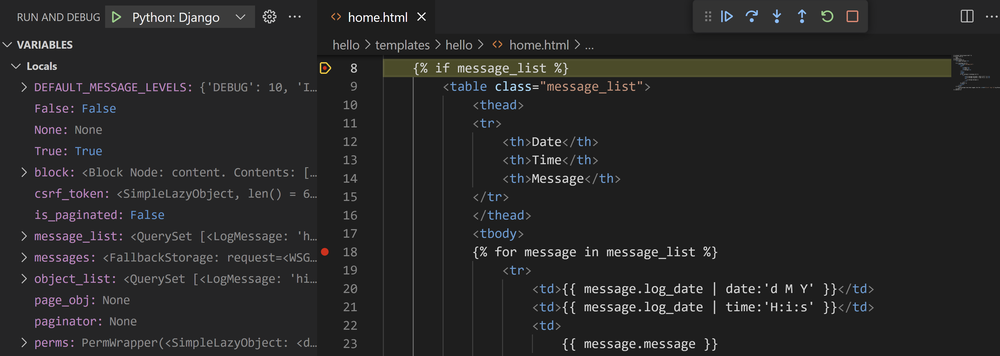

3. 使用 **单步跳过** 执行模板代码。调试器会跳过声明式语句，在过程代码处暂停。例如在 `` 循环中可以查看每个 `message`，步进到 `<td>{{ message.log_date | date:'d M Y' }}</td>`。

4. 可以在调试控制台试验变量（Django 的 `date` 等筛选器目前不可用）。完成后选择 **继续**。

## 可选活动 {#optional-activities}

### 创建 requirements.txt {#create-a-requirementstxt-file-for-the-environment}

1. 使用 **Python: Select Interpreter** 选择环境，运行 **终端: 创建新终端**。
2. 运行 `pip freeze > requirements.txt`。

其他人或构建服务器只需运行 `pip install -r requirements.txt` 重建依赖。

> **注意**：`pip freeze` 会列出所有已安装包及精确版本，可能需要改为版本范围。

### 创建超级用户并启用管理界面 {#create-a-superuser-and-enable-the-administrative-interface}

1. 在已激活环境的终端运行：

   ```bash
   python manage.py createsuperuser --username=<username> --email=<email>
   ```

   按提示设置密码。

2. 确认 `web_project/urls.py` 包含：

   ```python
   path("admin/", admin.site.urls),
   ```

3. 运行服务器并访问 `/admin`，使用超级用户登录：

   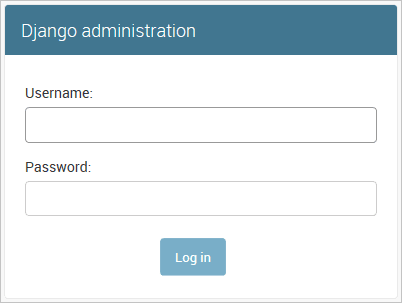

4. 登录后可以看到默认管理界面，管理用户和组：

   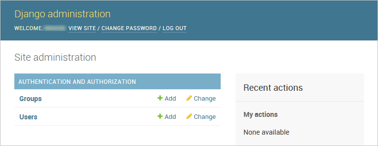

### 使用容器工具创建 Django 容器 {#create-a-container-for-a-django-app-using-the-container-tools-extension}

[容器工具扩展](https://marketplace.visualstudio.com/items?itemName=ms-azuretools.vscode-containers)可以在 VS Code 中构建、管理和部署容器化应用。[Python 容器教程](https://code.visualstudio.com/docs/containers/quickstart-python)介绍如何创建 `Dockerfile`、构建运行 Django 应用并在容器中调试。

## 后续步骤 {#next-steps}

完整示例代码位于 [python-sample-vscode-django-tutorial](https://github.com/microsoft/python-sample-vscode-django-tutorial)。

更多 Django 内容请参阅 [Django 文档](https://docs.djangoproject.com/en/3.1/)和[官方教程](https://docs.djangoproject.com/en/3.1/intro/tutorial01/)。

相关 VS Code Python 文档：

* [编辑 Python 代码](10.5.4-Editing/)
* [Lint](10.5.5-Linting/)
* [管理 Python 环境](10.5.8-Environments/)
* [调试 Python](10.5.7-Debugging/)
* [测试](10.5.9-Testing/)
